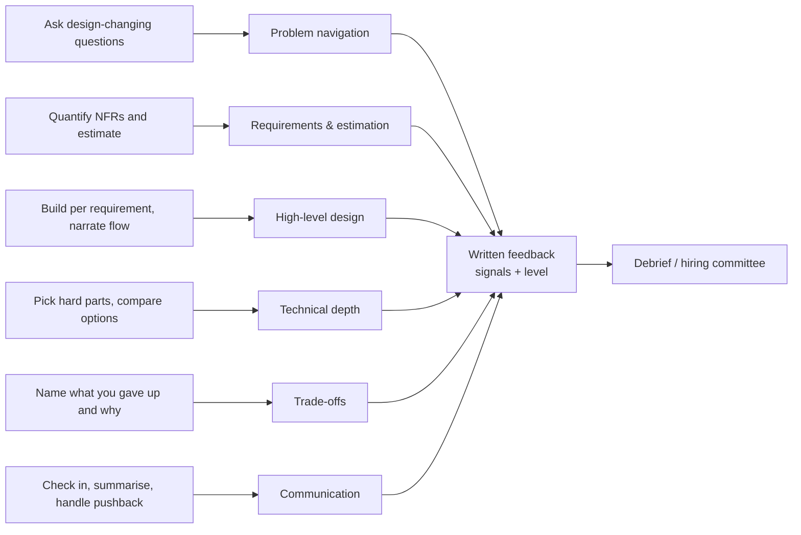

Interviewers don't grade the diagram; they grade the engineer who drew it. Behind every system design interview is a rubric — a
handful of dimensions, each with a bar that rises with the level being hired for. Knowing the dimensions, the signals interviewers write
down and the red flags that sink candidates lets you spend your 45 minutes on what is actually scored.

## Why it matters

Two candidates can draw nearly identical architectures and get opposite outcomes. One scoped the problem, quantified the requirements,
explained trade-offs and recovered gracefully from pushback; the other drew the same boxes in silence and couldn't say why. The
interviewer's written feedback — which is what a hiring committee or debrief reads — records **signals**: specific moments that show
how you think.

Knowing the rubric also tells you what *not* to do: perfect a minor component, recite technology trivia, or argue with the interviewer.

## How it works

### The dimensions

Companies word them differently, but they map closely to these six (the same ones on the [HLD landing page](#system-design/hld)):

| Dimension | What interviewers look for |
|---|---|
| **Problem navigation** | Scoping a vague prompt, asking questions that change the design, managing time |
| **Requirements and estimation** | Functional and quantified non-functional requirements; numbers that inform decisions |
| **High-level design** | A working end-to-end design that satisfies every functional requirement, with clear data flow |
| **Technical depth** | Going deep on the hard parts: partitioning, consistency, contention, failure |
| **Trade-offs** | Alternatives considered and the reasons for each choice |
| **Communication** | Structured, collaborative explanation; checking in; handling pushback |

The [mock interview simulator](#system-design/hld/interview) uses a closely related eight-point self-rating rubric that splits the design
into requirements, API, data model, architecture, scalability, reliability, trade-offs and communication.

### How the bar changes with level

| Dimension | SDE-2 (mid-level) | Senior | Staff |
|---|---|---|---|
| Navigation | Settles on a sensible scope with some guidance | Drives scoping and keeps the interview on schedule | Frames the problem in terms of the business and its constraints |
| Requirements | Lists core features and obvious targets | Quantifies the requirements that drive the design | Spots the hidden requirements (operations, migration, compliance) |
| Design | Correct design with standard components | Clean design quickly, with well-placed boundaries | Design that can evolve; clear ownership boundaries |
| Depth | Goes deep on one or two areas when pointed at them | Finds the hard parts unprompted; several options each | Goes deep across areas; knows failure modes from experience |
| Trade-offs | Explains a choice when asked | Volunteers alternatives with their costs | Weighs cost, risk, team and timeline; knows when "simple" wins |
| Communication | Clear, takes hints | Leads like a design review | Aligns a room; adapts depth to the audience |

The same performance can be a strong hire at one level and a down-level at the next. Asking your recruiter which level the loop is
calibrated for is reasonable.

### Signals interviewers write down

Positive signals are concrete moments:

- "Asked whether ratings must be exact before choosing a counter design."
- "Estimated 6K writes/s at peak and concluded one node suffices — didn't over-engineer."
- "Identified the cache stampede risk on hot keys without prompting; proposed request coalescing."
- "When I suggested SQL for ranking, agreed it works for top-100 and explained precisely why it fails for my-rank."
- "Summarised the design and the three key trade-offs in the last two minutes."

### Red flags

| Red flag | Why it hurts |
|---|---|
| Designing before scoping | Often designs the wrong system; shows poor problem navigation |
| Vague non-functional requirements | "Scalable, fast, available" gives no basis for decisions |
| Technology name-dropping | "Kafka and Kubernetes" without mechanisms suggests shallow understanding |
| Over-engineering | Sharding 40 writes/s signals that numbers don't inform decisions |
| No trade-offs | Every choice presented as obviously right |
| Ignoring hints | The interviewer is steering; not following looks like poor collaboration |
| Defensiveness under pushback | Arguing rather than reasoning |
| Long silences | The interviewer can't evaluate thinking they can't hear |
| Running out of time with no summary | Leaves the strongest parts unsaid |

## Architecture



## Failure scenarios

How strong engineers still fail system design interviews:

- **Brilliant depth, no breadth.** Forty minutes on one fascinating problem; three functional requirements never designed.
- **Perfect breadth, no depth.** Every box drawn, none explained beyond its name — reads as memorised templates.
- **The silent expert.** Correct decisions, never explained. The feedback says "unclear reasoning".
- **The argument.** Pushback was a test of reasoning; the candidate treated it as an attack.
- **The template.** A memorised "standard architecture" applied to a problem that needed something different — for example, a cache for
  a write-heavy workload.

## Trade-offs

Within the interview you constantly trade one signal against another:

- **Asking vs assuming.** Asking reveals judgement; asking too much hands the work back. Ask what changes the design; assume and state the
  rest.
- **Breadth vs depth.** A complete simple design first, then depth — not the reverse.
- **Leading vs following.** Senior candidates lead, but the interviewer's steering always wins; follow, then resume.
- **Confidence vs openness.** State decisions firmly, and the conditions under which you'd change them.

## In real systems

Many large technology companies use structured interviews with written rubrics, require interviewers to record evidence (specific quotes
and moments) rather than impressions, and make decisions in a debrief or hiring committee that reads all the feedback together. That is why
concrete signals matter: they are what survives into the room where the decision is made. Rubric wording varies by company, so treat the
dimensions here as a reliable common core rather than any one company's form.

## Common mistakes

- **Optimising for the diagram** instead of the reasoning behind it.
- **Treating hints as interruptions.**
- **Assuming senior means complex.** Senior signal is judgement — including choosing the simple option when it fits.
- **Not asking which level** the interview is calibrated for.
- **Ignoring communication** because "it's a technical interview".

## In the interview

````question title="What do you think interviewers look for in a system design interview?"
Structured problem solving more than a particular architecture. They want to see me scope a vague problem with questions that change the
design, turn it into quantified requirements, produce a working end-to-end design, go deep on the hardest parts with real options and
trade-offs, think about failure, and communicate clearly — checking in, handling pushback with reasoning and summarising at the end. At
senior level they also expect me to find the hard parts myself and to know when the simpler option is the right one.
````

````question title="The interviewer says your design won't scale. How do you respond?"
I'd ask which part they're concerned about, or name the most likely one, and then reason with numbers: what load it sees, what it can
handle, where it breaks first. If they're right, I'd say so and propose the change — partitioning, caching, moving work off the request
path — with its cost. If the numbers say it does scale for our requirements, I'd explain that calmly and note what would change my mind,
for example ten times the write rate. The goal is to show reasoning, not to win the point.
````

## Key takeaways

- You are scored on **navigation, requirements and estimation, design, depth, trade-offs and communication** — not on the diagram alone.
- The bar rises with level: **senior candidates find the hard parts and volunteer alternatives**; staff candidates also weigh evolution,
  ownership and cost.
- Interviewers write down **concrete signals**; make your reasoning audible so there's something to write.
- Avoid the red flags: **designing before scoping, vague NFRs, name-dropping, over-engineering, no trade-offs, ignoring hints,
  defensiveness, silence and no summary**.

## Knowledge check

```quiz
? Two candidates draw the same architecture. Which is most likely to receive stronger feedback?
- The one who drew faster
! Speed alone isn't a scored dimension.
+ The one who explained why each component exists, quantified decisions and named trade-offs
- The one who used more technology names
! Name-dropping without mechanisms is a red flag.
- The one who asked no questions
! Skipping scoping usually weakens navigation scores.
> Interviewers score reasoning, recorded as specific signals.

? Which behaviour most clearly distinguishes a senior candidate from an SDE-2 candidate?
+ Identifying the hard parts unprompted and comparing several options with costs
- Drawing more components
! More components can indicate over-engineering.
- Never asking clarifying questions
! Seniors ask fewer but sharper questions.
- Always choosing the most complex option
! Seniors know when the simple option wins.
> Senior signal is judgement and ownership of the hard problems.

? The interviewer suggests a different approach to the one you chose. What is the best response?
- Defend your approach without acknowledging theirs
! Defensiveness is a red flag.
- Switch immediately without comment
! Switching without reasoning suggests you didn't understand your own choice.
+ Engage with the suggestion — where it's better and where it isn't — and make a reasoned decision
- Ask to move on
! Avoiding the discussion loses signal.
> Pushback tests reasoning and collaboration.

? Which is a red flag even in an otherwise correct design?
- Stating assumptions explicitly
! That's a positive signal.
- Checking in at the end of each step
! That's good communication.
+ Sharding a database that receives 40 writes per second
- Summarising at the end
! That's a positive signal.
> Over-engineering shows that estimates aren't informing decisions.
```
