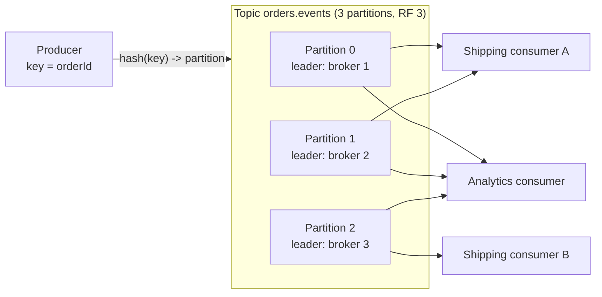

Kafka is a distributed, replicated **log**: producers append records to topics, records are kept for a configured time, and any
number of consumer groups read them at their own pace by tracking positions (offsets). That simple model — an append-only log rather than a
queue that deletes messages — is why Kafka sits at the centre of so many event-driven, analytics and data-integration architectures.

## What it is for

- **Event streaming between services**: order events, user activity, state changes published once and consumed by many teams.
- **High-throughput ingestion**: clickstreams, logs, metrics, IoT telemetry — millions of records per second across a cluster.
- **Buffering and load levelling** between fast producers and slower consumers, with days of retention as a safety margin.
- **Replay**: rebuild a search index, a cache or a new service's state by re-reading history.
- **Stream processing** (Kafka Streams, Flink) and **change data capture** pipelines (Debezium writes database changes to Kafka).

## Data model

- **Topic**: a named stream of records (`orders.events`).
- **Partition**: a topic is split into partitions, each an ordered, append-only log. A record's position in its partition is its
  **offset**. Ordering is guaranteed **within a partition only**.
- **Record**: key, value, headers, timestamp. The **key** decides the partition (by hash, by default), so all records with the same key land
  in the same partition, in order. Records without a key are spread across partitions.
- **Retention**: records are kept for a time (7 days by default) or size, whether or not they've been consumed. **Log compaction** instead
  keeps the latest record per key — a changelog that can rebuild current state.
- **Consumer group**: a set of consumers sharing a subscription. Each partition is assigned to **one** consumer in the group, so a group's
  maximum parallelism equals the partition count. Different groups read independently.
- **Offset commits**: each group records how far it has processed each partition (in the internal `__consumer_offsets` topic). After a
  crash, consumption resumes from the last committed offset.

## How it works inside

- **Brokers** store partitions on disk as segment files, appending sequentially and serving reads largely from the operating system's page
  cache — which is how Kafka achieves high throughput on ordinary disks.
- **Replication**: each partition has a **leader** replica and followers on other brokers (replication factor 3 is the production norm).
  Producers and consumers talk to the leader; followers that are caught up form the **in-sync replica set (ISR)**. If the leader fails, an
  in-sync follower takes over.
- **Durability settings**: with `acks=all`, the leader acknowledges a write once all in-sync replicas have it; `min.insync.replicas=2`
  (with replication factor 3) makes writes fail rather than be accepted with only one copy. Current Java producers default to `acks=all`
  and **idempotence enabled**, which removes duplicates caused by producer retries.
- **Metadata and controllers**: since Kafka 4.0, cluster metadata is managed by a Raft-based controller quorum (KRaft); ZooKeeper is no
  longer used.
- **Transactions** let a producer write to several partitions atomically and commit consumed offsets in the same transaction — exactly-once
  processing for read-process-write pipelines *within Kafka* (see [delivery guarantees](lesson:delivery-semantics)).
- **Queues for Kafka**: share groups (KIP-932) let several consumers process records from the same partition with per-record
  acknowledgement — queue semantics on top of the log — declared production-ready in Kafka 4.2 (2026).



The shipping group has two consumers sharing three partitions; the analytics group reads all three independently, at its own pace, with its
own offsets.

## Strengths and weaknesses

| Strengths | Weaknesses |
|---|---|
| Very high throughput via sequential I/O, batching and compression | Ordering only within a partition |
| Retention and replay; many independent consumer groups | Consumer parallelism capped by partition count (outside share groups) |
| Durable, replicated, horizontally scalable | No per-message routing, delays or priorities like a traditional broker |
| Strong ecosystem: Connect, Streams, Schema Registry, CDC | Operational complexity (partitions, rebalancing, retention, capacity) |
| Exactly-once within Kafka via idempotence and transactions | A slow message blocks its partition for that consumer |

## Scaling characteristics

- **Throughput scales with partitions and brokers**: each partition is served by one leader; spreading partitions over brokers spreads load.
  A broker commonly sustains on the order of hundreds of MB/s of writes, depending on hardware and replication.
- **Consumer parallelism** = number of partitions per group. Choose partition counts for peak consumer parallelism plus growth;
  increasing partitions later changes key-to-partition mapping for new records, disturbing per-key ordering.
- **Hot partitions**: a skewed key puts most traffic on one partition and one consumer — the same [hot key](lesson:hot-keys) problem.
- **Retention cost** = write rate × retention × replication factor; tiered storage can move older segments to object storage.

## When to use it

- Many consumers need the **same events**, possibly at different speeds, possibly replaying history.
- **High-volume ingestion** where batching and durability matter more than per-message latency of a few milliseconds.
- **Per-key ordering** (all events for an order, a user, a device) at scale.
- **Data integration**: CDC, connecting databases, search indexes, warehouses.

Prefer something simpler for a handful of background jobs with per-message retries and delays — a managed queue or RabbitMQ (see
[choosing a messaging system](lesson:choosing-messaging)).

## Alternatives

| Alternative | Prefer it when |
|---|---|
| Amazon Kinesis Data Streams, Azure Event Hubs, Google Pub/Sub | You want a managed streaming service with similar log semantics |
| Apache Pulsar, Redpanda | Pulsar for built-in multi-tenancy and tiered storage; Redpanda for a Kafka-compatible, single-binary implementation |
| RabbitMQ | Work queues with routing, per-message acknowledgements, priorities and delays |
| Amazon SQS | Simple managed queues with no capacity planning |
| Redis Streams | Lightweight streams with consumer groups when Redis is already present |

## Interview trade-offs

- **Partition key**: choose the entity whose events must stay ordered (order ID, user ID) — and check it doesn't create hot partitions.
- **Partition count**: enough for peak consumer parallelism; changing it later disturbs key placement.
- **Durability vs latency**: `acks=all` with `min.insync.replicas=2` costs a replication round trip per batch; `acks=1` is faster and can lose
  acknowledged records on leader failure.
- **Retention**: long enough to recover from consumer outages and to replay — days, not hours — priced into storage.
- **At-least-once by default**: consumers commit offsets after processing and must be idempotent.

## Java and Spring Boot example

A producer configured for durability and throughput, and a consumer group of three listener threads. Keying by order ID keeps each order's
events in one partition, in order. (Compiled against Spring for Apache Kafka 4.0 and the Kafka 4.x clients.)

```java file="KafkaConfig.java"
import java.util.Map;
import org.apache.kafka.clients.producer.ProducerConfig;
import org.apache.kafka.common.serialization.StringSerializer;
import org.springframework.context.annotation.Bean;
import org.springframework.context.annotation.Configuration;
import org.springframework.kafka.core.DefaultKafkaProducerFactory;
import org.springframework.kafka.core.KafkaTemplate;
import org.springframework.kafka.core.ProducerFactory;

@Configuration
public class KafkaConfig {

    @Bean
    public ProducerFactory<String, String> producerFactory() {
        return new DefaultKafkaProducerFactory<>(Map.of(
                ProducerConfig.BOOTSTRAP_SERVERS_CONFIG, "kafka-1:9092,kafka-2:9092",
                ProducerConfig.KEY_SERIALIZER_CLASS_CONFIG, StringSerializer.class,
                ProducerConfig.VALUE_SERIALIZER_CLASS_CONFIG, StringSerializer.class,
                // Durability: wait for all in-sync replicas; idempotence stops retry duplicates.
                // (Both are the defaults in current clients; stated here because they matter.)
                ProducerConfig.ACKS_CONFIG, "all",
                ProducerConfig.ENABLE_IDEMPOTENCE_CONFIG, true,
                // Throughput: wait up to 10 ms to fill batches, and compress them.
                ProducerConfig.LINGER_MS_CONFIG, 10,
                ProducerConfig.COMPRESSION_TYPE_CONFIG, "lz4"));
    }

    @Bean
    public KafkaTemplate<String, String> kafkaTemplate(ProducerFactory<String, String> pf) {
        return new KafkaTemplate<>(pf);
    }
}
```

```java file="OrderEvents.java"
import org.apache.kafka.clients.consumer.ConsumerRecord;
import org.springframework.kafka.annotation.KafkaListener;
import org.springframework.kafka.core.KafkaTemplate;
import org.springframework.stereotype.Component;

@Component
public class OrderEvents {

    private final KafkaTemplate<String, String> kafka;

    public OrderEvents(KafkaTemplate<String, String> kafka) {
        this.kafka = kafka;
    }

    // Key = orderId: every event for one order lands in the same partition, in order.
    public void orderPaid(String orderId, String json) {
        kafka.send("orders.events", orderId, json);
    }

    // Consumer group "shipping": the topic's partitions are shared among 3 listener threads
    // (and across every instance of this service). Each partition has exactly one reader.
    @KafkaListener(topics = "orders.events", groupId = "shipping", concurrency = "3")
    public void onEvent(ConsumerRecord<String, String> event) {
        // Must be idempotent: after a crash, events after the last committed offset come again.
        System.out.printf("partition %d offset %d key %s%n",
                event.partition(), event.offset(), event.key());
    }
}
```

## Key takeaways

- Kafka is a **replicated, partitioned, append-only log** with **retention** and **replay**.
- **Keys** decide partitions; ordering holds **within a partition**; a group's parallelism = **partition count**.
- Durability: **replication factor 3, `acks=all`, `min.insync.replicas=2`**; idempotent producers stop retry duplicates.
- Consumers are **at-least-once** by default — commit after processing and make handlers idempotent; transactions give exactly-once **within
  Kafka**.

## Knowledge check

```quiz
? A topic has 6 partitions. How many consumers in one consumer group can actively consume at once?
- 3
! Each partition can have its own consumer.
+ 6
- 12
! Extra consumers beyond 6 sit idle (outside share groups).
- Unlimited
! Each partition is assigned to one consumer in the group.
> Classic consumer groups get at most one consumer per partition.

? All events for an order must be processed in order. How should they be produced?
- With no key, for even spread
! Unkeyed records are spread across partitions, losing per-order order.
+ With the order ID as the key, so they share a partition
- With a random key
! Same problem as no key.
- To a topic with one partition only
! Works, but caps throughput and parallelism unnecessarily.
> Ordering is per partition; the key selects the partition.

? Which producer configuration prevents acknowledged writes from being lost when a partition leader fails?
- acks=0
! The producer doesn't even wait for the leader.
- acks=1
! Only the leader has the record when it's acknowledged.
+ acks=all with min.insync.replicas=2 on a topic with replication factor 3
- linger.ms=100
! Batching affects throughput, not durability.
> Writes are acknowledged only once a quorum of in-sync replicas has them.

? Why can a new analytics service read last week's events from Kafka but not from a traditional queue?
+ Kafka retains records for a configured period regardless of consumption, and each group tracks its own offsets
- Kafka stores events forever by default
! Default retention is time-limited (7 days).
- Traditional queues encrypt old messages
! They delete them once consumed.
- Kafka copies events to every service automatically
! Consumers read from the log; nothing is pushed.
> The log model separates storage from consumption.
```
