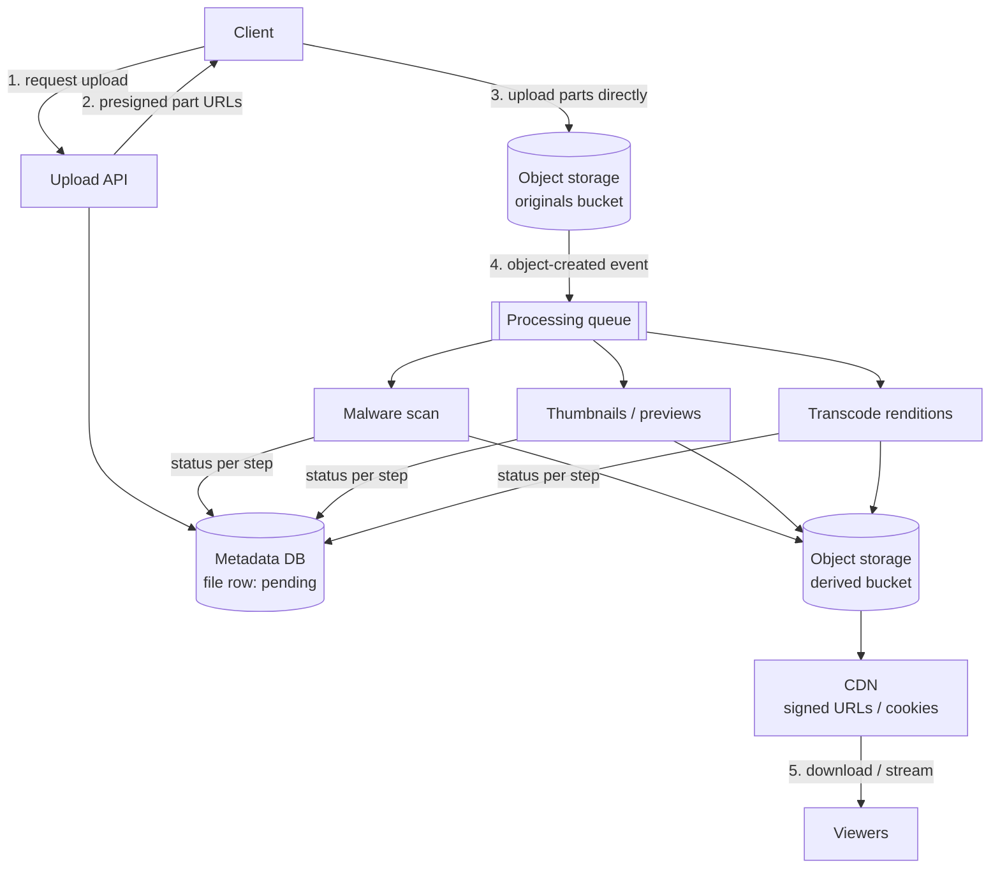
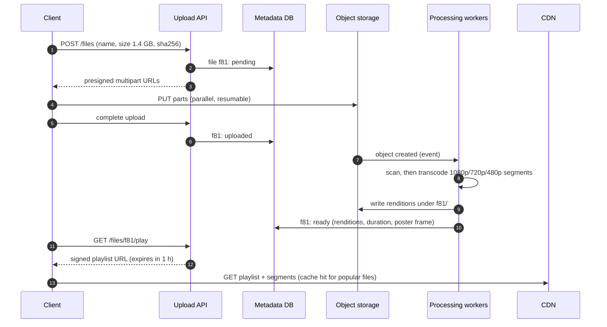

Photos, videos, documents, backups: once files are megabytes or gigabytes, the design changes. Bytes should **never flow through your
application servers**, processing happens **asynchronously** in a pipeline, and delivery runs through a **CDN**. This lesson assembles
[object storage](lesson:object-storage), [long-running jobs](lesson:long-running-jobs) and [CDNs](lesson:cdn) into the end-to-end pattern
for large binary content.

## The problem

Naive designs fail in predictable ways:

- **Uploads through the API**: a 2 GB upload holds a server thread, memory and bandwidth for minutes; a dropped connection restarts it.
- **Processing in the request**: thumbnails, transcoding and virus scanning take seconds to hours.
- **Serving from origin**: popular files saturate origin bandwidth and cost a fortune in egress.
- **Metadata and blobs drift apart**: a database row without its file, or a file nobody references.

The numbers usually make the case on their own:

```drill
? 10 million downloads a day of 5 MB files. What is the average egress, in Gbit/s?
= 4.6
~ 1.15
> 10M × 5 MB = 50 TB/day ÷ 86,400 s ≈ 579 MB/s ≈ 4.6 Gbit/s average — peaks several times higher.

? A CDN serves 95% of those bytes. How many TB per day still leave the origin?
= 2.5
~ 1.1
> 50 TB × 5% = 2.5 TB/day from origin storage.
```

## Architecture



**Upload**: the API creates a metadata row (`pending`) and hands out presigned URLs; the client uploads directly, in parts, retrying only
failed parts. Resumable protocols — S3 multipart, Google Cloud Storage resumable uploads, the open `tus` protocol — let an upload continue
after the app restarts. Clients send a checksum per part and for the whole file, so corruption is caught.

**Deduplication** (optional): if the client sends a content hash first, the API can skip the upload when an identical object already exists
— **content-addressed storage**, keyed by hash. Some systems dedupe at the chunk level, so editing a large file re-uploads only the changed
chunks.

**Processing**: storage emits an event when the object exists; a pipeline of independent steps runs in parallel or in sequence — malware
scanning, validation, thumbnails, transcoding into several resolutions, text extraction. Each step is idempotent, writes its output to a
key derived from the file ID, and records its status ([multi-step workflows](lesson:multi-step-workflows)).

**Delivery**: derived files are served through a CDN. Private content uses **signed URLs or signed cookies** with short expiry; the bucket
stays private behind the CDN. Large files support **range requests** for resuming and seeking. Video is cut into short segments at several
bitrates (HLS or DASH) so players switch quality as bandwidth changes and the CDN caches small, reusable pieces.

## Request and data flow



States make every step observable and recoverable: `pending → uploaded → processing → ready`, or `failed` with a reason. The UI shows
"processing" until `ready`; operators can retry failed steps.

## Advantages

- **Application servers stay small**: they authorise and record; storage moves the bytes.
- **Resilient transfers**: parts and resumable sessions survive flaky networks.
- **Scalable processing**: workers scale with the queue, on hardware suited to each step (GPUs for video).
- **Cheap, fast delivery**: the CDN absorbs most traffic close to users and cuts origin egress.
- **Security**: private buckets, short-lived signed URLs, scanning before content is published.

## Disadvantages

- **Eventual availability**: files aren't viewable until processing finishes.
- **Two sources of truth to reconcile**: metadata and objects.
- **Signed URL management**: expiry, revocation and caching interplay.
- **Storage multiplies**: originals plus renditions plus replicas; lifecycle rules are needed to control cost.

## Failure scenarios

| Failure | What happens | Mitigation |
|---|---|---|
| Upload abandoned halfway | Incomplete parts billed forever | Lifecycle rule aborting incomplete multipart uploads |
| Metadata row without a file | Broken links | `pending` rows expire; status only advances on storage events |
| File without a metadata row | Orphaned storage cost | Periodic reconciliation: list prefixes, delete unreferenced objects |
| Processing step fails | File stuck in `processing` | Retries, DLQ, visible `failed` state, manual retry |
| Viral file | Origin overloaded on cache misses | CDN origin shield, longer TTLs, pre-warming |
| Signed URL shared publicly | Unauthorised access until expiry | Short expiry, tie URLs to user or IP where possible, revoke by rotating keys |

## Alternatives

- **Proxying through the API** — acceptable for small files (a few MB) when you need inline validation or transformation.
- **Database BLOBs** — for tiny files that must be transactional with their rows.
- **Managed media services** (Mux, Cloudflare Stream, AWS Elemental MediaConvert) for transcoding and streaming without building the
  pipeline.
- **Peer-to-peer or edge storage** for very large distributions (software updates) — rarely needed in interviews.

## Where it shows up in interviews

YouTube and Netflix-style video platforms, Instagram photos, Dropbox and Google Drive file sync, file-sharing and attachment services,
document scanning and backups. Say it in one breath: presigned resumable uploads to object storage, metadata with a status in the database,
an event-driven processing pipeline, CDN delivery with signed URLs, and reconciliation of orphans.

````question title="How would you let users upload 5 GB files reliably from mobile networks?"
Never through the API servers. The API creates a pending metadata record and issues presigned URLs for a multipart (or resumable) upload;
the client uploads parts of, say, 16–64 MB in parallel directly to object storage, retrying only failed parts and persisting progress so it
can resume after the app is killed. Each part and the whole file carry checksums. On completion the API (or a storage event) marks the file
uploaded and starts processing; a lifecycle rule cleans up abandoned uploads.
````

````question title="How do you serve private videos to millions of users efficiently?"
Transcode them into segmented, multi-bitrate streams and serve them from a CDN in front of a private bucket. The API checks permissions and
returns a short-lived signed URL or sets signed cookies covering the video's segments; the CDN validates signatures at the edge and caches
segments, so popular videos are served almost entirely from cache. Range requests and segment sizes of a few seconds keep seeking fast and
let players adapt quality to bandwidth.
````

## Common mistakes

- **Streaming uploads through application servers.**
- **Synchronous processing** before returning the upload response.
- **Public buckets** instead of private storage behind a CDN with signed access.
- **No status model**, so clients can't tell "processing" from "broken".
- **No cleanup** of abandoned uploads and orphaned objects.
- **Ignoring egress cost** in the estimate.

## Key takeaways

- **Upload directly** with presigned, resumable, checksummed parts; record metadata with a **status**.
- **Process asynchronously** from storage events through idempotent pipeline steps.
- **Deliver through a CDN** with signed URLs or cookies, range requests and segmented video.
- **Reconcile** metadata and objects, and use **lifecycle rules** for abandoned uploads and old data.

## Knowledge check

```quiz
? Which component should receive the bytes of a 3 GB upload?
- The API server, which streams them to storage
! That ties up server resources and restarts on failure.
+ Object storage directly, via presigned multipart URLs issued by the API
- The metadata database
! Databases are the wrong place for large blobs.
- The CDN edge cache
! CDNs deliver content; uploads go to storage.
> The API authorises; storage receives.

? A file's metadata says `ready`, but the transcoded renditions are missing. Which design rule was likely broken?
+ Status was advanced before the processing step durably wrote its outputs
- The CDN cache expired
! Cache expiry doesn't delete origin objects.
- Multipart upload was used
! Upload method isn't the issue.
- The bucket was private
! Privacy doesn't remove files.
> Advance status only after outputs are stored.

? 20 million plays a day of 50 MB of video each; the CDN hit ratio is 98%. Roughly how much data leaves origin per day?
- 1 PB
! That's total egress, before the CDN.
+ 20 TB
- 2 TB
! That would be a 99.8% hit ratio.
- 200 GB
! Off by two orders of magnitude.
> 20M × 50 MB = 1 PB/day; 2% of that is 20 TB.

? Why serve video as short segments at several bitrates?
- To compress better than a single file
! Segmentation isn't about compression ratio.
+ Players switch quality as bandwidth changes, seeking fetches only nearby segments, and small segments cache well at the edge
- Because CDNs can't serve large files
! They can.
- To avoid signed URLs
! Segments still need access control.
> HLS/DASH adaptive streaming.
```
