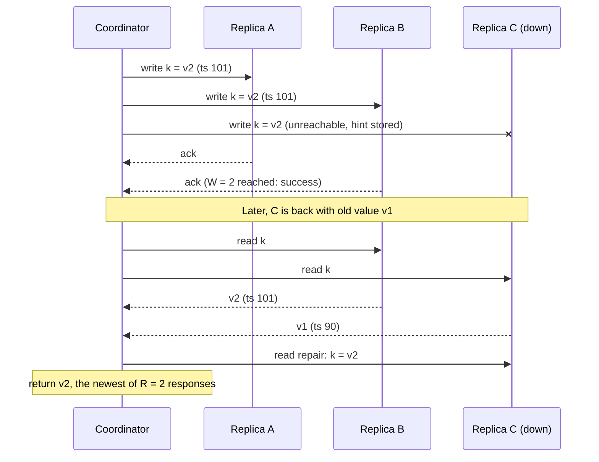

Leaderless replication drops the single leader: a client (or a coordinator node acting for it) sends each write to several replicas
and reads from several, and the overlap between the two sets is what lets reads find the latest value. It's the model Amazon's Dynamo
paper introduced and Cassandra, ScyllaDB and Riak follow — highly available, tunable per request, and honest about conflicts.

## Why it matters

When writes must keep flowing even if some replicas — or a whole zone — are unreachable, and you can tolerate resolving occasional
conflicts, leaderless replication is the standard answer. Interviewers expect you to explain N, R and W, what `R + W > N` does and does
**not** guarantee, how replicas catch up after failures, and how concurrent writes to the same key are resolved.

## How it works

### N, W and R

- **N**: how many replicas store each key (often 3), typically the next N nodes on a [consistent-hash ring](lesson:consistent-hashing).
- **W**: how many replicas must acknowledge a write before it succeeds.
- **R**: how many replicas a read must hear from; the newest version among the responses wins.

If **R + W > N**, every read set overlaps every write set in at least one replica, so a successful read sees the most recent successful
write (under normal conditions). With N = 3, the common choice is **W = 2, R = 2**: any one replica can be down and both reads and writes
still succeed.

| Setting (N = 3) | Survives | Character |
|---|---|---|
| W = 3, R = 1 | Reads survive 2 down; writes survive none | Fast reads, fragile writes |
| W = 1, R = 3 | Writes survive 2 down; reads survive none | Fast writes, fragile reads |
| W = 2, R = 2 | One replica down for both | Balanced — the usual "quorum" |
| W = 1, R = 1 | Two down for both | Fast and available; reads may be stale (R + W ≤ N) |

### What quorums do not guarantee

`R + W > N` is not linearizability. Edge cases break it: a write that succeeded on fewer than W replicas (reported as failed) may still be
read later; concurrent writes can be seen in different orders; sloppy quorums (below) can place writes outside the usual N replicas; and
clock-based conflict resolution can drop writes. Quorums give **probabilistically fresher** reads, not strict single-copy semantics.

### Keeping replicas in sync

Replicas miss writes when they're down or slow. Three mechanisms repair them:

- **Read repair**: a read that sees an older version on some replica writes the newest version back to it.
- **Hinted handoff**: if a target replica is down, another node accepts the write with a "hint" and delivers it when the target returns.
  Combined with a **sloppy quorum** — counting those stand-in nodes towards W — writes stay available during failures, at the cost of the
  read-overlap guarantee until hints are delivered.
- **Anti-entropy**: a background process compares replicas using **Merkle trees** (hash trees over key ranges), so only differing ranges
  need to be exchanged, and repairs the differences. Cassandra runs this as `nodetool repair`.

### Resolving conflicts

Concurrent writes to the same key on different replicas must be reconciled:

- **Last-write-wins (LWW)**: keep the write with the highest timestamp. Simple, but concurrent writes are silently discarded, and clock
  skew can let an *older* write win (see [clocks](lesson:clocks)). Cassandra uses LWW per cell.
- **Version vectors**: track which writes each version has seen; if neither version descends from the other, they're **siblings** — keep
  both and let the application (or the next writer) merge them, as Dynamo did with shopping carts.
- **CRDTs** (conflict-free replicated data types): counters, sets and maps designed so concurrent updates merge automatically and
  deterministically — for example, a grow-only counter that sums per-replica counts.

## Architecture



## Failure scenarios

- **A replica is down.** With W = 2 and R = 2 of N = 3, reads and writes continue; hinted handoff and repair catch it up later.
- **A whole zone is down** holding two of three replicas. Quorum operations fail for keys whose replicas are mostly there; place replicas
  across zones (Cassandra's `NetworkTopologyStrategy`) and use `LOCAL_QUORUM` per region.
- **Silent lost updates.** Two clients increment a counter concurrently under LWW; one increment disappears. Use CRDT counters or
  conditional updates (Cassandra's lightweight transactions use Paxos).
- **Clock skew.** A node with a fast clock makes its writes "win" for longer than they should. Monitor NTP; prefer version vectors where
  correctness matters.
- **Repair never run.** Deleted data reappears ("zombie" data) because tombstones expired before repair propagated them. Run repair more
  often than the tombstone grace period.

## Trade-offs

- **Availability vs consistency per request**: lower W and R increase availability and speed; higher values increase freshness.
- **Simplicity vs correctness of conflict handling**: LWW is simple and lossy; version vectors and CRDTs preserve concurrent updates at
  the cost of complexity.
- **Leaderless vs leader-based**: leaderless writes survive node loss without failover and keep latency predictable; leader-based systems
  give a single order of writes and easier transactions.

## In real systems

- Amazon's 2007 Dynamo paper introduced the combination of consistent hashing, sloppy quorums, hinted handoff, Merkle-tree anti-entropy and
  vector clocks. (The managed DynamoDB service uses a different, leader-based design per partition.)
- Cassandra and ScyllaDB expose per-query consistency levels (`ONE`, `QUORUM`, `LOCAL_QUORUM`, `ALL`, …), hinted handoff, read repair and
  Merkle-tree repair, with last-write-wins per column.
- Riak offered vector clocks (later dotted version vectors) and CRDT data types.
- Collaborative editors and some databases (Redis Enterprise's active-active, for example) use CRDTs for multi-region writes.

## Common mistakes

- **Claiming `R + W > N` gives strong consistency.**
- **Forgetting conflict resolution** — and the lost updates of last-write-wins.
- **Putting all replicas in one zone.**
- **Not running anti-entropy repair**, letting replicas drift and deletes resurrect.
- **Using quorum reads and writes everywhere** when `ONE` would do for the feature (or vice versa).

## In the interview

````question title="Explain N, R and W in a Dynamo-style store, and how you'd configure them."
N is the number of replicas per key, W the number that must acknowledge a write, and R the number a read waits for. If R + W > N, read and
write sets overlap, so a read normally sees the latest successful write. With N = 3, W = 2 and R = 2 tolerates one replica down for both
reads and writes; I'd place the three replicas in three zones and, in multi-region setups, use local quorums so each request waits only on
its own region. For write-heavy telemetry where some staleness is fine, W = 1 or R = 1 trades freshness for availability and latency. And
I'd note that quorums aren't linearizable — concurrent writes still need conflict resolution.
````

````question title="Two clients update the same key concurrently on different replicas. How is that resolved?"
It depends on the store's conflict strategy. With last-write-wins, the write with the highest timestamp survives and the other is silently
dropped — fine for idempotent overwrites, dangerous for counters or merges, and vulnerable to clock skew. With version vectors, the store
detects the writes were concurrent and keeps both as siblings for the application to merge on the next read. With CRDTs such as counters or
sets, concurrent updates merge automatically. For things like balances I'd avoid the conflict entirely with a conditional write through a
consensus-backed path.
````

## Key takeaways

- **N** replicas, **W** write acks, **R** read responses; **R + W > N** makes read and write sets overlap.
- Quorums give **fresher reads, not linearizability**.
- Replicas converge via **read repair, hinted handoff (with sloppy quorums) and Merkle-tree anti-entropy**.
- Conflicts need a strategy: **last-write-wins** (lossy), **version vectors** (siblings), or **CRDTs** (automatic merges).

## Knowledge check

```quiz
? With N = 3, which setting keeps both reads and writes working when one replica is down, while ensuring read/write overlap?
- W = 3, R = 1
! Writes fail with one replica down.
+ W = 2, R = 2
- W = 1, R = 1
! R + W = 2 is not greater than N, so reads may miss writes.
- W = 1, R = 3
! Reads fail with one replica down.
> 2 + 2 > 3 gives overlap, and each operation needs only two of three replicas.

? Which statement about `R + W > N` is correct?
- It guarantees linearizability
! Edge cases (sloppy quorums, concurrent writes, failed partial writes) break that.
+ It ensures read and write replica sets overlap, so reads usually see the latest successful write
- It prevents all conflicts
! Concurrent writes can still conflict.
- It removes the need for repair
! Replicas still drift and need repair.
> Overlap, not single-copy semantics.

? Two concurrent increments to the same counter under last-write-wins. What happens?
- Both increments are kept
! LWW keeps one value per key.
+ One increment is silently lost
- The write with the lower timestamp wins
! The higher timestamp wins.
- The store rejects the second write
! LWW accepts both and keeps one.
> Use CRDT counters or conditional updates for increments.

? What is the purpose of Merkle trees in anti-entropy repair?
- Encrypting replicas
! Merkle trees here are for comparison, not encryption.
+ Comparing replicas efficiently so only differing key ranges are exchanged
- Choosing the leader
! Leaderless systems have no leader.
- Ordering writes by time
! Clocks or version vectors do that.
> Hash trees let replicas find differences without shipping all data.
```
