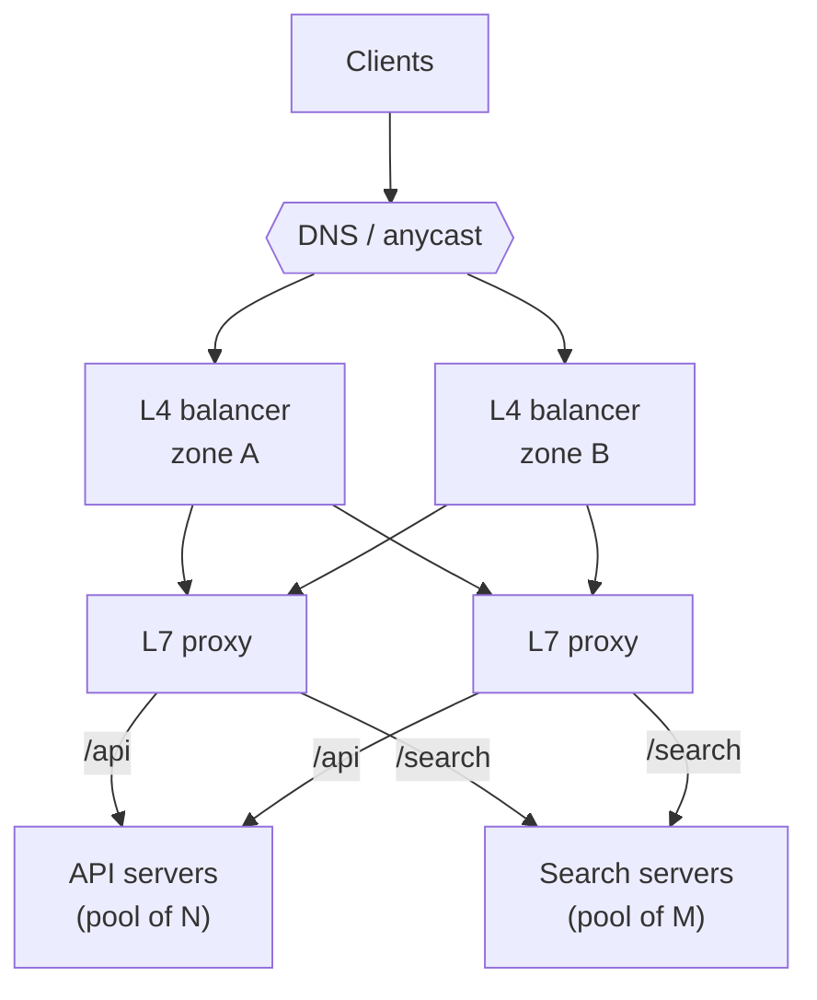

A load balancer turns many servers into one service. It decides which server handles each connection or request, stops
sending traffic to servers that fail, and lets you add or remove capacity without clients noticing. Nearly every design you draw
has one; the interesting decisions are its layer, its algorithm and how it knows a server is healthy.

## Why it matters

[Horizontal scaling](lesson:scaling-up-vs-out) only works if something spreads traffic across the copies. The load balancer is that
something — and also the place where failures are hidden from clients, deploys are made safe, and traffic is split for canaries. In
interviews you'll be asked what kind of load balancer, how it picks a server, how it detects failure, and how it avoids becoming a
single point of failure itself.

## How it works

### Layer 4 vs layer 7

| | L4 (transport) | L7 (application) |
|---|---|---|
| Decides using | IP addresses, ports, protocol | URL path, host, headers, cookies, method |
| Unit balanced | Connections (TCP) or flows (UDP) | Individual HTTP requests |
| TLS | Usually passed through (or terminated) | Terminated so requests can be read |
| Features | Very high throughput, low latency, any TCP/UDP protocol, preserves client IP | Path/host routing, retries, header rewriting, sticky cookies, auth hooks, request-level metrics |
| Cost | Little CPU per byte | More CPU per request (parsing, TLS) |
| Examples | AWS NLB, Google's network load balancer, HAProxy/Envoy in TCP mode, LVS | AWS ALB, NGINX, Envoy, HAProxy in HTTP mode, Kubernetes ingress |

One subtlety: an L4 balancer balances **connections**. With HTTP/2 or gRPC, a client may send thousands of requests over one long-lived
connection, all to the same backend. To spread *requests*, you need an L7 balancer (or client-side balancing).

### Algorithms

| Algorithm | How it picks | Good for | Watch out for |
|---|---|---|---|
| Round robin | Next server in turn | Similar servers, similar requests | Ignores current load |
| Weighted round robin | Round robin, proportional to weights | Mixed instance sizes, canaries | Weights are static |
| Least connections / least outstanding requests | Server with fewest active requests | Requests of varying cost, long-lived connections | Needs accurate counts |
| Power of two random choices | Pick two at random, send to the less loaded | Large fleets, many balancers with partial views | Slightly less optimal than global least-load, much cheaper |
| IP hash / consistent hashing | Hash of client IP or a key | Cache affinity, stateful backends | Uneven if keys are skewed; reshuffles when servers change unless hashing is consistent |
| Latency-aware (e.g. EWMA) | Server with lowest recent latency | Heterogeneous or noisy backends | Can herd onto one fast server without damping |

Least outstanding requests is a strong default for request/response services. Hashing is chosen when *which* server matters — for example
to keep a key's data in that server's cache; [consistent hashing](lesson:consistent-hashing) limits how many keys move when servers join
or leave.

### Health checks

- **Active checks**: the balancer calls an endpoint such as `GET /health` every few seconds; after N consecutive failures the server is
  removed, after M successes it is restored.
- **Passive checks (outlier detection)**: the balancer watches real traffic and ejects servers returning errors or timing out.

Design the health endpoint carefully. A **liveness** check ("the process is running") is cheap. A **readiness** check ("I can serve
traffic: warmed up, connected to my dependencies") is what the balancer should use. But a readiness check that fails when a *shared*
dependency such as the database is down will remove **every** server at once — turning a partial outage into a total one. Keep readiness
about the instance's own ability to serve.

### Sticky sessions

L7 balancers can pin a client to a server with a cookie. It helps warm per-instance caches, but load becomes uneven and the stickiness
breaks when that server goes away — so correctness must never depend on it (see [stateless vs stateful](lesson:stateless-vs-stateful)).

### Avoiding a single point of failure

The load balancer itself must be redundant:

- **Cloud load balancers** are managed fleets spread across availability zones behind DNS names.
- **Self-managed** balancers run as an active–passive pair sharing a floating (virtual) IP via a protocol such as VRRP (keepalived), or
  as an active–active group behind DNS or anycast.
- At very large scale, **tiers**: DNS or anycast spreads traffic across L4 balancers, which spread across L7 proxies, which spread across
  services.

### Connection draining and deploys

When a server is removed — scale-in or a deploy — the balancer stops sending it *new* requests but lets in-flight requests finish for a
grace period (draining or deregistration delay). Combined with readiness checks, this gives zero-downtime rolling deploys.

## Architecture



Most designs need only one managed L7 load balancer per region; the tiered version shows how the same idea scales when a single balancer
tier isn't enough.

## Failure scenarios

- **A backend crashes.** Health checks remove it within a few check intervals; requests in flight to it fail, and an L7 balancer can retry
  idempotent requests on another server.
- **A backend is slow, not dead.** Active checks may pass while real requests time out. Outlier detection and least-outstanding-requests
  routing steer traffic away; timeouts protect the balancer.
- **Health checks depend on the database.** The database blips, every server fails readiness, and the balancer has no healthy targets.
  Keep shared-dependency checks out of readiness, or make the balancer "fail open" when all targets look unhealthy.
- **Retry storms.** The balancer retries every failed request; under overload that doubles traffic to an already struggling fleet. Cap
  retries with a retry budget.
- **Uneven load from long-lived connections.** After a scale-out, old servers keep their HTTP/2 or WebSocket connections and new ones
  stay idle. Balance per request, limit connection lifetime, or rebalance gradually.

## Trade-offs

- **L4 vs L7.** L4 is faster, cheaper and protocol-agnostic; L7 is smarter (routing, retries, per-request balancing, observability) and
  costs more CPU. Use L7 for HTTP services unless raw throughput or non-HTTP protocols demand L4.
- **Smart algorithms vs simplicity.** Round robin is predictable; least-load and latency-aware algorithms handle uneven requests better but
  need accurate signals.
- **Affinity vs evenness.** Hash-based or sticky routing improves cache hit rates but concentrates hot keys and complicates scaling.
- **Server-side vs client-side balancing.** A central balancer is simple and language-independent; client-side balancing (a library or
  sidecar with service discovery) removes a hop and scales with the clients, but every client must implement it.

## In real systems

- AWS offers both: Network Load Balancer (L4, TCP/UDP/TLS) and Application Load Balancer (L7, HTTP/HTTPS, path- and host-based routing).
- Envoy and HAProxy support least-request balancing and outlier detection; Envoy's least-request balancer compares two randomly chosen
  hosts by default — the power-of-two-choices technique.
- Kubernetes Services balance at L4 (via kube-proxy), while Ingress or Gateway API controllers provide L7 routing.
- Large internet companies front their regions with anycast and custom L4 balancers that feed fleets of L7 proxies.

## Common mistakes

- **Drawing a single load balancer box** without saying how it is made redundant.
- **Using round robin with very uneven requests** (some 5 ms, some 5 s) — least outstanding requests copes much better.
- **Health checks that test shared dependencies** and evict the whole fleet at once.
- **Relying on sticky sessions for correctness.**
- **Forgetting HTTP/2 and gRPC connection pinning** behind an L4 balancer.

## In the interview

````question title="L4 or L7 load balancer for this service — which and why?"
For an HTTP API I'd use an L7 load balancer: it terminates TLS and balances individual requests, so it can route by path or host to
different services, retry idempotent requests, balance HTTP/2 and gRPC traffic per request, and report per-route latency and errors.
I'd choose L4 when I need raw throughput with minimal latency, non-HTTP protocols such as raw TCP or UDP, TLS passthrough to the
backends, or preservation of the client's source IP — and in very large systems an L4 tier in front of an L7 tier gives both.
````

````question title="How does a load balancer know a server is unhealthy, and what can go wrong?"
Through active health checks — calling a readiness endpoint every few seconds and removing a server after several consecutive
failures — and passive checks that watch real traffic for errors and timeouts. Things that go wrong: checks that only test liveness
miss a server that is up but unable to serve; checks that include shared dependencies like the database evict every server at once
during a database blip; check intervals that are too slow leave failed servers in rotation; and a slow server can pass checks while
failing real requests, which outlier detection catches. Removed servers should be drained so in-flight requests finish.
````

## Key takeaways

- **L4** balances connections using IPs and ports; **L7** balances requests using URLs, headers and cookies.
- Prefer **least outstanding requests** (or power of two choices) for varied requests; use **hashing** only when key affinity matters.
- **Readiness checks** should reflect an instance's own ability to serve — not shared dependencies.
- The balancer itself needs **redundancy**; drain servers on removal for zero-downtime deploys.

## Knowledge check

```quiz
? Requests take anywhere from 5 ms to 3 s depending on the endpoint. Which algorithm distributes load most evenly?
- Round robin
! Round robin can stack several slow requests on one server while others idle.
+ Least outstanding requests
- IP hash
! Hashing ignores current load and can concentrate busy clients.
- Random with no load information
! Random has the same problem as round robin.
> Routing to the server with the fewest in-flight requests adapts to uneven request costs.

? Every server's readiness check queries the shared database. The database is unavailable for 20 seconds. What happens?
- Only the servers that use the database are removed
! They all use the database, so they are all removed.
+ All servers fail readiness and the load balancer has no healthy targets, so even requests that don't need the database fail
- Nothing — health checks ignore database errors
! The check was written to include them.
- The load balancer switches to L4 mode
! Load balancers don't change layers in response to health checks.
> Readiness should test the instance itself; shared-dependency failures should be handled per request.

? After scaling from 4 to 8 gRPC servers behind an L4 load balancer, the new servers stay nearly idle. Why?
+ Existing clients keep their long-lived HTTP/2 connections to the original servers
- gRPC can't run on more than four servers
! There is no such limit.
- The new servers failed their health checks
! That's possible but not what this pattern indicates.
- Round robin only works with HTTP/1.1
! The algorithm isn't the issue; connection-level balancing is.
> L4 balances connections; HTTP/2 multiplexes many requests per connection. Balance per request at L7.

? How do you avoid the load balancer itself being a single point of failure in a self-managed setup?
- Run one very large load balancer
! One instance is one failure domain.
+ Run a redundant pair or group with a floating IP or DNS/anycast in front, across availability zones
- Put the load balancer on the database server
! That couples two critical components in one failure domain.
- Use sticky sessions
! Stickiness concerns backend selection, not the balancer's own availability.
> Redundancy applies to every component on the request path, including the balancer.
```
