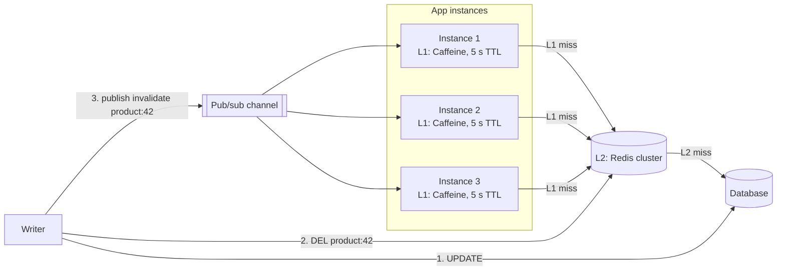

A cache can live inside each application process (local, in-process) or in a shared cluster every process talks to over the network
(distributed). Local caches are a hundred to a thousand times faster but each server has its own copy; distributed caches are consistent
across servers but cost a network hop. The best designs often use both, in two levels — and the hard part is keeping the local copies honest.

## Why it matters

Once Redis is in the design, interviewers ask about hot keys, latency budgets and network load — and the answer is frequently "an in-process
cache in front of Redis". But a local cache brings its own problems: N copies that go stale independently, memory pressure in the
application, and cold caches on every new instance. Knowing when local alone is enough, when distributed is required, and how to combine
them is a mark of practical experience.

## How it works

### Comparison

| Aspect | Local (in-process) | Distributed (Redis, Memcached) |
|---|---|---|
| Latency | ~100 ns–1 µs (memory access, no serialisation for objects) | ~0.5–1 ms (network round trip + serialisation) |
| Capacity | Limited by each instance's heap | Cluster-wide RAM, scalable |
| Consistency across servers | Each instance has its own copy; copies differ | One copy (per key) shared by all |
| Survives deploys/restarts | No — every restart starts cold | Yes |
| Effective hit ratio | Lower: each instance must see a key to cache it | Higher: one fill serves every instance |
| Failure impact | Instance-local | Shared dependency — its outage affects everyone |
| Invalidation | Must reach every instance | One delete |

### When local alone is enough

- **Small, rarely changing reference data**: configuration, feature flags, country lists, permission tables — loaded at startup and refreshed
  every minute or on change events.
- **Immutable data**: content-addressed objects, past versions, compiled templates — staleness is impossible.
- **Per-instance memoisation** of expensive pure computations.

### When you need distributed

- Data shared across instances that must be consistent "enough" — sessions, user objects after edits.
- A working set bigger than one instance's heap.
- Expensive fills you don't want repeated by every instance.

### Two-level (near) caching

Combine them: **L1** is a small in-process cache with a short TTL (seconds); **L2** is Redis; the database is behind both.

1. Read L1 → hit: return.
2. Miss → read L2 → hit: store in L1, return.
3. Miss → read the database → store in L2 and L1.

L1 removes the network hop for the hottest keys and protects Redis from [hot keys](lesson:hot-keys); L2 keeps the overall hit ratio high and
survives deploys.

### Keeping L1 honest

- **Short TTLs** on L1 (seconds) bound staleness without any messaging — often enough on its own.
- **Invalidation broadcast**: on a write, publish "invalidate product:42" over pub/sub (Redis pub/sub, Kafka); every instance evicts its L1
  copy. Lost messages are covered by the short TTL.
- **Client-side caching with server assistance**: Redis 6+ supports *client tracking*, where the server remembers which keys a client has
  read and sends invalidation messages when they change — near caching with server-driven invalidation.
- **Size L1 carefully**: it competes with the application for heap and adds garbage-collection pressure. Bound it by entry count or weight,
  with a good eviction policy (W-TinyLFU in Caffeine).

## Architecture



## Failure scenarios

- **Divergent L1 copies**: one instance missed an invalidation and serves an old price for its TTL. Keep L1 TTLs short; never use L1 for
  data that must be exact.
- **Cold starts**: a deploy restarts every instance, emptying every L1; Redis absorbs the extra load (that's what L2 is for). Without L2,
  the database takes it.
- **Heap pressure**: an unbounded L1 grows until garbage-collection pauses or out-of-memory errors. Bound it.
- **Shared cache outage**: Redis down means L1 hit ratio is all that's left; the database must cope with the rest — plan for it.
- **Invalidation storms**: a bulk update broadcasts millions of invalidations, overwhelming instances; use versioned namespaces for bulk
  changes.

## Trade-offs

- **Latency vs consistency**: L1 is fastest and stalest; shorten TTLs or add invalidation to tighten it.
- **Memory vs hit ratio**: a bigger L1 hits more and pressures the heap; L2 capacity is cheaper to scale independently.
- **Simplicity vs layers**: one cache tier is easier to reason about; two tiers buy latency and hot-key protection.

## In real systems

- Caffeine is the standard local cache on the JVM (and Spring Boot's default for local caching).
- Redis client-side caching (`CLIENT TRACKING`) supports server-assisted near caches; several Redis clients implement it.
- Large services keep small per-process caches in front of their distributed cache tier for the hottest keys — Facebook's memcache paper
  describes client-side optimisations of this kind.
- Hazelcast and similar data grids offer "near cache" configurations with built-in invalidation.

## Common mistakes

- **Local-only caching of data that changes**, with long TTLs and no invalidation.
- **Unbounded in-process caches.**
- **Assuming L1 invalidation is reliable** without a TTL safety net.
- **Using a distributed cache for immutable reference data** that could simply be loaded in memory.
- **Forgetting that every deploy empties L1.**

## In the interview

````question title="Would you use a local cache, a distributed cache, or both?"
Both, for different data. Reference data that rarely changes — configuration, feature flags, plan definitions — lives in each instance's
memory, refreshed on change events. Shared, mutable objects such as products and profiles live in a Redis cluster with cache-aside and
delete-on-write, so one fill serves every instance and the cache survives deploys. For the very hottest keys I'd add a small Caffeine L1 in
front of Redis with a few seconds' TTL, plus an invalidation broadcast on writes, which removes the network hop and shields Redis from hot
keys, while the short TTL bounds staleness if a broadcast is missed.
````

````question title="How do you keep many in-process caches consistent after a write?"
You can't make them perfectly consistent cheaply, so bound and shorten the inconsistency. Give L1 entries short TTLs, publish an
invalidation event on every write that each instance consumes to evict its copy, and — where supported — use server-assisted client-side
caching so Redis itself notifies clients when keys they read change. Data that must be exact isn't cached locally at all.
````

## Key takeaways

- **Local** caches are ~1,000× faster but per-instance, cold after restarts and hard to invalidate; **distributed** caches are shared and
  survive deploys at the cost of a network hop.
- Local alone suits **small, rarely changing or immutable** data.
- **Two-level caching** (L1 in-process + L2 Redis) gives low latency and hot-key protection.
- Keep L1 honest with **short TTLs, invalidation broadcasts or server-assisted tracking**, and **bound its size**.

## Knowledge check

```quiz
? Which data is best served from an in-process cache alone?
+ A list of countries and currency codes that changes a few times a year
- A user's shopping cart
! Carts change often and must be consistent across instances.
- The current stock level at checkout
! Must be exact; don't cache it.
- Session data
! Must be shared across instances.
> Small, rarely changing reference data fits local caches.

? After a deploy restarts all 60 instances, latency spikes briefly even though Redis is healthy. Why?
- Redis lost its data
! Redis survives application deploys.
+ Every instance's local (L1) cache started empty, so all reads went to Redis and the network until L1 warmed up
- The load balancer stopped routing
! Routing continues.
- The database failed over
! Unrelated to deploys.
> Local caches start cold on every restart.

? What bounds staleness in L1 caches if an invalidation message is lost?
- Nothing
! A TTL should always be the safety net.
+ A short TTL on L1 entries
- The size limit
! Size limits evict by policy, not by staleness.
- Redis persistence
! Persistence affects Redis, not L1.
> Every cached copy needs a TTL.

? Why place a small L1 cache in front of Redis for a viral item?
- To make Redis persistent
! Unrelated.
+ To serve the hot key from memory on each instance, removing network hops and load from the Redis node that owns it
- To avoid invalidation
! L1 still needs invalidation or short TTLs.
- To increase Redis memory
! L1 uses application memory.
> L1 spreads a hot key across all instances.
```
