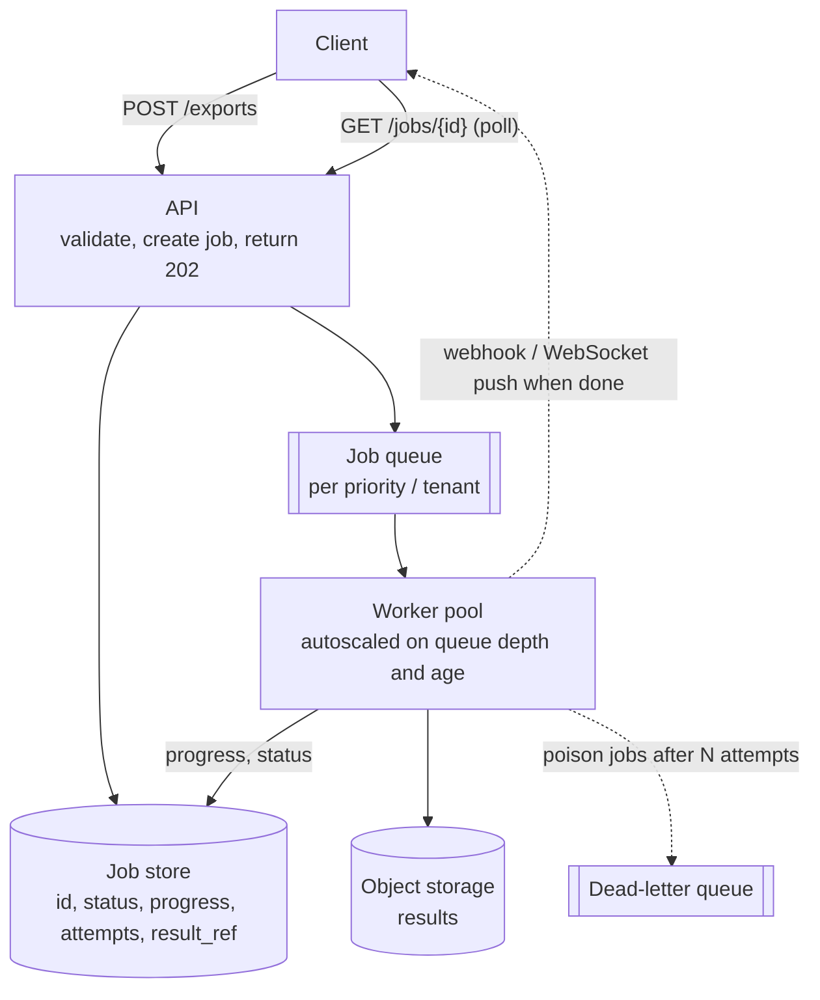
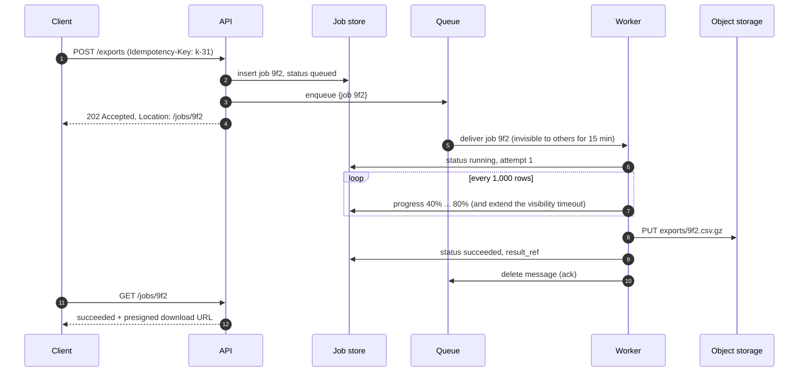

Transcoding a video, generating a 200-page report, running submitted code, exporting a year of data, sending a million emails: some work
takes seconds to hours. Doing it inside an HTTP request ties up threads, hits timeouts and fails badly when anything restarts. The pattern
is to **accept now and process later** — a job record, a queue, a pool of workers, and a way to report progress and results.

## The problem

Signs that work belongs off the request path:

- It takes **longer than a user should wait** (more than a second or two) or longer than proxy and load-balancer timeouts (often 30–60 s).
- It's **CPU-, memory- or I/O-heavy** and would starve request-serving threads.
- It must **survive restarts and deploys** and retry on failure.
- Demand is **bursty** — a thousand exports requested at month-end — and the work can be smoothed over time
  ([sync vs async](lesson:sync-vs-async)).

How many workers you need follows from Little's law: concurrent jobs = arrival rate × duration.

```drill
? 600 jobs arrive per minute and each takes 30 seconds of worker time. How many concurrent workers keep up, at minimum?
= 300
~ 1.1
> 600 ÷ 60 = 10 jobs/s × 30 s = 300 jobs in progress at any time; size above that for bursts and failures.

? A backlog of 18,000 jobs builds during a spike. 300 workers each finish one 30-second job at a time and no new jobs arrive. How many minutes to drain?
= 30
~ 1.1
> 300 workers ÷ 30 s = 10 jobs/s; 18,000 ÷ 10 = 1,800 s = 30 minutes.
```

## Architecture



The pieces:

- **Job record**: the durable source of truth for status (`queued`, `running`, `succeeded`, `failed`, `cancelled`), progress, attempts and
  a reference to the result. Clients poll it or get pushed updates.
- **Queue**: decouples arrival from processing, absorbs bursts and distributes work ([message queues](lesson:queues-pubsub)).
- **Workers**: stateless processes that take a job, run it, write the result to object storage, and update the job record. Scale them on
  **queue depth and age of the oldest job**, not CPU.
- **Result delivery**: a status URL to poll, a webhook, a WebSocket/SSE push, or an email with a download link.

## Request and data flow



Making it survive failure:

- **Visibility timeouts / leases**: a delivered message is hidden from other workers for a period; if the worker crashes without
  acknowledging, it reappears and another worker retries. Long jobs **extend** the lease as they make progress.
- **Idempotent jobs**: retries happen, so key outputs by job ID (`exports/9f2.csv.gz`) and make side effects safe to repeat
  ([dedup](lesson:dedup)).
- **Checkpoints**: split long jobs into chunks and persist progress, so a retry resumes at chunk 41 instead of starting over.
- **Attempts and dead letters**: after N failures, move the job to a DLQ, mark it failed and alert ([retries and DLQs](lesson:retries-dlq)).
- **Cancellation**: set `cancel_requested`; workers check between chunks and stop cleanly.
- **Fairness**: per-tenant queues or concurrency limits stop one customer's 10,000 exports from starving everyone else; separate queues
  for interactive and batch priorities.
- **Bounded intake**: when the backlog exceeds what can be processed in an acceptable time, reject new jobs with `429` and `Retry-After`
  rather than queueing unboundedly ([backpressure](lesson:backpressure)).

## Advantages

- **Responsive APIs**: requests return in milliseconds regardless of job length.
- **Resilience**: jobs survive crashes and deploys; failures retry automatically.
- **Smoothing**: bursts become a backlog processed at a steady rate.
- **Independent scaling and isolation**: workers scale on their own and can run on different hardware (GPUs, large-memory machines,
  sandboxes).

## Disadvantages

- **More moving parts**: job store, queue, workers, result storage, notification.
- **More complex client experience**: polling or push instead of one response.
- **At-least-once execution**: jobs must be idempotent.
- **Operational visibility needed**: queue depth, oldest job age, failure rates, stuck jobs.

## Failure scenarios

| Failure | What happens | Mitigation |
|---|---|---|
| Worker crashes mid-job | Job unfinished, message unacknowledged | Visibility timeout returns it; checkpoint to resume |
| Job longer than the visibility timeout | Two workers run it at once | Extend the lease periodically; idempotent outputs |
| Poison job crashes every worker | Retries forever, wasting capacity | Attempt limit, DLQ, alert |
| Burst of 100× normal jobs | Backlog grows, latency for everyone | Autoscale, per-tenant limits, priorities, reject with 429 |
| Result stored but status update fails | Client never sees success | Status update retried; reconcile from object storage |
| Client gives up and resubmits | Duplicate jobs | Idempotency key on job creation |

## Alternatives

- **Synchronous with a longer timeout**: fine for jobs that reliably finish in a few seconds.
- **Streaming responses**: send results incrementally over one connection (search results, LLM output) when partial output is useful.
- **Serverless functions** triggered by queue messages: no worker fleet to manage, within execution-time limits.
- **Batch frameworks** (Spark, Flink, Beam) for data-parallel processing of large datasets rather than independent jobs.
- **Workflow engines** when a job is really many steps with compensation ([multi-step workflows](lesson:multi-step-workflows)).

## Where it shows up in interviews

Online code judges (run submissions in sandboxes), video transcoding pipelines, web crawlers, report and data exports, image processing,
bulk notifications and ML inference queues. Show the 202 + job ID response, the queue and worker pool sized with Little's law, the job
status model, and what happens when a worker dies halfway.

````question title="How would you design an endpoint that generates a large report?"
Return 202 Accepted with a job ID and a status URL instead of generating it in the request. Store a job record and enqueue a message; a
worker pool processes jobs, writing progress to the record and the finished file to object storage keyed by job ID. The client polls the
status URL or receives a webhook or push notification, then downloads the file with a presigned URL. Retries are safe because outputs are
keyed by job ID and creation uses an idempotency key; crashed workers' jobs reappear after the visibility timeout.
````

````question title="A worker crashes halfway through a 40-minute job. What happens?"
The job's message was invisible while the worker held it; because the worker never acknowledged it, the message becomes visible again when
the lease expires and another worker picks it up. If the job checkpoints progress (chunks processed, offsets), the new worker resumes from
the last checkpoint instead of restarting. Outputs are written idempotently, so partial results from the first attempt are overwritten
safely. After a maximum number of attempts the job goes to a dead-letter queue and is marked failed.
````

## Java and Spring Boot example

A bounded worker pool in plain Java: two workers, a queue of four, and an explicit "busy, retry later" answer once both are full — the same
policy a job API should apply at its intake.

```java file="JobPool.java"
import java.util.Map;
import java.util.TreeMap;
import java.util.concurrent.*;

// Accept-now, process-later with a bounded worker pool: 2 workers, a queue of 4, and an
// explicit "busy, retry later" answer instead of unbounded queueing.
public class JobPool {
    enum Status { QUEUED, RUNNING, DONE, REJECTED }

    public static void main(String[] args) throws InterruptedException {
        Map<Integer, Status> status = new ConcurrentHashMap<>();
        CountDownLatch release = new CountDownLatch(1);          // holds workers busy for the demo
        ThreadPoolExecutor pool = new ThreadPoolExecutor(
                2, 2, 0, TimeUnit.SECONDS,
                new ArrayBlockingQueue<>(4),                     // bounded backlog
                new ThreadPoolExecutor.AbortPolicy());           // full -> rejected

        for (int id = 1; id <= 8; id++) {
            int jobId = id;
            status.put(jobId, Status.QUEUED);
            try {
                pool.execute(() -> {
                    status.put(jobId, Status.RUNNING);
                    try { release.await(); } catch (InterruptedException e) { return; }
                    status.put(jobId, Status.DONE);
                });
                Thread.sleep(20);                                // let workers pick up early jobs
                System.out.printf("POST /jobs -> 202 Accepted  job %d  (%s, queue %d/4)%n",
                        jobId, status.get(jobId), pool.getQueue().size());
            } catch (RejectedExecutionException full) {
                status.put(jobId, Status.REJECTED);
                System.out.printf("POST /jobs -> 429 Too Many Requests, "
                        + "Retry-After: 30  (job %d)%n", jobId);
            }
        }

        release.countDown();                                     // let the work finish
        pool.shutdown();
        pool.awaitTermination(5, TimeUnit.SECONDS);
        Map<Status, Integer> summary = new TreeMap<>();
        status.values().forEach(s -> summary.merge(s, 1, Integer::sum));
        System.out.println("\nfinal: " + summary);
    }
}
```

```text title="Output" output="JobPool.java"
POST /jobs -> 202 Accepted  job 1  (RUNNING, queue 0/4)
POST /jobs -> 202 Accepted  job 2  (RUNNING, queue 0/4)
POST /jobs -> 202 Accepted  job 3  (QUEUED, queue 1/4)
POST /jobs -> 202 Accepted  job 4  (QUEUED, queue 2/4)
POST /jobs -> 202 Accepted  job 5  (QUEUED, queue 3/4)
POST /jobs -> 202 Accepted  job 6  (QUEUED, queue 4/4)
POST /jobs -> 429 Too Many Requests, Retry-After: 30  (job 7)
POST /jobs -> 429 Too Many Requests, Retry-After: 30  (job 8)

final: {DONE=6, REJECTED=2}
```

An unbounded queue would have accepted all eight and quietly grown latency for everyone; the bounded one tells clients to come back.

## Common mistakes

- **Running slow work inside the request** and raising timeouts to compensate.
- **Unbounded queues** with no admission control.
- **Non-idempotent jobs** with at-least-once delivery.
- **Visibility timeouts shorter than job duration** without lease extension.
- **Scaling workers on CPU** instead of backlog and wait time.
- **No status model**, leaving clients guessing.

## Key takeaways

- **Accept now, process later**: 202 + job ID, a durable job record, a queue, a worker pool, and result delivery.
- Size workers with **Little's law** (arrival rate × duration) and scale on **queue depth and age**.
- Survive crashes with **leases**, **idempotent outputs**, **checkpoints** and **attempt limits with DLQs**.
- **Bound intake** and keep tenants **fair**.

## Knowledge check

```quiz
? Jobs arrive at 5 per second and take 2 minutes each. Roughly how many must be running concurrently to keep up?
- 10
! That ignores the 120-second duration.
+ 600
- 2.5
! Rate divided by duration has the wrong units.
- 120
! That's the duration in seconds.
> Little's law: 5/s × 120 s = 600.

? A job usually takes 20 minutes, but the queue's visibility timeout is 5 minutes. What happens?
+ The message reappears while the first worker is still running, so a second worker starts the same job
- The job is cancelled after 5 minutes
! Visibility timeout doesn't stop the worker.
- The queue extends the timeout automatically
! The worker must extend it.
- Nothing; visibility only affects new messages
! It applies to in-flight messages.
> Extend leases while working, and make jobs idempotent.

? Why should workers write results to a key derived from the job ID (e.g. exports/9f2.csv.gz)?
- It's required by object storage
! Any key is allowed.
+ Retries overwrite the same object instead of creating duplicates, making the job idempotent
- It makes downloads faster
! Key choice doesn't affect speed here.
- It encrypts the file
! Unrelated.
> Deterministic outputs make at-least-once execution safe.

? One tenant submits 50,000 exports at once and everyone else's exports are delayed for hours. What fixes it?
- More workers only
! Helps, but the big tenant still dominates.
+ Per-tenant queues or concurrency limits (fair scheduling), plus priorities for interactive jobs
- Rejecting all exports
! Penalises everyone.
- A longer visibility timeout
! Unrelated to fairness.
> Isolate tenants in shared job systems.
```
