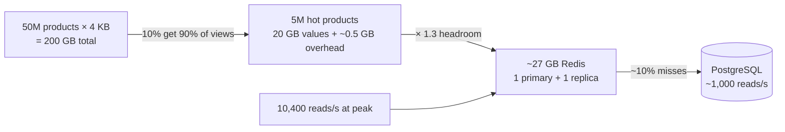

Memory is the fastest and most expensive place to keep data. Memory estimation answers how much RAM a cache, a session store or
a database's working set needs — and therefore whether it fits one node, needs a cluster, or is the wrong plan altogether.

## The question it answers

- **How big should the cache be** to absorb most reads — and will it fit on one node?
- **How much does each key really cost** in an in-memory store, beyond the value itself?
- **Does the database's working set fit in RAM**, so indexed reads stay fast — or has the dataset outgrown one machine?

## Formula

### Cache size from the hot set

Access is almost never uniform: a small share of items receives most requests (the "80/20 rule" is a rough description of this skew). Size
a cache by the **items that are hot**, not by all items:

```text title="Formula"
hot items      = distinct items receiving most reads (e.g. top 10% that get ~90% of views)
cache memory   = hot items × (value size + key size + per-key overhead) × headroom (≈ 1.25-1.5)
expected DB load = reads/s × (1 − hit ratio)
```

The calculator on this site uses a cruder upper bound — a share of one day's read *volume* — which over-counts because popular items are read
many times. Prefer counting distinct hot items when you know them.

### Per-key overhead in in-memory stores

Every key carries bookkeeping beyond its bytes: hash-table entries, pointers, type information, expiry metadata and allocator rounding. For
small values in Redis this overhead is **tens of bytes per key** — comparable to the data itself when values are tiny. Two consequences:

- For **millions of tiny values** (counters, flags), overhead can double memory. Grouping small fields into hashes or packing values reduces
  it.
- **Measure, don't guess**, once you have real data: Redis's `MEMORY USAGE <key>` reports the bytes a key uses, and `INFO memory` reports
  totals and fragmentation.

Also leave headroom: memory fragmentation, replication buffers, and snapshotting (which forks the process and can need extra memory under
write load) mean you should plan to fill only **about 70–80%** of a node's RAM.

### Does the database fit?

A relational database is fast when its **working set** — the indexes and rows touched frequently — fits in its buffer cache (RAM). It
doesn't need *all* data in memory:

```text title="Formula"
working set ≈ hot rows × row size + the upper levels of every hot index
fits one node if: working set ≲ RAM of a large instance,
                  total data ≲ a few TB, and writes ≲ thousands/s
```

When the working set exceeds memory, reads become disk-bound and latency jumps. That — not just total size — is a signal to add a cache,
archive cold data, or partition.

## Worked example

Product pages for an online store:

- **50M products**, each page's data (JSON for title, price, images, attributes) about **4 KB**.
- **300M product-page views a day**; peak 3× average.
- Popularity is skewed: about **5M products (10%) receive ~90% of views**.

**Traffic:** 300M ÷ 86,400 ≈ 3,500 reads/s on average, ~10,400/s at peak.

**Caching everything:** 50M × 4 KB = **200 GB** — possible with a cluster, but mostly wasted on products nobody views.

**Caching the hot set:** 5M × 4 KB = 20 GB of values. Keys like `product:12345678` (~16 bytes) plus overhead add roughly 5M × ~100 B ≈
0.5 GB. With 1.3× headroom: **about 27 GB** — a single large Redis node (or two smaller shards), plus a replica for failover.

**Database load:** at a ~90% hit ratio, peak cache misses are ~10% × 10,400 ≈ **1,000 reads/s** — easy for a PostgreSQL primary or a replica.
Without the cache, ~10,400 reads/s of 4 KB rows would need several replicas.

**Diminishing returns:** doubling the cache to 54 GB might lift the hit ratio from ~90% to ~95% — halving database reads from ~1,000/s to
~500/s. Useful if the database is struggling; wasteful if it isn't. The number to optimise is database load, not hit ratio for its own sake.



## Try it

The calculator's cache output uses the share-of-daily-reads upper bound; compare it with the hot-set figure above:

```estimator title="Product pages"
requestsPerDay = 303M
readsPerWrite = 100
writeBytes = 4 KB
readBytes = 4 KB
retentionYears = 3
peakFactor = 3
replication = 3
cachePercent = 2
serverRps = 3000
targetUtilization = 70
```

```drill
? 20M concurrent sessions at 2 KB each. How much session data must the store hold, before overhead?
= 40 GB
~ 1.25
> 20 × 10⁶ × 2 × 10³ B = 4 × 10¹⁰ B = 40 GB — one large node or a small cluster, with replicas.

? 100M small counters: 50-byte values, 30-byte keys and ~70 bytes of per-key overhead. Roughly how much memory?
= 15 GB
~ 1.3
> 100M × (50 + 30 + 70) B = 100M × 150 B = 15 GB — overhead is almost half of it.

? A cache absorbs 92% of 50,000 reads/s. How many reads per second reach the database?
= 4000
~ 1.15
> 50,000 × (1 − 0.92) = 4,000/s.
```

## How it changes the design

| Memory finding | Design response |
|---|---|
| Hot set fits one node (tens of GB) | One cache node + replica; no cluster needed |
| Hot set in hundreds of GB or more | A cache cluster partitioned by key; consider an in-process tier for the hottest keys |
| Millions of tiny keys | Pack values (hashes, bitmaps), reduce key length, measure overhead |
| Database working set exceeds RAM | Cache in front, archive cold data, larger instance, or partition |
| Cache miss load still too high for the database | Larger cache only if it materially reduces misses; otherwise replicas |
| Cache is a single node | Plan for its failure: replicas, and a database sized for a degraded hit ratio |

## Common mistakes

- **Caching the entire dataset** when a small hot set serves most reads.
- **Ignoring per-key overhead** for small values.
- **Filling RAM to 100%** — no room for fragmentation, replication buffers or snapshots.
- **Chasing hit ratio** instead of the database load it implies.
- **Forgetting the cold-cache case**: after a restart or failover, the database briefly sees almost every read.

## Key takeaways

- Size caches by the **hot set**: distinct hot items × (value + key + overhead) × headroom.
- In-memory stores add **tens of bytes per key**; measure with tools like `MEMORY USAGE`.
- Plan to use **~70–80% of a node's RAM**.
- A database stays fast while its **working set fits in memory**; when it doesn't, cache, archive or partition.
- Judge a cache by the **database load** it removes — and size the database for the day the cache is cold.

## Knowledge check

```quiz
? A catalogue has 100M items of 2 KB each; 5% of items receive almost all reads. Roughly how much cache do the hot values need?
- 200 GB
! That caches every item.
+ About 10 GB, plus key overhead and headroom
- About 1 GB
! That's too small for 5M items of 2 KB.
- About 100 GB
! That is half the catalogue.
> 5% of 100M = 5M items × 2 KB = 10 GB of values.

? Why can storing 500M tiny counters in Redis take far more memory than 500M × value size?
+ Each key carries tens of bytes of bookkeeping (hash entries, pointers, metadata), comparable to the tiny values themselves
- Redis compresses everything, which inflates memory
! Redis doesn't compress values by default, and compression would shrink them.
- Counters are stored on disk
! Redis keeps the dataset in memory.
- Redis stores each key three times
! Replicas are separate nodes, not extra copies inside one node.
> For small values, per-key overhead dominates; pack or measure.

? A cache hit ratio rises from 95% to 97% after doubling the cache. What actually changed for the database at 100,000 reads/s?
- Database reads fell by 2%
! The relative change in misses is much larger.
+ Misses fell from 5,000/s to 3,000/s — a 40% reduction in database reads
- Nothing meaningful
! 2,000 fewer reads per second can matter a lot to a busy database.
- The database now handles 97% of reads
! The cache handles 97%; the database handles 3%.
> Evaluate a cache by the misses that reach the database.

? A database has 3 TB of data and 256 GB of RAM, and latency is fine. What matters for whether reads stay fast?
- Whether all 3 TB fits in RAM
! Data doesn't need to be fully in memory.
+ Whether the working set — hot rows and index pages — fits in RAM
- Whether the data is under 1 TB
! Size alone doesn't decide read latency.
- The number of tables
! Table count is irrelevant here.
> When the frequently touched data fits in memory, most reads avoid disk.
```
