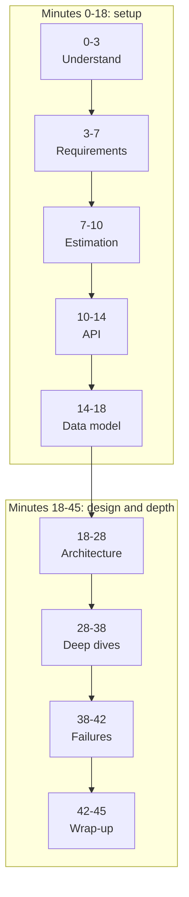
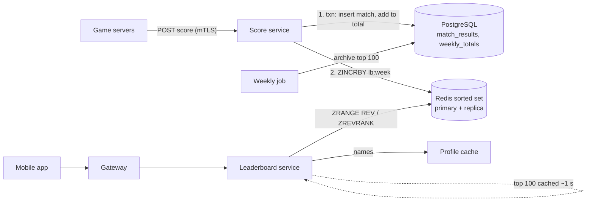

A complete 45-minute interview, step by step: **"Design a leaderboard for a mobile game."** At each step you first try the step
yourself, then read what the candidate said, what the interviewer pushed back on, and the notes an interviewer would write. The prompt is
deliberately not one of the practice problems, so you can see the framework applied without spoiling them.

## How to use this workshop



- **Set a timer** and do each "Your turn" before opening the transcript. Write your answer down — the gap between what you wrote and what
  the candidate said is the lesson.
- The callouts marked **interviewer's notes** show what an interviewer would record: signals, not just content.
- The candidate is strong but not perfect; watch how they recover from pushback.
- Afterwards, try the same prompt again from memory in the [mock interview format](#system-design/hld/interview) style: requirements,
  numbers, API, data, design, depth.

## Exercises

### Part 1 — Understand the problem (0–3 minutes)

**Your turn:** the prompt is "Design a leaderboard for a mobile game." Write the four or five questions you'd ask first.

````hint title="Hint: what kinds of leaderboard exist?"
Global or among friends? All-time, or per season? Best single score, or accumulated points? Who submits scores — clients or trusted
game servers? Each answer changes the data structure or the trust model.
````

````solution title="Transcript: understanding the problem"
> **Interviewer:** Design a leaderboard for a mobile game.
>
> **Candidate:** To make sure I build the right thing: players finish matches, earn points, and want to see the top players and where they
> rank. Is that the core?
>
> **Interviewer:** Yes.
>
> **Candidate:** Is it all-time, or reset periodically — like a weekly season?
>
> **Interviewer:** Weekly. Points accumulate during the week, then it resets.
>
> **Candidate:** What do players see — just the top 100, or also their own rank?
>
> **Interviewer:** Top 100, and their own rank with the players just above and below them.
>
> **Candidate:** Who reports scores — the mobile client or our game servers?
>
> **Interviewer:** Game servers, after each match. Assume they're trusted.
>
> **Candidate:** Friends leaderboards?
>
> **Interviewer:** Out of scope for today.
>
> **Candidate:** And scale — how many players?
>
> **Interviewer:** About 50 million players, 10 million daily.

> [!INTERVIEW] Interviewer's notes
> Restated the prompt, asked about season semantics, the read views, trust and scale. Didn't ask anything irrelevant. Good start.
````

### Part 2 — Requirements (3–7 minutes)

**Your turn:** write the functional and non-functional requirements, with numbers where you can.

````hint title="Hint: different guarantees for different operations"
Can the leaderboard lag behind a match by a few seconds? Can a match's points ever be lost or counted twice?
````

````solution title="Transcript: requirements"
> **Candidate:** Functional requirements:
> 1. Game servers **submit a match result**: player, match, points earned.
> 2. Players **view the weekly top 100**.
> 3. Players **view their own rank** with a few neighbours.
> 4. Leaderboards **reset weekly**, and past weeks' top 100 stay viewable.
>
> **Candidate:** Non-functional: 10 million daily players, around 10 matches each, so about 100 million score updates a day with an
> evening peak. Rank updates should appear within a few seconds of a match. Reading the top 100 or my rank should be fast — p99 under
> 100 ms. Points must never be lost or double-counted, even if a game server retries. The leaderboard itself can be eventually
> consistent by a few seconds.
>
> **Interviewer:** Why "never double-counted"? That's a strong requirement.
>
> **Candidate:** Because points decide weekly prizes, and game servers will retry when a request times out. If a retry adds the points
> again, rankings become wrong. I'll make submissions idempotent using the match ID.

> [!INTERVIEW] Interviewer's notes
> Quantified scale, set a freshness target and a latency target, and differentiated guarantees: exact points, eventually consistent
> ranking. Defended the idempotency requirement with a concrete reason.
````

### Part 3 — Estimation (7–10 minutes)

**Your turn:** estimate the write rate (average and peak), the read rate, and the memory a ranking structure needs.

````hint title="Hint: how big is the ranked set?"
Only players who played this week appear. Assume each ranked entry costs on the order of 100 bytes in an in-memory sorted structure.
````

````solution title="Transcript: estimation"
> **Candidate:** Writes: 100 million updates a day is about 1,200 a second; evenings and events maybe 5×, so about 6,000 a second at peak.
> Reads: if each daily player opens the leaderboard 5 times, that's 50 million a day — about 600 a second, maybe 3,000 at peak.
>
> **Candidate:** Size: up to maybe 20 million players active in a week. If a sorted in-memory structure costs on the order of 100 bytes per
> player, that's about 2 GB for a week's leaderboard. That fits comfortably in memory on one node.
>
> **Candidate:** So: a few thousand writes a second and a couple of gigabytes — one in-memory sorted structure can hold the whole weekly
> ranking. The interesting part isn't scale; it's computing rank quickly.

> [!INTERVIEW] Interviewer's notes
> Fast, rounded, and ended with a conclusion that shaped the design ("fits in memory; the problem is rank computation").
````

### Part 4 — API (10–14 minutes)

**Your turn:** define the endpoints, including how a retried submission is handled.

````solution title="Transcript: API"
> **Candidate:**
>
> ```text
> POST /internal/v1/scores           (game servers only, mTLS)
>      { matchId, playerId, points, finishedAt }
>      -> 200 { weeklyTotal }        same matchId again -> 200, no double count
>
> GET  /v1/leaderboards/weekly/top?limit=100
>      -> 200 { week, entries: [ { rank, playerId, name, points } ] }
>
> GET  /v1/leaderboards/weekly/me?around=5
>      -> 200 { rank, points, above: [...5], below: [...5] }       player from the token
>
> GET  /v1/leaderboards/2026-W10/top        past weeks, read-only
> ```
>
> **Candidate:** Score submission is internal and authenticated with mutual TLS. The match ID makes it idempotent. "Me" comes from the
> player's token.

> [!INTERVIEW] Interviewer's notes
> One endpoint per requirement, separate trust boundary for game servers, idempotency built into the API.
````

### Part 5 — Data model (14–18 minutes)

**Your turn:** what is stored durably, and what structure answers "top 100" and "my rank" quickly?

````hint title="Hint: why not ORDER BY in SQL?"
`ORDER BY points DESC LIMIT 100` is easy with an index. What does "what is my rank?" cost — how many rows must be counted?
````

````solution title="Transcript: data model, with pushback"
> **Candidate:** Two layers. The **system of record** is a relational table of match results, `match_results(match_id PK, player_id,
> week, points)`, plus `weekly_totals(week, player_id, points)` with primary key `(week, player_id)`. Inserting the match result and
> incrementing the total happen in one transaction, and the `match_id` primary key rejects duplicates.
>
> **Candidate:** The **ranking index** is a Redis sorted set per week: key `lb:2026-W11`, member = player ID, score = weekly points.
> Adding points is `ZINCRBY`, top 100 is `ZRANGE ... REV` over ranks 0–99, and my rank is `ZREVRANK` — all logarithmic in the number of
> players.
>
> **Interviewer:** Why not just use the database? An index on `(week, points DESC)` gives you the top 100.
>
> **Candidate:** For the top 100, yes — that query is fine. The problem is "my rank": the database has to count every player with more
> points than me, which for a mid-table player is millions of index entries, a few thousand times a second at peak. A sorted set keeps
> counts in its structure, so rank is O(log N). The database stays the source of truth; Redis is a derived index I can rebuild from
> `weekly_totals`.

> [!INTERVIEW] Interviewer's notes
> Handled pushback by agreeing with the part that's true (top 100 works in SQL) and isolating the real problem (rank = counting).
> Clear source-of-truth vs derived-index distinction.
````

### Part 6 — High-level architecture (18–28 minutes)

**Your turn:** draw the architecture and walk a score submission and a "my rank" request through it.

````solution title="Transcript: architecture"


> **Candidate:** A score arrives at the score service. Step one is the database transaction: insert the match result — a duplicate
> `match_id` means a retry, so I return the current total and stop — and add the points to the weekly total. Step two, `ZINCRBY` on
> this week's sorted set. Then the response.
>
> **Candidate:** Reads go through the leaderboard service. Top 100 is one `ZRANGE` with `REV`, enriched with player names from a profile
> cache, and cached in the service for about a second — at 3,000 reads a second that removes almost all Redis load for the top list. "My
> rank" is `ZREVRANK` plus a small range around that rank.
>
> **Candidate:** Weekly reset needs no deletion: next week simply uses a new key. A job archives the final top 100 to the database and
> sets an expiry on the old key.
>
> **Interviewer:** What if step one succeeds and the service crashes before step two?
>
> **Candidate:** Then Redis misses those points until something repairs it. I'd make step two reliable rather than hopeful: publish the
> score event through an outbox in the same transaction, and have a consumer apply `ZINCRBY` from the outbox. That consumer can retry
> safely if I make it idempotent — for instance by setting the member's score from the database total (`ZADD` with the absolute value)
> instead of incrementing.

> [!INTERVIEW] Interviewer's notes
> Working design for all four requirements; weekly reset handled elegantly with per-week keys. When challenged on the dual write,
> recognised the failure window and moved to an outbox with an idempotent absolute-value update — a strong answer.
````

### Part 7 — Deep dives (28–38 minutes)

**Your turn:** the interviewer asks, "What if the game grows to 500 million weekly players?" How do you compute rank across machines?

````hint title="Hint: what does rank mean in a sharded set?"
If players are spread across shards, a player's global rank is the number of players, on every shard, with more points. Which operation
counts that per shard?
````

````solution title="Transcript: deep dive on scale and ties"
> **Candidate:** At 500 million players the set is roughly 50 GB at 100 bytes each, and peak writes might be 60,000 a second. Memory still
> fits a large node, but I'd shard for write throughput and failure isolation. Three options:
>
> **Candidate:** **One, shard by player ID** across N Redis nodes. Top 100 = take the top 100 from each shard and merge — cheap. My rank
> = for each shard, `ZCOUNT` the members with a higher score, and add them up — N parallel O(log n) calls. With 10 shards that's fine.
>
> **Candidate:** **Two, shard by score range** — shard 1 holds the top band, and so on. Rank is cheap (count of higher shards plus local
> rank), but players move between shards as they score, and the top shard gets the hottest traffic.
>
> **Candidate:** **Three, approximate ranks** for everyone outside the top, say, 10,000: keep a histogram of how many players have each
> point value; a player's rank is the sum of counts above their score. Exact enough for "you're around #1,234,000", and tiny.
>
> **Candidate:** I'd combine one and three: exact ranks for the top band via sharded sorted sets, approximate ranks for the long tail.
>
> **Interviewer:** How do you break ties?
>
> **Candidate:** Redis orders equal scores by member name, which isn't fair. If ties should go to whoever reached the score first, encode
> it in the score: points in the high part and an "earlier is better" time component in the low part — keeping the total within the
> 53 bits a double represents exactly.

> [!INTERVIEW] Interviewer's notes
> Quantified the new scale, gave three options with trade-offs, combined two sensibly, and handled tie-breaking including the
> floating-point precision constraint. Senior-level depth.
````

### Part 8 — Failures (38–42 minutes)

**Your turn:** list the three most important failures and their mitigations.

````solution title="Transcript: failures"
> **Candidate:** First, **Redis fails**: reads of the leaderboard fail or go stale. Redis runs with a replica and automatic failover; if both
> are lost, I rebuild the sorted set from `weekly_totals` — 20 million rows loaded in batches takes minutes, and meanwhile the top 100
> can be served from the database with its index.
>
> **Candidate:** Second, **duplicate or lost score updates** during retries and crashes: the `match_id` key stops duplicates in the
> database, and the outbox guarantees Redis eventually reflects every committed result.
>
> **Candidate:** Third, **an event spike** — a tournament ending — multiplies writes. The score service is stateless and scales out, the
> database handles a few thousand transactions a second, and the outbox consumer absorbs bursts with a short lag, which our few-seconds
> freshness target allows.

> [!INTERVIEW] Interviewer's notes
> Prioritised, specific, and every mitigation tied back to an earlier decision (source of truth, outbox, freshness target).
````

### Part 9 — Wrap-up (42–45 minutes)

**Your turn:** give the 30-second summary and two trade-offs.

````solution title="Transcript: wrap-up"
> **Candidate:** To summarise: game servers submit match results idempotently to a score service that records them in PostgreSQL — the
> source of truth — and an outbox feeds a per-week Redis sorted set that serves top-100 and my-rank queries in logarithmic time. Weekly
> resets are new keys; past winners are archived.
>
> **Candidate:** Trade-offs: I keep two copies of the totals — the database for correctness, Redis for ranking — accepting a few seconds of
> lag and the outbox machinery. And at very large scale I'd accept approximate ranks for the long tail rather than pay for exact ranks
> nobody needs. I'd monitor outbox lag, Redis memory and failover, and p99 read latency.
>
> **Interviewer:** Thanks — that's time.

> [!INTERVIEW] Interviewer's notes
> Finished on time with a clear summary and honest trade-offs. Overall: strong hire signal at senior level — structured, quantitative,
> handled pushback well, depth on the hard parts.
````

## Key takeaways

- The framework held up under interruptions: each pushback was **answered, then the candidate resumed** the plan.
- The estimate ended in a conclusion — **"fits in memory; the problem is rank computation"** — that shaped every later choice.
- Separating the **source of truth** (database) from a **derived index** (sorted set) made failures and rebuilds easy to reason about.
- Strong deep dives give **several options with trade-offs and a decision**, and quantify the new scale first.
- The interviewer's notes record **signals** — scoping, quantifying, recovering, owning trade-offs — not just components.

## Knowledge check

```quiz
? Why did the candidate use a sorted set instead of answering "my rank" with SQL?
- SQL can't sort by points
! SQL sorts easily; the cost is counting rows above a player.
+ Computing a mid-table player's rank in SQL means counting millions of rows per request; a sorted set returns rank in logarithmic time
- Redis is always faster than any database for every query
! Not true in general; this is about the specific access pattern.
- To avoid having a database
! The database remains the source of truth.
> Match the data structure to the access pattern: rank queries need order statistics.

? The score service writes to PostgreSQL, then to Redis, and might crash between the two. What was the candidate's fix?
+ Write an outbox event in the same database transaction and update Redis from it idempotently (setting the absolute total)
- Write to Redis first, then the database
! Then a crash could leave points in Redis that the source of truth never recorded.
- Ignore it; it's rare
! Prize-deciding points can't silently go missing.
- Use a distributed transaction across PostgreSQL and Redis
! Redis doesn't participate in two-phase commit, and the outbox is simpler.
> The outbox turns a dual write into a reliable, replayable update.

? How did the candidate make score submission safe to retry?
- By rate-limiting game servers
! Rate limits don't stop duplicates.
+ By making `match_id` the primary key of match results, so a retried match is recognised and not counted twice
- By using UDP
! UDP doesn't provide idempotency.
- By asking game servers never to retry
! Retries are necessary after timeouts.
> A natural unique key makes the operation idempotent.

? What did the candidate propose for ranks outside the top 10,000 at 500 million players?
- Exact ranks on a single huge sorted set
! It works for memory but concentrates writes and failure risk on one node.
+ Approximate ranks from a histogram of point values
- No ranks at all
! Players still see a rank, just an approximate one.
- Querying every shard's full membership
! That's far more work than counting per shard or using a histogram.
> Exactness where it matters, approximation for the long tail.
```
