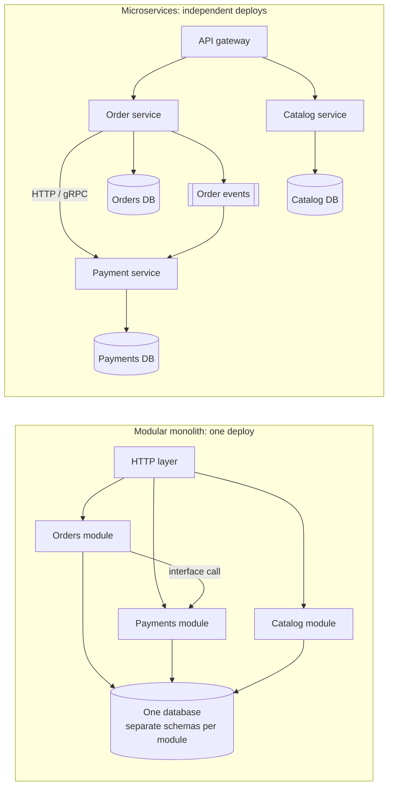

Splitting a system into services is an organisational decision as much as a technical one. Done for the right reasons it lets teams
move independently; done early or along the wrong lines it turns function calls into network failures. This lesson gives you the
criteria — and the vocabulary of maintainability that the choice is really about.

## Why it matters

- A **monolith** is one deployable application containing all features, usually with one database.
- A **modular monolith** is one deployable with strong internal boundaries: modules own their data and talk through defined
  interfaces, not by reaching into each other's tables.
- **Microservices** are separately deployable services, each owning its data and talking to others over the network.

In HLD interviews you draw services constantly. Drawing *five* services for a problem that needs one, without saying why, is a common
red flag; so is a design where services share one database and call each other synchronously in long chains. Knowing why to split —
and where — is the skill.

## How it works

### What each architecture buys

| | Monolith / modular monolith | Microservices |
|---|---|---|
| Deploy | One unit; simple pipeline | Independent per service; many pipelines |
| Calls between features | In-process function calls (ns) | Network calls (ms) that can fail |
| Data | One database; joins and transactions are easy | One store per service; cross-service queries need APIs or events |
| Scaling | Scale the whole app | Scale each service to its own load |
| Team autonomy | Shared codebase and release train | Teams own, deploy and operate their services |
| Failure | A bad deploy or memory leak affects everything | Failures can be isolated — or cascade across calls |
| Operational overhead | Low | High: discovery, tracing, versioning, many deploys |

### Maintainability: what the choice is really about

Maintainability is the ability to keep a system running and changing over years. It has three parts:

- **Operability** — how easy it is for operators to keep the system healthy: observability, predictable behaviour, safe deploys.
- **Simplicity** — how easy it is for new engineers to understand: few moving parts, clear boundaries, no accidental complexity.
- **Evolvability** — how easy it is to change: features can be added or replaced locally, without coordinating many teams.

A monolith is usually more **operable and simple** for a small team; microservices can be more **evolvable** for many teams — but only
if the boundaries are right. Bad boundaries make microservices worse on all three.

### Drawing service boundaries

Good boundaries follow **data ownership and business capability**, not nouns or layers:

- One service owns a piece of data and is the only one that writes it (for example, *Payments* owns payment records).
- A service should be able to do most of its work without synchronously calling others.
- Data other services need is exposed through an API or published as events — never by sharing tables.

Warning signs of a **distributed monolith**: services that must be deployed together, services sharing a database, and request paths
that chain five synchronous calls. You pay the costs of distribution and get none of the independence.

### When to split

Split a part out when there is a concrete reason:

- **Different scaling needs** — video transcoding needs GPUs and queues; the profile page doesn't.
- **Different reliability or security requirements** — payment handling needs stricter controls and isolation.
- **Team independence** — several teams blocked on one release train.
- **Different technology** — a search engine, a stream processor, a machine-learning model server.

Conway's law observes that systems end up mirroring the communication structure of the organisations that build them. Service
boundaries that match team boundaries tend to stay healthy; boundaries that cut across teams fight the organisation.

## Architecture

The same product as a modular monolith and as services, each owning its data:



In the modular monolith, "place order" is a function call and one database transaction. In the microservices version it is a network
call or an event, and keeping orders and payments consistent needs a pattern such as a saga (see [distributed transactions](lesson:distributed-transactions)).

## Failure scenarios

- **Cascading failure.** The payment service slows down; the order service's threads wait on it; the gateway's threads wait on the
  order service; the whole site stalls. Timeouts, circuit breakers and bulkheads (Stage 10) exist for this.
- **Partial failure mid-operation.** The order is saved but the payment call times out. Did the payment happen? Without idempotency and
  a reconciliation path, you can double-charge or lose orders.
- **Version skew.** Service A deploys a change to its API before service B is ready for it. APIs must evolve compatibly.
- **Monolith blast radius.** A memory leak in a rarely used report endpoint brings down checkout because they share a process.
- **Distributed monolith.** A schema change in a shared database requires coordinated deploys of four services.

## Trade-offs

- **Independence vs consistency.** Separate databases give teams autonomy and remove cross-service joins and transactions.
- **Isolation vs latency.** Network boundaries contain failures but add milliseconds and failure modes to every interaction.
- **Flexibility vs operational cost.** Each service needs CI/CD, monitoring, on-call, capacity planning and security patching.
- **Start simple, split deliberately.** A modular monolith keeps the option to extract services later along proven boundaries, at much
  lower cost than undoing a premature split.

## In real systems

- **Amazon** famously moved to service-oriented architecture with small teams owning services end to end — an organisational change as
  much as a technical one.
- **Shopify** has written about running a very large Ruby on Rails *modular monolith*, enforcing boundaries between components inside
  one codebase rather than splitting into many services.
- **Segment** published an account of consolidating many small microservices back into a monolith after the operational overhead
  outweighed the benefits ("Goodbye Microservices", 2018).

The lesson from all three: architecture should follow team structure and concrete needs, and either choice can be right.

## Common mistakes

- **Microservices by default.** Five services for a problem one service handles comfortably is complexity without benefit.
- **Splitting by noun or layer.** A "User service" that every request must call, or a "Data service" in front of the database, creates
  chatty dependencies.
- **Shared databases between services.** It couples deploys and hides who owns the data.
- **Long synchronous call chains.** Each hop multiplies failure probability and adds latency.
- **Ignoring the operational cost** — tracing, discovery, versioning — when proposing a split.

## In the interview

In HLD interviews you will usually draw a handful of services because the problem has genuinely different workloads (for example a
write path and a read path, or an upload path and a processing pipeline). Name the reason for each boundary: *"I'm separating
transcoding into workers behind a queue because it is slow, CPU-heavy and scales independently of uploads."*

````question title="When would you choose a monolith over microservices?"
For a small team, an early product, or a domain whose boundaries aren't yet clear. A modular monolith gives in-process calls, simple
transactions and one deploy, with low operational overhead, while strong internal module boundaries keep the option to extract services
later. I'd split out a service only for a concrete reason: different scaling or hardware needs, different reliability or security
requirements, independent team ownership, or a specialised technology.
````

````question title="What is a distributed monolith and why is it worse than either alternative?"
It is a system split into services that still have to change and deploy together — usually because they share a database, call each
other in long synchronous chains, or depend on each other's internal data formats. It pays all the costs of distribution (network
failures, latency, operational overhead, harder debugging) while keeping the coupling of a monolith, so neither teams nor services gain
independence.
````

````question title="How do you decide where to draw service boundaries?"
Around data ownership and business capabilities: each service owns its data, is the only writer of it, and can do most of its work
without synchronously calling others. Other services get the data through an API or events, never shared tables. Boundaries that match
team ownership stay healthy (Conway's law). I'd also check that each proposed service has a reason to be separate — different scale,
reliability, security or technology — rather than splitting by noun.
````

## Key takeaways

- **Monolith**, **modular monolith** and **microservices** trade simplicity and transactions against independent deploys and scaling.
- **Maintainability** = operability + simplicity + evolvability; the right architecture improves the one your organisation needs most.
- Draw boundaries around **data ownership and business capability**; never share databases between services.
- Split for **concrete reasons**, and beware the distributed monolith.

## Knowledge check

```quiz
? Which is the strongest reason to extract a component into its own service?
- It has its own noun in the domain model
! Nouns don't imply different scaling, ownership or reliability needs.
+ It needs to scale independently on different hardware, such as GPU-based video processing
- Microservices are the modern approach
! Fashion is not a requirement.
- It would make the codebase smaller
! A smaller codebase per service comes with network calls and operational overhead.
> Different scaling, reliability, security or ownership needs justify a boundary; nouns and fashion don't.

? Three services read and write the same database tables. What is the main problem?
- Databases can't handle three clients
! Databases handle many concurrent clients.
+ The services are coupled through the schema, so changes require coordinated deploys
- It is too fast
! Speed isn't the issue.
- The services can't use transactions
! They can, which is part of why the coupling is so tight.
> Shared tables make every schema change a cross-team, cross-service change — a distributed monolith.

? An order service calls payment synchronously; payment becomes slow and the whole site stalls. What is this?
- A deadlock in the database
! Nothing here is waiting on a lock; threads are waiting on slow responses.
+ A cascading failure through synchronous dependencies
- A split brain
! Split brain is two nodes both believing they are the leader.
- A cache stampede
! A stampede is many requests rebuilding the same missing cache entry at once.
> Threads waiting on a slow dependency exhaust pools upstream; timeouts and circuit breakers contain it.

? Which property of maintainability is about how easily the system can be changed?
- Operability
! Operability is about running the system healthily.
- Simplicity
! Simplicity is about understanding the system.
+ Evolvability
- Availability
! Availability is a runtime quality, not a maintainability property.
> Evolvability measures how easily features can be added or changed without wide coordination.
```
