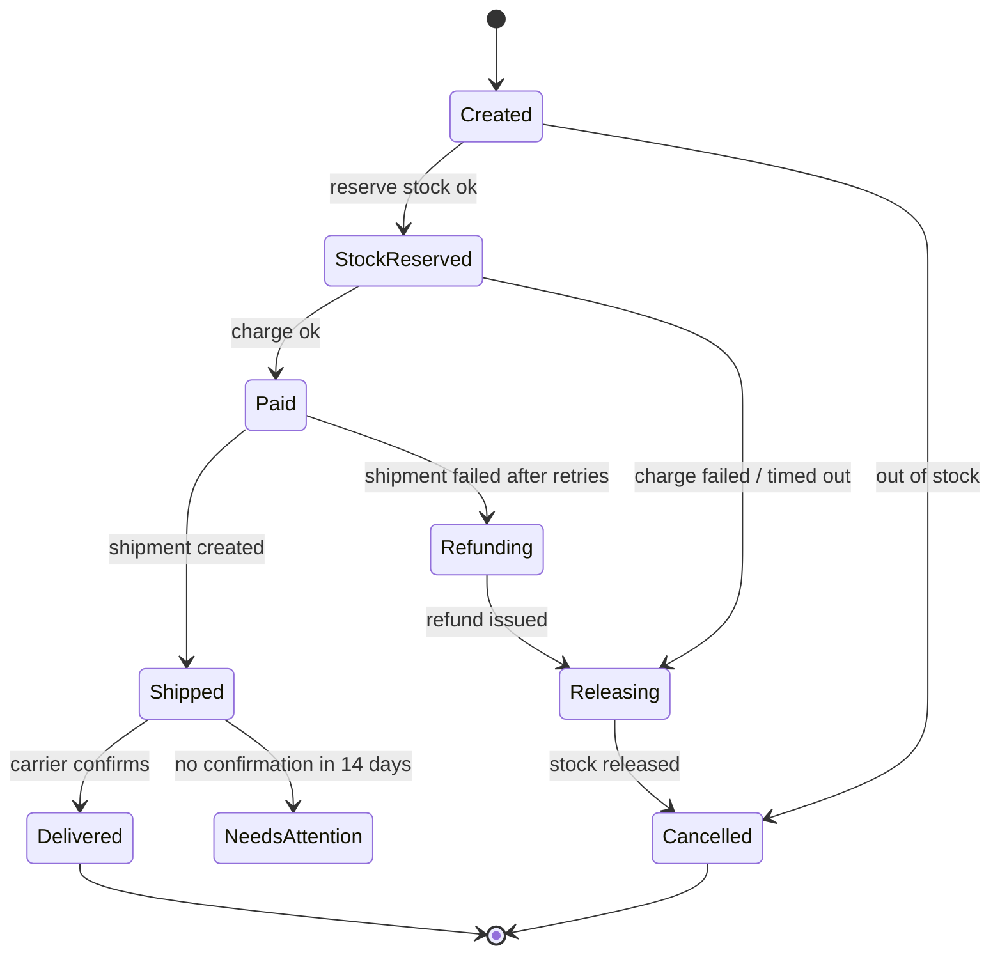
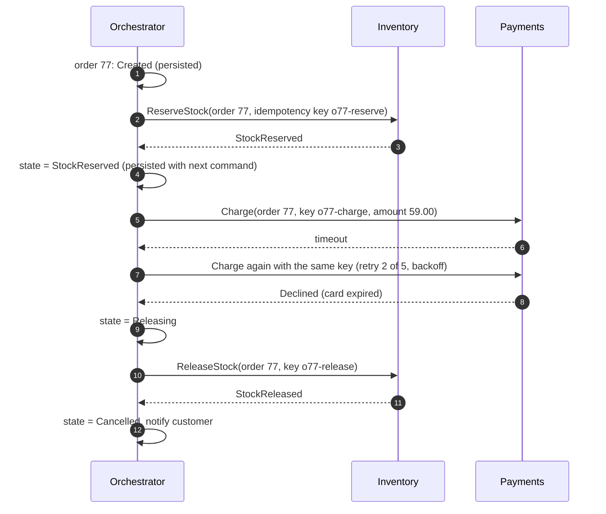

Placing an order, onboarding a customer, processing a loan, publishing a video: real business processes are **sequences of steps across
services and time** — some take milliseconds, some take days, some wait for a human. Any step can fail or time out, and the process must
resume correctly after crashes. This lesson covers how to model such workflows as **state machines**, and when to coordinate them with
events, an orchestrator, or a durable workflow engine.

## The problem

Consider order fulfilment: reserve stock, charge the card, create a shipment, wait for the carrier, notify the customer. In a single
database this could be one transaction; across services it can't ([distributed transactions](lesson:distributed-transactions)). So the
system must:

- **Remember where each order is** — durably, because processes outlive servers.
- **Retry transient failures** without repeating side effects (no double charges).
- **Undo completed steps** when a later step fails (release stock, refund) — **compensation**.
- **Wait** for external events and **time out** when they don't come (the carrier never confirms).
- **Show progress** to users and operators, and let operators fix stuck instances.

## Architecture

Model the process as a **state machine**: explicit states, the events that move between them, and what happens on failure.



Three ways to coordinate the steps:

| Style | How it works | Good for | Watch out for |
|---|---|---|---|
| **Choreography** | Each service reacts to events and emits its own (`StockReserved` → payment charges → `PaymentSucceeded` → ...) | Few steps, loosely coupled teams | The overall flow lives nowhere; hard to see, change and debug |
| **Orchestration** | A coordinator owns the state machine, sends commands, and records each result in its own database | Many steps, compensation, visibility | The orchestrator must be durable and idempotent |
| **Durable workflow engine** | Workflow code runs on an engine (Temporal, AWS Step Functions, Cadence) that persists every step, retries activities and survives crashes | Long-running, complex, timer-heavy processes | A new platform to run and learn; determinism rules |

An orchestrator built in-house typically looks like this:

```mermaid title="An orchestrator with durable state, commands and replies"
flowchart TB
  API["Order API"]:::client --> OR["Order orchestrator<br/>state machine per order"]:::svc
  OR --> WS[("Workflow state + outbox<br/>order_id, state, step, attempts, deadline")]:::db
  WS -->|"outbox relay"| CMD[["Command topics"]]:::queue
  CMD --> INV["Inventory service"]:::svc
  CMD --> PAY["Payment service"]:::svc
  CMD --> SHP["Shipping service"]:::svc
  INV & PAY & SHP -->|"replies / events"| RPL[["Reply topic"]]:::queue
  RPL --> OR
  TM["Timer service<br/>fires deadlines"]:::svc --> OR
```

Every transition is written to the orchestrator's database together with the next command, using an
[outbox](lesson:outbox-cdc) — so a crash never loses a step or sends a command without recording it.

## Request and data flow



The rules that make this safe:

- **Every step is idempotent** with a stable key per step, so retries after timeouts can't double-charge ([idempotent APIs](lesson:idempotent-apis)).
- **Retries with backoff and a limit** per step; transient errors retry, permanent ones (card declined) move straight to compensation
  ([retries and DLQs](lesson:retries-dlq)).
- **Compensations are themselves retried and idempotent** — a refund that fails must be retried until it succeeds or a human steps in.
- **Timeouts are durable timers** stored with the workflow, not `sleep` calls in memory.
- **Unknown outcomes** (the charge timed out) are resolved by retrying with the same key or querying the step's status — never by assuming.

With a durable workflow engine, the same flow is ordinary-looking code: the engine records an **event history** of each activity call and
result; if a worker crashes, another worker **replays** the history to rebuild the workflow's state and continues from the last step.
Workflow code must therefore be deterministic (no random numbers, clocks or direct I/O outside activities), and changes to running
workflows need versioning.

## Advantages

- **Correctness across services** without distributed transactions: forward progress or explicit compensation.
- **Visibility**: each instance has a state, history and current step; stuck instances are queryable.
- **Resilience**: crashes, deploys and network failures delay a workflow; they don't corrupt it.
- **Long waits are cheap**: a workflow waiting three days for approval is a row (or engine record), not a blocked thread.

## Disadvantages

- **Eventual consistency**: between steps, the system is in intermediate states that users and other services may observe.
- **Compensation isn't always possible** (an email sent can't be unsent) — such steps go last or need business-level apologies.
- **Complexity**: idempotency keys, timers, retries and versioning everywhere.
- **Platform cost** for workflow engines: another stateful system, and constraints on how workflow code is written.

## Failure scenarios

| Failure | What happens | Mitigation |
|---|---|---|
| Orchestrator crashes mid-step | Step's command may or may not have been sent | Outbox: state and command commit together; idempotent receivers |
| Step times out but actually succeeded | Retry would repeat it | Same idempotency key; or query status before retrying |
| Compensation fails | Inconsistent state (charged but cancelled) | Retry compensations indefinitely with alerts; manual queue |
| Reply never arrives | Workflow stuck | Durable deadline per state; escalate to NeedsAttention |
| Workflow definition changes | Running instances break | Version workflows; let old instances finish on old logic |
| Poison step keeps failing | Endless retries | Retry limit, then dead-letter and alert |

## Alternatives

- **One database transaction**: if all steps touch one database, use it — far simpler ([transactions](lesson:transactions)).
- **Two-phase commit**: atomic across resources that support it, but blocking and rarely available across services.
- **Batch reconciliation**: run steps independently and fix inconsistencies in periodic jobs, when delays are acceptable.
- **Choreography only**: for two or three steps with simple failure handling, events alone may be enough.

## Where it shows up in interviews

Payment and checkout flows, food and parcel delivery lifecycles, video upload and processing pipelines, account onboarding with
verification, travel bookings across providers, and notification campaigns. Draw the state machine first, mark which steps need
compensation, then say whether an orchestrator or workflow engine runs it and how idempotency and timeouts work.

````question title="Choreography or orchestration for an order process with six steps?"
Orchestration. With six steps and compensation, the flow needs a single owner: one place that records each order's state, decides the next
step, applies timeouts and runs compensations in the right order, and that operators can query when something is stuck. Choreography spreads
that logic across services' event handlers, making the end-to-end flow hard to see and change. Services still communicate asynchronously —
the orchestrator sends commands and consumes replies through queues.
````

````question title="The payment step timed out. Did the customer get charged? What does the workflow do?"
The outcome is unknown, so the workflow must not guess. It retries the charge with the same idempotency key — the payment service returns
the original result if the first attempt succeeded, or performs it once if it didn't. Alternatively it queries the payment's status by that
key. Only a definite failure moves the workflow to compensation; a definite success moves it forward.
````

## Common mistakes

- **Implicit state** spread across services' tables, with no single place to see a process's progress.
- **Retrying non-idempotent steps** after timeouts.
- **In-memory timers** that vanish on restart.
- **No compensation path**, or compensations that aren't retried.
- **Assuming a timeout means failure.**
- **Irreversible steps early** in the flow (send the confirmation email last).

## Key takeaways

- Model multi-step processes as **explicit state machines** persisted durably.
- **Choreography** for simple flows; **orchestration** or a **durable workflow engine** for many steps, compensation and long waits.
- Make **every step and compensation idempotent**; use **durable timers** and **retry limits**.
- Treat **unknown outcomes** as unknown: retry with the same key or query, never assume.

## Knowledge check

```quiz
? An orchestrator updates its state to PaymentRequested and then publishes a Charge command in a separate step. It crashes between them. What happens?
- The payment service charges anyway
! It never received the command.
+ The workflow is stuck in PaymentRequested with no command sent; an outbox (state + command in one transaction) prevents this
- The database rolls back the state change
! It was committed.
- Kafka retries the command automatically
! The command was never published.
> Commit state and outgoing commands together.

? Which step should come last in a workflow when possible?
- Reserving inventory
! Reversible by releasing it.
- Charging a card
! Reversible by refunding.
+ Sending the customer a confirmation email
- Writing an audit record
! Not customer-visible and cheap to correct.
> Irreversible side effects go last.

? A workflow must wait up to 3 days for a manager's approval. What is the right mechanism?
- A worker thread sleeping for 3 days
! Lost on restart, and wastes a thread.
+ A durable timer stored with the workflow, plus an event that resumes it when approval arrives
- Polling the approval table every second
! Wasteful and still needs durable state.
- A 3-day HTTP timeout
! Connections don't last that long.
> Long waits should be data, not threads.

? Why must workflow code in an engine like Temporal be deterministic?
+ The engine rebuilds workflow state by replaying recorded history; non-deterministic code would take a different path on replay
- Determinism makes the code faster
! Speed isn't the reason.
- Activities can't call external services
! Activities can; workflow code shouldn't directly.
- Engines run code on a single thread
! Threading isn't the reason.
> Side effects belong in activities, whose results are recorded.
```
