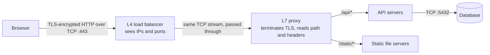
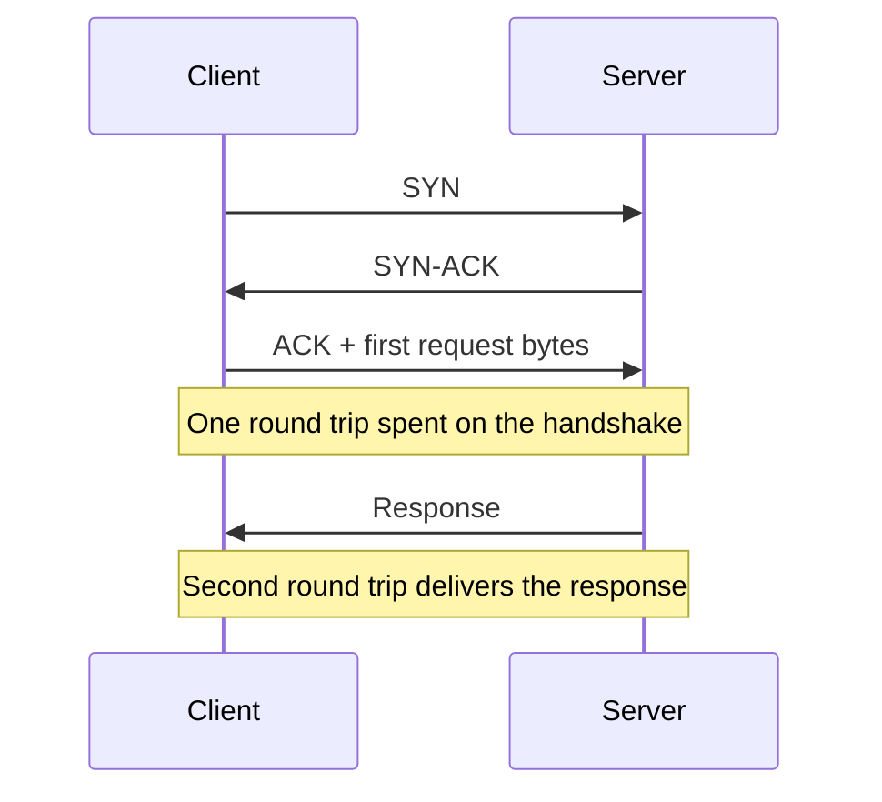

Every arrow you draw in a design is a network conversation, and the protocol under that arrow decides how fast it starts,
what happens when packets go missing, and which boxes can inspect or route it. You don't need to be a network engineer — you need
to know which layer each component works at and what TCP and UDP promise.

## Why it matters

Three interview moments depend on this lesson:

- **Drawing components.** "L4 load balancer" and "L7 load balancer" are different boxes with different abilities. An L4 balancer
  sees IP addresses and ports; an L7 balancer sees URLs, headers and cookies. You can only choose between them if you know what the
  layers are.
- **Explaining latency.** A new connection costs round trips before any data moves. Across an ocean, each round trip is 100–200 ms —
  often more than your server's processing time.
- **Choosing a transport.** Chat, video calls, multiplayer games and DNS make different choices between reliability and timeliness.
  "Why not just use TCP for video?" is a real follow-up question.

## How it works

### The layers you actually use

The OSI model has seven layers; the internet runs on the simpler TCP/IP model. System design conversations use the OSI *numbers*
(especially 4 and 7) to describe TCP/IP components:

| OSI layer | TCP/IP equivalent | Unit | Examples | What a box at this layer can see |
|---|---|---|---|---|
| 7 Application | Application | Message | HTTP, gRPC, DNS, SMTP, WebSocket | URLs, headers, cookies, bodies |
| 6 Presentation | (part of application) | — | TLS encryption, encoding | — |
| 5 Session | (part of application) | — | Connection reuse, session resumption | — |
| 4 Transport | Transport | Segment / datagram | TCP, UDP, QUIC | Source and destination ports |
| 3 Network | Internet | Packet | IP, ICMP | Source and destination IP addresses |
| 2 Data link | Link | Frame | Ethernet, Wi-Fi | MAC addresses |
| 1 Physical | Link | Bits | Fibre, copper, radio | Signals |

The practical rule: **a component can only make decisions using information at its layer or below.** An L4 load balancer can route
by IP and port but can't send `/api/*` and `/images/*` to different pools, because the path is inside the HTTP message — and if TLS
is used, it is encrypted until something terminates TLS.

### TCP: a reliable byte stream

TCP turns an unreliable packet network into an ordered, reliable stream of bytes between two endpoints:

- **Connection setup.** A three-way handshake (SYN, SYN-ACK, ACK) costs **one round trip** before the client can send data.
- **Reliability.** Every byte is acknowledged; lost segments are retransmitted.
- **Ordering.** The receiver delivers bytes in order. If segment 5 is lost, segments 6–10 wait in a buffer until 5 is
  retransmitted — **head-of-line blocking**.
- **Flow control.** The receiver advertises how much it can buffer, so a fast sender can't overwhelm a slow receiver.
- **Congestion control.** The sender starts slowly (*slow start*, with an initial window of about ten segments — roughly 14 KB) and
  speeds up as acknowledgements arrive, backing off when it detects loss. A new connection therefore can't use the full bandwidth
  immediately.

These guarantees are exactly what most applications want — web pages, APIs, database queries, file transfers — which is why HTTP/1.1,
HTTP/2, database protocols and most RPC frameworks run on TCP.

### UDP: datagrams with no promises

UDP sends independent datagrams with an 8-byte header and no handshake, acknowledgements, retransmission, ordering or congestion
control. The application decides what to do about loss. That is a feature when **late data is useless**:

- In a video call, a frame that arrives 300 ms late is worse than a skipped frame.
- In a multiplayer game, the newest position update replaces the old one; retransmitting the old one wastes bandwidth.
- A DNS query fits in one datagram; if the answer doesn't come back, the client simply asks again.

UDP is also the base for protocols that want TCP-like reliability *without* TCP's limitations. **QUIC**, the transport under HTTP/3,
runs over UDP and implements its own reliable, encrypted streams — with independent streams so one lost packet doesn't block the others.

### Ports, sockets and connections

A TCP connection is identified by four values: source IP, source port, destination IP, destination port. A server listening on port 443
can hold many thousands of connections at once because each client connection differs in source IP or port. Connections consume memory
and file descriptors on both ends — which matters for long-lived connections such as WebSockets.

## Architecture

The same HTTPS request seen by components at different layers:



The L4 balancer can spread connections across L7 proxies but can't look inside them. The L7 proxy decrypts TLS, so it can route by path,
add headers and retry failed requests. The database connection is plain TCP inside the private network, often also encrypted.

And the cost of a new TCP connection before the first byte of response:



## Failure scenarios

- **Packet loss on a TCP connection.** Throughput drops sharply (congestion control backs off) and latency spikes while lost segments
  are retransmitted; everything queued behind them waits. On lossy mobile networks this is the dominant cause of slow requests.
- **Half-open connections.** A server crashes or a NAT device forgets a mapping; the other side thinks the connection is alive until it
  tries to send or a keep-alive probe fails. Long-lived connections need application-level heartbeats.
- **Connection exhaustion.** A server runs out of file descriptors or ephemeral ports (common on proxies making many outbound
  connections), and new connections fail even though CPU is idle.
- **UDP loss is silent.** With UDP nothing tells you a datagram was dropped. Applications must detect gaps (sequence numbers) and decide
  whether to recover, interpolate or ignore.
- **Middleboxes.** Some firewalls and corporate networks block or throttle UDP, so UDP-based protocols need a TCP fallback — browsers
  fall back from HTTP/3 to HTTP/2 automatically.

## Trade-offs

| | TCP | UDP | QUIC (over UDP) |
|---|---|---|---|
| Setup cost | 1 RTT handshake (+ TLS) | None | 1 RTT including TLS; 0-RTT on resumption |
| Reliability and order | Built in | None — application decides | Built in, per stream |
| Head-of-line blocking | Yes, across the whole connection | No | Only within a stream |
| Congestion control | Built in | None — application must be careful | Built in |
| Best for | APIs, web, databases, file transfer | Real-time media, games, DNS, telemetry | Modern web (HTTP/3), mobile networks |
| Operational maturity | Universal | Universal, sometimes blocked | Widely deployed, sometimes blocked |

The general rule: **choose TCP (or HTTP on top of it) unless timeliness matters more than completeness.** If you choose UDP, say what the
application does about loss and congestion.

## In real systems

- Web traffic is HTTP over TCP or, increasingly, HTTP/3 over QUIC; major browsers and CDNs support HTTP/3 and fall back to HTTP/2 when UDP
  is blocked.
- Video conferencing uses RTP over UDP for media (via WebRTC in browsers), with jitter buffers and error concealment instead of
  retransmission, and TCP- or TLS-based signalling to set calls up.
- DNS queries use UDP port 53 and switch to TCP for responses too large for a datagram and for zone transfers.
- Cloud load balancers are sold by layer: for example, AWS Network Load Balancer works at layer 4 (TCP/UDP) and Application Load
  Balancer at layer 7 (HTTP).

## Common mistakes

- **Saying "UDP is faster" without qualification.** It avoids the handshake and retransmission delays, but you then own loss, ordering
  and congestion. For request/response APIs TCP is the right default.
- **Routing by URL at L4.** Paths and headers are invisible below layer 7 — and invisible to anyone until TLS is terminated.
- **Ignoring connection setup across regions.** Three round trips at 150 ms each is almost half a second before your server does anything.
- **Treating long-lived connections as free.** Each holds memory and a file descriptor, and needs heartbeats to detect silent failures.

## In the interview

````question title="When would you choose UDP over TCP?"
When fresh data matters more than complete data, and the application can tolerate or repair loss itself. Real-time voice and video drop
late frames rather than wait for retransmissions; multiplayer games send frequent state updates where the newest replaces the old; DNS
fits a query in one datagram and simply retries. For anything that must arrive completely and in order — API calls, payments, file
transfers — TCP is the right default. I'd also mention QUIC: it runs over UDP but provides reliable, encrypted, independently ordered
streams, which is why HTTP/3 uses it.
````

````question title="What is the difference between an L4 and an L7 load balancer?"
An L4 load balancer works with transport-level information — IP addresses and ports — and forwards TCP or UDP connections without
understanding their contents. It is fast, protocol-agnostic and can pass TLS through untouched. An L7 load balancer understands the
application protocol, usually HTTP: it terminates TLS, reads paths, headers and cookies, and can route by URL, retry failed requests,
add headers and enforce policies. The trade-off is more CPU per request and that it must hold certificates. Many architectures use
both: L4 at the very edge for raw scale, L7 behind it for smart routing.
````

````question title="What is head-of-line blocking, and where does it show up?"
It is when one delayed item holds up everything queued behind it. In TCP, a lost segment stops delivery of all later bytes on that
connection until it is retransmitted. In HTTP/1.1, one slow response blocks later requests on the same connection. HTTP/2 fixed the
HTTP-level problem by multiplexing streams over one TCP connection, but a single lost packet still stalls all streams because TCP
delivers bytes in order. HTTP/3 over QUIC removes that by giving each stream its own ordering.
````

## Key takeaways

- Components act on the information at their layer: **L4 sees IPs and ports, L7 sees URLs, headers and bodies.**
- **TCP** gives a reliable, ordered, congestion-controlled stream at the cost of a handshake round trip and head-of-line blocking.
- **UDP** gives raw datagrams; use it when late data is useless, and own loss and congestion yourself.
- **QUIC** builds reliable, encrypted, independent streams on UDP — the transport under HTTP/3.
- Count **round trips** when latency matters, especially across regions.

## Knowledge check

```quiz
? A load balancer must send requests for `/video/*` to one server pool and everything else to another. Which layer must it work at?
- Layer 3
! Layer 3 sees only IP addresses.
- Layer 4
! Layer 4 sees ports and addresses, not URL paths.
+ Layer 7
- Any layer, as long as TLS is enabled
! TLS hides the path from anything that doesn't terminate it.
> URL paths are part of the HTTP message, so routing by path requires an L7 component that terminates TLS.

? Why does one lost packet slow down every request multiplexed on a single HTTP/2 connection?
- HTTP/2 retries every request after a loss
! HTTP/2 doesn't retry requests on packet loss; TCP retransmits the lost segment.
+ TCP delivers bytes in order, so data behind the lost segment waits for its retransmission
- HTTP/2 uses UDP
! HTTP/2 runs on TCP; HTTP/3 uses QUIC over UDP.
- The server closes the connection on loss
! A single loss is repaired by retransmission, not by closing the connection.
> Transport-level head-of-line blocking is the reason HTTP/3 moved to QUIC.

? A multiplayer game sends each player's position 30 times a second. Which transport choice fits best?
+ UDP with sequence numbers, discarding stale updates
- TCP, so every position update is delivered in order
! Waiting for a retransmitted old position delays newer ones that make it irrelevant.
- HTTP/1.1 polling every second
! One update a second is far too slow and wastes headers and connections.
- SMTP
! SMTP is for email.
> The newest position replaces the old one; retransmitting stale data adds latency without value.

? A client in Sydney opens a new TCP connection (no TLS) to a server in Virginia with a 200 ms round trip. Ignoring DNS and server time, when does the first response byte arrive?
- After about 100 ms
! That is half a round trip — not even the handshake completes.
- After about 200 ms
! The handshake alone takes one round trip; the request needs another.
+ After about 400 ms
- After about 600 ms
! That would include a TLS 1.3 handshake, which this connection doesn't use.
> One round trip for SYN/SYN-ACK, one for the request and response: 2 × 200 ms.
```
