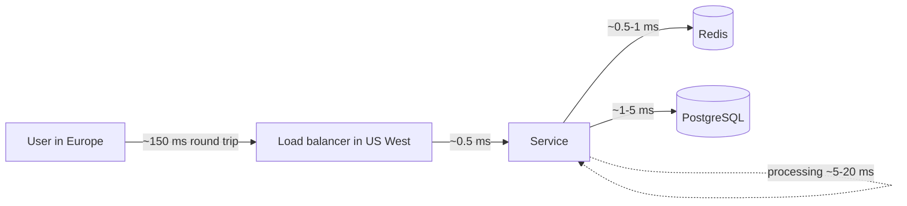

Estimates need anchors: how long a memory read, a disk read or a cross-continent round trip takes, and roughly what one server,
one database or one cache node can handle. You don't need exact figures — they vary with hardware and workload — but you need the right
**order of magnitude**, because that is what decides whether one machine is enough.

## The question it answers

"Is this fast enough?" and "Is one of these enough?" Both need reference numbers:

- **Latency anchors** tell you where time goes in a request, and which hops dominate: a network round trip across a continent costs as much
  as a million memory reads.
- **Throughput anchors** tell you when a component needs company: one Redis node versus a cluster, one PostgreSQL primary versus shards.
- **Size and conversion anchors** let you do the arithmetic quickly: seconds per day, bytes per kilobyte, bytes per photo.

## Formula

### The latency ladder

Each step is roughly ten to a thousand times slower than the one above it. These are the same figures as on the
[estimator page](#system-design/hld/estimator), extended:

| Operation | Typical latency | Relative to a memory read |
|---|---|---|
| L1 cache reference | ~1 ns | 1/100 |
| Main memory reference | ~100 ns | 1 |
| Read 1 MB sequentially from memory | ~50 µs | 500 |
| Random read from an NVMe SSD | ~0.1 ms (100 µs) | 1,000 |
| Round trip within a datacenter or availability zone | ~0.5 ms | 5,000 |
| Read 1 MB sequentially from SSD | ~0.5 ms | 5,000 |
| Redis `GET` over the network, same zone | ~0.5–1 ms | 5,000–10,000 |
| Indexed primary-key lookup in PostgreSQL (warm cache) | ~1–5 ms | 10,000–50,000 |
| Round trip between US coasts | ~70 ms | 700,000 |
| Round trip Europe ↔ US West | ~150 ms | 1,500,000 |

Three lessons hide in this table:

1. **Memory is fast, the network is slow.** Anything in a local cache is effectively free next to any network hop.
2. **Round trips dominate.** A request that makes ten sequential calls to a service 0.5 ms away spends 5 ms just travelling; five sequential
   calls across the Atlantic spend most of a second. Parallelise calls, batch them, or move data closer.
3. **SSDs changed disk maths.** A random SSD read (~100 µs) is fast enough that a database with data on SSD and hot pages in memory serves
   indexed lookups in a few milliseconds.

### What one machine can handle (orders of magnitude)

| Component | Rough capacity of one node | What changes it |
|---|---|---|
| Stateless application server | ~1,000–10,000 requests/s | Work per request: JSON parsing, crypto, downstream calls |
| PostgreSQL / MySQL primary | ~10,000s of simple indexed reads/s; ~1,000s–10,000s of small writes/s; a few TB comfortably | Indexes, transaction size, disk, how much fits in memory |
| Redis (single node) | ~100,000+ simple operations/s; tens to hundreds of GB of memory | Command complexity, value size, pipelining |
| Kafka broker | ~100s of MB/s of writes | Message size, replication, disks |
| Network interface | ~10–25 Gbit/s (~1–3 GB/s) on common cloud instances | Instance type |
| NVMe SSD | ~100,000s of random IOPS; GB/s sequential | Device, queue depth |

Treat these as **starting points for estimates, not benchmarks**. In an interview, say "a few thousand requests per second per server" and
move on; if a design depends on the exact number, say you'd measure it.

### Sizes and conversions

| Quantity | Value |
|---|---|
| Seconds per day | 86,400 ≈ 10⁵ |
| Seconds per month | ~2.6 × 10⁶ |
| Seconds per year | ~3.15 × 10⁷ |
| 1 million per day | ≈ 12 per second |
| 1 billion per day | ≈ 12,000 per second |
| 2¹⁰ / 2²⁰ / 2³⁰ / 2⁴⁰ / 2⁵⁰ bytes | ≈ 1 KB / 1 MB / 1 GB / 1 TB / 1 PB (each ≈ 10³ more) |
| 1 KB × 1 billion | 1 TB |
| 1 MB × 1 million | 1 TB |
| 8 bits per byte | 1 Gbit/s ≈ 125 MB/s |

Typical object sizes:

| Thing | Rough size |
|---|---|
| A numeric ID or timestamp | 8 bytes |
| A UUID | 16 bytes (36 as text) |
| A short text post with metadata | ~0.5–1 KB |
| A typical JSON API response | ~1–10 KB |
| A compressed photo | ~200 KB–2 MB |
| One minute of audio at 128 kbit/s | ~1 MB |
| One minute of 1080p video at ~5 Mbit/s | ~40 MB |

## Worked example

**How long does it take to move 1 GB?**

- From memory, sequentially: 1,000 MB × 50 µs ≈ **50 ms**.
- From an NVMe SSD, sequentially: 1,000 × 0.5 ms ≈ **0.5 s**.
- Over a 10 Gbit/s network link (~1.25 GB/s): ≈ **0.8 s**; over 1 Gbit/s (~125 MB/s): ≈ **8 s**.

So copying a 1 GB cache snapshot between machines is a matter of seconds; rebuilding a 1 TB index over 1 Gbit/s takes over two hours —
which is why replica rebuilds and backups need planning.

**Is a cross-region call acceptable on the request path?** A checkout page in Europe that calls a fraud service in US West
sequentially, three times, spends 3 × 150 ms = 450 ms on round trips alone — before either side does any work. The design should run that
service in the user's region, call it once, or call it asynchronously.

**How many Redis nodes?** 300,000 cache reads per second at peak, at roughly 100,000 simple operations per second per node: about **3–4
nodes**, plus replicas. Not one, and not fifty.



## Try it

A service with 1 billion requests a day, mostly reads, 2 KB responses. Change `serverRps` to see how sensitive the server count is to
per-server capacity:

```estimator title="One billion requests a day"
requestsPerDay = 1B
readsPerWrite = 20
writeBytes = 1 KB
readBytes = 2 KB
retentionYears = 3
peakFactor = 3
replication = 3
cachePercent = 10
serverRps = 2000
targetUtilization = 60
```

```drill
? How long does it take to transfer 500 GB over a 1 Gbit/s link (ignore overhead)?
= 4000 s
~ 1.3
> 1 Gbit/s ≈ 125 MB/s; 500,000 MB ÷ 125 MB/s = 4,000 s ≈ 67 minutes.

? A request makes 4 sequential calls to a service with a 70 ms round trip. How much time is spent on round trips alone?
= 280 ms
~ 1.2
> 4 × 70 ms = 280 ms — make the calls in parallel or move the service closer.

? A cache must serve 450,000 reads per second and one node handles about 100,000 simple operations per second. How many primary nodes do you need at minimum?
= 5
~ 1.25
> 450,000 ÷ 100,000 = 4.5 → 5 nodes, before adding replicas and headroom.
```

## How it changes the design

| Anchor | Typical design consequence |
|---|---|
| Network round trips ≫ memory reads | Cache in-process for the hottest data; batch and parallelise calls; avoid chatty protocols |
| Cross-region round trips of 70–150 ms | Keep the request path within one region; replicate data to users' regions |
| One app server ≈ thousands of requests/s | Tens of thousands of requests/s → tens of servers behind a load balancer, not thousands |
| One relational primary ≈ thousands of writes/s | Beyond that, batch, queue or partition writes |
| One Redis node ≈ 100K ops/s and its RAM | Above that, a Redis cluster partitioned by key |
| A NIC ≈ 10 Gbit/s | Media egress in tens of Gbit/s → a CDN, not a bigger server |

## Common mistakes

- **Confusing bits and bytes.** Network speeds are in bits; storage in bytes. 1 Gbit/s is 125 MB/s, not 1 GB/s.
- **Mixing milliseconds and microseconds** — off by 1,000.
- **Quoting benchmarks as facts.** "Redis does 1 million ops/s" is true with pipelining on fast hardware, not for a typical workload.
- **Ignoring round trips.** Adding up server processing times and forgetting the network between them.
- **Assuming one server per thousand users.** Capacity is per request rate, not per user count.

## Key takeaways

- Memory ~100 ns, SSD read ~100 µs, same-zone round trip ~0.5 ms, cross-continent round trip ~70–150 ms.
- Rough capacities: **app server 1K–10K req/s, relational primary thousands of writes/s, Redis ~100K ops/s per node, NIC ~10 Gbit/s**.
- **86,400 s/day ≈ 10⁵**; 1M/day ≈ 12/s; 1 KB × 1B = 1 TB; **1 Gbit/s ≈ 125 MB/s**.
- Use anchors for **orders of magnitude** and say you'd measure anything the design depends on precisely.

## Knowledge check

```quiz
? Which is closest to the latency of a round trip between Europe and the US West Coast?
- 1.5 ms
! That's within a city or datacenter range.
- 15 ms
! That is roughly a regional round trip, not intercontinental.
+ 150 ms
- 1.5 s
! Far too slow for a normal network path.
> Intercontinental round trips are tens to a couple of hundred milliseconds — physics, not hardware.

? A link is rated at 1 Gbit/s. How long does a 1 GB file take to transfer, ignoring overhead?
- About 1 second
! That confuses bits with bytes.
+ About 8 seconds
- About 125 seconds
! That divides by 8 the wrong way.
- About 0.125 seconds
! That would be the time for 125 Mbit — about 16 MB — not 1 GB.
> 1 Gbit/s ≈ 125 MB/s, so 1,000 MB takes about 8 s.

? Your design needs 40,000 simple writes per second sustained to one relational database. What does the anchor suggest?
- One primary handles it easily with no special design
! Tens of thousands of writes/s is at or beyond what one primary sustains comfortably.
+ It's beyond a comfortable single primary — batch writes, queue them, or partition the data
- Add read replicas
! Replicas add read capacity, not write capacity.
- Use a CDN
! CDNs serve reads of cacheable content.
> Thousands of writes/s per primary is the anchor; tens of thousands calls for a different write path.

? Why is an in-process cache sometimes worth adding even when Redis exists?
+ A memory read takes ~100 ns while a Redis round trip takes ~0.5–1 ms, so the hottest keys skip the network entirely
- Redis can't store small values
! Redis stores small values very efficiently.
- In-process caches are always consistent
! They can be stale; that's their main cost.
- Redis is slower than PostgreSQL
! Redis is typically faster than a database lookup.
> Network hops dominate when the work itself is tiny.
```
