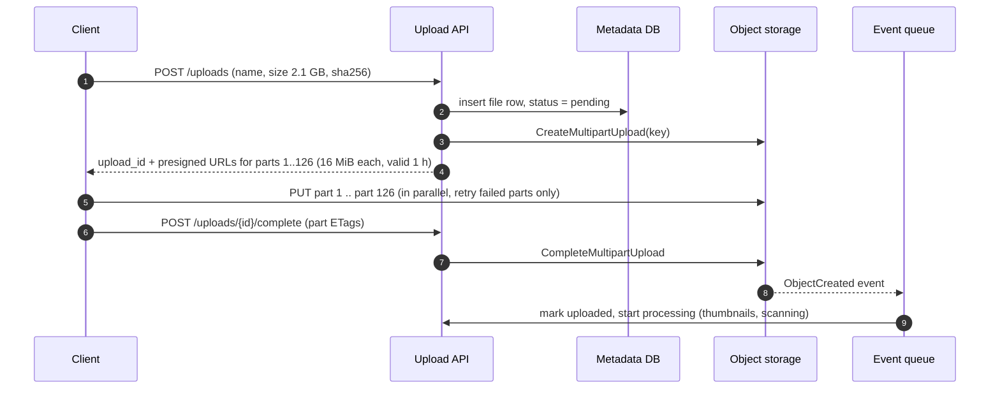

Object storage — Amazon S3, Google Cloud Storage, Azure Blob Storage, and self-hosted MinIO or Ceph — is where large binary data
lives: photos, videos, documents, backups, logs, data-lake files. It is cheap, effectively unlimited and extremely durable, but it is not a
file system or a database. Designs that use it well keep **blobs in object storage, metadata in a database**, and let clients move bytes
**directly** to and from storage.

## What it is for

- **User content**: images, video, audio, attachments, documents — anything too big for database rows
  ([storage estimation](lesson:storage-estimation)).
- **Static assets and media delivery** behind a CDN ([CDN](lesson:cdn)).
- **Backups, archives and exports** with lifecycle rules into cold storage classes.
- **Data lakes and logs**: Parquet and compressed log files read by analytics engines.
- **Durable hand-off between systems**: write a file, emit an event, let downstream jobs process it.

## Data model

- **Buckets** contain **objects** addressed by a **key** (`users/42/avatars/2026-11-07-a9f3.jpg`). The namespace is flat: slashes are
  just characters, and "folders" are **prefixes** used for listing and request scaling.
- An object is **bytes plus metadata** (content type, cache headers, custom key-value pairs, checksums) and optionally a **version ID**.
- Objects are **immutable as a whole**: you replace an object, you don't update bytes in the middle of it. Readers can fetch **byte
  ranges**, which is how video players seek and how large downloads parallelise.
- **Consistency**: S3 provides strong read-after-write consistency for all operations (since December 2020) — after a successful `PUT`,
  every read and list sees the new object. **Conditional writes** (`If-None-Match: *` to create only if absent, `If-Match` on an ETag)
  let clients avoid overwriting each other.

The application keeps everything else — ownership, names, folders, sharing, processing status — in its own database:

```sql title="Metadata in the database, bytes in object storage"
CREATE TABLE stored_files (
  file_id      uuid PRIMARY KEY,
  owner_id     bigint      NOT NULL,
  object_key   text        NOT NULL UNIQUE,     -- e.g. 'u/42/2026/11/9b1d...'
  size_bytes   bigint,
  sha256       text,
  content_type text        NOT NULL,
  status       text        NOT NULL DEFAULT 'pending'
               CHECK (status IN ('pending', 'uploaded', 'processed', 'deleted')),
  created_at   timestamptz NOT NULL DEFAULT now()
);
CREATE INDEX ON stored_files (owner_id, created_at DESC);
```

## How it works inside

Providers don't publish every detail, but the architecture is well understood: **front-end servers** authenticate and route requests; a
strongly consistent **metadata (index) layer** maps each key to where its data lives; **storage nodes** hold the data, typically split into
chunks and **erasure-coded** across several availability zones. Erasure coding (for example, 10 data fragments plus 4 parity fragments,
any 10 of which rebuild the object) gives very high durability at far less overhead than three full copies. Background processes
continuously verify checksums and repair lost fragments. S3 Standard is designed for 99.999999999% (eleven nines) durability.

### Direct uploads with presigned URLs

Pushing gigabytes through your application servers wastes their bandwidth and memory. Instead, the server **authorises** an upload and the
client sends bytes **straight to storage**:



- A **presigned URL** embeds a signature for one operation on one key with an expiry (up to 7 days with long-term credentials; keep it
  short). Anyone holding it can perform exactly that operation — so scope it tightly.
- **Multipart upload** splits an object into 1 to 10,000 parts of 5 MiB to 5 GiB (the last part can be smaller), uploaded in parallel and
  retried individually; objects can reach 48.8 TiB. AWS suggests multipart once objects reach about 100 MB. Configure a lifecycle rule to
  abort incomplete uploads, or abandoned parts accumulate (and are billed).
- **Event notifications** (to SQS, SNS, Lambda or EventBridge) trigger processing once the object exists
  ([long-running jobs](lesson:long-running-jobs)).

### Downloads and delivery

Private objects are served through **presigned GET URLs** or, at scale, a **CDN** with signed URLs or cookies; the CDN caches popular
objects at the edge, and origin access control keeps the bucket itself private ([large blobs](lesson:large-blobs)).

## Strengths and weaknesses

| Strengths | Weaknesses |
|---|---|
| Effectively unlimited capacity, pay per GB stored | First-byte latency of roughly 100–200 ms for small objects; not for hot small records |
| Eleven-nines durability by design; multi-AZ by default | No partial updates or appends to an object (rewrite it) |
| Strong read-after-write consistency, conditional writes | Listing is by prefix and paginated; not a query engine |
| Direct client transfers via presigned URLs and multipart | Per-request costs make millions of tiny objects expensive |
| Storage classes and lifecycle rules for cost control | Egress charges for data served out (a CDN reduces them) |

## Scaling characteristics

- **Request rates scale per prefix**: S3 supports at least 3,500 writes and 5,500 reads per second **per partitioned prefix**, with no limit
  on the number of prefixes. Spread hot keys over many prefixes (for example by a hash or ID in the key), and expect brief `503 Slow Down`
  responses while S3 scales up.
- **Throughput scales with parallelism**: parallel multipart uploads and parallel byte-range GETs saturate client network links.
- **Small objects**: batch them (logs into hourly files, thumbnails into packed archives) when per-request overhead dominates.
- **Cost tiers**: frequently accessed data in Standard; infrequent in Infrequent Access or Intelligent-Tiering; archives in Glacier classes,
  with retrieval delays from milliseconds to hours depending on class.

## When to use it

- Any blob larger than a few kilobytes that is **written once and read many times**, or archived.
- Bulk data that analytics engines scan (Parquet in a data lake).
- **Not** for small, frequently updated records (use a database or cache), or workloads needing POSIX file semantics with in-place
  edits (use a file system or block storage).

## Alternatives

| Alternative | Prefer it when |
|---|---|
| Google Cloud Storage / Azure Blob Storage | You're on those clouds; same model |
| Cloudflare R2 | Heavy public egress where egress fees dominate cost |
| MinIO / Ceph | Self-hosted or on-premises S3-compatible storage |
| Database BLOB columns | Tiny files (a few KB) that must be transactional with their rows |
| Network file systems (EFS, Filestore) | Applications need shared POSIX files with in-place updates |
| HDFS | Existing Hadoop clusters with data-local compute |

## Interview trade-offs

- **Blob vs metadata**: bytes in object storage, searchable metadata and permissions in a database — and a plan for keeping them in sync
  (pending rows, events on upload, cleanup of orphans).
- **Through-the-server vs direct upload**: direct presigned uploads scale and cost less; the server keeps control by issuing scoped,
  short-lived URLs and validating on completion.
- **Latency vs cost**: put a CDN or cache in front of hot objects; use cold storage classes for archives with acceptable retrieval delays.
- **Key design**: avoid all writes going to one prefix; include IDs or hashes early in keys.

## Key takeaways

- Object storage = **buckets, keys, immutable objects with metadata**, strong read-after-write consistency, erasure-coded durability.
- Keep **metadata in a database** and **bytes in object storage**; link them with keys and status.
- Upload and download **directly** with **presigned URLs**; use **multipart** for large files (up to 10,000 parts of 5 MiB–5 GiB).
- Scale by **spreading prefixes** and **parallelising**; deliver with a **CDN**; control cost with **storage classes and lifecycle rules**.

## Knowledge check

```quiz
? Users upload 2 GB videos through the API servers, which then write to S3. Servers run out of memory and bandwidth. What is the standard fix?
- Bigger API servers
! It moves the bottleneck without removing it.
+ Issue presigned multipart upload URLs so clients send parts directly to object storage, then confirm completion with the API
- Store videos in the database
! Large blobs bloat the database and its backups.
- Compress videos on the API servers
! Bytes still flow through the servers.
> The API authorises; storage receives the bytes.

? A 3 GB upload over a mobile network keeps failing near the end. What helps most?
+ Multipart upload: parts are uploaded independently and only failed parts are retried
- A longer presigned URL expiry alone
! Expiry doesn't help a failed transfer resume.
- Uploading with a single PUT
! One failure restarts the whole upload.
- Strong consistency
! S3 already provides it.
> Parts of 5 MiB to 5 GiB, up to 10,000 per upload.

? A service writes all new objects under the prefix `uploads/` and starts seeing 503 Slow Down errors at peak. What should change?
- Retry immediately in a tight loop
! That adds load.
+ Spread keys across many prefixes (for example a hash or ID early in the key) and retry with backoff while S3 scales
- Switch to eventual consistency
! S3 has no such mode; it isn't the cause.
- Use larger objects only
! Not always possible; the issue is request rate per prefix.
> Request rates scale per prefix.

? Why store file metadata (owner, name, sharing, status) in a database instead of only as object metadata?
- Object metadata can't hold strings
! It can hold key-value strings.
+ The application must query, filter, join and update it transactionally; object storage only lists by prefix
- Object metadata is not durable
! It's as durable as the object.
- Databases are cheaper per GB than object storage
! The opposite is true.
> Object storage is not a query engine.
```
