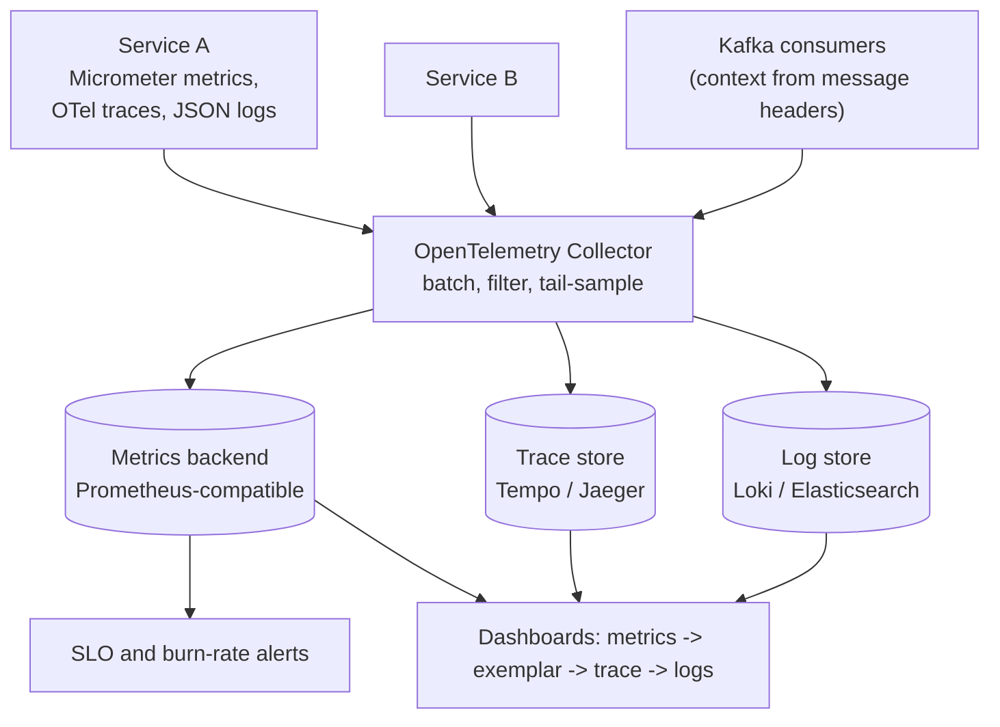
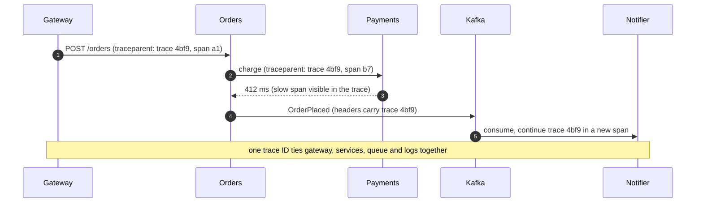

When a request is slow in a system of thirty services, you need to answer three questions fast: **is something wrong** (metrics), **what
exactly happened** (logs), and **where did the time go** (traces). Observability is designing services so those answers are available
without shipping new code during an incident. In interviews it shows up as the "monitoring" section of every design — and as follow-ups
like "how would you know?"

## Why it matters

- You can't meet an SLO you can't measure ([SLOs and error budgets](lesson:slos-error-budgets)).
- Distributed systems fail partially: one shard, one region, one dependency, one customer. Aggregate dashboards hide these unless the
  signals can be sliced.
- The time to detect and diagnose an incident is most of the time to recover — and recovery time drives availability
  ([availability math](lesson:availability-math)).
- Observability costs real money (storage, ingestion, cardinality); a design that ignores this quietly becomes a cost incident.

## How it works

### Three signals, three jobs

| Signal | What it is | Best for | Weakness |
|---|---|---|---|
| **Metrics** | Numeric time series, aggregated (counters, gauges, histograms) | Alerting, dashboards, trends, SLOs | Little detail; cost grows with label combinations |
| **Logs** | Discrete, timestamped events with context | Exact details of a failure, audits | Volume and cost; hard to aggregate without structure |
| **Traces** | The path of one request across services, as a tree of timed spans | Where latency goes; which dependency failed | Sampling means you don't keep every request |

They work best **linked**: logs carry the trace ID, metrics carry exemplars pointing to example traces, and a dashboard spike leads to the
traces and logs that explain it.

### What to measure

- **RED** for request-driven services: **R**ate, **E**rrors, **D**uration (as a histogram, so you can compute percentiles).
- **USE** for resources: **U**tilisation, **S**aturation (queue length, waiting), **E**rrors — CPU, memory, disks, connection pools,
  thread pools.
- **The four golden signals** (Google SRE): latency, traffic, errors, saturation — the same idea.
- **Business signals**: orders per minute, sign-ups, payments succeeded — often the fastest way to notice that something is broken.

### Cardinality

Each unique combination of a metric's labels is a separate time series. Labels must have **bounded** value sets:

```drill
? A request metric has labels endpoint (40 values), status (6) and region (4). How many time series can it create?
= 960
~ 1.01
> 40 × 6 × 4 = 960 series — fine.

? Someone adds a user_id label with 2 million active users. Roughly how many series could the same metric create?
= 1.92B
~ 1.1
> 960 × 2,000,000 ≈ 1.9 billion series — enough to overwhelm most metrics backends. User IDs belong in logs and traces.
```

### Logs that help

Write **structured** logs (JSON with fields: timestamp, level, service, trace_id, user or tenant ID, error code), log **events** that
matter (failures, retries, state changes) rather than every function call, and sample high-volume success logs. Ship them asynchronously so
logging never blocks requests ([logging system](problem:logging-system)).

### Tracing and context propagation

A trace starts at the edge; each service creates **spans** for its work and calls, and passes the trace context to the next hop — in HTTP
with the W3C `traceparent` header, in messages as Kafka/queue headers, so asynchronous work joins the same trace. **OpenTelemetry**
provides the vendor-neutral API, SDKs, auto-instrumentation and a **collector** that receives, processes and exports all three signals.

**Sampling** controls cost: **head sampling** decides at the start (keep 1% of traces); **tail sampling** decides after the trace
completes, so you can keep every slow or failed trace and only a fraction of the boring ones.

## Architecture





## Failure scenarios

- **Cardinality explosion**: an unbounded label (user ID, request ID, full URL) multiplies series until the metrics system slows down or
  costs explode. Normalise URLs to route templates; put IDs on spans and logs.
- **Broken context propagation**: traces stop at the first queue or thread pool, so asynchronous work looks disconnected.
- **Logging as the bottleneck**: synchronous logging to a slow disk or remote endpoint adds latency to every request.
- **Sampling away the evidence**: 1% head sampling drops 99% of the rare failing requests; tail sampling keeps them.
- **Telemetry depends on the thing that's broken**: if the monitoring stack shares the failing cluster or region, it goes dark during the
  incident. Monitor the monitoring from somewhere independent.
- **Averages and missing histograms**: without latency histograms there are no percentiles, and averages hide the tail.

## Trade-offs

| Choice | Gain | Cost |
|---|---|---|
| More metric labels | Finer slicing | Series count and cost multiply |
| Logging every request | Complete record | Storage and ingestion cost; noise |
| Head sampling | Simple, cheap | Misses rare failures |
| Tail sampling | Keeps interesting traces | Collector must buffer whole traces |
| Vendor SaaS | Little to operate | Cost grows with volume; lock-in (mitigated by OpenTelemetry) |
| Self-hosted stack | Control, cost at scale | Operational work |

## In real systems

- Google's **Dapper** paper (2010) described large-scale distributed tracing and inspired Zipkin and Jaeger; **OpenTelemetry** (a CNCF
  project formed by merging OpenTracing and OpenCensus) is now the common standard.
- **Prometheus** popularised pull-based metrics with labels and PromQL; Micrometer is the metrics facade in Spring Boot, exporting to
  Prometheus, OTLP and many vendors.
- Spring Boot's Actuator and Micrometer Observation API instrument HTTP servers, clients, JDBC and messaging automatically, and put the
  current trace ID into log lines.

## Java and Spring Boot example

A checkout method recording a RED-style timer with **bounded** tags through Micrometer, and a span with the high-cardinality details
through the OpenTelemetry API. Spring Boot auto-configures both the `MeterRegistry` and the `OpenTelemetry` bean. (Compiled against
Micrometer 1.17 and the OpenTelemetry API 1.68.)

```java file="CheckoutService.java"
import io.micrometer.core.instrument.MeterRegistry;
import io.micrometer.core.instrument.Timer;
import io.opentelemetry.api.OpenTelemetry;
import io.opentelemetry.api.trace.Span;
import io.opentelemetry.api.trace.StatusCode;
import io.opentelemetry.api.trace.Tracer;
import io.opentelemetry.context.Scope;
import org.springframework.stereotype.Service;

// RED metrics with low-cardinality tags (Micrometer) plus a span for the details (OpenTelemetry).
@Service
public class CheckoutService {

    private final MeterRegistry registry;
    private final Tracer tracer;

    public CheckoutService(MeterRegistry registry, OpenTelemetry openTelemetry) {
        this.registry = registry;
        this.tracer = openTelemetry.getTracer("checkout");
    }

    public Receipt checkout(Cart cart) {
        Timer.Sample sample = Timer.start(registry);
        Span span = tracer.spanBuilder("checkout").startSpan();
        span.setAttribute("user.id", cart.userId());     // high-cardinality: span, not metric
        span.setAttribute("cart.items", cart.items());
        String outcome = "error";
        try (Scope ignored = span.makeCurrent()) {       // child spans and logs inherit it
            Receipt receipt = reserveAndCharge(cart);
            outcome = "success";
            return receipt;
        } catch (RuntimeException e) {
            span.recordException(e);
            span.setStatus(StatusCode.ERROR);
            throw e;
        } finally {
            span.end();
            sample.stop(Timer.builder("checkout.duration")
                    .tag("outcome", outcome)                      // 2 values
                    .tag("payment_method", cart.paymentMethod())  // a handful of values
                    .publishPercentileHistogram()                 // enables p99 in the backend
                    .register(registry));
        }
    }

    private Receipt reserveAndCharge(Cart cart) {
        return new Receipt("o-" + Math.abs(cart.userId().hashCode()));
    }

    public record Cart(String userId, int items, String paymentMethod) { }

    public record Receipt(String orderId) { }
}
```

The timer yields request rate, error rate (by `outcome`) and latency percentiles per payment method — a few dozen series. The user ID lives
only on the span, where one value per request costs nothing in the metrics backend.

## Common mistakes

- **High-cardinality labels** on metrics (user IDs, request IDs, raw paths).
- **Unstructured logs** without trace IDs.
- **No latency histograms**, only averages.
- **Alerting on every cause** instead of on symptoms and SLO burn.
- **Not propagating context** through queues and thread pools.
- **Observability stack in the same failure domain** as the system it watches.

## In the interview

In the monitoring section of a design, name the signals and the specific measurements: *"RED metrics per endpoint with p99 from
histograms, burn-rate alerts on the checkout SLO, consumer lag for the queue, structured logs with trace IDs, and traces propagated through
Kafka headers with tail sampling of slow and failed requests."*

````question title="Metrics, logs and traces — when do you use each?"
Metrics are cheap aggregated numbers, so they power dashboards and alerts: is the error rate up, is p99 latency rising, is a queue backing
up? Traces show a single request's path and timing across services, so they answer where the time went or which dependency failed. Logs hold
the exact details of individual events — the error message, the input that broke a parser. In practice you go from an alert on a metric, to
example traces of slow or failed requests, to the logs of the failing span, all linked by the trace ID.
````

````question title="Why shouldn't you put user IDs in metric labels?"
Every distinct label combination creates a separate time series, so a label with millions of values multiplies the number of series by
millions — storage, memory and query costs explode and the metrics system degrades. Metrics should use labels with small, bounded value sets
(endpoint template, status class, region). Per-user detail belongs on trace spans and in logs, which are designed for high-cardinality data.
````

## Key takeaways

- **Metrics** for detection and SLOs, **traces** for where time goes, **logs** for exact details — linked by **trace IDs**.
- Measure **RED** for services, **USE** for resources, plus business signals; record **latency histograms**.
- Keep metric labels **bounded**; put high-cardinality data on spans and logs.
- Propagate **trace context** across HTTP and queues; prefer **tail sampling** for rare failures; keep telemetry **independent** of what
  it monitors.

## Knowledge check

```quiz
? An engineer adds the full request URL (including IDs) as a metric label. What is the most likely consequence?
+ The number of time series explodes, slowing and overloading the metrics backend
- Dashboards become more accurate with no downside
! Accuracy isn't the issue; cardinality is.
- Logs stop being written
! Unrelated.
- Traces lose their context
! Unrelated.
> Use route templates like /orders/{id} instead of raw paths.

? A request passes through two services and a Kafka topic, but the trace stops at the producer. What is missing?
- A higher sampling rate
! Sampling decides which traces to keep, not where they stop.
+ Propagating trace context in message headers so the consumer continues the same trace
- A log line in the consumer
! Logs don't link spans.
- A metric for consumer lag
! Useful, but not for trace continuity.
> Context must travel with the message.

? Which sampling approach keeps every failed request's trace while storing only a fraction of successful ones?
- Head sampling at 1%
! It decides before the outcome is known.
+ Tail sampling in the collector
- No sampling
! Keeps everything, at full cost.
- Random log sampling
! That's about logs, not traces.
> Decide after the trace completes.

? Which set best describes the RED method?
- Reliability, Efficiency, Durability
! Not the acronym.
+ Request rate, error rate, and duration (latency distribution)
- Read, Execute, Delete
! Not related.
- Replicas, Errors, Disks
! Not the acronym.
> RED for request-driven services, USE for resources.
```
