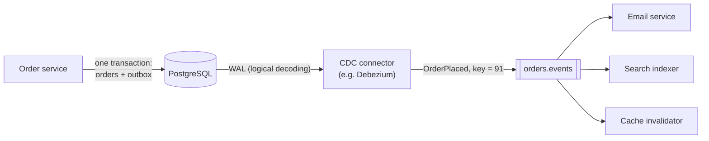

A service that updates its database and then publishes an event performs two writes to two systems — and nothing makes them atomic.
Crash between them and the database says "order placed" while no event was ever sent, or an event announces a change that rolled back. The
**transactional outbox** and **change data capture (CDC)** solve this dual-write problem without distributed transactions.

## Why it matters

Event-driven designs rely on "when X changes, publish an event". Interviewers check whether you notice that publishing after committing (or
before) is unsafe, and whether you know the standard fix. The same mechanisms keep caches, search indexes and read models in sync with a
database — so they come up in almost every design that has derived data.

## How it works

### The dual-write problem

| Order of operations | Crash in between | Result |
|---|---|---|
| Commit to DB, then publish | After commit | State changed, **no event** — downstream never learns |
| Publish, then commit | After publish | Event announces a change that **never happened** |
| Publish inside the DB transaction | Commit fails after publish | Same as above |

Retrying doesn't fix it in general; the two systems have no shared transaction.

### The transactional outbox

1. In the **same local transaction** as the business change, insert the event into an **outbox table** in the same database.
2. A separate **relay** reads unpublished outbox rows, publishes them to the broker, and marks them published (or deletes them).

Because the business row and the outbox row commit together, an event exists **if and only if** the change committed. The relay may publish
a row twice (crash after publishing, before marking) — so delivery is at-least-once and consumers must be idempotent, using the event ID
([deduplication](lesson:dedup)).

Two ways to relay:

- **Polling publisher**: a job queries the outbox for unpublished rows every few hundred milliseconds. Simple; adds query load; latency is the
  polling interval. With several relay instances, claim rows with `FOR UPDATE SKIP LOCKED` so they don't publish the same rows.
- **Log tailing (CDC on the outbox)**: a CDC connector reads the database's write-ahead log and publishes each inserted outbox row. Low
  latency, no polling queries, preserves commit order.

### Change data capture (CDC)

CDC reads the database's **transaction log** (PostgreSQL's WAL via logical decoding, MySQL's binlog) and turns every committed insert,
update and delete into an event. Uses:

- **Outbox relay** (above).
- **Keeping derived data in sync** without changing application code: invalidate caches, update search indexes, feed analytics and data
  warehouses, build read models ([CQRS](lesson:event-sourcing-cqrs)).
- **Migrations**: stream changes into a new database while backfilling, then cut over.

CDC of raw tables publishes **internal schema** (column names, row shapes) to the world, coupling consumers to it. The outbox lets you
publish deliberate, versioned **domain events** instead — a reason to CDC the outbox table rather than every business table for
cross-service events.

### The SQL

```sql
CREATE TABLE orders (
  id          bigint PRIMARY KEY,
  customer_id bigint NOT NULL,
  status      text   NOT NULL,
  total_paise bigint NOT NULL
);
CREATE TABLE outbox (
  id            uuid PRIMARY KEY DEFAULT gen_random_uuid(),
  aggregate_id  bigint      NOT NULL,           -- the order, used as the message key
  event_type    text        NOT NULL,
  payload       jsonb       NOT NULL,
  created_at    timestamptz NOT NULL DEFAULT now(),
  published_at  timestamptz
);
CREATE INDEX outbox_unpublished ON outbox (created_at) WHERE published_at IS NULL;
```

```sql
-- The business change and its event commit together, or not at all.
BEGIN;
INSERT INTO orders (id, customer_id, status, total_paise) VALUES (91, 7, 'placed', 499900);
INSERT INTO outbox (aggregate_id, event_type, payload)
VALUES (91, 'OrderPlaced', '{"orderId": 91, "customerId": 7, "totalPaise": 499900}');
COMMIT;
```

```sql
-- Polling relay: several instances can run this safely; SKIP LOCKED gives each its own rows.
BEGIN;
SELECT id, aggregate_id, event_type, payload
FROM outbox
WHERE published_at IS NULL
ORDER BY created_at
LIMIT 100
FOR UPDATE SKIP LOCKED;
-- publish each row to the broker (key = aggregate_id), then:
UPDATE outbox SET published_at = now()
WHERE id IN (SELECT id FROM outbox WHERE published_at IS NULL ORDER BY created_at LIMIT 100);
COMMIT;
```

In production the relay marks exactly the IDs it published (passing them back as parameters); published rows are deleted or partitioned and
dropped after a few days.

## Architecture



## Failure scenarios

- **Relay crash after publishing, before marking**: the event is published again on restart. Idempotent consumers (event ID).
- **Relay down or lagging**: events are delayed but not lost; monitor outbox backlog and CDC lag.
- **Outbox table grows forever**: published rows never cleaned. Delete or drop old partitions.
- **CDC replication slot holds WAL**: a stopped CDC connector keeps PostgreSQL from recycling WAL, filling the disk. Monitor slot lag; alert.
- **Schema change breaks CDC consumers** of raw tables. Prefer outbox events with versioned schemas.
- **Ordering across aggregates**: events for different orders may interleave; key messages by aggregate ID to keep per-entity order.

## Trade-offs

| | Polling outbox | CDC on outbox | CDC on business tables |
|---|---|---|---|
| Latency | Polling interval | Sub-second | Sub-second |
| Load on DB | Periodic queries | Log reading | Log reading |
| Event design | Deliberate domain events | Deliberate domain events | Internal row changes |
| Infrastructure | Just a job | CDC platform (Debezium, Kafka Connect) | CDC platform |
| Best for | Simple setups | Cross-service events at scale | Caches, search, analytics, migrations |

## In real systems

- Debezium streams changes from PostgreSQL, MySQL, MongoDB and others into Kafka and includes an outbox event router.
- Cloud databases expose change streams directly: DynamoDB Streams, MongoDB change streams, Cloud Spanner change streams.
- Many companies keep search indexes and caches in sync by consuming CDC streams rather than adding writes to every code path.

## Common mistakes

- **Publishing after commit** and calling it reliable.
- **Publishing inside the transaction** before commit.
- **Assuming the relay publishes exactly once.**
- **Exposing raw table changes** as the public event contract.
- **Forgetting outbox cleanup and CDC slot monitoring.**

## In the interview

````question title="How do you reliably publish an event when an order is placed?"
With a transactional outbox. In the same database transaction that inserts the order, the service inserts an OrderPlaced row into an outbox
table, so the event exists if and only if the order committed. A relay — a CDC connector reading the database log, or a polling job using
SKIP LOCKED — publishes outbox rows to Kafka keyed by order ID and marks them published. A crash can make the relay publish a row twice, so
every event carries a unique ID and consumers deduplicate on it. Published rows are cleaned up after a few days, and I'd alert on outbox
backlog and CDC lag.
````

````question title="What is change data capture, and what would you use it for?"
CDC reads a database's transaction log — PostgreSQL's WAL, MySQL's binlog — and emits an event for every committed insert, update and
delete, in commit order. I'd use it to relay outbox events with low latency, and to keep derived data in sync without touching application
code: invalidating cache keys, updating a search index, feeding the analytics warehouse, or streaming changes into a new database during a
migration. For events consumed by other teams I'd CDC the outbox rather than raw tables, so the contract is a deliberate, versioned event
rather than our internal schema.
````

## Key takeaways

- Writing the database and the broker separately is a **dual write**: a crash leaves them disagreeing.
- The **transactional outbox** commits the event with the business change; a **relay** publishes it (polling with `SKIP LOCKED`, or CDC).
- Delivery is **at-least-once**: events carry IDs; consumers deduplicate.
- **CDC** turns the database log into a change stream for outbox relay, caches, search indexes, analytics and migrations.

## Knowledge check

```quiz
? A service commits an order, then publishes OrderPlaced, and crashes between the two. What happens?
- The broker publishes the event automatically
! The broker never received it.
+ The order exists but no event was published; downstream services never learn about it
- The database rolls back the order
! It already committed.
- The event is published twice
! It wasn't published at all.
> That's the dual-write problem the outbox solves.

? Why must outbox consumers be idempotent?
+ The relay may publish a row again if it crashes after publishing but before marking it published
- Because outbox rows are random
! Rows are deterministic.
- Because CDC reorders all events
! CDC preserves commit order.
- Because Kafka requires idempotent consumers
! It's the relay's at-least-once behaviour.
> Outbox relaying is at-least-once.

? Several polling relay instances read the same outbox. How do they avoid publishing the same rows concurrently?
- They can't; run only one relay
! It's possible to run several safely.
+ Claim rows with `SELECT … FOR UPDATE SKIP LOCKED`, so each instance locks different rows
- Use a larger polling interval
! Overlap still happens.
- Delete rows before publishing
! A crash would lose events.
> Row locks with SKIP LOCKED let workers share a table as a queue.

? Why prefer CDC on an outbox table over CDC on raw business tables for cross-team events?
- Raw tables can't be captured
! They can.
+ The outbox carries deliberate, versioned domain events instead of exposing internal schema
- The outbox is faster to read
! Both are read from the same log.
- Raw-table CDC loses events
! It doesn't lose them.
> Contracts should be designed, not leaked from internal tables.
```
