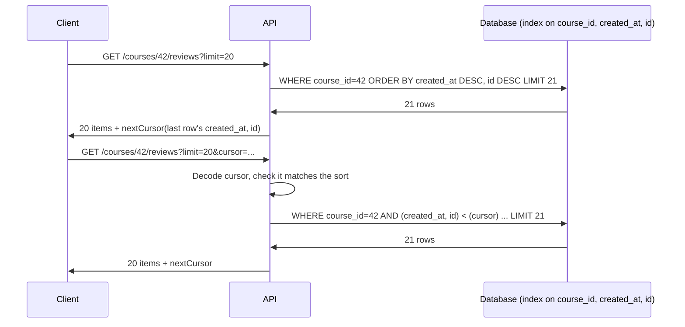

Any collection that can grow — reviews, posts, orders, search results — must be returned in pages. How you page decides whether
page 5,000 is as fast as page 1, whether users see duplicates or gaps when data changes underneath them, and which indexes your
database needs.

## Why it matters

"Return all reviews for a course" works in a demo and fails in production: a popular course with 200,000 reviews produces a
multi-megabyte response, a long database query and a slow client. Every list endpoint in your interview API should be paginated, and
interviewers often follow up with "how do you paginate a feed that changes constantly?" The answer — cursor (keyset) pagination — is also
the bridge to [indexing](lesson:indexing): a good cursor walks an index directly.

## How it works

### Offset pagination

```http
GET /courses/42/reviews?limit=20&offset=40
```

```sql
CREATE TABLE reviews (
  id          bigint PRIMARY KEY,
  course_id   bigint NOT NULL,
  rating      smallint NOT NULL,
  created_at  timestamptz NOT NULL
);
CREATE INDEX reviews_course_recent ON reviews (course_id, created_at DESC, id DESC);
```

```sql
SELECT id, rating, created_at
FROM reviews
WHERE course_id = $1
ORDER BY created_at DESC, id DESC
LIMIT 20 OFFSET $2;
```

Easy to implement, supports "jump to page 37" and total page counts. Two problems:

1. **Cost grows with depth.** The database must find and discard every row before the offset. `OFFSET 500000` reads 500,020 index
   entries to return 20.
2. **Unstable under writes.** If a new review is inserted while a user pages, every later row shifts by one: page 3 repeats the last item
   of page 2. A deletion skips an item instead.

### Cursor (keyset) pagination

Instead of "skip N rows", the client says "give me the rows **after this one**". The server returns an opaque cursor encoding the sort key
of the last row it sent:

```http
GET /courses/42/reviews?limit=20
-> { "items": [ ...20 reviews... ],
     "nextCursor": "eyJjcmVhdGVkQXQiOiIyMDI1LTEyLTE0VDA1OjIwOjAwWiIsImlkIjoiNTAwMDAwIn0" }

GET /courses/42/reviews?limit=20&cursor=eyJjcmVhdGVkQXQiOi...NTAwMDAwIn0
```

The cursor above is just base64url-encoded JSON — `{"createdAt":"2025-12-14T05:20:00Z","id":"500000"}` — that the server decodes into
a `WHERE` clause:

```sql
SELECT id, rating, created_at
FROM reviews
WHERE course_id = $1
  AND (created_at, id) < ($2, $3)
ORDER BY created_at DESC, id DESC
LIMIT 20;
```

The row-value comparison `(created_at, id) < ($2, $3)` means "older than the cursor, or equally old with a smaller ID". With the index
`(course_id, created_at DESC, id DESC)`, the database jumps straight to the cursor position and reads 20 entries — **the same cost for
every page**. Inserts and deletes elsewhere don't shift anything, so no duplicates or gaps.

Rules for a correct cursor:

- **The sort must be total.** `created_at` alone isn't unique; two reviews in the same millisecond would be skipped or repeated.
  Add a unique tiebreaker (`id`).
- **The index must match the sort.** Same columns, same order, after any equality filters (`course_id` first).
- **Keep it opaque.** Encode (and optionally sign or encrypt) the cursor so clients don't build them by hand and you can change the
  format later.
- **Ask for one extra row** (`LIMIT 21`) to know whether there is a next page without a separate count query.

### What it costs, measured

Measured on a one-million-row `reviews` table in PostgreSQL 18 (running in-process, so there is no network time), paging through all
reviews by `(created_at DESC, id DESC)` with an index on exactly those columns, averaged over 30 runs:

| Query | Average time |
|---|---|
| First page (`OFFSET 0`) | 0.77 ms |
| `OFFSET 10000` | 1.97 ms |
| `OFFSET 500000` | 59.35 ms |
| Keyset page at the same depth as offset 500,000 | 0.60 ms |

The query plans show why — both use the same index, but the offset query walks half a million entries:

```text title="EXPLAIN ANALYZE (PostgreSQL 18, abridged)"
-- OFFSET 500000
Limit (actual rows=20.00 loops=1)
  ->  Index Only Scan using reviews_created_id on reviews (actual rows=500020.00 loops=1)

-- keyset: WHERE (created_at, id) < ('2025-12-14 05:20:00+00', 500000)
Limit (actual rows=20.00 loops=1)
  ->  Index Only Scan using reviews_created_id on reviews (actual rows=20.00 loops=1)
        Index Cond: (ROW(created_at, id) < ROW(...))
```

### Filtering and sorting parameters

```http
GET /courses?category=databases&level=beginner&sort=-rating,id&limit=20&cursor=...
```

- **Filters** are query parameters with explicit names (`category`, `level`, `minRating`). Validate them against an allow-list.
- **Sort** takes a small set of supported fields (`-rating` for descending). Each supported combination of filter and sort needs an index
  that serves it — or a search engine. Offering arbitrary sorting on arbitrary fields means arbitrary full scans.
- **The cursor is tied to the sort.** A cursor from `sort=-rating` is meaningless for `sort=recent`; include the sort in the cursor and
  reject mismatches.
- **Totals are expensive.** `COUNT(*)` over a large filtered set is a full scan; return `hasMore` instead, or an approximate count.

### Pagination in other stores

- **DynamoDB** returns `LastEvaluatedKey`, which you pass back as `ExclusiveStartKey` — keyset pagination by design.
- **Cassandra** pages with an opaque paging state.
- **Elasticsearch** discourages deep `from`/`size` paging and offers `search_after` (keyset over sort values), with a point-in-time view
  for consistent results.

## Architecture



## Failure scenarios

- **Deep offsets as a denial of service.** A scraper requesting `offset=10000000` forces huge scans. Cap offsets or use cursors only.
- **Duplicates and gaps** in offset pagination when items are inserted or deleted between page loads — visible in fast-moving feeds.
- **Non-unique sort keys** in keyset pagination silently skip rows that share the boundary value.
- **Index doesn't match the sort**, so each "cheap" cursor query becomes a sort of the whole filtered set.
- **Forged or stale cursors.** Clients editing cursors or reusing one after a schema change; sign cursors and return 400 on invalid ones.

## Trade-offs

| | Offset | Cursor (keyset) |
|---|---|---|
| Cost of page N | Grows with N | Constant |
| Stable under inserts/deletes | No | Yes |
| Jump to arbitrary page | Yes | No (only next/previous) |
| Total pages | Easy (with a count) | Needs a separate count |
| Implementation | Trivial | Needs a total order, matching index, cursor encoding |
| Best for | Small, rarely changing lists; admin tables | Feeds, timelines, large collections, APIs |

Infinite-scroll feeds, timelines and public APIs should use cursors. Small admin tables with page numbers can use offsets with a cap.

## In real systems

- Stripe paginates with `starting_after` / `ending_before` object IDs; Slack's API returns `next_cursor`; GitHub uses `Link` headers
  with page URLs.
- Social feeds page by cursor because new items arrive constantly at the top.
- DynamoDB and Cassandra expose only keyset-style paging — offsets don't exist.

## Common mistakes

- **No pagination at all** on a collection endpoint.
- **Sorting by a non-unique column** without a tiebreaker.
- **Offering every sort field** without indexes to back them.
- **Returning exact totals** on huge collections.
- **Exposing raw cursor internals** that clients then depend on.

## In the interview

````question title="How would you paginate a timeline that receives new posts every second?"
With cursor (keyset) pagination. Each response returns items sorted by (created_at DESC, id DESC) plus an opaque nextCursor encoding
the last item's created_at and id. The next request asks for rows strictly older than that pair, which an index on (feed key,
created_at DESC, id DESC) answers by seeking directly to the position. New posts arriving at the top don't shift older pages, so
there are no duplicates or gaps, and every page costs the same. To show new posts at the top, the client separately asks for items
newer than the first item it has.
````

````question title="Why is OFFSET slow for deep pages, and when is it still acceptable?"
Because the database can't jump to row 500,000 — it has to walk and discard every row before the offset, even when an index provides
the order, so the cost grows linearly with page depth; in a test on a million-row PostgreSQL table, OFFSET 500000 took about 100
times longer than the equivalent keyset query. It also shifts results when rows are inserted or deleted. It's acceptable for small or
slowly changing collections where users need page numbers — admin screens, a few hundred search results — ideally with a maximum
offset.
````

## Key takeaways

- **Offset** pagination is simple but gets slower with depth and shifts under concurrent writes.
- **Cursor (keyset)** pagination seeks to "after the last row seen": constant cost per page and stable results.
- A cursor needs a **total order** (add a unique tiebreaker) and an **index matching the filter + sort**.
- Offer a **small set of filters and sorts**, each backed by an index; avoid exact totals on large sets.

## Knowledge check

```quiz
? Why must a keyset cursor include a unique column such as `id` along with `created_at`?
- To make the cursor longer and harder to guess
! Length isn't the goal; correctness is.
+ Rows with the same `created_at` would otherwise be skipped or repeated at page boundaries
- Databases can't sort by timestamps alone
! They can; the problem is ties.
- So the client can compute the next page itself
! Cursors should be opaque to clients.
> A total order is required so "rows after this one" is unambiguous.

? Users scrolling a busy feed with offset pagination report seeing the same post twice. What is the cause?
+ New posts inserted at the top shifted every later row, so the next offset page starts one row earlier in the old order
- The database returned duplicate rows
! The database returned exactly what the offset query asked for.
- The page size is too small
! Page size doesn't cause duplicates.
- The cursor was forged
! There is no cursor in offset pagination.
> Offsets count rows from the top; inserts move the boundary. Keyset pagination is immune.

? An endpoint supports `sort=recent` with an index on `(course_id, created_at DESC, id DESC)`. Product asks to add `sort=helpful` (by helpful votes). What must change?
- Nothing; the existing index covers any sort
! An index only serves the order of its own columns.
+ Add an index (and cursor format) on `(course_id, helpful_votes DESC, id DESC)`, or serve that sort from a search engine
- Switch to offset pagination
! Offsets make deep pages even more expensive.
- Sort in the application after loading all reviews
! That loads the entire collection on every request.
> Each supported sort needs its own index and its own cursor fields.

? Which approach avoids an expensive `COUNT(*)` while still telling the client whether more results exist?
- Run COUNT(*) in the same transaction
! That is exactly the expensive query.
+ Fetch `limit + 1` rows and return `hasMore` based on whether the extra row came back
- Return the total from a cache that never expires
! Totals would drift and be wrong.
- Always return `hasMore: true`
! Clients would request empty pages forever.
> One extra row answers "is there a next page?" at almost no cost.
```
