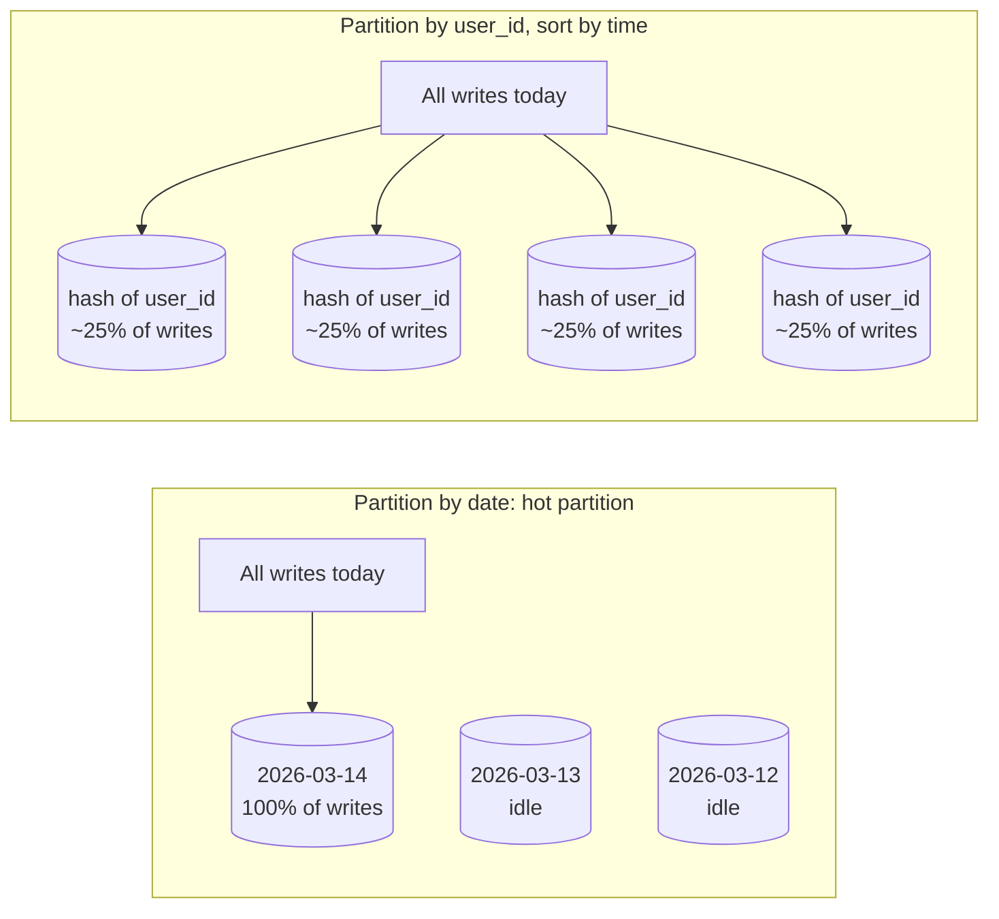
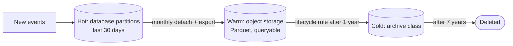

In any partitioned store — a sharded database, DynamoDB, Cassandra, Kafka — the partition key decides which machine holds each
item and which machine serves each request. A good key spreads load evenly and keeps each query on one partition; a bad one creates a
"hot partition" that caps the whole system at one machine's capacity. And because data rarely needs to live forever, how it expires is
part of the same design.

## Why it matters

Partitioned systems promise near-linear scaling — *if* load is spread evenly. Interviewers ask "what is your partition key?" for any design
with large data, and follow up with "what happens when one celebrity, one tenant or one day gets most of the traffic?" Retention questions
follow naturally: logs, events, messages and metrics grow without bound unless you decide how long they live and where old data goes.

## How it works

### Choosing a partition key

A partition key should satisfy three tests:

1. **The main queries include it.** "Messages of conversation C" → partition by `conversation_id`. Queries that lack the key must ask every
   partition.
2. **High cardinality with even load.** Many distinct values, none receiving a large share of traffic. `country` has too few values and
   hugely uneven load; `user_id` usually has millions.
3. **Related data stays together.** Items read or updated together should share a partition so the query (or transaction) stays local.

Many stores combine a **partition key** (where) with a **sort key** (order within the partition): DynamoDB's partition and sort keys,
Cassandra's partition key and clustering columns. `(conversation_id, sent_at)` puts a conversation's messages together, sorted by time —
"latest 50 messages" is one partition read in order.

### Hot partitions

| Cause | Example | Mitigation |
|---|---|---|
| **Time as the key** | Partitioning events by `date`: all of today's writes hit one partition | Lead with a high-cardinality key (`device_id`), keep time as the sort key; or add a hash bucket to the time key |
| **Celebrities** | One account with 50 million followers, one viral post, one huge tenant | Split the hot key into N sub-keys (write sharding), cache reads, give large tenants dedicated partitions |
| **Low cardinality** | Partition by `status` or `country` | Choose a key with many values; use the low-cardinality field as a filter or secondary index |
| **Sequential keys in range partitioning** | Auto-increment IDs: new writes always land in the last range | Hash the key, or use hash partitioning |

**Write sharding** splits one hot logical key into several physical ones by appending a suffix: writes go to `post#123#0` … `post#123#9`
chosen at random; reads query all ten and combine. It multiplies write capacity by the number of suffixes at the cost of fan-out reads.

The numbers make the limits concrete. In DynamoDB, each partition delivers at most **3,000 read units and 1,000 write units per second**
(one write unit = one write of up to 1 KB per second). A single key receiving 5,000 one-kilobyte writes per second therefore needs at
least five sub-keys — however much total capacity the table has.

### Partition size

Partitions shouldn't grow without bound. A Cassandra partition holding every message of a decade-old group chat becomes slow to read,
compact and repair. Bound partitions by adding a **time bucket** to the key: `(conversation_id, month)` — a conversation's messages for one
month per partition, with queries walking backwards month by month.

### Retention

Decide per dataset how long data lives and where it goes after its hot period:

| Mechanism | How it works | Notes |
|---|---|---|
| **Time-partitioned tables** | One partition per day or month; drop or detach old ones | Dropping a partition is a metadata operation — far cheaper than `DELETE` of billions of rows |
| **Per-item TTL** | The store deletes items after an expiry time | DynamoDB deletes expired items **within a few days** of expiry, without consuming write capacity — filter expired items in queries; Redis expires keys precisely; Cassandra TTLs create tombstones until compaction |
| **Tiered storage** | Hot data in the database, warm data in cheaper storage, cold data archived | Object storage lifecycle rules move objects to colder classes automatically |
| **Downsampling** | Keep raw data for days, hourly aggregates for months, daily for years | Common for metrics and analytics |
| **Legal holds and deletion requests** | Some data must be kept; some must be erased on request | Retention is also a compliance requirement |

In PostgreSQL, declarative partitioning makes time-based retention a two-statement job:

```sql
CREATE TABLE activity_events (
  user_id      bigint NOT NULL,
  occurred_at  timestamptz NOT NULL,
  kind         text NOT NULL,
  payload      jsonb
) PARTITION BY RANGE (occurred_at);

CREATE TABLE activity_events_2026_01 PARTITION OF activity_events
  FOR VALUES FROM ('2026-01-01') TO ('2026-02-01');
CREATE TABLE activity_events_2026_02 PARTITION OF activity_events
  FOR VALUES FROM ('2026-02-01') TO ('2026-03-01');
CREATE TABLE activity_events_2026_03 PARTITION OF activity_events
  FOR VALUES FROM ('2026-03-01') TO ('2026-04-01');

CREATE INDEX ON activity_events (user_id, occurred_at DESC);
```

```sql
-- Queries with a time range touch only the matching partitions (partition pruning).
EXPLAIN SELECT kind, occurred_at
FROM activity_events
WHERE user_id = 42 AND occurred_at >= '2026-03-01' AND occurred_at < '2026-03-08';

-- Retention: detach January, archive it (e.g. export to object storage), then drop it.
ALTER TABLE activity_events DETACH PARTITION activity_events_2026_01;
DROP TABLE activity_events_2026_01;
```

New partitions must be created ahead of time — usually by a scheduled job or an extension such as `pg_partman` — or inserts for the new
month fail.

## Architecture





## Failure scenarios

- **Throttling on one key.** A viral item exceeds its partition's limit; requests for that item fail while the table as a whole is mostly
  idle.
- **Unbounded partitions.** A partition keeps growing for years; reads, compaction and repair slow down and eventually time out.
- **Missing future partitions.** The job that creates next month's partition fails; inserts on the 1st of the month error out.
- **Mass deletes instead of drops.** `DELETE FROM events WHERE occurred_at < …` on billions of rows causes hours of I/O, bloat and replica
  lag; time partitions avoid it.
- **TTL surprises.** Expired items still appear until the background deletion runs (DynamoDB), or tombstones pile up and slow reads
  (Cassandra).

## Trade-offs

- **Locality vs spread.** Keeping related data in one partition makes queries cheap but risks hot or oversized partitions; spreading it
  balances load but forces fan-out reads.
- **Write sharding.** Multiplies write capacity for hot keys at the cost of reading N sub-keys.
- **Retention length vs cost and value.** Longer retention supports analytics and audits; it costs storage and slows queries unless data is
  tiered.
- **Time buckets.** Smaller buckets bound partition size but make "everything for this user" queries touch more partitions.

## In real systems

- DynamoDB documents the per-partition limits above and recommends high-cardinality keys and write sharding for hot items.
- Cassandra data models routinely use `(entity_id, time_bucket)` partition keys to bound partition size.
- Kafka topics are partitioned by message key, so a hot key also makes one partition (and one consumer) hot.
- Observability platforms keep raw logs for days or weeks and aggregated metrics for much longer, tiering data to object storage.

## Common mistakes

- **Partitioning by time alone** for write-heavy data.
- **Ignoring celebrity keys** in social and multi-tenant designs.
- **Letting partitions grow forever** with no time bucket.
- **No retention policy** — data kept forever by default.
- **Deleting old rows one by one** instead of dropping partitions.

## In the interview

````question title="How would you choose the partition key for storing user activity events, and how long would you keep them?"
The dominant query is "recent activity for user X", so I'd partition by user_id — high cardinality, even load for most users, and each
user's events together — with occurred_at as the sort key so recent events come back in order. To bound partition size I'd add a monthly
bucket to the key for very active users. For outliers such as bots or celebrities I'd watch for hot keys and split them with suffixes.
For retention: keep 30–90 days hot in the database using time-partitioned tables, export older months to object storage in a columnar
format for analytics, and drop the database partitions — a cheap metadata operation instead of mass deletes — with lifecycle rules
handling archive and final deletion.
````

````question title="What is a hot partition, and how do you fix one?"
It's a partition receiving a disproportionate share of traffic, so its machine saturates while others sit idle; the system's effective
capacity collapses to one partition's limit — in DynamoDB, for example, 1,000 write units per second per partition. Causes are time-based
keys, celebrities or big tenants, and low-cardinality keys. Fixes: choose a higher-cardinality key with time as the sort key; split a hot
logical key into several physical keys with random suffixes and read them all; cache hot reads; and give very large tenants their own
partitions or shards.
````

## Key takeaways

- A partition key should be **in the main queries**, **high-cardinality with even load**, and **keep related data together**.
- **Hot partitions** come from time keys, celebrities and low cardinality — fix with better keys, **write sharding** and caching.
- **Bound partition size** with time buckets.
- Plan **retention** up front: time partitions you can drop, TTLs, tiered storage and downsampling.

## Knowledge check

```quiz
? A metrics table is partitioned by `date`. What happens under heavy write load?
- Writes spread evenly across dates
! Every write today has today's date.
+ All current writes land on today's partition, which becomes a hot spot
- Old partitions get most writes
! Old dates receive almost no writes.
- Partitioning by date is ideal for writes
! It's ideal for retention, not for spreading writes.
> Lead with a high-cardinality key (e.g. metric or host) and use time as the sort key or a bucket.

? One DynamoDB item receives 4,500 one-kilobyte writes per second. What is the minimum number of sub-keys (write shards) needed?
- 1
! One partition supports at most 1,000 write units per second.
- 3
! 3 × 1,000 = 3,000 < 4,500.
+ 5
- 45
! Far more than needed.
> 4,500 ÷ 1,000 per partition = 4.5 → at least 5 sub-keys (more for headroom).

? Why drop monthly partitions instead of running `DELETE … WHERE occurred_at < cutoff`?
+ Dropping a partition is a quick metadata operation, while mass deletes generate heavy I/O, bloat and replica lag
- DELETE is not allowed on partitioned tables
! It's allowed, just expensive at scale.
- Dropping partitions keeps the data
! Dropping removes it; detach first if you need to archive.
- DELETE removes indexes
! DELETE leaves indexes in place (and bloated).
> Time-partitioned tables make retention cheap.

? A group-chat table uses `conversation_id` as the partition key. Some conversations have tens of millions of messages. What change bounds partition size?
- Use `message_id` as the partition key
! Then a conversation's messages scatter, and reading history becomes a fan-out.
+ Add a time bucket: `(conversation_id, month)`
- Use `sender_id` as the partition key
! History reads by conversation would hit many partitions.
- Remove the sort key
! Ordering within the partition would be lost.
> Bucketing keeps each partition bounded while preserving per-conversation locality.
```

Two partition estimates:

```drill
? A single hot key receives 7,200 one-kilobyte writes per second, and each partition supports 1,000 write units per second. Allowing 50% headroom (each partition at most 500 writes/s), how many sub-keys do you need?
= 15
~ 1.15
> 7,200 ÷ 500 = 14.4 → 15 sub-keys.

? Events arrive at 2,000 per second, 500 bytes each, kept for 30 days. How much raw storage is that before replication?
= 2.6 TB
~ 1.25
> 2,000 × 500 B × 86,400 s × 30 days ≈ 2.59 × 10¹² bytes ≈ 2.6 TB.
```
