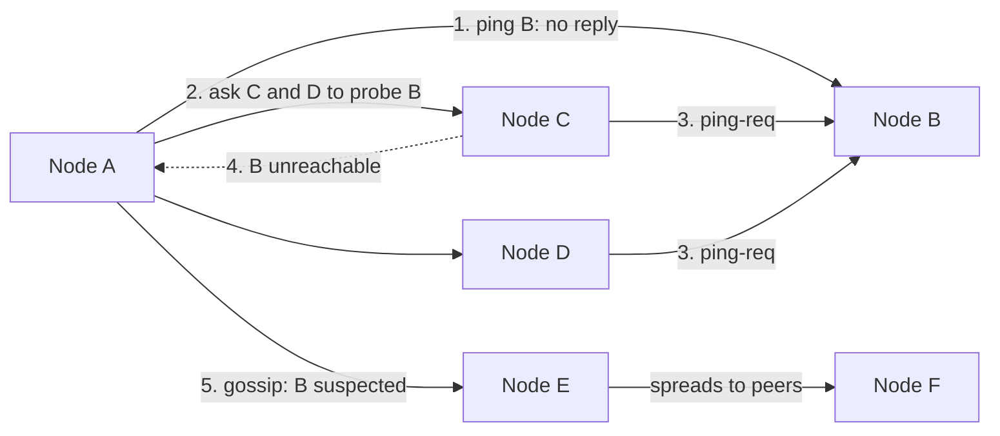

In a distributed system you can never be sure another node has failed. A missing reply might mean it crashed, it's overloaded, it's
in a long pause, or the network between you is broken — and from where you stand, these look identical. Failure detection is therefore
always a guess, and correct systems are designed so that a wrong guess can't cause damage.

## Why it matters

Leader election, failover, cluster membership, load-balancer health checks and lock expiry all rest on deciding that something has failed.
Interviewers probe the edge cases: what if the "dead" leader is alive? What if node A can reach B but B can't reach A? What if one node is
slow rather than down? Knowing how detection works — and how quorums, leases and fencing make wrong guesses safe — is what keeps designs
out of split brain.

## How it works

### Timeouts: the basic detector

Send heartbeats (or requests) and declare a node failed if nothing arrives within a timeout. The timeout is a trade-off:

- **Too short**: false positives during GC pauses, load spikes or brief network blips → needless failovers, which themselves cause load and
  risk.
- **Too long**: real failures go unnoticed for longer → longer outages.

Typical heartbeat intervals are hundreds of milliseconds to seconds, with failure declared after several missed beats. Many systems require
**confirmation from multiple observers** before acting.

### Adaptive detectors: phi accrual

Instead of a fixed timeout, a **phi accrual** detector tracks the distribution of recent heartbeat arrival intervals and outputs a suspicion
level φ that rises the longer a heartbeat is overdue relative to what's normal for that link. The application acts when φ crosses a
threshold. It adapts to slow or jittery links automatically; Cassandra and Akka use it.

### Gossip: spreading membership

In large clusters, every node heartbeating every other node is O(n²) messages. **Gossip protocols** have each node periodically exchange
membership and heartbeat information with a few random peers; information spreads through the cluster in a number of rounds that grows
roughly logarithmically with cluster size. **SWIM**-style protocols add indirect probing: if A can't reach B, it asks a few other nodes to
probe B before suspecting it, which filters out problems with A's own link. HashiCorp's memberlist (used by Consul) and Cassandra use
gossip.

### Network partitions and their shapes

- **Clean partition**: the cluster splits into groups that can't talk to each other.
- **Partial / asymmetric partition**: A reaches B, B reaches C, but A can't reach C — or messages flow one way only. Simple detectors
  disagree about who is alive.
- **Gray failure**: a node is "up" (passes health checks) but is badly degraded — dropping some requests, very slow disks. The hardest to
  detect; use real-traffic metrics (error rates, latency) rather than pings alone.

### Making wrong guesses safe

Because detection is a guess, safety must not depend on it being right:

- **Quorums**: only a majority can elect a leader or commit, so the minority side of a partition can't act (see [consensus](lesson:consensus)).
- **Leases**: a leader may act only while its lease is valid, and must stop when it can't renew with a majority.
- **Fencing**: resources reject stale leaders by token or epoch ([distributed locks](lesson:distributed-locks)).
- **STONITH** ("shoot the other node in the head"): before promoting a replacement, forcibly power off or isolate the old node.

## Architecture



If C or D can reach B, the problem was A's link, and B isn't marked suspect. Only when indirect probes fail too does B become suspected, and
then confirmed after a further timeout unless B refutes the suspicion.

## Failure scenarios

- **False failover**: a leader's GC pause exceeds the heartbeat timeout; a new leader is elected; the old one wakes up and keeps writing —
  split brain, unless leases and fencing stop it.
- **Flapping**: a node on a lossy link is repeatedly declared dead and alive, triggering rebalancing each time. Use adaptive detectors and
  hysteresis.
- **Asymmetric partition**: the leader can send heartbeats but can't receive acknowledgements; followers keep it in office while writes fail.
  Leaders should step down if they can't confirm a majority.
- **Gray failure**: a slow disk makes one replica slow; health checks pass; p99 latency degrades cluster-wide. Outlier detection on real
  traffic, and hedged requests.
- **Correlated failure**: a whole rack or zone disappears; many simultaneous failures overwhelm rebalancing. Place replicas across failure
  domains.

## Trade-offs

- **Detection speed vs false positives**: shorter timeouts mean faster recovery and more needless failovers.
- **Simplicity vs scale**: all-to-all heartbeats are simple for small clusters; gossip scales to thousands of nodes with eventual agreement.
- **Availability vs safety**: acting on suspicion quickly improves availability; requiring quorums and fencing keeps it safe but leaves the
  minority side unavailable.

## In real systems

- Cassandra uses gossip for membership and a phi accrual failure detector.
- Consul and Nomad use HashiCorp's memberlist, based on SWIM with refinements (Lifeguard) to reduce false positives.
- Kubernetes marks a node `NotReady` after missed kubelet heartbeats (node leases) and evicts its pods after a further grace period.
- Raft-based systems (etcd) combine heartbeats with randomised election timeouts and majority votes, so a partitioned minority can't elect a
  leader.

## Common mistakes

- **Treating a timeout as proof of death.**
- **Electing leaders on detection alone**, without quorums and fencing.
- **Fixed, aggressive timeouts** in environments with GC pauses or noisy networks.
- **Health checks that ping only**, missing gray failures.
- **Assuming partitions are clean and symmetric.**

## In the interview

````question title="How does your system detect a failed node, and what happens if it's wrong?"
Nodes exchange heartbeats; a node is suspected after several missed intervals — using an adaptive detector (phi accrual) so slow links
don't cause false alarms — and confirmed after indirect probes from other nodes also fail, so one node's bad link doesn't condemn a healthy
peer. Since that's still a guess, actions that need exclusivity are protected independently: a new leader is elected only by a majority, the
old leader must stop when its lease can't be renewed, and storage rejects writes carrying an old epoch or fencing token. So if a "failed"
node was merely paused, its late writes are rejected rather than causing split brain.
````

````question title="What is a gray failure, and how do you catch it?"
A gray failure is a component that is degraded but not down: it passes liveness checks yet serves some requests slowly or with errors —
a failing disk, a saturated NIC, a bad deploy on one instance. Ping-based health checks miss it. Catch it with signals from real traffic:
per-instance error rates and latency percentiles, outlier detection in the load balancer or mesh that ejects instances much worse than their
peers, and synthetic transactions that exercise the full path. Hedged requests can also hide a slow replica from users.
````

## Key takeaways

- Failure detection is **always a guess**: slow, paused, partitioned and dead look the same.
- Timeouts trade **speed against false positives**; **phi accrual** adapts; **gossip/SWIM** scales membership with indirect probes.
- Partitions can be **partial and asymmetric**; **gray failures** need real-traffic signals.
- Make wrong guesses safe with **quorums, leases, fencing and STONITH**.

## Knowledge check

```quiz
? A leader misses heartbeats for 10 seconds because of a garbage-collection pause, and a new leader is elected. What prevents the old leader's writes from causing split brain?
- Shorter heartbeat intervals
! Any interval can be exceeded by a pause.
+ Leases and fencing: the old leader's lease has expired and its stale epoch/token is rejected
- Gossip
! Gossip spreads membership; it doesn't stop stale writes.
- Restarting the old leader automatically
! It may not be possible to reach it.
> Safety must not depend on detection being right.

? Why do SWIM-style protocols ask other nodes to probe a suspect node?
+ To distinguish a problem with the prober's own link from a genuinely failed node
- To spread load evenly
! Load spreading isn't the purpose.
- To elect a new leader
! Probing isn't election.
- To encrypt heartbeats
! Probes aren't about encryption.
> Indirect probes reduce false positives.

? A node passes every health check but serves 30% of requests with 5-second latency. What kind of failure is this?
- A clean network partition
! The node is reachable.
+ A gray failure
- Split brain
! There's no second leader.
- A false positive
! The degradation is real.
> Gray failures need detection from real traffic, not pings.

? What is the main risk of very short failure-detection timeouts?
- Failures are detected too slowly
! That's the risk of long timeouts.
+ False positives during pauses and blips, causing needless failovers
- Higher memory use
! Not a meaningful effect.
- Gossip stops working
! Gossip still works.
> Fast detection must be balanced against spurious failovers.
```
