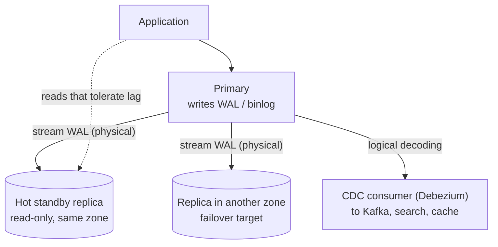

PostgreSQL and MySQL are the default systems of record in most designs: transactions, constraints, joins and secondary indexes in one
mature engine. Interviewers rarely want you to replace them — they want to know how far one goes, what breaks first, and how you stretch it.
This lesson covers what's inside (pages, the write-ahead log, MVCC, replication) and the scaling path from one primary to sharded clusters.

## What it is for

- **The system of record** for business data: users, orders, payments, inventory, bookings — anything with relationships, invariants and
  transactions ([transactions](lesson:transactions)).
- **Flexible querying**: joins, aggregates and ad-hoc queries over the same data, with secondary indexes for each access path.
- **Strong guarantees**: ACID transactions, foreign keys, unique and check constraints enforced by the database rather than the application.
- **More than tables** (PostgreSQL especially): `JSONB` documents, arrays, range types, full-text search, and extensions such as PostGIS
  (geospatial) and pgvector (vector similarity) — often enough to avoid adding another store.

## Data model

Rows in tables with typed columns, primary keys, foreign keys and indexes — covered in [relational modelling](lesson:relational-modeling) and
[indexing](lesson:indexing). What differs between the two engines matters in interviews:

| Aspect | PostgreSQL | MySQL (InnoDB) |
|---|---|---|
| Table storage | Heap: rows in insertion order; every index points to a row location | Clustered: rows stored inside the primary-key B-tree |
| Secondary index lookup | Index → heap location (`ctid`) | Index → primary key → clustered index (two B-tree descents) |
| Page size | 8 KB | 16 KB by default |
| Old row versions | Kept in the table itself until `VACUUM` removes them | Kept in undo logs until purge removes them |
| Rich types and extensions | JSONB, arrays, ranges, PostGIS, pgvector | JSON type; fewer extension points |
| Sharding ecosystem | Citus (extension) | Vitess (proxy layer, created at YouTube) |

**Primary key choice matters more in InnoDB**: rows are physically ordered by it, so random UUIDv4 keys scatter inserts across the B-tree,
while time-ordered keys (auto-increment, UUIDv7, Snowflake IDs) append at the end. PostgreSQL 18 added a built-in `uuidv7()` function.

## How it works inside

### Pages, buffer pool and the write-ahead log

Tables and indexes are stored in fixed-size pages. Reads go through an in-memory cache (PostgreSQL's shared buffers plus the OS page cache;
InnoDB's buffer pool). A write changes pages in memory and appends a record describing the change to the **write-ahead log** (PostgreSQL's
WAL, InnoDB's redo log). **Commit** means the log record is flushed to disk; the changed data pages are written later by background
checkpoints. After a crash, the database replays the log from the last checkpoint. This is why commits cost an `fsync`, and why grouping
many rows into one transaction is so much faster than committing each ([scaling writes](lesson:scaling-writes)).

MySQL also writes a **binary log** (binlog) of changes at the server level, used for replication and point-in-time recovery; InnoDB
coordinates it with the redo log so the two agree after a crash.

### MVCC: readers don't block writers

Both engines use **multi-version concurrency control**: a transaction reads a snapshot, so readers never wait for writers and vice versa.
They implement it differently:

- **PostgreSQL** writes a **new row version** for every `UPDATE`. Each version carries the transaction ID that created it (`xmin`) and
  the one that deleted or replaced it (`xmax`); a snapshot decides which version is visible. Old versions stay in the table as dead tuples
  until **autovacuum** reclaims them.
- **InnoDB** updates the row **in place** and copies the old version into the **undo log**; readers with older snapshots reconstruct the
  old version from undo. A **purge** thread discards undo records nobody needs.

Here is PostgreSQL 18 creating a new version on update (run in PGlite):

```sql title="One update, two row versions"
CREATE TABLE accounts (id int PRIMARY KEY, balance int NOT NULL);
INSERT INTO accounts VALUES (1, 100), (2, 50);
SELECT ctid, xmin, xmax, id, balance FROM accounts ORDER BY id;

UPDATE accounts SET balance = balance - 30 WHERE id = 1;
SELECT ctid, xmin, xmax, id, balance FROM accounts ORDER BY id;
```

```text title="Output (PostgreSQL 18.6)"
 ctid  | xmin | xmax | id | balance        -- after INSERT
 (0,1) |  752 |    0 |  1 |     100
 (0,2) |  752 |    0 |  2 |      50

 ctid  | xmin | xmax | id | balance        -- after UPDATE
 (0,3) |  753 |    0 |  1 |      70        <- new version, new location, new xmin
 (0,2) |  752 |    0 |  2 |      50
```

The row for account 1 moved from `(0,1)` to `(0,3)`: the old version is now a dead tuple that occupies space until vacuum runs. Consequences
you can name in an interview:

- **Update-heavy tables bloat** if autovacuum can't keep up; tune it per table or batch updates.
- **Long-running transactions** hold back cleanup in both engines (dead tuples in PostgreSQL, a growing undo history in InnoDB), slowing
  everything. Keep analytics off the primary.
- **Transaction ID wraparound**: PostgreSQL's 32-bit transaction IDs must be "frozen" by vacuum before they wrap; a disabled or starved
  vacuum eventually forces the database to stop accepting writes.

### Replication



- **PostgreSQL streaming replication** ships WAL to standbys, which replay it; replicas are byte-for-byte copies and can serve reads.
  Asynchronous by default; `synchronous_standby_names` with `synchronous_commit` makes commits wait for one or more standbys.
  **Logical replication** and logical decoding stream row changes, which is how CDC tools read the database ([outbox and CDC](lesson:outbox-cdc)).
- **MySQL replication** ships the binlog (row-based format) to replicas, asynchronous or **semi-synchronous** (the primary waits until at
  least one replica has received the transaction). Group Replication and InnoDB Cluster add consensus-based failover.
- **Failover** is not built into PostgreSQL itself; tools like Patroni (with etcd) or managed services handle detection and promotion
  ([leader-follower replication](lesson:leader-follower)).

### Connections

PostgreSQL starts a **process per connection**, each using several MB of memory, so thousands of direct connections hurt; a pooler such as
**PgBouncer** in transaction mode multiplexes many clients onto a few hundred server connections. MySQL uses a thread per connection and
tolerates more, but pooling in the application is still standard ([connection management](lesson:connection-management)).

## Strengths and weaknesses

| Strengths | Weaknesses |
|---|---|
| ACID transactions and constraints across many tables | One primary takes all writes; write scaling needs partitioning or sharding |
| Joins and ad-hoc queries on the same data | Schema changes on huge tables need care (online migration tools) |
| Mature tooling, backups, point-in-time recovery | Cross-shard joins and transactions are hard once sharded |
| Rich types and extensions (PostgreSQL) | MVCC cleanup (vacuum, purge) needs attention under heavy updates |
| Well understood by every engineer and interviewer | Process/thread per connection limits connection counts without pooling |

## Scaling characteristics

The path from one box to many, roughly in the order you should use it:

1. **Indexes and query fixes** — most "the database is slow" problems are missing indexes or bad queries
   ([query optimisation](lesson:query-optimization)).
2. **Vertical scaling** — cloud instances with hundreds of vCPUs and terabytes of RAM; a well-tuned primary handles tens of thousands of
   indexed reads/s and thousands to tens of thousands of small writes/s.
3. **Caching and read replicas** — move reads off the primary; accept replication lag or route read-your-writes to the primary.
4. **Native partitioning** — split a huge table by range (time), list or hash inside one database. Queries filtering on the partition key
   touch only matching partitions, and retention becomes dropping a partition rather than deleting billions of rows
   ([partition keys and retention](lesson:partition-keys-retention)).
5. **Sharding** — split data across many primaries by a shard key ([sharding](lesson:sharding)): in the application, or with **Citus**
   (PostgreSQL extension: distributed tables by a distribution column, co-located joins) or **Vitess** (MySQL: a routing layer, `vtgate`,
   in front of many MySQL shards, with online resharding).
6. **Distributed SQL** — when you need SQL, transactions and horizontal write scaling together: Spanner, CockroachDB, YugabyteDB, TiDB.

Native partitioning in practice — monthly partitions for an events table, measured in PGlite:

```sql title="Range partitioning by month"
CREATE TABLE events (
  id         bigint GENERATED ALWAYS AS IDENTITY,
  user_id    bigint      NOT NULL,
  kind       text        NOT NULL,
  created_at timestamptz NOT NULL
) PARTITION BY RANGE (created_at);

CREATE TABLE events_2026_10 PARTITION OF events
  FOR VALUES FROM ('2026-10-01') TO ('2026-11-01');
CREATE TABLE events_2026_11 PARTITION OF events
  FOR VALUES FROM ('2026-11-01') TO ('2026-12-01');
CREATE INDEX ON events (user_id, created_at);

EXPLAIN (COSTS OFF)
SELECT count(*) FROM events
WHERE user_id = 42 AND created_at >= '2026-11-01' AND created_at < '2026-11-08';
```

```text title="Plan (abridged; 80,000 rows across two partitions)"
Aggregate
  ->  Bitmap Heap Scan on events_2026_11 events
        ->  Bitmap Index Scan on events_2026_11_user_id_created_at_idx
              Index Cond: ((user_id = 42) AND (created_at >= ...) AND (created_at < ...))
```

Only `events_2026_11` is scanned — **partition pruning**. Dropping `events_2026_10` removed its 44,639 rows instantly, with no dead tuples
left behind.

## When to use it

- **Start here** for transactional business data unless you have a specific reason not to: relationships, invariants, money, inventory.
- When **query patterns are varied or still evolving** — SQL handles new questions without redesigning the storage.
- When the **write rate fits one primary** (with headroom), or can be partitioned by a key that keeps transactions on one shard.
- **Look elsewhere** for sustained writes far beyond one primary with simple access patterns (Cassandra, DynamoDB), full-text relevance
  search (Elasticsearch), blobs (object storage), or analytics over billions of rows (a columnar warehouse).

## Alternatives

| Alternative | Prefer it when |
|---|---|
| Amazon Aurora (PostgreSQL/MySQL-compatible) | You want managed replicas (up to 15) sharing a replicated storage layer and fast failover |
| Spanner, CockroachDB, YugabyteDB | You need SQL transactions with horizontal write scaling and multi-region placement |
| DynamoDB or Cassandra | Access patterns are known and simple, and write volume or availability needs exceed one primary |
| MongoDB | Data is naturally document-shaped and read together, with few cross-document invariants |
| A columnar warehouse (BigQuery, Snowflake, ClickHouse) | Analytical queries scan large volumes; keep them off the OLTP primary |

## Interview trade-offs

- **Simplicity vs write scale**: one primary keeps transactions and joins easy; sharding buys write capacity at the cost of cross-shard
  queries and transactions. Say what your shard key is and which queries become scatter-gather.
- **Replica reads vs freshness**: replicas multiply read capacity but lag; decide which reads must hit the primary.
- **Synchronous vs asynchronous replication**: zero data loss on failover costs commit latency and availability when a standby is slow.
- **PostgreSQL vs MySQL**: rarely decisive in an interview. Mention a concrete reason if you pick one — PostGIS, JSONB, extensions or
  Citus for PostgreSQL; Vitess or an existing MySQL estate for MySQL.

## Key takeaways

- Both engines write a **log first** (WAL/redo) and commit by flushing it; data pages follow later.
- **MVCC** lets readers and writers proceed without blocking: PostgreSQL keeps versions in the table (vacuum cleans up), InnoDB in undo
  logs (purge cleans up). Long transactions hurt both.
- Replication **ships the log**; it's asynchronous by default, so failover can lose recent commits unless you pay for synchronous commits.
- Scale in order: indexes → bigger box → cache and replicas → partitioning → sharding (Citus, Vitess) → distributed SQL.
- Native **partitioning** prunes queries and makes retention a cheap `DROP`.

## Knowledge check

```quiz
? In PostgreSQL, what happens physically when you UPDATE one column of a row?
- The value is changed in place
! That's closer to InnoDB, which keeps the old version in undo.
+ A new version of the whole row is written; the old one becomes a dead tuple until vacuum removes it
- Only the changed column is appended to the WAL and the row is untouched
! The WAL records the change, but the heap also gets a new row version.
- The row is locked and copied to a temporary table
! No temporary table is involved.
> MVCC in PostgreSQL stores versions in the table itself, hence vacuum.

? An analytics query runs for six hours on the primary. Why does the OLTP workload slowly degrade?
- The query holds a table lock that blocks writes
! Plain SELECTs don't block writers under MVCC.
+ Its snapshot prevents cleanup of old row versions, so dead tuples (or undo history) pile up and slow everything
- It fills the WAL disk
! Reads don't generate WAL.
- It forces synchronous replication
! Replication mode isn't affected.
> Run long analytics on a replica or a warehouse.

? A PostgreSQL primary fails and an asynchronous standby is promoted. What can be lost?
+ Transactions committed on the primary whose WAL hadn't reached the standby
- Nothing; streaming replication is synchronous
! It's asynchronous by default.
- Only uncommitted transactions
! Those are never durable anyway; committed ones can also be lost.
- The standby's own reads
! Reads don't create data.
> Synchronous commit to a standby closes this window at a latency cost.

? A 3 TB events table must keep 90 days of data. Deleting expired rows nightly causes heavy load and bloat. What is the better design?
- A bigger instance
! The problem is the delete pattern, not size.
+ Range-partition by time and drop whole partitions as they expire
- Move the table to Redis
! Not a fit for durable event history.
- Add an index on created_at
! It helps find rows but the deletes still create dead tuples.
> DROP of a partition is a metadata operation.
```
