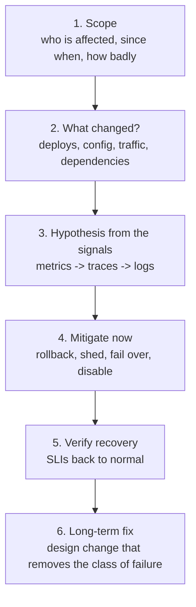

Eight production incidents, each told the way it would reach an on-call engineer: symptoms, graphs, a timeline. For each one, work out what
is happening, what you would do in the next ten minutes, and what you would change so it can't happen again. The incidents are composites
of failure patterns seen across the industry; every one maps to a pattern from earlier stages.

## How to use this workshop

Use the same loop for every case — it's how real incident response works ([health, alerting and incidents](lesson:health-alerting-incidents)):



- **Spend 5–10 minutes per case** before opening the hint. Write three lines: diagnosis, mitigation, long-term fix.
- **Mitigation and fix are different answers.** "Add jitter to retries" is a fix; at 3 a.m. the mitigation is usually turning something off.
- Compare with the worked solution and follow the lesson links for anything unfamiliar.

## Exercises

### Exercise 1 — The two-second blip that lasted forty minutes

The orders database failed over to its replica at 09:12. Failover took about 2 seconds. Then:

- 09:12–09:52: order API error rate 60–80%; database CPU at 100%; database connections maxed.
- Request rate **reaching the database** is 9× normal, though user traffic is normal.
- The mobile app, the API gateway and the order service each retry failed calls 3 times, with fixed 200 ms waits.
- Error rate drops only when the team blocks traffic at the gateway; when they unblock, it climbs again.

````hint title="Hint: where does 9x come from?"
Count the attempts per user request across the layers, and think about what happens to a database that is slow because it is overloaded.
````

````solution title="Worked solution"
**Diagnosis: a retry storm.** The 2-second failover caused a burst of failures. Three layers each retrying up to three times can multiply
calls by up to 27×; with fixed delays, the retries arrive in synchronised waves. The database, now overloaded, times out more requests, which
triggers more retries — a feedback loop that keeps it saturated long after the original cause has gone.

**Mitigate now:** shed load so the database can recover — rate-limit or block at the gateway (as the team found), then disable retries in
the inner layers (via a flag or config), and reopen traffic gradually while watching database latency.

**Long-term fix:**
- Retry at **one layer** only, with **exponential backoff and jitter** and a **retry budget** ([timeouts and retries](lesson:timeouts-retries)).
- **Circuit breakers** in the order service so a struggling database gets fewer calls, not more ([circuit breakers](lesson:circuit-breakers-bulkheads)).
- **Load shedding** with admission control at the service, so overload produces fast rejections instead of timeouts
  ([graceful degradation](lesson:graceful-degradation)).
- A **game day** that repeats the failover to verify the storm no longer happens.
````

### Exercise 2 — "I changed my address, but the confirmation shows the old one"

Support tickets spike after a marketing campaign:

- Users update their shipping address; the confirmation page sometimes shows the old one. Some orders ship to old addresses.
- Reads go to read replicas; writes go to the primary.
- Replica lag is normally under 100 ms, but has been 20–90 seconds since 08:00. A new nightly "customer segments" analytics job was moved to
  run at 08:00 against a replica.

````hint title="Hint: two separate problems"
One problem is why lag grew. The other is why any lag at all produces wrong behaviour.
````

````solution title="Worked solution"
**Diagnosis:** the heavy analytics job on a replica slows its replay of changes (and long queries can delay replay outright), so lag grows to
tens of seconds. Independently, the application violates **read-your-writes**: reads immediately after a user's own write go to a replica
that hasn't received it yet — and the order flow reads the address from a replica when creating the shipment.

**Mitigate now:** stop or move the analytics job; temporarily route address and order reads to the primary.

**Long-term fix:**
- **Read-your-writes routing**: after a user writes, read their data from the primary for a short window, or pass a "minimum position"
  so the replica serves only once it has caught up ([leader-follower](lesson:leader-follower)).
- **Business-critical reads on the primary**: the shipping address used to create a shipment must come from the source of truth.
- **Lag-aware routing**: take replicas out of rotation when lag exceeds a threshold; alert on lag.
- **Analytics on a dedicated replica or warehouse**, never on replicas serving users ([scaling reads](lesson:scaling-reads)).
````

### Exercise 3 — The deploy that took down the database

A routine deploy at 14:00 changed the cache key format for product pages from `product:{id}` to `product:v2:{id}`:

- 14:00: cache hit ratio drops from 97% to 0%; product database QPS goes from 1,500 to 48,000.
- Database latency rises from 3 ms to 2 s; product pages time out; the cache fills very slowly because most database reads fail.
- The deploy itself is healthy; no errors in the new code.

````hint title="Hint: what did the old cache contents become?"
Every key the new code looks for is new. What reaches the database on each miss, and what happens when many requests miss the same key?
````

````solution title="Worked solution"
**Diagnosis: a cold cache plus a stampede.** Changing the key format is equivalent to flushing the cache: every request misses at once, and
many concurrent requests for the same popular product each go to the database ([cache failure modes](lesson:cache-failure-modes)). The
database is overloaded, so misses don't refill the cache, so the overload continues.

**Mitigate now:** roll back the deploy (the old keys are still cached), or shed product-page traffic until the cache warms.

**Long-term fix:**
- **Warm caches before switching** key formats (dual-read old and new keys, backfill, then switch), or roll out to a small percentage of
  traffic first ([cache warming](lesson:cache-warming)).
- **Request coalescing** (single-flight) so only one request per key goes to the database on a miss.
- **Serve stale** on database errors, and **protect the database** with concurrency limits so overload fails fast.
- Treat cache key changes as **migrations**, not code changes ([zero-downtime migrations](lesson:zero-downtime-migrations)).
````

### Exercise 4 — A slow recommendation service takes down checkout

At 19:30 the recommendations service starts responding in 20–30 seconds because its feature store is degraded. By 19:34:

- Product pages, cart and **checkout** all fail, even though checkout never calls recommendations directly.
- The web tier (one shared thread pool of 200 threads per instance) shows 200 busy threads, mostly waiting on recommendations; the HTTP
  client's read timeout is the library default of 60 seconds.
- Users refresh repeatedly.

````hint title="Hint: what do all the pages share?"
Checkout doesn't call recommendations. What resource do checkout requests need that recommendation calls are holding?
````

````solution title="Worked solution"
**Diagnosis: cascading failure through a shared resource.** Product and cart pages call recommendations and wait up to 60 seconds, so the
shared thread pool fills with blocked threads (Little's law: requests per second × 30 s easily exceeds 200). Checkout requests then have no
threads to run on. Users refreshing add more blocked requests.

**Mitigate now:** disable the recommendations widget with a feature flag (or set its timeout to a few hundred milliseconds via config) so
threads are released immediately.

**Long-term fix:**
- **Timeouts from latency budgets** (e.g. 200 ms for recommendations), never library defaults ([timeouts and retries](lesson:timeouts-retries)).
- **Bulkheads**: a separate, small concurrency limit for recommendation calls so they can't take the shared pool
  ([circuit breakers and bulkheads](lesson:circuit-breakers-bulkheads)).
- **A circuit breaker with a fallback** (popular items) for recommendations ([graceful degradation](lesson:graceful-degradation)).
- Keep **checkout on an isolated path** (its own pool, or its own service) so optional features can't affect it.
````

### Exercise 5 — Scaling out made it worse

Black Friday traffic arrives. Autoscaling raises the API tier from 40 to 160 instances:

- Shortly after, the API starts returning errors: `FATAL: sorry, too many clients already` from PostgreSQL.
- Each instance has a connection pool with a maximum of 25 connections. The database's `max_connections` is 1,000.
- Adding more instances increases the error rate.

````hint title="Hint: multiply"
How many connections can 160 instances open?
````

````solution title="Worked solution"
**Diagnosis: connection exhaustion.** 160 instances × 25 connections = 4,000 potential connections against a limit of 1,000. New instances
can't connect, and even those that can make the database spend memory and CPU on thousands of connections — PostgreSQL uses a process per
connection ([connection management](lesson:connection-management)).

**Mitigate now:** cap the autoscaler at the instance count the database can support, or lower per-instance pool sizes via config; shed
non-critical traffic.

**Long-term fix:**
- **A connection pooler** (PgBouncer in transaction mode) between the app tier and the database, so thousands of client connections share a
  few hundred server connections.
- **Size pools from the database's capacity**, not per instance: total connections = instances × pool size must stay below the limit, with
  headroom.
- **Load-test autoscaling limits** against every downstream, not just the tier being scaled ([scaling the app tier](lesson:scaling-app-tier)).
````

### Exercise 6 — One config change, every region down

At 11:41 an engineer pushes a new rate-limit rule containing a regular expression to the API gateways' shared configuration:

- Within 30 seconds, CPU on **every gateway in every region** goes to 100%; almost all requests time out.
- The rule is valid configuration; it passed schema validation.
- Rolling back takes 25 minutes because the configuration service is slow under load and engineers can't reach the admin UI through the
  gateway.

````hint title="Hint: why everywhere at once?"
Code deploys go canary-first. How did this change travel, and how could it have been stopped earlier?
````

````solution title="Worked solution"
**Diagnosis:** the regular expression has pathological backtracking on some inputs, consuming CPU on every request. Because configuration
was pushed **globally and instantly**, every gateway was affected at once — the blast radius was the whole fleet. Recovery was slow because
the tooling depended on the system that was down.

**Mitigate now:** push the previous configuration through an out-of-band path (direct access to the config store or a break-glass
deployment), bypassing the broken gateway.

**Long-term fix:**
- **Roll out configuration like code**: validate (including performance tests of rules), apply to a canary slice, watch error rates and
  CPU, then proceed region by region with automatic rollback ([API gateway](problem:api-gateway), [deployment
  strategies](lesson:deployment-strategies)).
- **Use regex engines with linear-time guarantees** (RE2-style) for user-supplied or rule-supplied patterns.
- **Out-of-band access** for operators that doesn't depend on the production data path.
- **Cells or staged regions** so no single change reaches everyone at once ([fault isolation](lesson:fault-isolation)).
````

### Exercise 7 — The queue that stopped draining

The notification pipeline's consumer lag starts climbing at 02:10 and reaches 4 million messages by 06:00:

- Consumer instances restart every 40–60 seconds (out-of-memory kills).
- Each restart processes a few hundred messages, then crashes at the same offset on the same partition.
- No alert fired until users complained about missing password-reset emails at 06:15.

````hint title="Hint: same offset, every time"
What is special about the message at that offset, and what does the consumer do when it fails?
````

````solution title="Worked solution"
**Diagnosis: a poison message.** One message (for example, a payload with a huge embedded list) makes the consumer run out of memory. The
consumer restarts, resumes from the last committed offset, reads the same message and crashes again — blocking its partition forever. The
alerting watched error rates but not lag or message age, so a silent stall went unnoticed for four hours.

**Mitigate now:** skip the offending message (commit past it, or move it aside manually), then let consumers catch up; scale consumers to
drain the backlog; prioritise time-sensitive messages like password resets.

**Long-term fix:**
- **Bounded retries then dead-letter**: after N failures for the same message, publish it to a DLQ and continue
  ([retries and DLQs](lesson:retries-dlq)).
- **Input limits**: validate message size and structure at the producer and consumer.
- **Alerts on lag and oldest-message age**, not just errors ([backpressure](lesson:backpressure)).
- **Separate queues** for critical messages (password resets) and bulk ones, so a bulk backlog never delays them.
````

### Exercise 8 — Midnight, and every internal call fails

At 00:00 UTC on a Sunday:

- Service-to-service calls to the payments service fail with TLS handshake errors; checkout errors jump to 100%.
- Nothing was deployed. The payments service itself looks healthy and is serving its health checks over plain HTTP.
- The internal certificate for `payments.internal` was issued manually 397 days earlier.

````hint title="Hint: what changes at midnight without a deploy?"
Time-based events don't need a deploy to happen. What has a date on it?
````

````solution title="Worked solution"
**Diagnosis: an expired certificate.** The manually issued certificate reached its expiry date; clients reject the TLS handshake. Health
checks over plain HTTP didn't exercise TLS, so the service looked healthy.

**Mitigate now:** issue and deploy a new certificate (or roll back to a valid one if available); if the deploy path itself needs the expired
certificate, use a break-glass procedure.

**Long-term fix:**
- **Automated issuance and renewal** with short-lived certificates (ACME, a service mesh or an internal CA that rotates automatically).
- **An inventory of certificates and expiry alerts** at 30, 14 and 7 days, plus synthetic checks that perform real TLS handshakes.
- **Health checks that use the same path as real traffic**, including TLS ([health, alerting and incidents](lesson:health-alerting-incidents)).
- The same lesson applies to other **time bombs**: expiring API keys, domain registrations, licence files, and counters that overflow.
````

## Key takeaways

- **Mitigate first, fix later**: rollback, shed load, disable features, skip poison messages — then remove the class of failure.
- Most big incidents are **amplifications**: retries, stampedes, shared pools, global config, reconnect storms. Look for the feedback loop.
- **Shared resources** (thread pools, connection limits, configuration, certificates) are where independent services fail together.
- **Alert on absence and saturation** (lag, message age, pool usage) as well as errors; silent stalls are common.
- Every fix maps to a pattern: **timeouts, budgets, jitter, breakers, bulkheads, coalescing, DLQs, staged rollouts, automation**.

## Knowledge check

```quiz
? A database recovers from a 3-second failover, but errors continue for 30 minutes while database request rates are several times normal. What is the most likely cause?
+ A retry storm: layered, synchronised retries keep the database overloaded
- The replica has less memory than the old primary
! Possible, but it wouldn't multiply request rates.
- DNS caching of the old primary address
! That causes connection errors, not request multiplication.
- A slow query introduced by the failover
! Failover doesn't change queries.
> Request rate above user traffic signals amplification.

? Checkout fails while a slow, unrelated recommendation service is degraded. What shared resource is the usual culprit?
- The database
! Recommendations don't share checkout's database here.
+ A shared request thread or connection pool filled by calls waiting on the slow service
- The CDN
! The CDN doesn't run checkout requests.
- The load balancer's TLS certificates
! Unrelated.
> Bulkheads and short timeouts prevent cascading failures.

? Autoscaling from 50 to 200 instances triggers "too many connections" errors. What is the durable fix?
- Raise max_connections to 100,000
! PostgreSQL can't run that many backend processes efficiently.
+ Put a connection pooler between the app tier and the database and size pools against database capacity
- Disable autoscaling permanently
! Throws away elasticity.
- Restart the database
! The connections come back.
> Total connections = instances × pool size.

? A consumer crashes repeatedly at the same offset. What should the consumer do after a few failed attempts on one message?
- Retry forever
! The partition stays blocked.
+ Move the message to a dead-letter queue, alert, and continue with the next message
- Delete the whole topic
! Destroys good data.
- Restart with a bigger heap
! Treats a symptom; the message may still crash it.
> Poison messages go to a DLQ.
```
