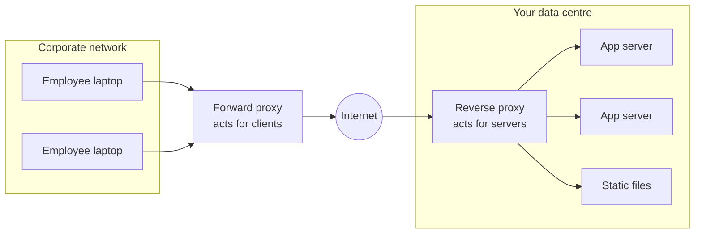

A proxy is a server that sits in the middle of a conversation and speaks for one side. Which side it speaks for is the whole
difference between a forward proxy and a reverse proxy — and reverse proxies, in many forms, are in front of almost every system
you will design.

## Why it matters

Load balancers, API gateways, CDNs, ingress controllers and service-mesh sidecars are all **reverse proxies** with different
specialisations. Understanding the general idea lets you explain what each box in your diagram does — terminate TLS, cache, compress,
route, retry, authenticate — and why putting that work in a proxy keeps application servers simpler.

## How it works

### Forward proxy: acts for clients

A **forward proxy** sits in front of a group of clients. Clients send their outbound requests to it, and it makes the requests to the
internet on their behalf. The destination server sees the proxy, not the client.

Uses: corporate egress control and content filtering, caching for many clients, hiding client identity, and controlling which external
services internal servers may call (an **egress proxy** allow-list).

### Reverse proxy: acts for servers

A **reverse proxy** sits in front of a group of servers. Clients connect to it believing it is the server; it forwards requests to one
of the real servers and relays the response. Clients never see the servers behind it.

What reverse proxies do for your system:

| Capability | What it means |
|---|---|
| **TLS termination** | Decrypts traffic once at the edge; certificates live in one place |
| **Load balancing** | Spreads requests across healthy backends |
| **Routing** | Sends `/api/*` and `/static/*` (or different hostnames) to different services |
| **Caching** | Serves repeated responses without touching the backend |
| **Compression** | gzip or Brotli responses, saving bandwidth |
| **Connection management** | Holds slow client connections and keeps a few pooled, fast connections to backends |
| **Security** | Hides backend addresses, enforces request size limits, filters bad traffic, terminates attacks at the edge |
| **Observability** | One place to log every request, add request IDs and measure latency |

The connection-management point is subtle but important. Slow clients (mobile networks) would otherwise hold an application thread for
the whole time it takes them to upload a request or download a response. A proxy such as NGINX buffers the request and response, so the
application handles the request at data-centre speed and moves on.

### The family of reverse proxies

| Component | A reverse proxy specialised for… |
|---|---|
| [Load balancer](lesson:load-balancers) | Spreading traffic across identical backends, health checking |
| [API gateway](lesson:api-gateway) | API concerns: auth, rate limits, routing to many services, request shaping |
| [CDN](lesson:cdn) | Caching and serving content from locations near users |
| Ingress controller | Routing external traffic into a Kubernetes cluster |
| Service-mesh sidecar | Service-to-service traffic: mTLS, retries, timeouts, telemetry for every call |

Products overlap heavily: NGINX, HAProxy and Envoy can each be configured as a load balancer, a gateway, a cache or a sidecar.

### Headers that carry the original request

Because the backend sees the proxy's connection, proxies add headers describing the original client: `X-Forwarded-For` (client IP
chain), `X-Forwarded-Proto` (http or https), `X-Forwarded-Host`, or the standard `Forwarded` header. Backends must trust these only from
their own proxies — otherwise a client can forge its IP address.

## Architecture



On the left, websites see requests coming from the forward proxy rather than from individual laptops. On the right, internet users see
the reverse proxy rather than individual app servers.

## Failure scenarios

- **The proxy becomes a single point of failure.** All traffic flows through it, so run at least two instances behind a highly available
  address (a floating IP, DNS with health checks, or a cloud load balancer).
- **The proxy becomes a bottleneck.** TLS, compression and buffering cost CPU and memory; scale proxies horizontally and watch their
  saturation like any other tier.
- **Misconfigured timeouts.** A proxy timeout shorter than a legitimate slow request turns it into a 504 error; a longer one ties up
  resources on hung backends. Set timeouts per route.
- **Header spoofing.** A backend that trusts `X-Forwarded-For` from anyone can be fooled into rate-limiting or authorising the wrong IP.
- **Cache poisoning.** A caching proxy that keys on the wrong inputs (ignoring a header that changes the response) serves one user's
  response to another.

## Trade-offs

- **Centralise or not.** Putting cross-cutting concerns in a proxy keeps services simple and consistent, but adds a hop (usually well
  under a millisecond inside a data centre) and a component that must be scaled and kept highly available.
- **Edge proxy vs sidecar.** An edge proxy handles north–south traffic (clients to services); sidecars handle east–west traffic
  (service to service) and give per-call mTLS, retries and telemetry, at the cost of running a proxy next to every service instance.
- **Smart proxy vs smart client.** Retries, load balancing and circuit breaking can live in proxies (language-independent) or in client
  libraries (no extra hop, but must be implemented per language).

## In real systems

- NGINX and HAProxy are long-standing reverse proxies and load balancers; Envoy is widely used as an edge proxy and as the sidecar in
  service meshes such as Istio.
- Cloud load balancers (AWS ALB, Google Cloud Load Balancing, Azure Application Gateway) are managed reverse proxies.
- Companies commonly route outbound calls from servers through an egress proxy so only approved external domains can be reached.

## Common mistakes

- **Mixing up the directions.** Forward proxies serve clients; reverse proxies serve servers.
- **Drawing one proxy box with no redundancy.** Every proxy on the request path needs a second instance.
- **Trusting forwarded headers blindly.** Only accept them from your own proxies.
- **Duplicating cross-cutting logic in every service** when the proxy layer could enforce it once.

## In the interview

````question title="What is the difference between a forward proxy and a reverse proxy?"
A forward proxy acts on behalf of clients: clients send their outbound requests through it, and destination servers see the proxy
instead of the client — used for egress control, filtering, caching and anonymity. A reverse proxy acts on behalf of servers: clients
connect to it as if it were the server, and it forwards requests to backends they never see — used for TLS termination, load
balancing, routing, caching, compression and protection. Load balancers, API gateways, CDNs and service-mesh sidecars are all
specialised reverse proxies.
````

````question title="Why put a reverse proxy in front of application servers even if there is only one server?"
It still terminates TLS, so certificates and cipher settings live in one place; it buffers slow clients so application threads aren't
tied up by slow networks; it can compress and cache responses, serve static files, enforce request size limits and add request IDs and
access logs. It also hides the server's address and makes adding a second server later a configuration change rather than a client
change.
````

## Key takeaways

- A **forward proxy** represents clients; a **reverse proxy** represents servers.
- Reverse proxies provide **TLS termination, load balancing, routing, caching, compression, buffering, security and logging**.
- Load balancers, gateways, CDNs, ingress controllers and sidecars are **specialised reverse proxies**.
- Proxies on the request path must be **redundant and scaled**, and forwarded headers trusted only from your own proxies.

## Knowledge check

```quiz
? A company requires all servers' outbound calls to external APIs to go through one place that enforces an allow-list. What is that component?
+ A forward (egress) proxy
- A reverse proxy
! A reverse proxy handles inbound traffic to your servers.
- A CDN
! CDNs cache and serve your content to users.
- A database connection pool
! Pools manage connections to a database, not outbound web traffic.
> Forward proxies act for clients — here, your servers acting as clients of external APIs.

? Which is NOT a typical reverse-proxy responsibility?
- TLS termination
! Reverse proxies commonly terminate TLS.
- Compressing responses
! Compression is a common proxy feature.
+ Executing the application's business transactions
- Routing requests to different services by path
! Path-based routing is a core proxy feature.
> Proxies handle cross-cutting concerns; business logic stays in services.

? Your rate limiter keys on the client IP from `X-Forwarded-For`, and attackers evade it by sending random values in that header. What is the fix?
- Stop using a reverse proxy
! The proxy isn't the problem; trusting client-supplied headers is.
+ Have the edge proxy overwrite or append the real client IP, and trust the header only from your own proxies
- Rate-limit on the User-Agent header instead
! Clients control that header too.
- Use UDP
! Unrelated to header trust.
> Forwarded headers are only trustworthy when set by infrastructure you control.

? Why does a buffering reverse proxy help an application serving many slow mobile clients?
- It makes the mobile network faster
! The client's network speed doesn't change.
+ The proxy absorbs slow uploads and downloads, so application threads handle each request quickly and move on
- It removes the need for TLS
! TLS is still used between client and proxy.
- It stores sessions for the application
! Session storage is a separate concern.
> Buffering decouples slow client transfers from expensive application resources.
```
