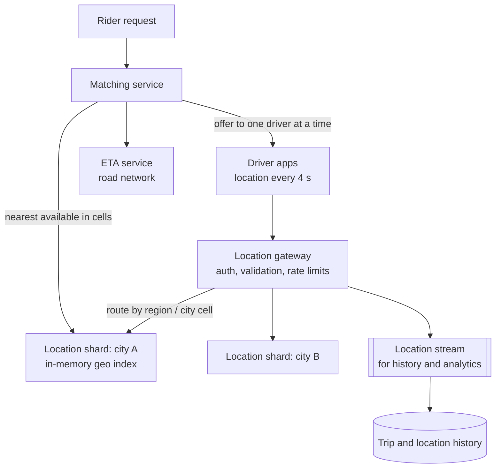
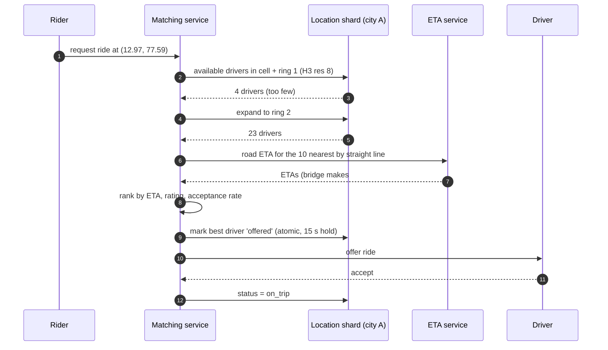

"Restaurants near me" and "the nearest available driver" are both proximity queries, but they're very different systems. Places barely
move and are read millions of times; drivers move every few seconds and are queried by a matching engine. This lesson turns
[geospatial indexes](lesson:geospatial-indexes) into two designs — **static places** and **moving objects** — and shows how to choose the
index, the update path and the ranking for each.

## The problem

| Aspect | Static places (shops, restaurants, hotels) | Moving objects (drivers, couriers, scooters) |
|---|---|---|
| Updates | Rare (new place, edited hours) | Every 3–5 seconds per object |
| Reads | Very high, often with text and filters | High, from a matching or dispatch service |
| Freshness | Minutes are fine | Seconds matter; stale positions mislead |
| Result | Ranked list: distance, rating, relevance | Best candidates for one assignment |
| Data size | Millions of places, rich attributes | Hundreds of thousands to millions of small records |

Moving objects are a [write-heavy](lesson:write-heavy) problem disguised as a search problem:

```drill
? 600,000 active drivers each send a location every 4 seconds. How many location updates per second?
= 150000
~ 1.1
> 600,000 ÷ 4 = 150,000 updates/s — far beyond what a disk-based spatial index should absorb as random updates.

? Each driver's live record (ID, position, status, timestamp, cell) is about 100 bytes. How much memory holds all 600,000?
= 60 MB
~ 1.3
> 600,000 × 100 B = 60 MB — tiny. Memory isn't the constraint for live positions; update throughput is.
```

## Architecture

**Static places** are a [read-heavy](lesson:read-heavy) search problem: store places in PostgreSQL with PostGIS (or Elasticsearch when text
relevance matters), cache popular queries by **cell + filters**, and update the index asynchronously when places change.

**Moving objects** need an **in-memory index**, partitioned by geography:



- **Index**: Redis `GEOADD`/`GEOSEARCH` per city, or an in-memory grid keyed by geohash or H3 cell → set of driver IDs, rebuilt from the
  stream if a node is lost ([Redis beyond caching](lesson:redis-beyond-cache)).
- **Updates**: overwrite the driver's position and move it between cells only when it crosses a boundary; give each entry a TTL so
  drivers who go silent disappear.
- **Sharding by geography**: a city or region per shard keeps queries local; dense cities split into several cell ranges
  ([sharding](lesson:sharding)).
- **History**: positions also flow into a durable stream for trip records, analytics and dispute resolution — but not on the query path.

## Request and data flow



Key ideas:

- **Expanding rings**: start with the rider's cell and its neighbours; widen the ring until enough candidates are found.
- **Distance is a filter, not the ranking**: straight-line distance picks candidates; **road ETA** ranks them, because a river or a
  one-way street can make the closest driver the slowest.
- **One offer at a time**: mark a driver `offered` atomically with a short hold, so two riders can't be matched to the same driver
  ([contention](lesson:contention)).
- **Static places** follow the same cover-filter-rank shape, with **relevance** (text match, rating, open now) blended into the score.

## Advantages

- **Fast queries**: in-memory cell lookups answer in milliseconds.
- **Absorbs high update rates**: overwriting a small record in memory is cheap.
- **Locality**: geographic sharding keeps both updates and queries within one shard.
- **Separation of concerns**: live state (memory), history (stream and database), and road-aware ranking (ETA service) scale independently.

## Disadvantages

- **Volatile state**: a lost shard loses live positions until drivers' next updates (seconds) — usually acceptable.
- **Hot regions**: a stadium after a concert or a city centre at rush hour concentrates load on one shard.
- **Boundary effects**: queries near shard or cell edges must consult neighbours, possibly on other shards.
- **ETA calls are expensive**: limit them to the top candidates.

## Failure scenarios

| Failure | What happens | Mitigation |
|---|---|---|
| Location shard restarts | Live positions missing briefly | Rebuild from the next updates (seconds) or replay the stream |
| Driver app goes offline | Ghost driver offered rides | TTL on positions; require a recent heartbeat to be "available" |
| Surge of requests in one area | Hot shard and cells | Split dense cells, replicate read-only views, rate-limit requests |
| Two riders matched to one driver | Double assignment | Atomic offer/hold on driver status |
| GPS noise or spoofing | Wrong positions, fraud | Smooth and validate (speed limits, map matching), anomaly detection |
| Query near a city boundary | Missed drivers on the other shard | Query neighbouring shards for edge cells |

## Alternatives

- **PostGIS for moving objects** at small scale (thousands of updates/s) — simpler, durable, but heavy under high update rates.
- **Elasticsearch** for static places with text and geo filters together ([Elasticsearch](lesson:elasticsearch)).
- **Precomputed results** for static data: nearest-N per cell refreshed periodically.
- **Batch matching**: collect requests for a second or two and solve a global assignment instead of greedy nearest-first.

## Where it shows up in interviews

Yelp-style local search, Uber and Lyft, food and grocery delivery, scooter and bike sharing, dating apps, and "friends nearby". Start by
classifying the data as static or moving, estimate the update rate, then choose a persistent geo index for places or a sharded in-memory
index for moving objects.

````question title="How do you store and query the locations of a million moving drivers?"
Keep live positions in memory, not in a disk-based spatial index: an in-memory grid keyed by geohash or H3 cell (or Redis GEO), sharded by
city or region so updates and queries stay local. Each update overwrites the driver's record and moves it between cells only when it crosses
a boundary; a TTL drops drivers who stop reporting. Positions are also streamed to durable storage for history. Queries search the rider's
cell and expanding rings of neighbours, then rank candidates by road ETA.
````

````question title="Why not rank drivers purely by distance?"
Straight-line distance ignores the road network: a driver 300 m away across a river or on the wrong side of a highway can be ten minutes
away. Distance is good for narrowing candidates cheaply; then an ETA service computes road travel times for the top few, and ranking also
considers factors like driver rating, acceptance likelihood and fairness of trip distribution.
````

## Common mistakes

- **One design for both static places and moving objects.**
- **Writing every location update into a relational spatial index** at high rates.
- **Querying only the rider's own cell.**
- **Ranking by straight-line distance alone.**
- **No TTL**, so offline drivers stay "available".
- **Matching without an atomic hold**, double-assigning drivers.

## Key takeaways

- Classify first: **static places** (persistent geo index, cached, read-heavy) versus **moving objects** (in-memory, write-heavy).
- Moving objects: **in-memory cell index sharded by geography**, **TTLs**, history via a **stream**.
- Query shape: **cover with cells and expanding rings → filter → rank** (by ETA and relevance, not just distance).
- Use **atomic holds** when a proximity result is a scarce resource.

## Knowledge check

```quiz
? 200,000 couriers send locations every 5 seconds. What dominates the design of the live location store?
- Storage size
! 200,000 small records fit easily in memory.
+ 40,000 updates per second, so an in-memory, sharded index rather than a disk-based spatial index
- Complex text queries
! Couriers aren't searched by text.
- Durability of every position
! History goes to a stream; live state can be rebuilt.
> Update throughput, not size, is the constraint.

? A rider's nearest driver by straight line is 400 m away across a river with no bridge nearby. How should matching handle it?
- Always pick the nearest by distance
! Ignores road reality.
+ Use distance only to shortlist candidates, then rank them by road ETA
- Exclude all drivers within 1 km
! Arbitrary and wrong.
- Ask the rider to walk to the driver
! Not a system design answer.
> Distance filters; ETA ranks.

? Drivers who close the app keep appearing as available for hours. What is missing?
+ A TTL or heartbeat requirement on live positions
- A bigger geohash precision
! Precision doesn't remove stale entries.
- A spatial index on driver ID
! The issue is staleness, not lookup.
- Synchronous replication
! Replication copies stale data too.
> Live state must expire without updates.

? Why shard live locations by geography rather than by driver ID?
- Driver IDs are not unique
! They are.
+ A nearby query then touches one shard (plus neighbours at edges), instead of every shard
- It balances load perfectly
! Geographic sharding can create hot regions.
- It removes the need for an index
! Each shard still needs a geo index.
> Keep spatial queries local.
```
