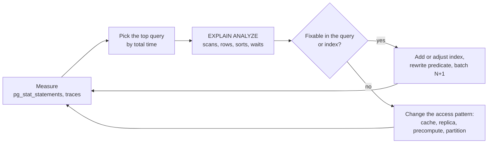

When a page is slow, the cause is very often a handful of queries doing far more work than they need to. Query optimisation is
the practice of finding those queries, reading how the database executes them, and fixing the plan — and recognising when no amount of
tuning will help because the access pattern itself has to change.

## Why it matters

In interviews, "the database is the bottleneck" is a common turn in the conversation. A strong answer doesn't jump straight to sharding:
it asks which queries are slow and why, fixes the cheap things (indexes, query shape, round trips), and then reaches for caching, replicas
or redesign. In production, a single missing index or an N+1 loop can take a healthy system down during a traffic spike.

## How it works

### Find the slow queries first

- **Query statistics:** PostgreSQL's `pg_stat_statements` extension (or MySQL's performance schema and slow query log) ranks queries by
  total time, calls and mean latency. Sort by **total time** — a 2 ms query run 10,000 times a second matters more than a 2 s report run
  hourly.
- **Traces:** distributed tracing shows which database calls a slow request made, how many and in what order.
- **Locks and waits:** a query can be slow because it waits for locks, not because it does much work.

### Read the plan

`EXPLAIN` shows the plan the optimiser chose; `EXPLAIN ANALYZE` runs the query and reports what actually happened. What to look for:

| Plan detail | What it tells you |
|---|---|
| `Seq Scan` on a large table with a selective filter | Missing or unusable index |
| `Rows Removed by Filter` in the hundreds of thousands | Reading far more rows than returned |
| Estimated rows far from actual rows | Stale statistics or correlated columns — the planner chose badly |
| `Sort` with `external merge  Disk:` | The sort spilled to disk; an index providing the order would avoid it |
| `Nested Loop` with a large outer side | A join doing per-row lookups many times — may need an index on the inner side or a hash join |
| `Buffers: shared read=…` | Pages read from disk rather than cache |

### The usual culprits and their fixes

**1. A function or cast on an indexed column.** An index on `email` stores emails as written; `lower(email)` produces different values, so
the index can't be used. Measured on PostgreSQL 18 with 200,000 users:

```sql
CREATE TABLE users (id bigint PRIMARY KEY, email text NOT NULL, name text NOT NULL);
CREATE INDEX users_email ON users (email);

EXPLAIN SELECT id FROM users WHERE lower(email) = 'user42@example.com';
```

```text title="Plan: the index on email can't serve lower(email)"
Seq Scan on users
  Filter: (lower(email) = 'user42@example.com'::text)
```

Fix: index the expression (or store a normalised column) so the predicate matches the index:

```sql
CREATE INDEX users_email_lower ON users (lower(email));
```

```text title="Plan after adding the expression index"
Index Scan using users_email_lower on users
  Index Cond: (lower(email) = 'user42@example.com'::text)
```

The same trap appears with `WHERE date(created_at) = '2026-03-01'` (rewrite as a range:
`created_at >= '2026-03-01' AND created_at < '2026-03-02'`), with implicit casts between text and numbers, and with leading wildcards
(`LIKE '%sql'`).

**2. The N+1 query pattern.** Code loads a list, then makes one query per item:

```text title="N+1: one query for the page, then one per row"
reviews = query("SELECT id, course_id FROM reviews ORDER BY created_at DESC LIMIT 50")
for each review: query("SELECT title FROM courses WHERE id = ?", review.course_id)   -- 50 more
```

On a one-million-row table, measured in-process with **no network** in between, the N+1 version took about **23 ms per page** and a
single join about **2.4 ms**. Over a real network each of those 51 queries also pays a round trip — at 0.5 ms each that is another 25 ms —
so the gap grows. Fix: one join, or one batched query (`WHERE id IN (…)` / `= ANY($1)`), which is what ORM "eager loading" and GraphQL data
loaders do.

```sql
CREATE TABLE courses (id bigint PRIMARY KEY, title text NOT NULL);
CREATE TABLE reviews (
  id bigint PRIMARY KEY, course_id bigint NOT NULL, created_at timestamptz NOT NULL
);

SELECT r.id, c.title
FROM (SELECT id, course_id FROM reviews ORDER BY created_at DESC LIMIT 50) AS r
JOIN courses c ON c.id = r.course_id;
```

**3. Reading more than you need.** `SELECT *` pulls large columns (descriptions, JSON blobs) the page doesn't show and prevents index-only
scans. Select the columns you use; paginate; don't fetch 10,000 rows to display 20.

**4. Deep `OFFSET`.** Covered in [pagination](lesson:pagination): `OFFSET 500000` walks half a million entries. Switch to keyset
pagination.

**5. Sorts and aggregates over huge sets.** "Top courses by enrolments this week" computed live over every enrolment is expensive at any
index quality. Precompute it ([denormalisation](lesson:normalization)) or cache it.

**6. Stale statistics.** The planner estimates row counts from statistics; after bulk loads they can be badly wrong. Run `ANALYZE`
(autovacuum normally does this), and consider extended statistics for correlated columns.

**7. Lock contention.** A slow query may be waiting for a row lock held by a long transaction; the fix is shorter transactions, not
indexes.

### When to stop tuning

Optimisation has diminishing returns. If a query is well-indexed, returns little data and is still too slow or too frequent, the
problem is the **access pattern**: too many reads (cache them), reads that could go to replicas ([scaling reads](lesson:scaling-reads)), a
computation that should be precomputed, or a dataset that has outgrown one machine ([sharding](lesson:sharding)). Recognising that moment
is as important as reading plans.

## Architecture



## Failure scenarios

- **A deploy introduces an N+1 loop.** Latency and database load jump with no traffic change; traces show dozens of identical queries per
  request.
- **A plan flips.** After statistics change, the planner switches from an index scan to a sequential scan for a query; latency jumps
  overnight. Monitoring per-query latency (not just averages for the whole database) catches it.
- **A missing index on a foreign key** makes deletes of parent rows scan child tables.
- **Optimising the wrong query.** Shaving 50% off a rare report while the real load is a hot lookup without an index.
- **Fixes that hurt writes.** Adding indexes to fix reads on a write-heavy table moves the problem.

## Trade-offs

- **Index vs precompute vs cache.** Indexes keep data live and cost writes; precomputation is fast but stale and complex to maintain;
  caching is fast but adds invalidation questions.
- **ORM convenience vs control.** ORMs speed up development but hide N+1 patterns and inefficient queries; inspect generated SQL for hot
  paths.
- **Query hints vs planner trust.** Forcing a plan fixes today's problem and breaks when data changes; prefer fixing statistics, indexes or
  the query.

## In real systems

- `pg_stat_statements` is the standard first stop for PostgreSQL performance work; managed services expose similar "top queries"
  dashboards (for example, Amazon RDS Performance Insights).
- ORMs offer batch loading to avoid N+1 queries — `JOIN FETCH` or entity graphs in JPA/Hibernate, `includes` in Rails, `select_related`
  and `prefetch_related` in Django.
- Many teams fail CI builds when a test request issues more than a set number of queries, to catch N+1 regressions early.

## Common mistakes

- **Guessing instead of measuring** which queries matter.
- **Reading `EXPLAIN` without `ANALYZE`** and trusting estimates that are wrong.
- **Wrapping indexed columns in functions.**
- **Jumping to sharding** before fixing indexes, N+1 queries and caching.
- **Treating averages as the whole story** — a query that is usually fast can have a terrible p99.

## In the interview

````question title="The database CPU is at 90% after a traffic increase. What do you do before adding replicas or sharding?"
Find out which queries consume the time — pg_stat_statements sorted by total time, and traces for the slowest endpoints. For the top
few, read EXPLAIN ANALYZE: sequential scans with selective filters mean a missing or unusable index; huge row counts removed by filters,
spilled sorts or deep offsets point to query-shape fixes; dozens of identical queries per request mean an N+1 pattern to batch. Fix
those, then cache hot, rarely changing reads and precompute expensive aggregates. Only if well-tuned queries still exceed one machine do
I add read replicas for read load or partition the data — and I'd say which query pattern forces it.
````

````question title="What is the N+1 query problem and how do you detect and fix it?"
It's loading a list with one query and then running one more query per item to fetch related data — 1 + N queries instead of one or two.
Each adds latency and a network round trip, and under load it multiplies database work. You detect it in traces (many identical queries
in one request), in query statistics (one query with a huge call count) or with tests that count queries per request. You fix it with a
join or a single batched query using IN or ANY on the collected IDs — eager loading in ORMs, data loaders in GraphQL.
````

## Key takeaways

- **Measure first**: rank queries by total time; use traces to see per-request query patterns.
- Read **EXPLAIN ANALYZE**: sequential scans, rows removed, estimate errors, spilled sorts, waits.
- Common fixes: **expression indexes or sargable predicates**, **batch N+1 queries**, select only needed columns, **keyset pagination**,
  fresh statistics.
- When a well-tuned query is still too expensive, **change the access pattern** — cache, replicate, precompute or partition.

## Knowledge check

```quiz
? `WHERE date(created_at) = '2026-03-01'` is slow despite an index on `created_at`. What is the best fix?
- Add a hash index on `created_at`
! A hash index on the raw column has the same problem.
+ Rewrite as a range: `created_at >= '2026-03-01' AND created_at < '2026-03-02'`
- Increase the shared buffers
! More memory doesn't make the predicate use the index.
- Use OFFSET pagination
! Pagination is unrelated to this predicate.
> Functions on indexed columns hide them from the index; ranges keep the predicate index-friendly.

? A request runs 1 query for 50 orders and then 50 queries for each order's customer. What is the fix?
+ Fetch all 50 customers in one query (join or `WHERE id = ANY(...)`)
- Add 50 database connections
! More connections don't remove the round trips or the extra work.
- Cache each customer query for a second
! It may help briefly but leaves the N+1 structure in place.
- Use a larger instance
! It buys headroom without fixing the pattern.
> Batch related lookups into one query.

? `EXPLAIN ANALYZE` shows the planner estimated 10 rows but 2,000,000 were read. What does this suggest?
- The query is optimal
! A 200,000× estimate error usually means a poor plan choice.
+ Statistics are stale or misleading, so the planner may have chosen the wrong plan
- The index is too large
! Index size doesn't explain estimate errors.
- The network is slow
! Estimates are computed inside the database.
> Refresh statistics (ANALYZE) or add extended statistics, then re-check the plan.

? A query is well indexed, returns 10 rows in 2 ms, and runs 40,000 times per second, saturating the database. What is the right next step?
- Add another index
! It's already well indexed.
+ Change the access pattern: cache the result, or serve it from read replicas
- Rewrite it in a stored procedure
! It still runs 40,000 times per second on the same database.
- Increase the query timeout
! Timeouts don't reduce load.
> When individual queries are cheap but too frequent, reduce how often they hit the database.
```
