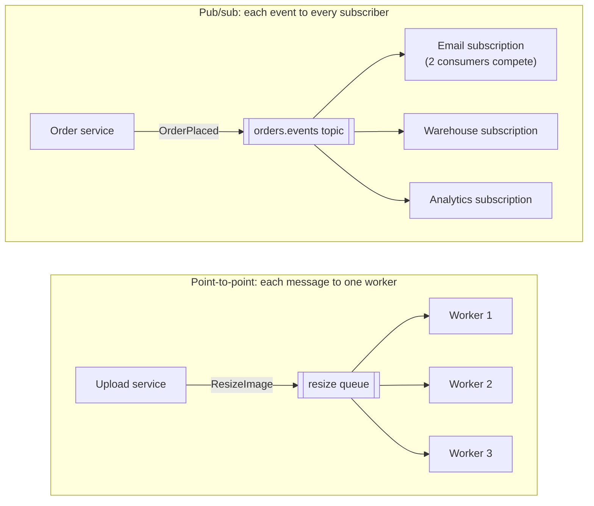

Messaging systems come in two basic shapes. A **queue** delivers each message to **one** of many consumers — a way to share work. A
**publish/subscribe topic** delivers each message to **every** subscriber — a way to broadcast events. Most real systems use both, often in
the same broker, and choosing the right shape for each flow is the first messaging decision in any design.

## Why it matters

Notification pipelines, order processing, chat fan-out, crawlers and analytics all rest on queues and topics. Interviewers expect you to say
which shape you need and why, how consumers scale, what happens when they fall behind, and how the same event reaches several independent
services without the producer knowing them.

## How it works

### Point-to-point queues

Producers send messages to a queue; a pool of consumers pulls from it, and each message is processed by **one** consumer — the
**competing consumers** pattern.

- **Scaling**: add consumers to process more messages in parallel.
- **Acknowledgement**: a consumer acknowledges a message after processing it; if it crashes first, the message becomes visible again and
  another consumer gets it (at-least-once delivery). SQS calls the hidden period the **visibility timeout** (30 seconds by default, up to 12
  hours).
- **Load levelling**: a burst of messages waits in the queue and is drained at the consumers' pace.
- **Typical uses**: background jobs (send this email, resize this image), work distribution, buffering writes.

### Publish/subscribe topics

Producers publish events to a topic; every **subscription** receives its own copy. Within a subscription, multiple consumers can still
compete for messages (a consumer group), so pub/sub and competing consumers combine naturally:

- The email service, the warehouse service and analytics each subscribe to `orders.events`; each gets every event.
- Inside the email service, five instances share the email subscription's messages.

Producers don't know who subscribes — new consumers can be added without changing the producer. That's the decoupling event-driven
architectures rely on.

### Fan-out implementations

- **Broker-managed subscriptions**: SNS topic → several SQS queues (one per subscriber); Google Pub/Sub subscriptions; RabbitMQ fanout
  exchanges bound to several queues.
- **Log-based topics**: Kafka topics retain messages; each **consumer group** tracks its own position (offset), so any number of groups read
  the same log independently, and a new group can even start from the beginning ([Kafka](lesson:kafka)).

### Message design

- **Events** describe something that happened (`OrderPlaced`, past tense); **commands** ask for something to happen (`SendEmail`). Topics
  carry events; queues often carry commands.
- Include an **event ID** (for deduplication), a **timestamp**, the **entity key** (for ordering and partitioning), a **schema version**,
  and either the data consumers need or a reference to fetch it.
- Keep messages small (brokers have limits — SQS allows up to 1 MiB per message); put large payloads in object storage and send a reference.

## Architecture



## Failure scenarios

- **Consumer crash mid-message**: the message is redelivered — so consumers must be idempotent ([deduplication](lesson:dedup)).
- **Slow processing exceeds the visibility timeout**: the message reappears while still being processed, and a second consumer starts on
  it. Extend the timeout while working, or keep processing short.
- **Poison message**: one message always fails, is redelivered forever and blocks progress. Limit receives and move it to a dead-letter
  queue ([retries and DLQs](lesson:retries-dlq)).
- **Backlog grows without bound**: consumers can't keep up; latency of processing grows. Monitor queue depth and age of the oldest
  message; scale consumers; apply [backpressure](lesson:backpressure).
- **Subscriber missing events**: a subscription created after events were published (non-retaining brokers) never sees them; log-based
  brokers can replay.

## Trade-offs

| | Queue (competing consumers) | Pub/sub |
|---|---|---|
| Delivery | Each message to one consumer | Each event to every subscription |
| Purpose | Share work | Broadcast facts |
| Coupling | Producer knows the work exists | Producer doesn't know subscribers |
| Adding a new reaction | Producer sends to another queue | Add a subscription; producer unchanged |
| Ordering | Usually best-effort (FIFO variants per group) | Per partition/key in log-based systems |

## In real systems

- Amazon SQS (queues) and SNS (topics) are commonly combined: SNS fans out to one SQS queue per consuming service.
- RabbitMQ routes messages through exchanges (direct, topic, fanout) to queues.
- Kafka and Google Pub/Sub serve both shapes: consumer groups compete within a subscription while different groups each get every message.
- Celery, Sidekiq and similar job frameworks implement work queues on top of Redis or RabbitMQ.

## Common mistakes

- **Using a queue when several services need the same event** — they'd steal messages from each other.
- **Non-idempotent consumers** under at-least-once delivery.
- **Huge messages** instead of references.
- **No dead-letter handling**, letting one bad message block a queue.
- **Producers that know every consumer**, defeating pub/sub's decoupling.

## In the interview

````question title="When would you use a queue and when a pub/sub topic?"
A queue when the message is work that should be done once, by any one of a pool of workers — resizing an image, sending a specific email —
because competing consumers share the load and a backlog simply waits. A pub/sub topic when the message is a fact that several independent
parts of the system care about — an order was placed — because each subscriber gets its own copy and new subscribers can be added without
changing the producer. They combine: the order topic fans out to an email subscription, inside which several instances compete for the
messages.
````

````question title="A consumer takes 2 minutes per message, but the queue's visibility timeout is 30 seconds. What happens?"
After 30 seconds the message becomes visible again while the first consumer is still working, so another consumer picks it up — duplicate
processing, wasted work and possibly duplicate side effects, repeating every 30 seconds. Fix it by extending the visibility timeout while
processing (a heartbeat that pushes it out), setting a timeout comfortably above the processing time, splitting the work into smaller
messages, and making the consumer idempotent anyway.
````

## Key takeaways

- **Queues** share work: each message to **one** of many competing consumers; **topics** broadcast: each event to **every** subscription.
- Combine them: **fan out** to subscriptions, **compete** within each.
- Delivery is **at-least-once**: idempotent consumers, visibility timeouts longer than processing, **DLQs** for poison messages.
- Send **events with IDs, keys and versions**; keep messages small and put large payloads in object storage.

## Knowledge check

```quiz
? Email, warehouse and analytics services all need every OrderPlaced event. Which design is right?
- One queue that all three services consume
! Competing consumers would split the events between services.
+ A topic with one subscription (or consumer group) per service
- The order service calls each service directly
! That couples the producer to every consumer.
- Three separate databases
! Not a messaging design.
> Pub/sub gives each subscriber its own copy.

? How do you process image-resize jobs faster when the queue backs up?
+ Add more competing consumers to the queue
- Add more subscriptions
! Each subscription would resize every image.
- Increase message size
! Unrelated to throughput.
- Lower the visibility timeout
! That causes duplicate processing.
> Competing consumers scale out work.

? Why include an event ID in every message?
- To order messages globally
! IDs don't impose order by themselves.
+ So consumers can detect and skip duplicates under at-least-once delivery
- Because brokers require it
! Most don't.
- To encrypt payloads
! Unrelated.
> Stable IDs make idempotent consumers possible.

? A 10 MB report must be processed asynchronously. What should the message contain?
- The full 10 MB report
! Many brokers limit message size (SQS: 1 MiB), and large messages slow everything.
+ A reference (object storage key) to the report, plus metadata
- Nothing; the consumer guesses the report
! The consumer needs to know which report.
- A compressed copy split over 20 messages
! Reassembly adds failure modes; use a reference.
> Messages carry references to large payloads.
```
