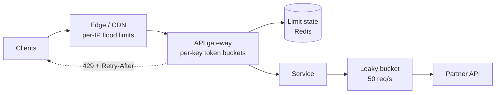
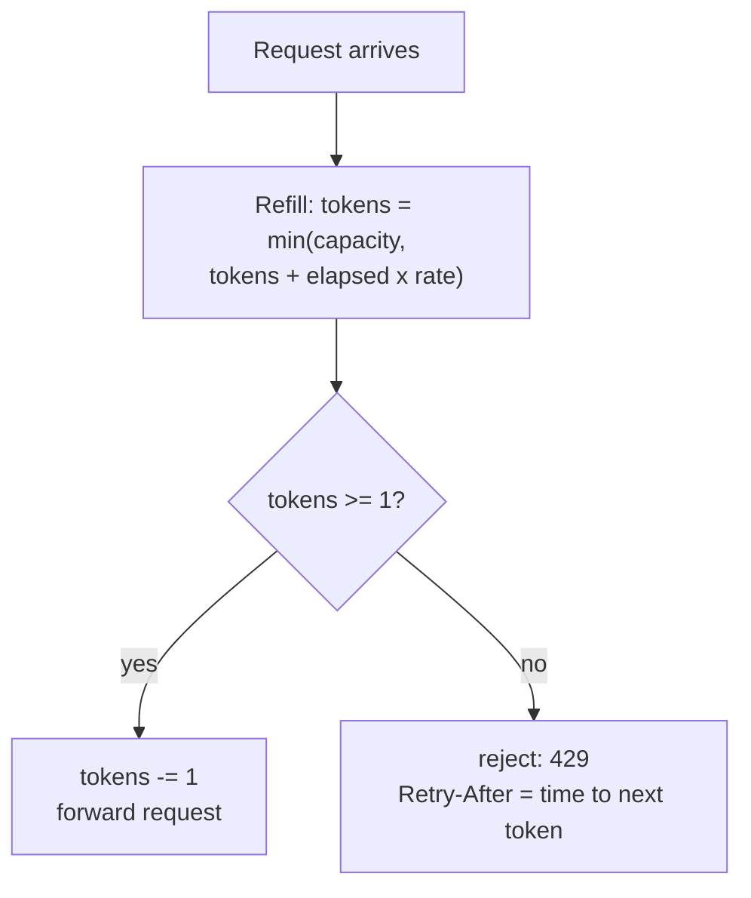

A rate limiter caps how many requests a client may make in a period. It protects services from abuse and accidents, shares
capacity fairly between customers, and keeps costs predictable. The algorithm you pick decides how bursts are treated — and how
much memory each limit costs.

## Why it matters

Without limits, one misbehaving client — a retry loop, a scraper, a buggy deploy, an attacker — can consume the capacity everyone else
needs. Rate limiting is therefore part of almost every public API and a common interview topic in two forms: as a component of a larger
design ("how do you stop abuse of the URL shortener?") and as a design problem of its own ([design a rate limiter](problem:rate-limiter)).
This lesson covers the algorithms on a single node; making them work across a fleet is covered in
[distributed rate limiting](lesson:distributed-rate-limiting).

## How it works

### Why and where

| Goal | Example limit |
|---|---|
| Stop abuse | 5 login attempts per account per 15 minutes |
| Fairness between tenants | 1,000 requests per minute per API key |
| Protect a fragile dependency | 50 requests per second to a partner API across the fleet |
| Control cost | 100 SMS messages per user per day |
| Shed overload | Reject excess requests before they queue and time out |

Limits apply at several layers: the **edge** (per IP, to absorb floods), the **API gateway** (per API key or user, per plan), and inside
**services** (protecting databases or third-party APIs). The key — IP, user, API key, tenant, endpoint — decides who shares a limit.

### The algorithms

**Fixed window counter.** Count requests per key in each calendar window (12:00:00–12:00:59). Simple: one counter per key per window,
one atomic increment per request. Flaw: a client can send the full limit at the end of one window and again at the start of the next —
**twice the limit within a second or two**.

**Sliding window log.** Store the timestamp of every accepted request; count those in the last N seconds. Exact, but memory grows with the
limit (one entry per request per key).

**Sliding window counter.** Approximate the sliding window from two fixed-window counters: the current window's count plus the previous
window's count weighted by how much of it still overlaps the sliding window. If 40% of the current minute has passed, the estimate is
`current + previous × 0.6`. Constant memory and much smoother than a fixed window; slightly approximate.

**Token bucket.** A bucket holds up to `capacity` tokens and refills at a steady `rate`. Each request takes a token; with none left, it
is rejected. Allows bursts up to the capacity, enforces the average rate over time, and needs only two numbers per key (tokens and last
refill time). The most common choice for API limits.

**Leaky bucket.** Requests enter a queue that drains at a fixed rate; when the queue is full, new requests are dropped. Output is perfectly
smooth — useful in front of something that needs a steady rate (a partner API, a payment processor) — but bursts wait in the queue,
adding latency.

| Algorithm | Memory per key | Bursts | Accuracy | Typical use |
|---|---|---|---|---|
| Fixed window | 1 counter | Up to 2× at window edges | Coarse | Simple quotas (per day) |
| Sliding window log | 1 entry per request | Exact | Exact | Low limits needing precision (logins) |
| Sliding window counter | 2 counters | Smoothed | Close approximation | General API limits |
| Token bucket | 2 numbers | Allowed up to capacity | Exact average rate | API limits with burst allowance |
| Leaky bucket | Queue | Queued, output smoothed | Exact output rate | Shaping traffic to a fixed-rate consumer |

### Telling clients

A rejected request gets **`429 Too Many Requests`**, ideally with a `Retry-After` header saying when to try again. Many APIs also return
the limit, what remains and when it resets — traditionally with vendor headers such as `X-RateLimit-Remaining`. The IETF HTTPAPI working
group is standardising `RateLimit-Policy` and `RateLimit` header fields (still an Internet-Draft in 2026), so check what your clients
expect. Well-behaved clients back off with exponential delays plus jitter.

### Overload is different from quotas

Per-client limits don't protect you when *all* clients together exceed capacity. **Load shedding** — rejecting or deprioritising work when
the service itself is saturated (queue depth, CPU, concurrency) — is the complementary mechanism; see
[graceful degradation](lesson:graceful-degradation).

## Architecture





## Failure scenarios

- **Limiter store unavailable.** If limits live in Redis and Redis is down, choose deliberately: **fail open** (allow traffic, risk
  overload) for most product APIs, **fail closed** (reject) where abuse is costly, such as login or SMS sending. A small local fallback
  limit per instance is a common compromise.
- **Shared IP addresses.** Per-IP limits punish everyone behind a corporate NAT or mobile carrier gateway; prefer user or API-key limits
  for authenticated traffic.
- **Retry storms from rejected clients.** Clients that retry 429s immediately keep the load high. Send `Retry-After`, and document
  backoff with jitter.
- **Clock and window edges.** Fixed windows allow double bursts at boundaries; distributed limiters with skewed clocks disagree about
  windows.
- **Limits that are too tight.** Legitimate batch jobs or launches get throttled. Monitor rejection rates per key and offer higher tiers.

## Trade-offs

- **Precision vs memory.** Sliding logs are exact but costly; counters and buckets use constant memory with small inaccuracies.
- **Burst tolerance vs smoothness.** Token buckets let short bursts through (friendly to real clients); leaky buckets smooth output
  (friendly to fragile dependencies) at the cost of queueing delay.
- **Local vs global limits.** Per-instance limits are fast and dependency-free but inexact (each of 20 instances allowing 100/min means
  up to 2,000/min); a shared store is exact but adds a network call per request.
- **Fail open vs fail closed.** Availability for users versus protection for the system.

## In real systems

- Cloud API gateways (for example AWS API Gateway) throttle with token-bucket semantics — a steady-state rate plus a burst limit.
- Stripe, GitHub and others document per-key rate limits and return 429 responses; GitHub exposes remaining-quota headers.
- NGINX's `limit_req` module implements a leaky-bucket-style limiter with an optional burst queue.
- Redis is the usual shared store for distributed limiters, with Lua scripts or atomic commands so check-and-update is one step.

## Java and Spring Boot example

Three algorithms fed the same traffic — a limit of "10 requests per minute", hit with 10 requests at 59.0 s, 10 more at 60.0 s (just
across a minute boundary), and 10 at 90.0 s. A simulated clock keeps the output deterministic.

```java file="RateLimiters.java"
import java.util.ArrayDeque;
import java.util.Deque;

// Three ways to enforce "10 requests per minute", fed the same traffic:
// 10 requests at 59.0 s, then 10 more at 60.0 s - just across a minute boundary.
public class RateLimiters {

    interface Limiter {
        boolean allow(long nowMillis);
    }

    // Counts requests per calendar minute; the count resets at each boundary.
    static class FixedWindow implements Limiter {
        private final int limit;
        private long window = -1;
        private int count;

        FixedWindow(int limit) {
            this.limit = limit;
        }

        public boolean allow(long nowMillis) {
            long current = nowMillis / 60_000;
            if (current != window) {
                window = current;
                count = 0;
            }
            return ++count <= limit;
        }
    }

    // Remembers each accepted request's time and counts those in the last 60 s.
    static class SlidingWindowLog implements Limiter {
        private final int limit;
        private final Deque<Long> accepted = new ArrayDeque<>();

        SlidingWindowLog(int limit) {
            this.limit = limit;
        }

        public boolean allow(long nowMillis) {
            while (!accepted.isEmpty() && accepted.peekFirst() <= nowMillis - 60_000) {
                accepted.pollFirst();
            }
            if (accepted.size() < limit) {
                accepted.addLast(nowMillis);
                return true;
            }
            return false;
        }
    }

    // Holds up to `capacity` tokens, refilled continuously; each request spends one.
    static class TokenBucket implements Limiter {
        private final double capacity;
        private final double refillPerMilli;
        private double tokens;
        private long last;

        TokenBucket(int capacity, double refillPerSecond) {
            this.capacity = capacity;
            this.refillPerMilli = refillPerSecond / 1000.0;
            this.tokens = capacity; // starts full, so an idle client may burst
        }

        public boolean allow(long nowMillis) {
            tokens = Math.min(capacity, tokens + (nowMillis - last) * refillPerMilli);
            last = nowMillis;
            if (tokens >= 1) {
                tokens -= 1;
                return true;
            }
            return false;
        }
    }

    public static void main(String[] args) {
        run("Fixed window", new FixedWindow(10));
        run("Sliding window log", new SlidingWindowLog(10));
        run("Token bucket", new TokenBucket(10, 10 / 60.0));
    }

    static void run(String name, Limiter limiter) {
        int first = burst(limiter, 59_000, 10);
        int second = burst(limiter, 60_000, 10);
        int later = burst(limiter, 90_000, 10);
        System.out.printf("%-19s 59.0 s: %2d/10   60.0 s: %2d/10   90.0 s: %2d/10%n",
                name, first, second, later);
    }

    static int burst(Limiter limiter, long at, int requests) {
        int allowed = 0;
        for (int i = 0; i < requests; i++) {
            if (limiter.allow(at)) {
                allowed++;
            }
        }
        return allowed;
    }
}
```

```text title="Output" output="RateLimiters.java"
Fixed window        59.0 s: 10/10   60.0 s: 10/10   90.0 s:  0/10
Sliding window log  59.0 s: 10/10   60.0 s:  0/10   90.0 s:  0/10
Token bucket        59.0 s: 10/10   60.0 s:  0/10   90.0 s:  5/10
```

The fixed window lets **20 requests through in one second** because the counter resets at 60.0 s. The sliding log refuses the second
burst because all ten earlier requests are still inside the last 60 seconds. The token bucket also refuses it (only a sixth of a token
has refilled), but by 90.0 s it has earned five tokens back — it enforces the *average* rate while allowing an occasional burst. In
production these run in a shared store such as Redis so every gateway instance sees the same count.

## Common mistakes

- **Using a fixed window** where boundary bursts matter, without acknowledging the 2× burst.
- **Rate-limiting only by IP** for authenticated APIs.
- **Returning 429 without `Retry-After`** or guidance, so clients hammer the API.
- **No decision on fail-open vs fail-closed** when the limiter's store is unavailable.
- **Confusing per-client limits with overload protection** — you need both.

## In the interview

````question title="Compare the token bucket and sliding window algorithms. Which would you use for a public API?"
A token bucket keeps two numbers per key — tokens and last refill time — refills at the allowed average rate and allows bursts up to
its capacity; it is cheap, exact about the long-run rate and friendly to real clients that are occasionally bursty. A sliding window
log stores every request time and is exact over any window, but memory grows with the limit; the sliding window counter approximates
it with two fixed-window counters. For a public API I'd use a token bucket per API key with a burst allowance matching the plan, stored
in Redis and updated atomically, returning 429 with Retry-After. For something like login attempts, where precision matters and limits
are small, a sliding window log is fine.
````

````question title="Your rate limiter runs in Redis. What happens if Redis goes down?"
That is a policy decision to make in advance. For most product traffic I'd fail open — let requests through, perhaps with a
conservative per-instance local limit as a fallback — because rejecting everyone is an outage caused by a protective component. For
abuse-sensitive endpoints such as login, password reset or SMS sending, I'd fail closed, because the cost of abuse is higher than a
brief denial. Either way: alert on it, keep the Redis call on a tight timeout so it can't slow every request, and run Redis replicated.
````

## Key takeaways

- Rate limits protect against **abuse, unfairness, cost and overload**, applied per **IP, user, key or tenant** at several layers.
- **Fixed windows** allow 2× bursts at boundaries; **sliding windows** fix that; **token buckets** allow bounded bursts with an exact
  average rate; **leaky buckets** smooth output.
- Reject with **429 + Retry-After**; clients should back off with jitter.
- Decide **fail-open vs fail-closed** for the limiter's store, and pair quotas with **load shedding**.

## Knowledge check

```quiz
? A fixed-window limiter allows 100 requests per minute. What is the most a client can get through within about two seconds?
- 100
! It can get 100 at the end of one window and 100 at the start of the next.
+ 200
- 300
! Only two windows are involved within two seconds.
- 50
! The limit per window is 100.
> The counter resets at the boundary, allowing the full limit on each side of it.

? Which algorithm best protects a partner API that can handle exactly 20 requests per second, smoothly?
- Fixed window
! It allows bursts at boundaries.
- Token bucket with a large capacity
! A large bucket lets big bursts through.
+ Leaky bucket (a queue drained at 20 per second)
- No limiter; rely on retries
! Retries add load instead of shaping it.
> A leaky bucket outputs at a constant rate, queueing or dropping the excess.

? A token bucket has capacity 20 and refills 5 tokens per second. It is empty. How many requests can succeed in the next 2 seconds if they arrive steadily?
- 0
! The bucket refills continuously.
+ About 10
- 20
! That would require 4 seconds of refill or a full bucket.
- 40
! Capacity and refill rate don't add up to that.
> 5 tokens/s × 2 s = 10 tokens, each allowing one request.

? Which response tells a client it is being rate-limited and when it may retry?
- 401 Unauthorized with no headers
! 401 means authentication failed.
- 503 Service Unavailable
! 503 signals the service itself is unavailable; it isn't the standard rate-limit status.
+ 429 Too Many Requests with a Retry-After header
- 200 OK with an error message in the body
! A success status hides the throttling from clients and tooling.
> 429 is the standard status for rate limiting; Retry-After says when to try again.
```
