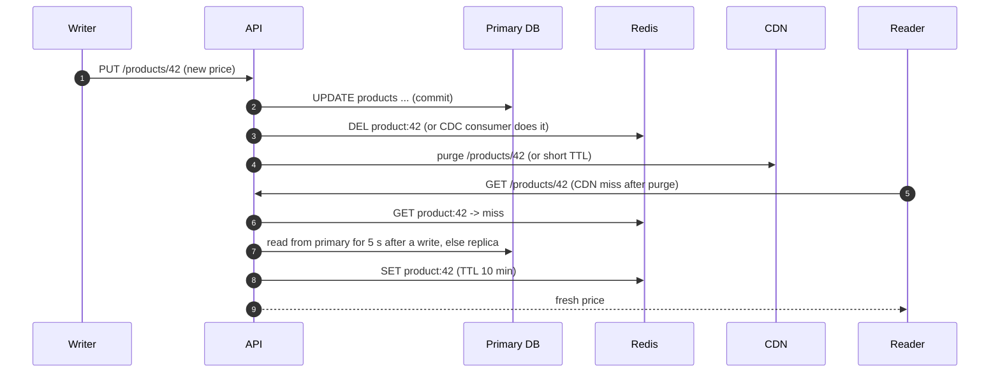

Most consumer products are read-heavy: a product page, a profile or a short link is read hundreds or thousands of times for every write.
The pattern for these systems is **layering** — each layer answers most of the requests that reach it, so only a trickle reaches the
database. This lesson assembles the pieces from earlier stages (CDNs, caches, replicas, read models) into one design you can draw and
defend.

## The problem

Signals that a problem is read-heavy:

- A read:write ratio of **10:1 or more** — often 100:1 for content, profiles and catalogues, 1000:1+ for short-link redirects.
- **Popularity skew**: a small fraction of items gets most of the traffic (a viral post, a bestseller).
- **Latency targets on reads** (p99 of 50–200 ms) that a database round trip per request makes hard at peak.
- **Tolerance for slight staleness** on most reads — a like count a few seconds old is fine; a bank balance is not.

One relational primary serves thousands to tens of thousands of indexed reads per second ([numbers to know](lesson:numbers-to-know)).
At 200,000 reads/s you need almost all of them answered **before** the database.

## Architecture

```mermaid title="Layered read path: each layer absorbs most of what reaches it"
flowchart TB
  U["Clients<br/>HTTP cache, app cache"]:::client --> CDN["CDN edge<br/>public, cacheable responses"]:::lb
  CDN -->|"miss"| LB["Load balancer"]:::lb
  LB --> API["Stateless API servers<br/>small in-process cache for the hottest keys"]:::svc
  API -->|"miss"| RC[("Distributed cache<br/>Redis / Memcached")]:::cache
  RC -.->|"miss"| RR[("Read replicas<br/>or read models")]:::db
  API -->|"writes"| P[("Primary database")]:::db
  P -->|"replication"| RR
  P -->|"CDC: invalidate / update"| RC
```

The layers, from the user inward:

1. **Client caching**: HTTP `Cache-Control`, ETags and app-level caches avoid requests entirely.
2. **CDN**: public, cacheable responses (images, static pages, public API responses) served from the edge ([CDN](lesson:cdn)).
3. **In-process cache**: a small, short-TTL cache on each API server for the very hottest keys — no network hop
   ([local vs distributed cache](lesson:local-vs-distributed-cache)).
4. **Distributed cache**: the shared cache-aside layer with TTLs and invalidation ([cache patterns](lesson:cache-patterns)).
5. **Read replicas and read models**: replicas for queries that miss; denormalised views or search indexes for queries the primary schema
   serves badly ([scaling reads](lesson:scaling-reads), [event sourcing and CQRS](lesson:event-sourcing-cqrs)).
6. **Primary**: writes, plus reads that must be fresh.

## Request and data flow

Hit ratios multiply. Suppose 100,000 reads/s arrive; the CDN serves 80%, the in-process cache 30% of what's left, and Redis 95% of the rest:

```text title="Load per layer"
arrive at CDN            100,000 /s
reach API servers         20,000 /s   (80% CDN hits)
reach Redis               14,000 /s   (30% in-process hits)
reach the database           700 /s   (95% Redis hits)
```

Seven hundred reads per second is comfortable for one replica. The same arithmetic shows why a **cache flush** is dangerous: with Redis
empty, the database sees 14,000/s — twenty times its normal load ([cache failure modes](lesson:cache-failure-modes)).

```drill
? 50,000 reads/s; the CDN serves 60%, and Redis serves 90% of what reaches it. How many reads/s reach the database?
= 2000
~ 1.1
> 50,000 × 0.4 = 20,000 reach the API; 20,000 × 0.1 = 2,000 miss Redis and reach the database.

? Same system: Redis is flushed by mistake. How many reads/s hit the database until the cache refills?
= 20000
~ 1.1
> Everything that passes the CDN — 20,000/s, ten times the normal 2,000/s.
```

The **write path** keeps layers fresh enough:



Freshness is chosen **per layer and per field**: prices may get a 30-second TTL and explicit invalidation; review counts a 5-minute TTL;
images are immutable and cached for a year under versioned URLs.

## Advantages

- **Massive read capacity** from cheap layers; the database handles a small fraction of traffic.
- **Lower latency**: most reads finish at the edge or in memory.
- **Resilience**: stale-but-available cached data can keep reads working when the database struggles (serve stale on error).
- **Independent scaling**: each layer scales on its own (more edge capacity, more cache nodes, more replicas).

## Disadvantages

- **Staleness**: every layer can serve old data; invalidation is the hard part ([cache invalidation](lesson:cache-invalidation)).
- **Complexity**: more components to run, monitor and reason about.
- **Cold-start risk**: the system depends on warm caches; a flush or new region can overload the database
  ([cache warming](lesson:cache-warming)).
- **Personalised content** caches poorly at the edge — per-user responses multiply cache keys.

## Failure scenarios

| Failure | What happens | Mitigation |
|---|---|---|
| Hot key expires | Thousands of concurrent misses hit the database | Request coalescing, early refresh, locks per key |
| Cache cluster lost | Database load jumps by the cache's hit ratio | Replicas, gradual warm-up, load shedding, serve stale |
| Replica lag | Users don't see their own writes | Read-your-writes routing to the primary after a write |
| CDN purge delayed | Old content visible at some edges | Versioned URLs for assets, short TTLs for dynamic pages |
| Popular item updated constantly | Invalidations defeat the cache | Short TTL instead of invalidation, or update-in-place |

## Alternatives

- **A bigger database** — vertical scaling plus indexes may be enough at modest scale; don't add layers you don't need.
- **Precomputation** — generate pages or responses ahead of time (static site generation, materialised views) when the set of items is
  known and changes rarely.
- **Read models (CQRS)** — maintain a separate store shaped exactly like the read query (a denormalised document, a search index), updated
  from change events.
- **Edge compute** — assemble responses at the edge from cached fragments when pages mix public and personal data.

## Where it shows up in interviews

URL shorteners (redirects at 100:1+), product catalogues, news and content sites, profile pages, local business search, and the read side
of feeds. Say the read:write ratio out loud, then walk the layers and the hit-ratio arithmetic, then name the freshness requirement per
field.

````question title="Your service has 200,000 reads per second and a single PostgreSQL primary. How do you scale reads?"
Layer it. Cacheable public responses go through a CDN; API servers keep a tiny in-process cache for the hottest keys; a Redis cluster serves
cache-aside reads with TTLs and invalidation on writes; misses go to read replicas, with read-your-writes requests routed to the primary for
a few seconds after a user's own write. With 80% CDN and 95% cache hit ratios, the database sees 5% of the 20% that pass the CDN — about
2,000 reads/s, easily handled by replicas. Then I'd protect it from stampedes and cache loss with coalescing and gradual warm-up.
````

````question title="How fresh is the data in your read path, and how do you control it?"
It depends on the field. Immutable assets are cached for a long time under versioned URLs; prices or stock use short TTLs plus explicit
invalidation from the write path or a CDC consumer; counters tolerate minutes. Users always see their own edits because their reads go to the
primary (or bypass caches) for a short window after writing. The rest of the time, staleness is bounded by the TTL of each layer.
````

## Common mistakes

- **Adding a cache without stating the hit ratio** and what the database sees on a miss storm.
- **Caching personalised responses at the CDN** — leaking or fragmenting data.
- **Treating replicas as consistent** and breaking read-your-writes.
- **One TTL for everything** instead of choosing freshness per field.
- **No plan for a cold cache** after a flush, deploy or regional failover.

## Key takeaways

- Read-heavy systems are **layers**: client, CDN, in-process cache, distributed cache, replicas or read models, primary.
- **Hit ratios multiply**: a few layers at 80–95% each reduce database load by orders of magnitude — and a flush multiplies it back.
- Choose **freshness per field** and keep **read-your-writes** for the author.
- Protect the database from **stampedes** and **cold starts**.

## Knowledge check

```quiz
? 100,000 reads/s; CDN hit ratio 90%; Redis hit ratio 90% of the remainder. What does the database serve?
- 10,000/s
! That's after the CDN only.
+ 1,000/s
- 100/s
! That would require 99% at the second layer.
- 0/s
! Misses always exist.
> 100,000 × 0.1 × 0.1 = 1,000.

? After updating their profile, users sometimes see the old version for a few seconds. The design reads from replicas. What is the targeted fix?
- Disable replicas
! Gives up read scaling for everyone.
+ Route that user's reads to the primary (or bypass caches) for a short window after their write
- Make replication synchronous
! Costs write latency everywhere.
- Lower every cache TTL to 1 second
! Hurts hit ratios and doesn't fix replica lag.
> Read-your-writes only matters for the writer.

? Which response should NOT be cached at a shared CDN?
- A product image
! Immutable and public.
- A public product page with a 60 s TTL
! Public and tolerant of brief staleness.
+ A user's account page with their address and orders
- A JavaScript bundle with a hashed filename
! Immutable and public.
> Personal data must not be cached in shared edge caches.

? Why is a full cache flush dangerous in a read-heavy system?
+ The database suddenly receives all the traffic the cache was absorbing, often many times its capacity
- The cache cluster cannot restart
! It can; it's just empty.
- Writes stop working
! Writes go to the primary regardless.
- CDN caches are flushed too
! They're independent layers.
> Warm gradually and shed load while refilling.
```
