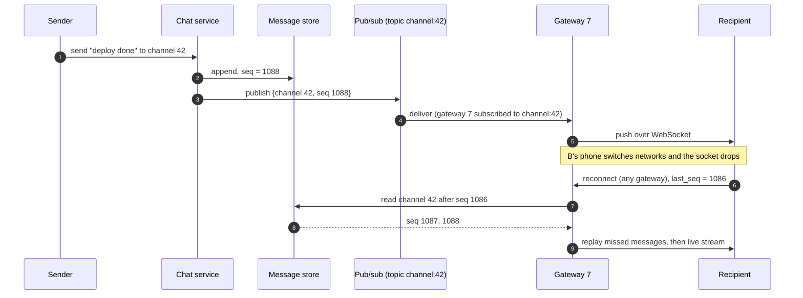

Chat messages, live comments, driver locations, collaborative cursors, stock prices: real-time features push updates to clients the moment
they happen. One server holding a few thousand WebSockets is easy. Ten million concurrent connections spread across hundreds of servers raise
three hard questions: **where is this user connected, how does an update get there, and what happens when the connection drops?**

## The problem

[Real-time transport](lesson:realtime-transport) chose the wire protocol — WebSockets for two-way traffic, server-sent events (SSE) for
one-way streams, long polling as a fallback. At scale the difficulties are elsewhere:

- **Connections are stateful and pinned**: a user's socket lives on one specific gateway server, but the event that concerns them is
  produced by some other service, on some other machine.
- **Fan-out**: one event (a message in a 10,000-member channel, a comment on a stream with 2 million viewers) must reach many sockets on
  many gateways ([fan-out](lesson:fan-out)).
- **Connections drop constantly**: mobile networks, deploys, crashes. Clients must catch up on what they missed without duplicates.
- **Resources per connection**: memory for buffers, file descriptors, heartbeats — multiplied by millions.

```drill
? 12 million concurrent connections at peak; each gateway is sized for 120,000 connections at target utilisation. How many gateways?
= 100
~ 1.1
> 12,000,000 ÷ 120,000 = 100 gateways, plus spare capacity for a zone failure and rolling deploys.
```

## Architecture

```mermaid title="Gateways hold sockets; a routing layer delivers events to them"
flowchart TB
  C["Clients<br/>WebSocket / SSE"]:::client --> LB["L4 load balancer<br/>long-lived TCP"]:::lb
  LB --> G1["Gateway 1<br/>~100K sockets"]:::svc
  LB --> G2["Gateway 2"]:::svc
  LB --> G3["Gateway N"]:::svc
  REG[("Session registry<br/>Redis, TTL heartbeats")]:::cache
  G1 & G2 & G3 -->|"register user -> gateway,<br/>subscribe to topics"| REG
  APP["Application services<br/>chat, comments, location"]:::svc
  DB[("Durable store<br/>per-stream sequence numbers")]:::db
  APP -->|"persist first"| DB
  APP -->|"publish event"| PS[["Pub/sub layer<br/>partitioned by topic"]]:::queue
  PS -->|"only to gateways with subscribers"| G1 & G2 & G3
```

The components:

- **Connection gateways** do one job: terminate sockets, authenticate, keep heartbeats, and write events to sockets. Keep business logic out
  so they're cheap to scale and safe to restart.
- **Session registry** maps users (or devices) to gateways, with TTLs refreshed by heartbeats so dead entries expire.
- **Routing**, one of two styles:
  - **Direct**: look up the user's gateway in the registry and send the event to that gateway (good for one-to-one delivery).
  - **Topic-based**: gateways subscribe to topics (`channel:42`, `stream:9`) for the sockets they hold; publishers publish to the topic;
    the pub/sub layer delivers only to subscribed gateways (good for channels and broadcasts).
- **Durable store with sequence numbers**: every event is persisted **before** it's pushed, with a per-stream sequence number. The push
  is a fast path; the store is the truth.

## Request and data flow



Rules that make this robust:

- **Persist, then publish**: if the pub/sub layer drops a message (many, like Redis pub/sub, are fire-and-forget), the client recovers it
  from the store on its next catch-up.
- **Sequence numbers per stream** let clients detect gaps, ask for exactly what they missed, and drop duplicates
  ([delivery semantics](lesson:delivery-semantics)).
- **Reconnects with jittered backoff**: when a gateway dies, its 100,000 clients reconnect; without randomised delays they arrive at once
  and knock over the next gateway.
- **Graceful draining on deploy**: a gateway stops accepting new sockets and asks its clients to reconnect over a few minutes.
- **Bounded per-connection buffers**: a slow client can't consume unlimited memory; drop or coalesce updates (keep only the latest
  location), and disconnect clients that fall too far behind ([backpressure](lesson:backpressure)).
- **Presence** is a heartbeat-refreshed key with a TTL; presence changes are pushed only to users who can see them (contacts, channel
  members currently viewing), and batched, because presence chatter can exceed message traffic.

## Advantages

- **Low latency**: updates reach clients in tens to hundreds of milliseconds instead of a polling interval.
- **Efficient**: no wasted polling requests for clients with nothing new.
- **Horizontally scalable**: gateways scale with connections; pub/sub partitions scale with topics; services stay stateless.
- **Resilient by design**: the durable log plus sequence numbers make dropped pushes harmless.

## Disadvantages

- **Stateful tier**: gateways hold connections, so deploys, autoscaling and failures cause reconnect waves.
- **More moving parts**: registry, pub/sub, catch-up logic, heartbeats.
- **Load balancing is coarse**: long-lived connections don't rebalance when new gateways are added; rebalance by draining.
- **Mobile constraints**: background apps lose sockets; offline users need push notifications instead.

## Failure scenarios

| Failure | Impact | Mitigation |
|---|---|---|
| Gateway crashes | 100K clients disconnected at once | Jittered reconnect backoff, spare capacity, catch-up by sequence number |
| Pub/sub node fails | Live pushes lost for some topics | Persist-before-publish; clients detect gaps and fetch from the store |
| Registry entry stale | Events sent to the wrong gateway | TTL heartbeats; gateway rejects unknown users; fall back to catch-up |
| Hot topic (2M viewers) | One pub/sub partition and many gateways overloaded | Hierarchical fan-out (relays), sampling or batching updates |
| Slow clients | Gateway memory grows | Bounded buffers, coalescing, disconnect laggards |
| Deploy restarts all gateways | Reconnect storm | Drain gradually; roll a few gateways at a time |

## Alternatives

- **Polling or long polling** when updates are infrequent or latency tolerance is seconds — far simpler to operate.
- **SSE** for one-way streams (feeds, comments, dashboards): plain HTTP, automatic reconnect with `Last-Event-ID`.
- **Managed services** (AWS API Gateway WebSockets, Ably, Pusher, Firebase) when connection management isn't your core problem.
- **Push notifications** (APNs, FCM) for users who aren't connected.

## Where it shows up in interviews

Chat and messaging, live comments and reactions, ride tracking, collaborative editing, live sports scores, trading screens and in-app
notifications. Draw the gateway tier, say how events are routed to the right gateway, and explain how a client that reconnects gets exactly
what it missed.

````question title="A user is connected to gateway 17. A message for them is created by a service on another machine. How does it reach them?"
Gateways register each connected user in a session registry (user → gateway, with a heartbeat-refreshed TTL) or subscribe to topics for the
conversations their users are in. The service persists the message with a sequence number, then publishes it — either directly to gateway 17
after a registry lookup, or to the conversation's topic, which delivers it to every gateway with subscribers. Gateway 17 writes it to the
socket. If anything along the way drops it, the client notices the sequence gap and fetches the message from the store.
````

````question title="How do you handle 10 million clients reconnecting after a regional outage?"
Make reconnects cheap and spread out. Clients use exponential backoff with random jitter, so arrivals are spread over minutes rather than
seconds; gateways have spare capacity and admit connections at a controlled rate, returning a retry-after hint when overloaded. On
reconnect, clients send their last sequence numbers and receive only missed events, paginated, rather than a full resync. Non-essential
streams (presence, typing indicators) are restored last.
````

## Common mistakes

- **Publishing before persisting**, so a dropped push means a lost message.
- **No sequence numbers**, so clients can't detect gaps or duplicates.
- **Business logic in gateways**, making them expensive and risky to restart.
- **Broadcasting every event to every gateway** instead of routing by subscription.
- **Ignoring reconnect storms** and slow clients.
- **Treating presence as cheap** — it can be the largest source of traffic.

## Key takeaways

- Separate a **gateway tier** (sockets only) from **services**; connect them with a **registry** and/or **topic-based pub/sub**.
- **Persist first, then push**; use **per-stream sequence numbers** so reconnecting clients catch up exactly.
- Plan for **reconnect storms** (jittered backoff, draining) and **slow consumers** (bounded buffers).
- Size gateways by **connections**, pub/sub by **topics and fan-out**, and handle **hot topics** with hierarchical fan-out.

## Knowledge check

```quiz
? Why should a chat service persist a message before publishing it to the pub/sub layer?
- Publishing is slower than persisting
! Speed isn't the reason.
+ If the push is lost (gateway crash, fire-and-forget pub/sub), the client can still recover the message from the store by sequence number
- Pub/sub layers require a database ID
! They don't.
- To encrypt it
! Encryption is unrelated.
> The store is the truth; the push is the fast path.

? A gateway holding 150,000 connections crashes, and the next two gateways fall over seconds later. What was missing?
+ Jittered exponential backoff on client reconnects (and admission control on gateways)
- A larger heartbeat interval
! Heartbeats don't control reconnect timing.
- Sequence numbers
! They help catch up, not spread load.
- A bigger database
! The overload is on gateways.
> Reconnect storms need randomised delays.

? A client reconnects and reports last_seq = 5,000 for a channel now at 5,040. What should the server do?
- Send the full channel history
! Wasteful.
+ Send messages 5,001 to 5,040, then continue with live updates
- Send only new messages from now on
! The client would miss 40 messages.
- Ask the client to refresh the page
! Poor experience; the server has what it needs.
> Sequence numbers make catch-up exact.

? Which routing approach suits delivering a message to all members of a 5,000-person channel spread over 300 gateways?
- Look up each member in the registry and send 5,000 direct messages
! Works, but topic routing does it with one publish.
+ Gateways subscribe to the channel's topic; the service publishes once and the pub/sub layer delivers to gateways with members connected
- Broadcast to all gateways
! Wastes work on gateways with no members of the channel.
- Store the message and let clients poll
! Gives up real-time delivery.
> Topic routing fans out per gateway, not per user.
```
