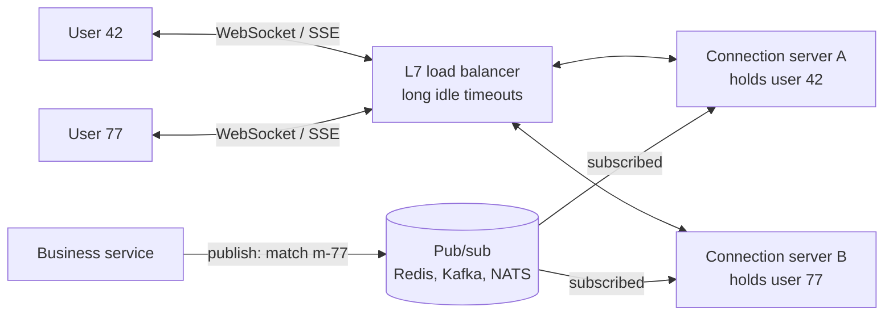
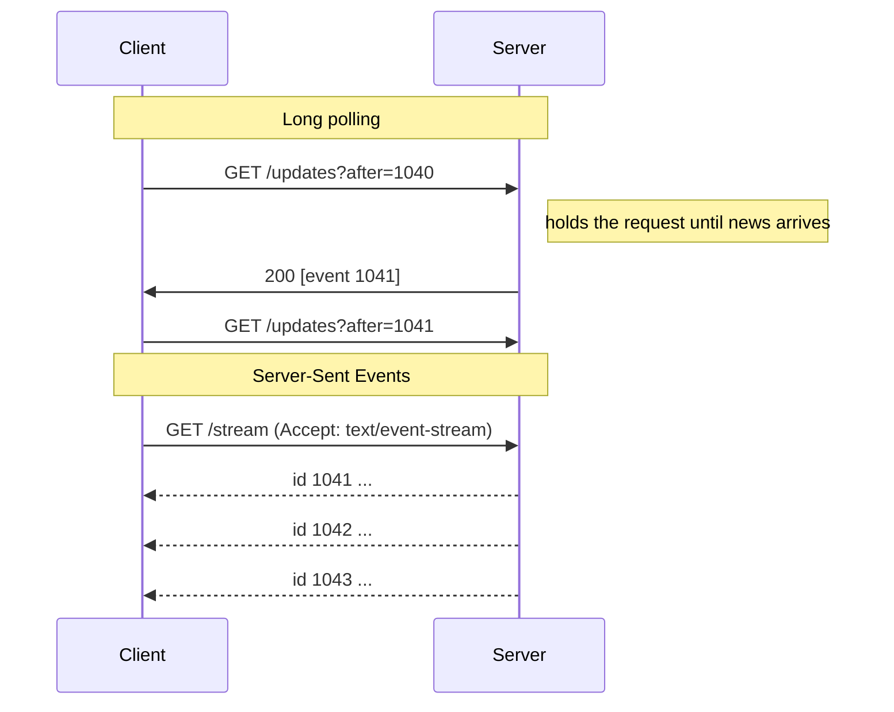

HTTP was designed for the client to ask and the server to answer. Live scores, chat messages, notifications and collaborative
cursors need the opposite: the server has news and must deliver it now. Four techniques do that — short polling, long polling,
Server-Sent Events and WebSockets — and the choice changes your infrastructure more than your code.

## Why it matters

Real-time features appear in a large share of interview problems: chat, live comments, ride tracking, notifications, collaborative
editing, dashboards. The transport decides:

- **Latency** — how quickly an update reaches the user.
- **Load** — how many requests or open connections your servers carry when nothing is happening.
- **Statefulness** — persistent connections tie a user to a specific server, which complicates load balancing, deploys and scaling.
- **Direction** — whether the client also needs a low-latency channel back to the server.

## How it works

### Short polling

The client asks every few seconds: "anything new?" Simple, works everywhere, stateless on the server — and wasteful. Most responses are
empty, and an update waits on average half the polling interval. **One million clients polling every 5 seconds is 200,000 requests per
second**, nearly all of them answered "no".

### Long polling

The client asks, and the server **holds the request open** until there is news or a timeout (say 30 seconds) expires; the client then
immediately asks again. Updates arrive almost instantly, and idle load drops: one million clients re-polling every 30 seconds is about
33,000 requests per second. Costs: each waiting client holds a request open, every message is followed by a new request (with headers),
and messages produced between one response and the next request must be buffered on the server or they are lost.

### Server-Sent Events (SSE)

The client opens one HTTP request with `Accept: text/event-stream`; the server keeps the response open and writes events as lines of text:

```http
HTTP/1.1 200 OK
Content-Type: text/event-stream

id: 1041
event: score
data: {"match":"m-77","home":2,"away":1}

```

- **One direction:** server to client only. The client sends anything else with normal HTTP requests.
- **Built-in reconnection:** the browser's `EventSource` reconnects automatically and sends the last event ID it saw in a
  `Last-Event-ID` header, so the server can resume from there.
- **Plain HTTP:** works through proxies, CDNs and HTTP/2; easy to authenticate with existing cookies or headers.
- **Limit:** over HTTP/1.1, browsers cap open connections per domain at about six, shared across tabs. Over HTTP/2 many streams share
  one connection, so the limit effectively disappears. Text only — binary data must be encoded.

### WebSockets

The client sends an HTTP request with `Upgrade: websocket`; the server answers `101 Switching Protocols`, and the TCP connection becomes a
**full-duplex message channel**: both sides send messages at any time with a few bytes of framing.

- **Two-way and low overhead:** ideal when the client also sends frequently — chat, games, collaborative editing.
- **Not plain HTTP after the upgrade:** proxies and load balancers must support it and must not cut idle connections; you implement your
  own heartbeats, reconnection, resume-from-offset and message acknowledgements.

### Choosing

| Aspect | Short polling | Long polling | SSE | WebSockets |
|---|---|---|---|---|
| Direction | Client pulls | Client pulls (server holds) | Server → client | Both ways |
| Update latency | Up to the interval | Near-instant | Near-instant | Near-instant |
| Idle cost | High request rate | Moderate request rate + held requests | One open connection per client | One open connection per client |
| Server state | None | Held requests | Open streams | Open connections |
| Reconnect / resume | N/A | Client logic | Built in (`Last-Event-ID`) | Your own logic |
| Infrastructure | Anything HTTP | Anything HTTP (watch timeouts) | Anything HTTP; best with HTTP/2 | Needs WebSocket-aware proxies |
| Good for | Rare updates, simple clients | Fallback, modest scale | Feeds, notifications, dashboards, progress | Chat, games, collaboration |

A useful rule: **if only the server pushes, prefer SSE; if both sides talk often, use WebSockets; poll only when updates are rare or
latency doesn't matter.**

## Architecture

Persistent connections make the servers that hold them stateful: a message for user 42 must reach *the* server holding user 42's
connection. The standard shape separates a **connection tier** from stateless business services and connects them with pub/sub:



Each connection server subscribes to the topics its connected users care about. When the business service publishes an update, every
interested connection server receives it and writes it to its open connections. Business services stay stateless; only the connection
tier holds connections, and it holds no durable data.

The difference between polling and pushing, in time:



## Failure scenarios

- **Connection server dies.** Every client on it disconnects at once and reconnects to other servers — a **thundering herd**. Clients
  must reconnect with exponential backoff and jitter, and resume from their last event ID so nothing is missed.
- **Deploys.** Restarting connection servers drops connections; drain gradually (stop accepting new connections, ask clients to
  reconnect elsewhere over a few minutes) rather than restarting everything at once.
- **Silent dead connections.** Mobile networks and NAT devices drop idle connections without telling either side. Send heartbeats
  (application pings every 20–30 seconds) and close connections that miss them.
- **Proxy timeouts.** A load balancer with a 60-second idle timeout cuts a quiet WebSocket or SSE stream. Raise the timeout for these
  routes and send heartbeats more often than it.
- **Missed messages during reconnect.** Without a durable log or buffer to resume from, messages sent while a client was reconnecting are
  lost. Keep recent events per topic (for example in Redis Streams or Kafka) so clients can catch up.
- **Slow consumers.** A client on a poor network can't keep up; its server-side buffer grows. Cap per-connection buffers and drop or
  coalesce updates (latest score wins) for slow clients.

## Trade-offs

- **Push vs pull.** Push gives low latency and less wasted work but requires holding connections — memory, file descriptors, heartbeats
  and stateful routing. Pull is stateless and cacheable but either slow or wasteful.
- **SSE vs WebSockets.** SSE is simpler, rides on HTTP (auth, proxies, HTTP/2 multiplexing) and reconnects for you; WebSockets give
  two-way, binary, low-overhead messaging at the cost of more custom protocol work.
- **Connection density vs blast radius.** Packing hundreds of thousands of connections per server saves money but means one crash
  disconnects more users at once.
- **Delivery guarantees.** Real-time transports deliver while connected; anything that must not be lost (a chat message) also needs to be
  stored, with the transport as a fast notification path and a catch-up API as the safety net.

## In real systems

- Chat and collaboration products use WebSockets with a separate connection tier and pub/sub between servers; most also offer an HTTP
  catch-up API for messages missed while offline.
- Many notification centres, live dashboards and AI chat interfaces stream responses with Server-Sent Events because the flow is one
  way and SSE works through ordinary HTTP infrastructure.
- Managed services such as AWS API Gateway WebSocket APIs, Azure Web PubSub and Ably/Pusher provide the connection tier as a service.
- Long polling remains a common fallback when WebSockets are blocked by restrictive networks.

## Common mistakes

- **Polling every second at scale** without computing the request rate it creates.
- **Choosing WebSockets for one-way updates** where SSE would be simpler.
- **Forgetting that connection servers are stateful** — no plan for routing messages to the right server, draining or reconnect storms.
- **Treating the transport as storage.** If a message must survive disconnects, persist it and let clients catch up.
- **Leaving default proxy timeouts** that silently cut long-lived connections.

## In the interview

````question title="How would you push live updates to a million connected clients?"
First choose the transport from the direction of traffic: SSE if only the server pushes, WebSockets if clients send frequently too.
Then separate a connection tier — servers that only hold connections, each with a large number of them — from stateless business
services. Business services publish updates to a pub/sub system keyed by topic (match, conversation or user); connection servers
subscribe to the topics their users need and forward messages. Clients reconnect with backoff and jitter and resume from the last event
ID, served from a short retained log, so nothing is lost during reconnects. Heartbeats detect dead connections, the load balancer's idle
timeouts are raised for these routes, and deploys drain connections gradually.
````

````question title="When would you choose Server-Sent Events over WebSockets?"
When the data flows only from server to client — notifications, live feeds, dashboards, progress updates or streamed responses. SSE
is plain HTTP, so it works with existing authentication, proxies, CDNs and HTTP/2 multiplexing; the browser reconnects automatically
and sends Last-Event-ID so the server can resume. The client can still send occasional actions with ordinary HTTP requests.
WebSockets are worth their extra protocol work when the client also sends frequent, low-latency messages, such as chat typing
indicators, games or collaborative editing, or when you need binary frames.
````

## Key takeaways

- **Short polling** is simple but wasteful; **long polling** cuts waste and latency; **SSE** streams server-to-client over HTTP;
  **WebSockets** give full-duplex messaging.
- Prefer **SSE for one-way push**, **WebSockets for two-way** traffic, polling only for rare updates.
- Persistent connections make servers **stateful**: use a dedicated connection tier and **pub/sub** to route messages to it.
- Plan for **reconnect storms, heartbeats, proxy timeouts and catch-up** — persist anything that must not be lost.

## Knowledge check

```quiz
? A dashboard shows live metrics; users never send data back except through normal page actions. Which transport fits best?
+ Server-Sent Events
- WebSockets
! WebSockets work, but two-way messaging and custom reconnect logic aren't needed here.
- Short polling every 100 ms
! That creates a huge request rate for little benefit.
- UDP datagrams to the browser
! Browsers don't expose raw UDP sockets to web pages.
> One-way push over plain HTTP with automatic reconnection and resume is exactly what SSE provides.

? Two million clients short-poll every 10 seconds. What request rate does that create, even when nothing changes?
- 20,000 requests per second
! That divides by 100 instead of 10.
+ 200,000 requests per second
- 2,000,000 requests per second
! That would be polling every second.
- 20 requests per second
! That ignores the number of clients.
> 2,000,000 ÷ 10 s = 200,000 requests per second of mostly empty responses.

? A business service needs to send a message to user 42, who is connected to one of 50 WebSocket servers. What is the standard approach?
- Broadcast every message to all clients on all servers
! Users would receive other users' messages; filtering client-side wastes bandwidth and leaks data.
+ Publish to a pub/sub topic that the server holding user 42's connection subscribes to
- Make every WebSocket server stateless
! Holding a connection is state by definition.
- Use DNS to find the right server
! DNS isn't a per-user routing mechanism.
> Pub/sub (or a user-to-server registry) routes messages to whichever server holds the connection.

? A WebSocket server crashes and its 100,000 clients reconnect immediately. What should clients do?
- Reconnect in a tight loop until it works
! A tight loop makes the thundering herd worse.
+ Reconnect with exponential backoff and jitter, then resume from their last received event
- Wait for the user to refresh the page
! That loses updates and gives a poor experience.
- Switch to short polling permanently
! That multiplies load rather than recovering.
> Spreading reconnects over time avoids overloading the remaining servers, and resuming avoids gaps.
```

Two quick load estimates:

```drill
? 600,000 clients long-poll with a 30-second hold time and almost no updates. Roughly how many requests per second reach the servers?
= 20000
~ 1.25
> Each client re-polls every 30 seconds: 600,000 ÷ 30 = 20,000 requests per second.

? Each persistent connection costs about 20 KB of server memory. How much memory do 500,000 connections need?
= 10 GB
~ 1.25
> 500,000 × 20 KB = 10,000,000 KB ≈ 10 GB — before message buffers.
```
