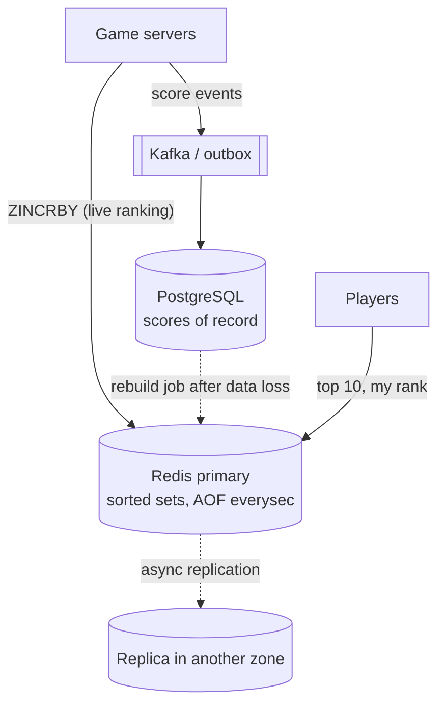

[Redis](lesson:redis) is usually introduced as a cache, but many production features use it as their main store: leaderboards, counters,
rate limiters, unique-visitor counts, nearby search, job streams. Its data structures make these features a few commands each. The question
an interviewer will ask is the other half: **what happens to this data when a node fails?**

## What it is for

- **Rankings**: leaderboards and "top N" lists with live rank lookups — sorted sets.
- **Counters and rate limits**: views, likes, API quotas per window — atomic `INCR` with expiry ([distributed rate limiting](lesson:distributed-rate-limiting)).
- **Approximate counting**: unique visitors per page or per day in a fixed 12 KB — HyperLogLog.
- **Location**: drivers or stores near a point — geo sets ([geospatial indexes](lesson:geospatial-indexes)).
- **Lightweight queues and event logs**: work distribution with consumer groups and acknowledgements — Streams.
- **Short-lived coordination**: holds, reservations, locks and deduplication sets with TTLs ([distributed locks](lesson:distributed-locks)).

## Data model

Each feature maps onto a structure whose commands do the work in one round trip:

| Feature | Structure | Key commands | Cost |
|---|---|---|---|
| Leaderboard, rank lookup | Sorted set | `ZINCRBY`, `ZRANGE ... REV WITHSCORES`, `ZREVRANK`, `ZADD ... GT` | O(log N) per update or rank |
| Counters per window | String | `INCR` + `EXPIRE`, `INCRBY` | O(1) |
| Grouped counters | Hash | `HINCRBY stats:post:9 likes 1` | O(1) |
| Unique visitors | HyperLogLog | `PFADD`, `PFCOUNT`, `PFMERGE` | 12 KB per key, ~0.81% standard error |
| Daily active flags | Bitmap | `SETBIT active:2026-11-07 <user_id> 1`, `BITCOUNT` | 1 bit per user ID |
| Nearby search | Geo (a sorted set of geohash scores) | `GEOADD`, `GEOSEARCH ... BYRADIUS` | O(log N + M) |
| Work queue with acks | Stream | `XADD`, `XREADGROUP`, `XACK`, `XAUTOCLAIM` | O(1) append |
| Recent items | List | `LPUSH` + `LTRIM` | O(1) amortised |

A few commands worth knowing by heart:

```redis title="Leaderboard, unique counts and nearby search"
ZINCRBY lb:2026-W45 120 player:981          # add points, returns the new score
ZRANGE lb:2026-W45 0 9 REV WITHSCORES       # top 10
ZREVRANK lb:2026-W45 player:981             # 0-based rank of one player
ZADD lb:best GT 3400 player:981             # keep only a player's best score

PFADD uv:page:77:2026-11-07 user:41 user:902
PFCOUNT uv:page:77:2026-11-07               # approximate unique visitors

GEOADD drivers:blr 77.5946 12.9716 driver:17
GEOSEARCH drivers:blr FROMLONLAT 77.60 12.97 BYRADIUS 2 km ASC COUNT 10 WITHDIST

XADD jobs * type resize image_id 8812
XREADGROUP GROUP workers w1 COUNT 10 BLOCK 5000 STREAMS jobs >
XACK jobs workers 1730971234567-0
```

**Streams** deserve a note: unlike pub/sub, entries persist; a **consumer group** hands each entry to one consumer, tracks unacknowledged
entries in a pending list, and `XAUTOCLAIM` lets another consumer take over entries whose consumer crashed — at-least-once delivery
([delivery semantics](lesson:delivery-semantics)). Trim with `MAXLEN` so a stream doesn't grow forever.

Recent versions add more: Redis 8 ships JSON, time-series and probabilistic structures (Bloom filters, top-k) in the core distribution.

## How it works inside

Everything from the [Redis lesson](lesson:redis) applies — single-threaded command execution, RDB/AOF persistence, asynchronous replication,
16,384 cluster slots. Three properties matter specifically when Redis is the main store:

- **Atomic multi-step logic with Lua.** A script runs as one command: no other client's command interleaves. That turns check-then-act
  sequences into one atomic step. Here is a flash-sale reservation: take one unit of stock and record a per-user hold with an expiry,
  refusing duplicates.

```lua file="reserve_stock.lua"
-- KEYS[1] = stock counter, KEYS[2] = this user's hold
-- ARGV[1] = hold TTL in seconds, ARGV[2] = order attempt id
-- Returns 1 = reserved, 0 = sold out, -1 = this user already holds one
local stock = tonumber(redis.call('GET', KEYS[1]) or '0')
if stock <= 0 then
  return 0
end
if not redis.call('SET', KEYS[2], ARGV[2], 'NX', 'EX', ARGV[1]) then
  return -1
end
redis.call('DECR', KEYS[1])
return 1
```

  Run against a stock of 2 (tested with a Lua interpreter and a simulated `redis.call`): user 1 reserves (1), user 1 again is refused (-1),
  user 2 reserves (1), user 3 finds it sold out (0). In a cluster both keys must share a slot, so name them with a hash tag:
  `{sale:42}:stock` and `{sale:42}:hold:u7`. Keep scripts short — a long script blocks every other client, like any slow command.

- **Encodings change with size.** Small hashes and sorted sets use a compact listpack encoding; past configurable thresholds they convert to
  hash tables and skip lists. Memory per element is a real sizing input: 10 million members in a sorted set take on the order of a gigabyte.

- **Durability is a dial, not a guarantee.** AOF with `appendfsync everysec` loses up to about a second on a crash; replication is
  asynchronous, so a failover can lose writes the replica hadn't received; `WAIT` narrows that window but doesn't make Redis a consensus
  store.



The pattern: Redis serves the feature at memory speed; a durable log or database holds what can't be lost; a rebuild path restores Redis.

## Strengths and weaknesses

| Strengths | Weaknesses |
|---|---|
| Purpose-built structures: one command per feature operation | Data must fit in RAM; memory is the main cost |
| Atomic commands and Lua scripts remove race conditions | Async replication: failover can lose acknowledged writes |
| Sub-millisecond latency for ranks, counts and geo queries | Multi-key operations must stay within one cluster slot |
| TTLs make holds and windows self-cleaning | Long scripts or big-key commands stall the node |
| Streams give a simple durable-ish queue with consumer groups | Streams lack Kafka's retention scale, replay tooling and partition model |

## Scaling characteristics

- **Per-key scale is one node.** A single leaderboard key lives in one slot on one primary: millions of members are fine, but its update
  rate is bounded by that node (on the order of 100,000 simple operations/s). Split by region, by time window or by shard and merge the top
  entries when needed ([hot keys](lesson:hot-keys)).
- **Many keys scale out** across a cluster: per-user counters, per-page HyperLogLogs and per-city geo sets distribute naturally.
- **Memory planning**: estimate members × bytes per member × replicas, plus headroom for fragmentation and forks during snapshots.
- **Read scaling**: replicas serve stale-tolerant reads such as a top-10 board refreshed every second.

## When to use it

- The feature needs a **data structure Redis already has** (ranking, approximate counting, geo, windows) at high request rates.
- The data is **rebuildable** from a source of truth, or **tolerable to lose** briefly (rate-limit windows, presence, holds).
- **Not** as the only copy of money, orders or anything you can't reconstruct — use a database and let Redis serve the hot path.

## Alternatives

| Alternative | Prefer it when |
|---|---|
| PostgreSQL with indexes | Ranking queries are infrequent, or the data must be durable and transactional |
| Kafka | You need a durable, replayable, partitioned event log rather than a work queue |
| SQS / RabbitMQ | You need a managed queue with retries and dead-letter handling |
| Elasticsearch / PostGIS | Geo queries combine location with text filters, polygons or complex ranking |
| DynamoDB / Cassandra counters | Counters must survive node loss and scale across many writers |

## Interview trade-offs

- **Speed vs durability**: say what the feature loses on failover and how it recovers (rebuild, replay, accept).
- **Exact vs approximate**: HyperLogLog's 0.81% error in 12 KB versus a set of every user ID — say which the product needs.
- **One big key vs many**: a global leaderboard is one hot key; partition it and merge top entries when traffic demands.
- **Streams vs Kafka**: Streams for modest, short-lived queues inside a Redis-based system; Kafka for durable, high-volume, replayable logs.

## Java and Spring Boot example

A weekly leaderboard backed by one sorted set per week, using Spring Data Redis. (Compiled against Spring Data Redis 4.1.)

```java file="LeaderboardService.java"
import java.util.List;
import java.util.Set;
import org.springframework.data.redis.core.StringRedisTemplate;
import org.springframework.data.redis.core.ZSetOperations;
import org.springframework.data.redis.core.ZSetOperations.TypedTuple;
import org.springframework.stereotype.Service;

// A weekly leaderboard in one Redis sorted set: O(log N) score updates and rank lookups.
@Service
public class LeaderboardService {

    private final ZSetOperations<String, String> zset;

    public LeaderboardService(StringRedisTemplate redis) {
        this.zset = redis.opsForZSet();
    }

    private static String key(String week) {
        return "lb:" + week;                                  // e.g. lb:2026-W45
    }

    public double addPoints(String week, String playerId, double points) {
        Double total = zset.incrementScore(key(week), playerId, points);     // ZINCRBY
        return total == null ? 0 : total;
    }

    public List<TypedTuple<String>> top(String week, int n) {
        Set<TypedTuple<String>> rows = zset.reverseRangeWithScores(key(week), 0, n - 1);
        return rows == null ? List.of() : List.copyOf(rows);   // highest scores first
    }

    public Long rankOf(String week, String playerId) {
        Long rank = zset.reverseRank(key(week), playerId);     // ZREVRANK, 0-based
        return rank == null ? null : rank + 1;
    }
}
```

Week-scoped keys make "this week's board" a fresh key each week; give old keys a TTL (`EXPIRE`) or archive them to the database.

## Key takeaways

- Redis features are **data-structure recipes**: sorted sets for ranks, `INCR` + TTL for windows, HyperLogLog for uniques, geo for
  nearby, Streams for acknowledged work queues.
- **Lua scripts** make check-then-act logic atomic; keep them short and keep their keys in one slot (hash tags).
- Treat Redis as the **fast path**, not the only copy: pair it with a durable log or database and a rebuild path.
- A single key never scales beyond one node — **partition hot keys**.

## Knowledge check

```quiz
? A game needs "top 100 players this week" and "my rank" for 20 million players, updated on every match. Which Redis structure?
+ A sorted set per week: ZINCRBY on each match, ZRANGE ... REV for the top 100, ZREVRANK for a player's rank
- A list sorted by the application
! Re-sorting on every update is O(N).
- A hash of player to score
! Hashes don't keep order or ranks.
- HyperLogLog
! It counts unique items; it can't rank them.
> Sorted sets keep members ordered by score with O(log N) updates.

? A marketing dashboard needs daily unique visitors per page for 2 million pages, accurate within about 1%. What is the most memory-efficient choice?
- A Redis set of user IDs per page per day
! Exact, but memory grows with every visitor.
+ A HyperLogLog per page per day (12 KB each, ~0.81% standard error)
- An INCR counter per page
! Counts visits, not unique visitors.
- A sorted set per page
! Even larger than a set.
> HyperLogLog trades exactness for fixed, tiny memory.

? Why does the flash-sale reservation need a Lua script rather than GET, then SET NX, then DECR from the application?
- Lua scripts are faster to write
! Speed of writing isn't the point.
+ Between separate commands another client can act, so two buyers could both see stock = 1; the script runs atomically
- DECR alone is not atomic
! DECR is atomic, but the check before it isn't part of it.
- Lua makes the data durable
! Durability is unchanged.
> Check-then-act must be one atomic step.

? Redis Streams hold payment events as the only copy. The primary fails over. What is the risk?
- None; streams are replicated synchronously
! Replication is asynchronous.
+ Events acknowledged to producers but not yet replicated can be lost
- Consumer groups are deleted
! They're replicated like other data.
- XACK stops working
! It works on the new primary.
> Use a durable log (Kafka, a database outbox) for data you can't lose.
```
