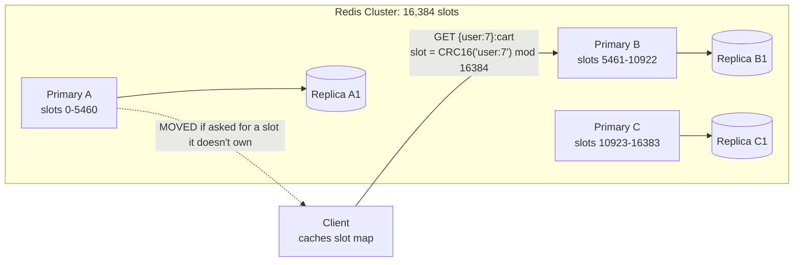

Redis is an in-memory data structure server: keys map to strings, hashes, lists, sets, sorted sets and more, each with atomic commands
that run in microseconds. It's the default cache in most designs, and also the default answer for counters, rate limits, leaderboards,
sessions, queues and locks. Knowing how it works inside — single-threaded execution, persistence, replication, Cluster — tells you where it's
safe to lean on it and where it isn't.

## What it is for

- **Caching** objects and computed results, with TTLs and eviction.
- **Fast shared state**: sessions, feature flags, rate-limit counters, deduplication sets.
- **Data-structure workloads**: leaderboards (sorted sets), unique counts (HyperLogLog), recent-items lists, geo queries, bitmaps.
- **Lightweight messaging**: pub/sub, and Streams for durable, consumer-group queues.
- **Coordination for efficiency**: short-lived locks and leases where an occasional duplicate is acceptable
  ([distributed locks](lesson:distributed-locks)).

Broader uses beyond caching are covered in [Redis beyond caching](lesson:redis-beyond-cache).

## Data model

| Type | Example | Typical use |
|---|---|---|
| String | `SET product:42 "{json}" EX 600` | Cached objects, counters (`INCR`) |
| Hash | `HSET user:7 name Asha plan pro` | Objects with fields; compact for small maps |
| List | `LPUSH recent:7 post:91` + `LTRIM` | Recent items, simple queues |
| Set | `SADD online users:7` | Membership, deduplication |
| Sorted set | `ZADD lb:week 4200 player:9` | Leaderboards, time-ordered indexes, priority queues |
| Stream | `XADD events * type click` | Durable log with consumer groups |
| HyperLogLog | `PFADD uniques:page9 user:7` | Approximate unique counts in ~12 KB |
| Geo | `GEOADD drivers 77.59 12.97 d:1` | Nearby search |
| Bitmap | `SETBIT active:2026-03-14 7 1` | Per-user daily flags |

Every key can have an expiry (`EXPIRE`, or `EX`/`PX` on `SET`). Commands on one key are atomic; multi-step logic can run atomically with Lua
scripts or functions, or optimistically with `MULTI`/`EXEC` plus `WATCH`.

## How it works inside

- **In memory, single-threaded command execution.** Commands execute one at a time on one main thread, so each is atomic and there are no
  locks; throughput comes from commands being tiny. Since Redis 6, network I/O can use extra threads, but command execution stays serial.
  Consequence: **one slow command** (`KEYS *`, a huge `SMEMBERS`, a long Lua script) blocks everything — use `SCAN` and bounded operations.
- **Persistence** (optional):
  - **RDB snapshots**: the process forks and writes a point-in-time snapshot; copy-on-write means memory use can grow during heavy writes.
    Fast restarts; loses changes since the last snapshot.
  - **AOF (append-only file)**: logs every write; `appendfsync everysec` (the usual setting) loses at most about a second on a crash;
    `always` is safest and slowest. Can be combined with RDB.
- **Replication** is **asynchronous**: replicas stream changes from the primary. A primary that fails can lose writes its replicas hadn't
  received; `WAIT` can block until a number of replicas acknowledge, narrowing (not eliminating) that window.
- **High availability**: **Sentinel** monitors primaries and promotes replicas for non-clustered deployments; **Redis Cluster** includes its
  own failover.
- **Cluster**: the key space is split into **16,384 hash slots** (`CRC16(key) mod 16384`) distributed across primaries, each with replicas.
  Clients are told `MOVED`/`ASK` when a slot lives elsewhere and cache the slot map. Multi-key commands work only when all keys are in one
  slot — **hash tags** (`{user:7}:cart`, `{user:7}:profile`) force related keys together.



The hash tag `{user:7}` means only `user:7` is hashed, so `{user:7}:cart` and `{user:7}:profile` share a slot and can be used together in one
command or script.

## Strengths and weaknesses

| Strengths | Weaknesses |
|---|---|
| Sub-millisecond operations; ~100K+ simple ops/s per node | Data set limited by RAM (and RAM is expensive) |
| Rich, atomic data structures | Asynchronous replication: failover can lose acknowledged writes |
| TTLs and eviction built in | One slow command stalls the whole node |
| Simple to operate for caching | Cluster restricts multi-key operations to one slot |
| Lua scripting for atomic custom logic | Not a system of record for data you can't lose (unless configured and accepted carefully) |

## Scaling characteristics

- **Vertical first**: one node with tens to hundreds of GB and on the order of 100K simple ops/s covers many caches.
- **Read replicas** add read throughput (with replication lag).
- **Cluster** scales memory and writes horizontally by slots; resharding moves slots between nodes online.
- **Hot keys** don't scale with nodes — one key lives in one slot; use client-side caching or key replication
  ([hot keys](lesson:hot-keys)).
- **Pipelining** batches many commands per round trip, multiplying throughput for bulk work.

## When to use it

- A **cache** in front of a database or service: almost always a good fit.
- **Counters, rate limits, sessions, leaderboards, short-lived dedup sets** — state that is hot, small and tolerable to lose briefly (or
  rebuildable from a source of truth).
- **Not** as the only copy of orders, payments or anything you can't rebuild — unless you accept and mitigate the failover window.

## Alternatives

| Alternative | Prefer it when |
|---|---|
| Memcached | Pure, simple key-value caching of strings with multi-threaded nodes |
| Valkey | You want a BSD-licensed, community fork compatible with Redis 7.2 (Linux Foundation project) |
| In-process cache (Caffeine) | Hottest keys, per instance, with no network hop |
| DynamoDB DAX / managed caches | You're on a managed database with an integrated cache |
| A database (PostgreSQL) | You need durability and queries more than microsecond latency |

Licensing changed in 2024 (RSALv2/SSPLv1) and Redis 8 added AGPLv3 as an option in 2025; managed offerings (ElastiCache, Memorystore, Azure
Cache) support Redis and/or Valkey.

## Interview trade-offs

- **Speed vs durability**: RAM-speed operations, asynchronous replication — say what happens to recent writes on failover.
- **Simplicity vs scale**: a single node is simplest; Cluster adds slot-aware clients and single-slot multi-key operations.
- **Persistence vs latency**: AOF `everysec` is the usual compromise; `always` costs latency.
- **Cache vs store**: treat Redis as a cache or derived state unless you've explicitly designed for its loss modes.

## Java and Spring Boot example

A Spring Boot service backing `@Cacheable` methods with Redis: a default TTL, per-cache TTLs, JSON values, and a versioned key prefix that can
be bumped to invalidate everything at once. (Compiled against Spring Framework 7 and Spring Data Redis 4.1.)

```java file="CacheConfig.java"
import java.time.Duration;
import java.util.Map;
import org.springframework.cache.annotation.EnableCaching;
import org.springframework.context.annotation.Bean;
import org.springframework.context.annotation.Configuration;
import org.springframework.data.redis.cache.RedisCacheConfiguration;
import org.springframework.data.redis.cache.RedisCacheManager;
import org.springframework.data.redis.connection.RedisConnectionFactory;
import org.springframework.data.redis.serializer.RedisSerializationContext.SerializationPair;
import org.springframework.data.redis.serializer.RedisSerializer;

// Spring's cache abstraction backed by Redis: every @Cacheable method becomes cache-aside.
@Configuration
@EnableCaching
public class CacheConfig {

    @Bean
    public RedisCacheManager cacheManager(RedisConnectionFactory connections) {
        RedisCacheConfiguration defaults = RedisCacheConfiguration.defaultCacheConfig()
                .entryTtl(Duration.ofMinutes(10))                 // bound staleness
                .disableCachingNullValues()
                .prefixCacheNameWith("catalog:v3:")               // bump to invalidate all
                .serializeValuesWith(SerializationPair.fromSerializer(RedisSerializer.json()));

        return RedisCacheManager.builder(connections)
                .cacheDefaults(defaults)
                .withInitialCacheConfigurations(Map.of(
                        "products", defaults.entryTtl(Duration.ofMinutes(30)),
                        "prices", defaults.entryTtl(Duration.ofSeconds(30))))
                .build();
    }
}
```

With this configuration, the `products` cache in [cache patterns](lesson:cache-patterns) stores entries under keys like
`catalog:v3:products::42` for 30 minutes, prices for 30 seconds, and nothing at all for null results.

## Key takeaways

- Redis is an **in-memory data-structure server** with atomic commands and TTLs — the default cache and fast shared state.
- **Single-threaded execution**: atomic and lock-free, but one slow command stalls everything.
- **RDB/AOF persistence** and **asynchronous replication** mean failover can lose recent writes; don't make it the only copy of critical data.
- **Cluster** = 16,384 hash slots across primaries; **hash tags** keep related keys together.

## Knowledge check

```quiz
? Why can a single `KEYS *` command take a production Redis node down?
- It deletes keys
! KEYS only lists keys.
+ Commands execute one at a time, so scanning millions of keys blocks every other client
- It triggers a snapshot
! It doesn't trigger persistence.
- It disables replication
! Replication is unaffected.
> Use SCAN for incremental iteration.

? A Redis primary acknowledges a write and fails before its replica receives it. The replica is promoted. What happens to the write?
+ It is lost, because replication is asynchronous
- It is replayed from the AOF on the replica
! The replica never received it.
- Sentinel recovers it from the client
! Sentinel doesn't hold writes.
- Nothing; Redis replication is synchronous
! It's asynchronous by default.
> WAIT can narrow the window but Redis isn't a zero-loss store by default.

? In Redis Cluster, a Lua script must update `cart:7` and `profile:7` atomically but fails with a cross-slot error. What is the fix?
- Use MULTI/EXEC instead
! It's also limited to one slot in Cluster.
+ Use hash tags so both keys share a slot, e.g. `{user:7}:cart` and `{user:7}:profile`
- Disable Cluster mode
! That gives up horizontal scaling.
- Use two separate scripts
! That loses atomicity.
> Hash tags control which part of the key determines the slot.

? Which use of Redis is most risky without extra design?
- Caching product pages
! Loss only causes misses.
- Rate-limit counters
! Brief loss briefly resets limits.
+ Storing the only copy of customer orders
- A leaderboard rebuilt from a database
! It can be rebuilt.
> Asynchronous replication and memory-first storage make Redis risky as the sole system of record.
```
