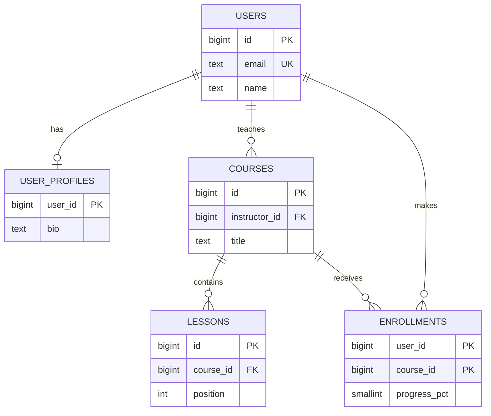

Relational modeling turns "users enrol in courses that have lessons" into tables, keys and relationships the database can
enforce. In an interview the data model is a short list of tables with their keys — but the choices inside it (which key, where the
foreign key goes, what is unique) decide whether the design is correct under concurrency and fast for its main queries.

## Why it matters

The data-model step comes right after the API in most interviews, and interviewers read it to check three things: that every entity in
the requirements has a home, that relationships are modelled so the database itself prevents bad states (duplicate enrolments, orphaned
lessons), and that the keys support the main queries. You don't need to write perfect DDL — a table list with primary keys, foreign keys,
key columns and indexes is enough — but you need to be able to explain each choice.

## How it works

### Primary keys

Every table needs a primary key that uniquely and permanently identifies a row.

| Kind | Example | Pros | Cons |
|---|---|---|---|
| Natural key | `email`, ISBN, country code | Meaningful; no extra column | Natural values change (people change email) and may not be truly unique |
| Surrogate integer (`bigint` identity) | 1, 2, 3… | Small, fast, ordered inserts | Reveals volume, guessable, needs a central sequence — awkward across shards |
| Random UUID (v4) | `9b2f…` | Generated anywhere, unguessable | 16 bytes; random inserts scatter across a B-tree index, hurting write locality |
| Time-ordered ID (UUIDv7, Snowflake-style) | `01a1a238-78d9-7fff-…` | Generated anywhere, roughly sortable by time, index-friendly | Leaks creation time; slightly more complex |

A sensible default: a surrogate key for identity (`bigint` identity on a single database, a time-ordered ID when IDs are generated across
services or shards), plus `UNIQUE` constraints on natural keys like `email`. PostgreSQL 18 added a built-in `uuidv7()` function, which
returned values like `01a1a238-78d9-7fff-b70f-04302f0caaf3` in a test run — the leading bits are a millisecond timestamp, so consecutive IDs
sort together.

### Relationships

**One-to-one** — a user has one profile. Put the foreign key on the dependent table and make it the primary key, so there can only be one:

**One-to-many** — a course has many lessons. The foreign key goes on the "many" side (`lessons.course_id`), with an index for "lessons of
course X".

**Many-to-many** — users enrol in many courses; courses have many students. Use a **join table** whose primary key is the pair. The join
table often carries its own data (enrolment date, progress), which makes it a first-class entity.

```sql
CREATE TABLE users (
  id          bigint GENERATED ALWAYS AS IDENTITY PRIMARY KEY,
  email       text NOT NULL UNIQUE,
  name        text NOT NULL,
  created_at  timestamptz NOT NULL DEFAULT now()
);

-- 1:1 - the foreign key is also the primary key, so a user has at most one profile.
CREATE TABLE user_profiles (
  user_id     bigint PRIMARY KEY REFERENCES users (id) ON DELETE CASCADE,
  bio         text,
  avatar_url  text
);

-- 1:N - each course has one instructor; each lesson belongs to one course.
CREATE TABLE courses (
  id            bigint GENERATED ALWAYS AS IDENTITY PRIMARY KEY,
  instructor_id bigint NOT NULL REFERENCES users (id),
  title         text NOT NULL,
  published_at  timestamptz
);
CREATE INDEX courses_instructor ON courses (instructor_id);

CREATE TABLE lessons (
  id         bigint GENERATED ALWAYS AS IDENTITY PRIMARY KEY,
  course_id  bigint NOT NULL REFERENCES courses (id) ON DELETE CASCADE,
  position   int NOT NULL,
  title      text NOT NULL,
  UNIQUE (course_id, position)
);

-- M:N - the pair is the primary key, so a user can't enrol twice in the same course.
CREATE TABLE enrollments (
  user_id       bigint NOT NULL REFERENCES users (id),
  course_id     bigint NOT NULL REFERENCES courses (id),
  enrolled_at   timestamptz NOT NULL DEFAULT now(),
  progress_pct  smallint NOT NULL DEFAULT 0 CHECK (progress_pct BETWEEN 0 AND 100),
  PRIMARY KEY (user_id, course_id)
);
CREATE INDEX enrollments_course ON enrollments (course_id);
```

Notice the indexes. The primary key `(user_id, course_id)` serves "courses of user X"; the extra index on `course_id` serves "students of
course X". Foreign keys in PostgreSQL don't create indexes on the referencing column automatically — you add them for the queries you run.

### The SQL behind common endpoints

```sql
INSERT INTO users (email, name) VALUES
  ('asha@example.com', 'Asha'), ('ravi@example.com', 'Ravi'), ('mei@example.com', 'Mei');
INSERT INTO courses (instructor_id, title, published_at) VALUES
  (1, 'Databases 101', now()), (1, 'Distributed Systems', now()), (2, 'Intro to Networking', NULL);
INSERT INTO lessons (course_id, position, title) VALUES
  (1, 1, 'Tables'), (1, 2, 'Keys'), (2, 1, 'Clocks');
INSERT INTO enrollments (user_id, course_id, progress_pct) VALUES
  (2, 1, 40), (3, 1, 100), (3, 2, 10);
```

```sql
-- GET /courses?published=true : courses with their instructor (1:N join)
SELECT c.title, u.name AS instructor
FROM courses c
JOIN users u ON u.id = c.instructor_id
WHERE c.published_at IS NOT NULL
ORDER BY c.title;

-- GET /users/me/enrollments : my courses with progress (through the join table)
SELECT c.title, e.progress_pct
FROM enrollments e
JOIN courses c ON c.id = e.course_id
WHERE e.user_id = 3
ORDER BY e.enrolled_at DESC;

-- Admin report: students per course, including courses with none (LEFT JOIN + GROUP BY)
SELECT c.title, count(e.user_id) AS students
FROM courses c
LEFT JOIN enrollments e ON e.course_id = c.id
GROUP BY c.id, c.title
ORDER BY students DESC, c.title;
```

Results from running these on PostgreSQL 18:

| Query | Rows returned |
|---|---|
| Published courses | Databases 101 – Asha; Distributed Systems – Asha |
| Mei's enrolments | Databases 101 – 100%; Distributed Systems – 10% |
| Students per course | Databases 101 – 2; Distributed Systems – 1; Intro to Networking – 0 |

The `LEFT JOIN` keeps "Intro to Networking" with zero students; an inner join would drop it — a classic reporting bug.

And the constraints doing their job:

```sql
-- expect error
-- Enrolling Ravi in Databases 101 a second time violates the primary key.
INSERT INTO enrollments (user_id, course_id) VALUES (2, 1);
```

```sql
-- expect error
-- Enrolling in a course that doesn't exist violates the foreign key.
INSERT INTO enrollments (user_id, course_id) VALUES (2, 99);
```

### Writing it in an interview

Compress it to what matters:

```text title="Data model"
users        (id PK, email UNIQUE, name, created_at)
courses      (id PK, instructor_id FK -> users, title, published_at)
               index: instructor_id
lessons      (id PK, course_id FK -> courses, position, title)
               UNIQUE (course_id, position)
enrollments  (user_id FK, course_id FK, enrolled_at, progress_pct)
               PK (user_id, course_id), index: course_id
```

## Architecture



## Failure scenarios

- **Duplicate rows from races.** Without a unique constraint on `(user_id, course_id)`, two concurrent "enrol" requests both insert. The
  constraint makes the second fail atomically.
- **Orphaned rows.** Without foreign keys, deleting a course leaves lessons pointing at nothing. Use FKs with an explicit
  `ON DELETE` behaviour (cascade, restrict or set null).
- **Changing natural keys.** Using email as the primary key means an email change must update every referencing row.
- **Missing indexes on foreign keys.** "Students of course X" scans the whole enrolments table; deleting a user scans every referencing
  table to check constraints.
- **Random UUID primary keys at high insert rates** spread writes across the whole index, increasing page splits and I/O compared with
  time-ordered keys.

## Trade-offs

- **Integer vs UUID keys.** Integers are compact and fast but centralised and guessable; UUIDs can be generated anywhere; time-ordered UUIDs
  recover most of the index locality.
- **Foreign keys vs scale.** FKs guarantee integrity but add checks to writes and don't work across shards or services; at large scale
  some teams enforce relationships in application code and with periodic reconciliation.
- **Cascades vs explicit deletes.** `ON DELETE CASCADE` is convenient but can delete far more than intended; soft deletes (`deleted_at`)
  keep history at the cost of filtering everywhere.

## In real systems

- Twitter's Snowflake popularised 64-bit time-ordered IDs generated without coordination; similar schemes (ULID, UUIDv7, standardised in
  RFC 9562) are now common.
- Rails, Django and Spring Data JPA all map one-to-many and many-to-many relationships to exactly these foreign-key and join-table shapes.
- Large sharded MySQL deployments often drop cross-shard foreign keys and keep integrity checks in application code.

## Common mistakes

- **Storing lists in a column** (`course_ids = '1,5,9'`) instead of a join table — impossible to index or constrain.
- **Putting the foreign key on the wrong side** of a one-to-many relationship.
- **No unique constraints** where the business rule says "only one".
- **Forgetting indexes for reverse lookups** on join tables.
- **Inner joins in reports** that silently drop rows with no matches.

## In the interview

````question title="Model users, courses and enrolments, and explain your keys."
Three tables: users with a bigint primary key and a unique email; courses with a primary key and an instructor_id foreign key to users,
indexed for "courses by instructor"; and enrollments as the many-to-many join table with user_id and course_id foreign keys, a
composite primary key on (user_id, course_id) so a user can't enrol twice, plus enrolled_at and progress. The composite key serves "my
courses", and a second index on course_id serves "students of a course". If IDs had to be generated across services or shards I'd use
time-ordered IDs such as UUIDv7 instead of a database sequence.
````

````question title="Why use a surrogate primary key instead of the email address?"
Emails change, and a primary key is referenced from many tables, so changing it means updating every reference — or worse, breaking
history. Emails are also longer than a bigint, making every index and foreign key larger. A surrogate key never changes and carries no
meaning; uniqueness of email is still enforced with a UNIQUE constraint, and lookups by email use that constraint's index.
````

## Key takeaways

- Use **stable surrogate primary keys** (identity or time-ordered IDs) and **UNIQUE constraints** for natural keys.
- **1:1** → FK as PK on the dependent table; **1:N** → FK on the many side; **M:N** → join table with a composite key.
- Let the database enforce rules with **PK, FK, UNIQUE and CHECK** constraints — they win races your code loses.
- **Index for the queries**, including reverse lookups on join tables; FKs aren't indexed automatically in PostgreSQL.

## Knowledge check

```quiz
? Where does the foreign key go for "a course has many lessons"?
- On `courses`, as `lesson_id`
! A course would then reference only one lesson.
+ On `lessons`, as `course_id`
- In both tables
! Duplicated references can disagree.
- In a join table
! Join tables are for many-to-many relationships.
> The "many" side references the "one" side.

? Which schema detail prevents a user from enrolling in the same course twice, even under concurrent requests?
- An index on `enrolled_at`
! It doesn't enforce uniqueness.
+ A primary key or UNIQUE constraint on `(user_id, course_id)`
- Checking in the service whether an enrolment exists
! Two concurrent requests can both pass the check.
- A foreign key on `course_id`
! It ensures the course exists, not uniqueness.
> Uniqueness must be enforced atomically by the database.

? An admin report of "students per course" is missing courses with no students. What is the likely bug?
- Missing index
! Indexes affect speed, not which rows are returned.
+ An inner join between courses and enrolments instead of a LEFT JOIN
- Wrong primary key
! Keys don't remove unmatched courses from a join.
- The courses aren't published
! The report should include them regardless.
> Inner joins drop rows without a match; LEFT JOIN keeps them with a count of 0.

? Why can random UUIDv4 primary keys slow down heavy insert workloads compared with time-ordered IDs?
+ Each insert lands at a random place in the B-tree index, touching many pages and causing splits
- UUIDs can't be indexed
! They can; the issue is locality.
- UUIDs are always slower to compare than strings
! 16-byte UUID comparisons are cheap.
- Databases reject UUIDs as primary keys
! UUID primary keys are common.
> Time-ordered IDs append near the end of the index, keeping writes local.
```
