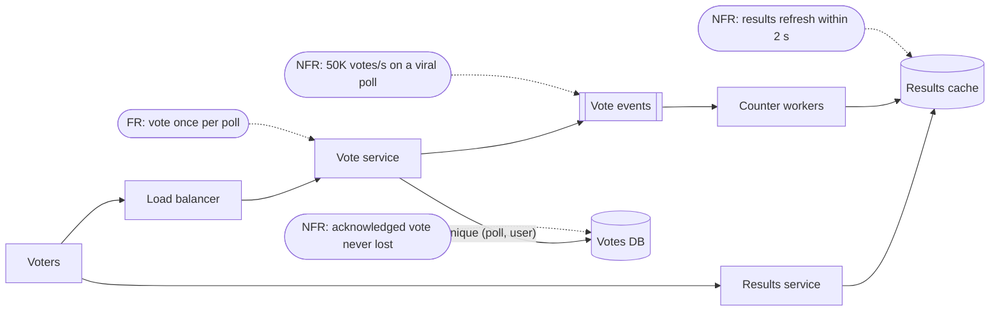

Every design decision you make later — the database, the cache, the queue, the consistency model — is an answer to a requirement.
If the requirements are vague, the design is a guess. This lesson shows how to turn a one-line prompt into a short, measurable
list you can design against.

## Why it matters

Requirements come in two kinds:

- **Functional requirements** say *what the system does*: the capabilities users have. "Users can create a poll." "Voters see live
  results."
- **Non-functional requirements** say *how well it must do it*: scale, latency, availability, durability, consistency, security,
  cost. "Results update within two seconds for 1 million concurrent viewers."

Functional requirements decide **which components and APIs exist**. Non-functional requirements decide **how those components are
built** — whether you need a cache, replicas, partitioning, queues, multiple regions, or stronger consistency. Two systems with
identical features can need completely different architectures because their non-functional requirements differ.

In interviews, requirements are also how you *scope*. "Design a polling app" could take a week; three functional requirements and
four numbers make it a 45-minute problem.

## How it works

We'll use one running example: **an online polling service** where anyone can create a poll, share a link, vote, and watch results.

### 1. Functional requirements: capabilities, not implementations

Write them as things a user can do, and keep only the core three to five. Each will become an API endpoint later.

- Users can **create a poll** with a question and 2–10 options.
- Users can **vote** once per poll.
- Users can **see results**, updated live while the poll is open.
- *(Lower priority)* Poll creators can close a poll.

Notice what is *not* there: "use WebSockets", "store votes in Redis". Those are design decisions, not requirements. Also notice the
explicit priority: the interviewer will usually let you drop the lowest-priority item to save time.

### 2. Non-functional requirements: quantify them

"Fast" and "scalable" cannot be designed against. Numbers can.

| Quality | Vague | Designable |
|---|---|---|
| Scale | "lots of users" | 10M votes/day, a viral poll can get 50K votes/second |
| Latency | "fast" | Vote acknowledged in < 200 ms at p99; results refresh within 2 s |
| Availability | "always up" | 99.9% for voting; results may degrade to slightly stale |
| Consistency | "correct" | Each user votes once (strict); live totals may lag by seconds (eventual) |
| Durability | "don't lose data" | An acknowledged vote is never lost |
| Security | "secure" | Prevent ballot stuffing: one vote per account or device |

Two habits make these useful:

- **Use percentiles for latency.** Averages hide the slow requests users notice; p99 ("99% of requests are faster than this") does not.
- **Specify consistency per operation.** "One vote per user" and "live totals" need different guarantees in the same system. That
  split — strict where correctness matters, relaxed where freshness doesn't — is one of the most valuable things you can say in an
  interview.

### 3. Scope and exclusions

Say what you are *not* designing: accounts and login (assume an auth service exists), poll analytics, moderation, editing a poll after
votes arrive. Exclusions protect your time and show judgement.

### 4. Let requirements drive the design

Change one non-functional requirement and watch the architecture move:

| If the requirement is… | …the design needs |
|---|---|
| Totals can lag by a few seconds | Count votes asynchronously; serve totals from a cache |
| Totals must be exact the instant a vote is accepted | Synchronous counter updates — and a plan for the hot counter on a viral poll |
| One vote per user, strictly | A uniqueness check: a unique key on `(poll_id, user_id)` |
| Anonymous voting allowed | Device or IP heuristics and rate limits instead of a uniqueness key |
| Viewers worldwide, < 100 ms result reads | Results cached at the edge or in each region |

## Architecture

How the polling requirements map onto components. The arrows from requirements show *why* each box exists:



A vote is acknowledged once it is durably stored with a uniqueness check; counting happens asynchronously so a viral poll's votes do
not all contend on one row; viewers read totals from a cache that is at most a couple of seconds behind.

## Failure scenarios

What goes wrong when requirements are missing or wrong:

- **Missed scale requirement.** A design with a single `UPDATE polls SET count = count + 1` row works in testing and collapses when
  one poll goes viral: every vote waits on the same row lock.
- **Missed consistency split.** Treating everything as strongly consistent makes live results expensive; treating everything as
  eventual lets users vote twice.
- **Missed durability requirement.** Counting votes only in memory (or a cache) loses them on restart.
- **Over-specified requirements.** Promising 99.999% availability for a polling app multiplies cost and complexity for no business
  reason.

## Trade-offs

Non-functional requirements compete. Naming the tension is part of the answer:

- **Latency vs consistency.** Fresh, exact totals require coordination on every vote; slightly stale totals are cheap.
- **Availability vs consistency.** During a network partition, do you keep accepting votes (and reconcile later) or refuse them?
- **Durability vs latency.** Waiting for a vote to reach several replicas before acknowledging it is safer and slower.
- **Cost vs everything.** Each extra nine of availability and each extra region multiplies infrastructure and operational cost.

## In real systems

- **Product requirement documents** describe functional requirements; **service level objectives (SLOs)** make the non-functional ones
  measurable — "99.9% of vote requests succeed and complete within 200 ms over 30 days". Stage 11 covers SLOs.
- Large services routinely apply different guarantees to different operations, exactly like the poll: strict for payments or
  uniqueness, relaxed for counters, feeds and recommendations.
- Requirements change. Designs that keep the strict parts small and isolated are easier to evolve when they do.

## Common mistakes

- **Listing ten features.** You cannot design ten things well in 45 minutes. Pick three to five and say so.
- **Writing solutions as requirements.** "Use Kafka" is not a requirement; "absorb 50K votes/s bursts" is.
- **Leaving NFRs unquantified.** Without numbers, nothing later can be justified.
- **One consistency level for everything.** Different operations deserve different guarantees.
- **Forgetting exclusions.** Unstated scope invites the interviewer to ask about everything.

## In the interview

Say your requirements out loud, write them where you'll see them, and confirm with the interviewer before moving on: *"These are
the three features I'll design for, and the numbers I'll design against — does that match what you had in mind?"*

````question title="What is the difference between functional and non-functional requirements? Give an example of each."
Functional requirements describe what the system does — the capabilities users have, such as "users can vote once on a poll".
Non-functional requirements describe how well it must do it — qualities such as scale, latency, availability, durability and
consistency, for example "a vote is acknowledged within 200 ms at p99 and is never lost once acknowledged". Functional requirements
decide which components and APIs exist; non-functional requirements decide how they are built.
````

````question title="Why should latency requirements use percentiles instead of averages?"
Averages hide the slow tail. A service whose average latency is 50 ms can still make 1 in 100 users wait two seconds, and those users
notice. Percentiles such as p99 state what almost every request experiences. They also compound: a page that calls many services is
only as fast as its slowest call, so tail latency per service matters more than the average.
````

````question title="How would you specify consistency for a system where some data must be exact and other data can lag?"
Specify it per operation, not per system. For a polling app: "a user can vote at most once" is strict — enforced by a uniqueness
constraint at write time — while "live totals" are eventually consistent and may lag by a few seconds, which lets them be counted
asynchronously and served from a cache. Saying this explicitly lets you keep the expensive guarantees small.
````

## Key takeaways

- **Functional** requirements are capabilities (3–5 core ones); **non-functional** requirements are measurable qualities.
- **Quantify** non-functional requirements: scale, p99 latency, availability, durability, and **consistency per operation**.
- State **exclusions** to keep the problem the right size.
- Every later decision should trace back to a requirement — if it doesn't, question it.

## Knowledge check

```quiz
? Which of these is a well-formed non-functional requirement?
- The system should be fast
! Not measurable — you cannot design or test against "fast".
- Use Redis for caching results
! That is a design decision, not a requirement.
+ 99% of vote requests are acknowledged within 200 ms
- Users can vote on polls
! That describes a capability, so it is a functional requirement.
> A good non-functional requirement is measurable and says nothing about how it is achieved.

? A polling app must prevent double voting but can show totals a few seconds late. What does this imply?
+ Enforce uniqueness strictly when the vote is written, and compute totals asynchronously
- Make every read and write strongly consistent
! That pays the cost of strong consistency for totals that don't need it.
- Make everything eventually consistent
! Eventual consistency alone allows duplicate votes to slip through.
- Skip storing individual votes and keep only counts
! Without individual votes there is nothing to enforce one-vote-per-user against.
> Different operations deserve different guarantees; that split is what keeps the design both correct and cheap.

? Why list scope exclusions in an interview?
- To avoid difficult topics
! Exclusions are about time and focus, not avoidance; you should still be ready to discuss them briefly.
+ To keep the problem solvable in the time available and show judgement about priorities
- Because interviewers require a fixed list
! There is no fixed list; exclusions depend on the prompt.
- To reduce the number of APIs to zero
! Core features still need APIs.
> A 45-minute interview cannot cover everything; saying what you're leaving out keeps the discussion on what matters.

? A requirement changes from "totals may lag by seconds" to "totals must be exact immediately after each vote". What becomes the main design challenge?
- Choosing a CDN
! Edge caching makes freshness harder, not easier.
+ Contention on the counter of a popular poll, since every vote must update it synchronously
- Storing poll questions
! Poll metadata is small and rarely written.
- Supporting more poll options
! Option count barely affects the architecture.
> Synchronous exact counting turns one popular poll into one hot row or key that every vote must update.
```
