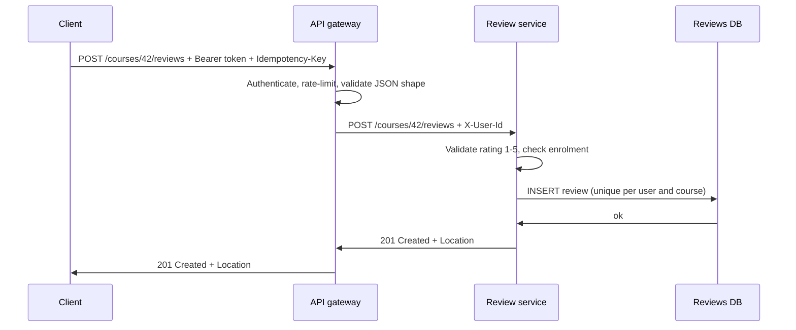

The API step of an interview is where your design becomes concrete: what can clients ask for, and what do they get back? A
well-designed REST API is predictable — nouns for resources, HTTP methods for actions, status codes that tell clients exactly what
happened — so an interviewer can read it at a glance and spot how it maps onto your data model.

## Why it matters

The API is the contract between your system and everything that uses it. Getting it right in an interview shows that you understand
**what the system does** (one endpoint per core use case), **how it will be called** (reads vs writes, payload sizes, pagination), and
**what can go wrong** (validation errors, conflicts, retries). Infrastructure also depends on it: CDNs cache `GET` responses, gateways
retry idempotent methods, and monitoring groups errors by status class.

This lesson uses one running example — an online course platform with users, courses, lessons, enrolments and reviews.

## How it works

### Resources and URLs

Model **things**, not operations. Use plural nouns, stable identifiers and nesting only where it expresses ownership:

```http
GET    /courses                      list courses (filtered, paginated)
POST   /courses                      create a course
GET    /courses/{courseId}           one course
PATCH  /courses/{courseId}           change some fields
DELETE /courses/{courseId}           delete (or archive) it
GET    /courses/{courseId}/lessons   lessons belonging to the course
POST   /courses/{courseId}/enrollments   enrol the caller
GET    /users/me/enrollments         the caller's enrolments
```

Guidelines:

- **Nest one level for ownership** (`/courses/{id}/lessons`), not five levels deep. A lesson that is fetched on its own can also live at
  `/lessons/{lessonId}`.
- **Use `me`** for "the authenticated user" rather than putting the caller's ID in the URL and trusting it.
- **Identifiers are opaque strings** to clients. Don't expose auto-increment IDs if enumeration matters (they reveal volume and invite
  scraping).
- **Actions that aren't CRUD** can be modelled as a state change (`PATCH /courses/42` with `{"status":"published"}`) or, when the action
  has its own life, as a sub-resource (`POST /courses/42/publications`). An occasional explicit action (`POST /orders/9/cancel`) is
  acceptable when it reads more clearly — consistency matters more than purity.

### Methods: safety and idempotency

HTTP defines two properties that infrastructure relies on (RFC 9110):

- **Safe**: the request doesn't change server state. Safe requests can be cached, prefetched and retried freely.
- **Idempotent**: sending the request several times has the same effect as sending it once — so it can be retried after a timeout.

| Method | Use | Safe | Idempotent | Typical success |
|---|---|---|---|---|
| `GET` | Read a resource or collection | Yes | Yes | `200 OK` |
| `HEAD` | Like GET, headers only | Yes | Yes | `200 OK` |
| `POST` | Create in a collection, or perform an action | No | **No** | `201 Created` + `Location`, or `200` / `202` |
| `PUT` | Replace a resource entirely (create or replace at a known URL) | No | Yes | `200 OK` or `204 No Content` (`201` if created) |
| `PATCH` | Change some fields | No | Not necessarily | `200 OK` |
| `DELETE` | Remove a resource | No | Yes | `204 No Content` |

`POST` is not idempotent, so a retry after a timeout may create a second course or a second payment. That is solved with idempotency keys
— see [idempotency & safe retries](lesson:idempotent-apis).

### Status codes clients can act on

| Code | Meaning | When |
|---|---|---|
| `200 OK` | Success with a body | Reads, updates returning the resource |
| `201 Created` | A resource was created | `POST` to a collection; include `Location: /courses/123` |
| `202 Accepted` | Accepted for asynchronous processing | Long-running work; return a status URL |
| `204 No Content` | Success, no body | `DELETE`, some updates |
| `304 Not Modified` | Client's cached copy is still valid | Conditional `GET` with `If-None-Match` |
| `400 Bad Request` | Malformed request | Unparseable JSON, wrong types |
| `401 Unauthorized` | Not authenticated | Missing or invalid credentials |
| `403 Forbidden` | Authenticated but not allowed | Editing someone else's course |
| `404 Not Found` | No such resource (or hidden from this caller) | Unknown ID |
| `409 Conflict` | Conflicts with current state | Duplicate enrolment, version conflict |
| `412 Precondition Failed` | `If-Match` didn't match | Lost-update protection |
| `422 Unprocessable Content` | Well-formed but semantically invalid | Rating of 7 on a 1–5 scale |
| `429 Too Many Requests` | Rate-limited | Include `Retry-After` |
| `500` / `502` / `503` / `504` | Server or upstream failure | Retriable for idempotent requests, with backoff |

The class matters most to clients: **4xx means "fix the request, don't just retry"; 5xx and 429 mean "you may retry later".**

### Request and response bodies

```http
POST /courses/42/reviews
Authorization: Bearer eyJhbGciOi...
Content-Type: application/json
Idempotency-Key: 7c1e2f0a-5b9d-4e0c-9a51-3f6f1b2d8c11

{ "rating": 5, "text": "Clear explanations and good exercises." }

HTTP/1.1 201 Created
Location: /courses/42/reviews/rv_8812
Content-Type: application/json

{ "id": "rv_8812", "courseId": "42", "rating": 5,
  "text": "Clear explanations and good exercises.", "createdAt": "2026-03-14T09:12:44Z" }
```

Conventions worth stating: consistent field casing; ISO 8601 timestamps in UTC; amounts as integers in minor units (paise, cents) with a
currency code; IDs as strings; collections wrapped in an object (`{"items": [...], "nextCursor": "..."}`) so pagination metadata can
be added later without breaking clients.

### Writing the API in an interview

Keep it short and tied to the requirements. One or two endpoints per functional requirement, each with method, path, the important
request fields and the response — then mention pagination, auth and idempotency in a sentence each:

```http
POST /courses/{id}/enrollments          -> 201 {enrollmentId}        (idempotent via key)
GET  /users/me/enrollments?cursor=...   -> 200 {items[], nextCursor}
POST /courses/{id}/reviews {rating,text} -> 201 {review}
GET  /courses/{id}/reviews?sort=recent&cursor=... -> 200 {items[], nextCursor}
```

## Architecture

How one write flows, and what each layer reads from the request:



The method and path drive routing and retry policy at the gateway; the status code drives the client's next step; the unique constraint
in the database backs up the "one review per user per course" rule even if two requests race.

## Failure scenarios

- **Retrying a POST after a timeout** creates duplicates unless the API supports idempotency keys or natural uniqueness.
- **Using 200 for errors** (`{"success": false}`) breaks client libraries, gateways and monitoring that rely on status classes.
- **Inconsistent 404 vs 403** leaks information: returning 403 for a private resource confirms it exists. Return 404 when the caller
  shouldn't know.
- **Unbounded collections.** `GET /courses/42/reviews` without pagination works in testing and falls over at 200,000 reviews.
- **Breaking field changes.** Renaming `text` to `body` breaks every client — evolve additively; see
  [API versioning](lesson:api-evolution).

## Trade-offs

- **Purity vs readability.** Strict resource modelling (`POST /course-publications`) versus a readable action (`POST /courses/42/publish`).
  Pick one convention and apply it consistently.
- **Fine-grained vs coarse endpoints.** Small resources compose well and cache well but cause chatty clients; coarse endpoints serve a
  screen in one call but couple the API to a UI. Backends-for-frontends or GraphQL address this at a separate layer.
- **PUT vs PATCH.** PUT's full replacement is idempotent and simple to reason about but forces clients to send everything; PATCH is
  convenient but needs a defined merge format (JSON Merge Patch or JSON Patch).

## In real systems

- Stripe's API is a frequently cited example of consistent REST design: plural resources, string IDs with type prefixes, idempotency
  keys on POST, cursor pagination with `starting_after`, and expandable related objects.
- GitHub's REST API uses `me`-style endpoints (`/user` for the authenticated user), conditional requests with ETags and `Link` headers
  for pagination.
- OpenAPI is the common way to publish REST contracts and generate clients.

## Common mistakes

- **Verbs in URLs** for ordinary CRUD (`/getCourse`, `/createReview`).
- **Trusting IDs in the URL for identity** (`/users/42/enrollments` without checking the caller is user 42).
- **Returning 500 for validation errors**, or 400 for everything.
- **Forgetting pagination, idempotency and auth** when writing endpoints in an interview.
- **Designing the API around the database tables** rather than around client use cases.

## In the interview

````question title="Design the API for enrolling in a course and listing my courses."
POST /courses/{courseId}/enrollments with the caller identified by their token: it returns 201 Created with the enrollment and a
Location header, or 409 Conflict if they're already enrolled — and it accepts an Idempotency-Key so a retried request doesn't double
charge for paid courses. GET /users/me/enrollments?cursor=…&limit=20 returns {items: [{courseId, title, progressPercent,
enrolledAt}], nextCursor}, sorted by most recent activity. Both require authentication; the server never trusts a user ID in the
path for identity. Behind them, a unique constraint on (user_id, course_id) enforces one enrolment per user per course.
````

````question title="What is the difference between PUT, PATCH and POST, and why does idempotency matter?"
POST creates a resource in a collection or performs an action; it isn't idempotent, so two identical requests can create two
resources. PUT replaces the resource at a known URL with the full representation; repeating it leaves the same state, so it is
idempotent. PATCH changes some fields; it may or may not be idempotent depending on the operation — setting a field is, incrementing
a counter isn't. Idempotency matters because networks fail ambiguously: after a timeout the client doesn't know whether the request
happened, so it must be able to retry safely. Gateways and clients retry idempotent methods automatically; POSTs need idempotency
keys to get the same safety.
````

## Key takeaways

- Model **resources with plural nouns**, nest only for ownership, and use **`me`** for the caller.
- Use methods by their semantics: **GET safe, PUT and DELETE idempotent, POST neither** — add idempotency keys to POSTs that matter.
- Return **status codes clients can act on**: 4xx = fix the request; 5xx/429 = retry later.
- In interviews, write **one or two endpoints per functional requirement** and mention pagination, auth and idempotency.

## Knowledge check

```quiz
? A client creates a review and the response times out. Which method makes a blind retry risky?
- GET
! GET is safe; retrying it can't create anything.
+ POST
- PUT to a known URL
! PUT is idempotent: repeating it leaves the same state.
- DELETE
! DELETE is idempotent; deleting twice leaves the resource deleted.
> POST isn't idempotent, so a retry may create a duplicate unless an idempotency key is used.

? A user tries to view a private course they have no access to. Which response avoids revealing that the course exists?
- 403 Forbidden
! 403 confirms the resource exists but is off-limits.
+ 404 Not Found
- 500 Internal Server Error
! 500 signals a server bug, which is misleading.
- 200 with an empty body
! A success status misrepresents what happened.
> Returning 404 for resources the caller may not know about prevents enumeration.

? Which endpoint best follows REST conventions for "list the authenticated user's enrolments"?
- POST /getMyEnrollments
! A verb in the URL with POST loses caching and HTTP semantics.
+ GET /users/me/enrollments?cursor=…
- GET /enrollments?userId=42 with no auth check
! Trusting a client-supplied user ID lets anyone read anyone's enrolments.
- DELETE /users/me/enrollments
! DELETE removes resources; it doesn't list them.
> A safe GET on a collection, scoped to the authenticated caller, with pagination.

? A request has valid JSON but `rating: 9` on a 1–5 scale. What is the most precise status?
- 200 OK
! The request wasn't processed successfully.
- 500 Internal Server Error
! The server didn't fail; the input is invalid.
+ 422 Unprocessable Content (or 400 with a clear error code)
- 404 Not Found
! The resource exists; the content is the problem.
> 422 signals a well-formed request with invalid semantics; many APIs use 400 with a machine-readable error code.
```
