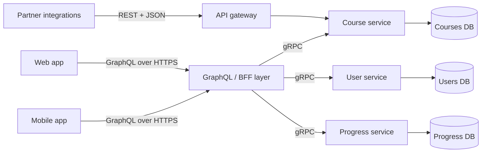

REST, GraphQL and gRPC are three answers to "how should two programs talk over a network?" Each makes different things easy:
REST makes resources cacheable and universally consumable, GraphQL lets clients ask for exactly the data a screen needs, and gRPC
makes service-to-service calls fast and strongly typed. Choosing well — and saying why — is a standard part of the API step.

## Why it matters

The API style shapes the rest of the design: what a CDN can cache, how many round trips a mobile screen needs, how services evolve
independently, what the gateway can inspect and how errors propagate. Interviewers rarely want a long comparison — they want a clear
default with a reason, and awareness of when a different style is better.

## How it works

### REST

REST models the system as **resources** identified by URLs and manipulated with standard HTTP methods:

```http
GET    /courses/42             -> the course
GET    /courses/42/lessons     -> its lessons
POST   /courses/42/enrollments -> enrol the current user
DELETE /enrollments/9001       -> unenrol
```

- **Wire format:** usually JSON over HTTP/1.1 or HTTP/2.
- **Strengths:** universal tooling; every proxy, CDN and browser understands it; HTTP caching works on `GET` responses; status codes and
  methods carry meaning (safe, idempotent) that infrastructure can act on.
- **Weaknesses:** the server decides the response shape, so clients get **over-fetching** (fields they don't need) or
  **under-fetching** (several calls to build one screen). Contracts are often documented separately (OpenAPI) rather than enforced.

### GraphQL

GraphQL exposes **one endpoint** and a **typed schema**; clients send a query describing exactly the fields they need, possibly across
related objects:

```graphql
query CoursePage {
  course(id: 42) {
    title
    instructor { name avatarUrl }
    lessons(first: 10) { title durationMinutes }
  }
}
```

- **Wire format:** JSON over HTTP, usually `POST` to a single URL; subscriptions for real-time updates over WebSockets.
- **Strengths:** one round trip per screen; no over-fetching; a self-documenting schema; front-end teams can evolve screens without
  waiting for new endpoints. Often used as an aggregation layer over many back-end services.
- **Weaknesses:** HTTP caching is harder (one URL, `POST` bodies) so caching moves to clients and persisted queries; arbitrary queries
  can be expensive, so servers need depth and complexity limits; naive resolvers cause the **N+1 problem** (one query for the list, then
  one per item) unless batched with a data loader; per-field authorization and error handling are more complex.

### gRPC

gRPC defines **services and messages** in Protocol Buffers and generates client and server code; calls look like local method calls:

```protobuf
service CourseService {
  rpc GetCourse (GetCourseRequest) returns (Course);
  rpc WatchProgress (WatchRequest) returns (stream ProgressEvent);
}
```

- **Wire format:** compact binary Protocol Buffers over HTTP/2, with multiplexed streams.
- **Strengths:** small, fast messages; a strict contract checked at compile time; backward-compatible schema evolution via field
  numbers; deadlines that propagate across calls; four call types — unary, server streaming, client streaming and bidirectional
  streaming.
- **Weaknesses:** browsers can't speak native gRPC (they can't control HTTP/2 framing directly), so web clients need **gRPC-Web** and a
  proxy, or a REST/GraphQL edge; binary payloads are harder to inspect and debug; L4 load balancing pins a long-lived HTTP/2 connection
  to one backend, so gRPC needs L7 (per-request) balancing or client-side balancing.

### Side by side

| Aspect | REST | GraphQL | gRPC |
|---|---|---|---|
| Contract | Optional (OpenAPI) | Required schema | Required `.proto` |
| Payload | JSON (text) | JSON (text) | Protocol Buffers (binary) |
| Transport | HTTP/1.1 or HTTP/2 | HTTP (+ WebSockets for subscriptions) | HTTP/2 |
| Response shape decided by | Server | Client | Server (typed messages) |
| HTTP caching / CDN | Natural for `GET` | Hard; needs persisted queries or client caches | Not applicable |
| Browser support | Native | Native | Needs gRPC-Web + proxy |
| Streaming | Via SSE / WebSockets alongside | Subscriptions | Built in (4 modes) |
| Sweet spot | Public APIs, resource CRUD, cacheable reads | Varied clients aggregating many sources | Internal service-to-service calls |

## Architecture

A common combination: REST (or GraphQL) at the edge, gRPC inside.



Partners get a stable, cacheable, well-understood REST API. The company's own apps get GraphQL so each screen loads in one round trip.
Services talk to each other with typed, efficient gRPC calls with deadlines.

## Failure scenarios

- **GraphQL query of death.** A deeply nested query (`courses → students → courses → students …`) fans out into millions of database
  reads. Defend with depth limits, complexity scoring, pagination on every list field and persisted (allow-listed) queries.
- **N+1 resolvers.** A list of 50 courses triggers 50 instructor lookups. Batch per request with a data loader.
- **gRPC connection pinning.** An L4 balancer sends all of a client's HTTP/2 traffic to one backend; new backends get no load. Use an L7
  proxy (such as Envoy) or client-side balancing.
- **Breaking changes.** Renaming a JSON field or reusing a Protocol Buffers field number silently breaks old clients — see
  [API versioning](lesson:api-evolution).
- **Chatty REST.** A mobile screen that needs eight sequential REST calls over a 200 ms network takes well over a second. Aggregate on
  the server (a backend-for-frontend or GraphQL).

## Trade-offs

- **Flexibility vs predictability.** GraphQL lets clients ask anything — which makes load less predictable and caching harder. REST
  endpoints are fixed, so they are easier to cache, rate-limit and capacity-plan.
- **Efficiency vs accessibility.** gRPC's binary format and HTTP/2 streams are efficient; JSON over REST can be read with `curl` and
  consumed from any language and from browsers.
- **Contract strictness vs speed of change.** Schemas and `.proto` files catch mistakes at build time but require coordinated tooling.
- **One style vs several.** Mixing styles at different boundaries is normal; mixing them at the same boundary usually isn't worth it.

## In real systems

- Public APIs from payment, communication and cloud providers are predominantly REST with JSON, versioned and documented with
  OpenAPI.
- GraphQL is widely used as a front-end aggregation layer (GitHub offers a public GraphQL API alongside REST).
- gRPC is common for internal microservice traffic and is used by many cloud platform APIs; Kubernetes components use gRPC for some
  internal interfaces such as the container runtime interface.

## Common mistakes

- **Choosing GraphQL "because it's modern"** for a simple CRUD API with one client.
- **Exposing gRPC directly to browsers** without gRPC-Web or a translating gateway.
- **Ignoring GraphQL cost controls** — no depth limit, no pagination, no complexity budget.
- **Designing REST as RPC-over-HTTP** — `POST /getCourse`, `POST /deleteCourse` — losing HTTP semantics and caching.
- **Forgetting load balancing for HTTP/2 and gRPC**, which needs per-request (L7) balancing.

## In the interview

````question title="Which API style would you use for this system, and why?"
I'd state a default per boundary. For a public or partner-facing API: REST with JSON — universally consumable, cacheable at CDNs for
GET requests, and simple to rate-limit and document. If our own web and mobile apps need data from many services on each screen, I'd
consider GraphQL or a backend-for-frontend so each screen is one round trip, with depth limits and pagination to control cost. Between
internal services I'd use gRPC for typed contracts, compact payloads, streaming and deadline propagation, behind L7 or client-side load
balancing. In the interview itself I'd write the external API as REST endpoints because they are the quickest to read.
````

````question title="What is the N+1 problem in GraphQL and how do you fix it?"
When a query asks for a list and a field on each item — say 50 courses and each course's instructor — a naive resolver runs one query
for the list and one per course for the instructor: 51 queries. Under load that multiplies database calls and latency. The fix is to
batch: a data loader collects all instructor IDs requested during one execution tick and fetches them in a single query (WHERE id IN
...), and caches results for the rest of the request. The same problem appears in REST clients and ORMs, with the same solution.
````

## Key takeaways

- **REST**: resources + HTTP methods; cacheable, universal; the server decides the shape — the default for public APIs.
- **GraphQL**: client-specified queries over a typed schema; one round trip per screen, but needs cost limits and has harder caching.
- **gRPC**: binary Protocol Buffers over HTTP/2 with generated clients and streaming; ideal internally, needs gRPC-Web for browsers
  and L7 load balancing.
- It's normal to use **different styles at different boundaries**; justify each with clients, caching and performance.

## Knowledge check

```quiz
? A mobile screen needs data from five services, and the app makes five sequential REST calls over a 250 ms network. What is the best improvement?
- Switch the five services to gRPC
! The mobile client still makes five sequential calls; the round trips remain.
+ Aggregate on the server with a backend-for-frontend or GraphQL so the screen needs one call
- Increase the server thread pool
! Server threads aren't the bottleneck; client round trips are.
- Use UDP
! Request/response APIs need reliable delivery.
> Round trips dominate on mobile; aggregation cuts five round trips to one.

? Why can't a browser call a gRPC service directly?
- Browsers can't send binary data
! Browsers send binary data routinely.
+ Browsers don't expose the low-level HTTP/2 framing and trailers gRPC relies on, so gRPC-Web and a proxy are needed
- gRPC only works over UDP
! gRPC runs over HTTP/2 on TCP.
- gRPC requires a GraphQL schema
! gRPC uses Protocol Buffers, not GraphQL.
> gRPC-Web adapts gRPC to what browsers can do; a proxy translates to native gRPC.

? Which risk is specific to exposing a GraphQL API to the public?
- Responses can't be JSON
! GraphQL responses are JSON.
+ Clients can write deeply nested, expensive queries unless depth and complexity are limited
- Clients can't select which fields they want
! Field selection is GraphQL's core feature.
- It can only be used for reads
! Mutations handle writes.
> Client-defined queries need cost controls: depth limits, complexity budgets, pagination and persisted queries.

? New backend instances added behind an L4 load balancer receive almost no gRPC traffic. Why?
- gRPC requires sticky sessions
! The symptom is caused by connection reuse, not a stickiness requirement.
+ Clients hold long-lived HTTP/2 connections, so an L4 balancer keeps sending their requests to the original backends
- gRPC messages are too small to balance
! Message size has nothing to do with balancing.
- The new instances need a GraphQL schema
! Unrelated to gRPC routing.
> Balance per request with an L7 proxy or client-side balancing for HTTP/2 traffic.
```
