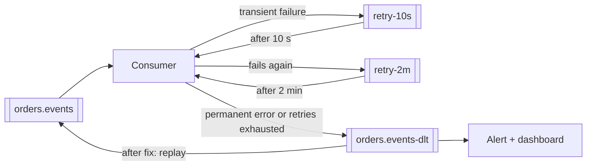

Messages fail. Some failures are transient — a database blip, a provider's rate limit — and succeed if retried a moment later. Others
never will — malformed data, a bug, a deleted record. Good messaging design retries the first kind patiently, without hammering the
struggling dependency, and moves the second kind out of the way into a dead-letter queue where people can look at it.

## Why it matters

Without a retry strategy, a consumer either drops messages on the first error (data loss) or retries one message forever (a stuck queue).
Interviewers expect: exponential backoff with jitter, bounded attempts, classification of retryable versus permanent errors, a dead-letter
queue (DLQ) with alerting and replay, and awareness that retries interact with ordering and idempotency.

## How it works

### Classify the failure

| Error | Example | Action |
|---|---|---|
| Transient | Timeout, 503, connection reset, throttling (429) | Retry with backoff |
| Permanent | Validation error, 400, unknown entity, deserialisation failure | Don't retry — dead-letter immediately |
| Unknown | An unexpected exception | Retry a few times, then dead-letter |

Retrying permanent failures wastes capacity and delays everything behind them.

### Exponential backoff with jitter

Wait longer after each failure — for example 1 s, 2 s, 4 s, 8 s, capped at some maximum — so a struggling dependency gets breathing room.
Add **jitter** (randomise each delay, e.g. a random value between 0 and the computed delay) so that thousands of consumers that failed at the
same moment don't all retry at the same moment, recreating the spike.

Bound the total: a maximum number of attempts or a maximum time window, after which the message goes to the DLQ.

### Where to wait

- **In the consumer** (blocking retries): simple, preserves per-partition ordering, but the partition — and every message behind the failed
  one — is stalled while it waits. Fine for short backoffs.
- **Retry topics or delayed redelivery** (non-blocking retries): move the failed message to `orders-retry-10s`, `orders-retry-1m`… and
  continue with the next message. Throughput continues, but later messages for the **same key overtake** the failed one — ordering is lost
  unless you pause the key.
- **Broker features**: SQS's visibility timeout and redrive policy (`maxReceiveCount` → DLQ); RabbitMQ dead-letter exchanges with TTLs.

### Poison messages and dead-letter queues

A **poison message** fails every time. Without a cap it's redelivered forever, blocking its partition or consuming capacity. After the
retry limit, publish it to a **dead-letter queue** with the original payload, headers, the error, the attempt count and timestamps. Then:

- **Alert** when the DLQ is non-empty (or growing) — a DLQ nobody watches is data loss with extra steps.
- **Inspect and fix** — a bug, bad data, a missing reference.
- **Replay** messages back to the main topic once fixed, idempotently (consumers must tolerate a message they may already have partly
  processed).

### Retries amplify load

Every layer that retries multiplies attempts: a client retrying 3 times, through a gateway retrying 3 times, to a service retrying 3 times
can send 27 requests to a failing database. Retry at **one** layer where possible, use **retry budgets** (retries limited to a percentage of
normal traffic) and **circuit breakers** to stop retrying a dependency that's down ([timeouts and retries](lesson:timeouts-retries)).

## Architecture



## Java and Spring Boot example

Spring for Apache Kafka's `DefaultErrorHandler` retries a failing record with exponential backoff, then hands it to a recoverer that publishes
it to a dead-letter topic (`<topic>-dlt` by default) with the exception details in headers. Exceptions that can't succeed skip the retries.
(Compiled against Spring for Apache Kafka 4.0.)

```java file="ErrorHandlingConfig.java"
import org.springframework.context.annotation.Bean;
import org.springframework.context.annotation.Configuration;
import org.springframework.kafka.core.KafkaTemplate;
import org.springframework.kafka.listener.DeadLetterPublishingRecoverer;
import org.springframework.kafka.listener.DefaultErrorHandler;
import org.springframework.kafka.support.ExponentialBackOffWithMaxRetries;

@Configuration
public class ErrorHandlingConfig {

    // Retry a failing record 4 times (1 s, 2 s, 4 s, 8 s), then publish it to "<topic>-dlt"
    // and move on, so one poison message can't block its partition forever.
    @Bean
    public DefaultErrorHandler errorHandler(KafkaTemplate<Object, Object> template) {
        ExponentialBackOffWithMaxRetries backOff = new ExponentialBackOffWithMaxRetries(4);
        backOff.setInitialInterval(1_000);
        backOff.setMultiplier(2.0);
        backOff.setMaxInterval(10_000);

        DefaultErrorHandler handler =
                new DefaultErrorHandler(new DeadLetterPublishingRecoverer(template), backOff);
        // Bad data will never succeed: skip the retries and dead-letter it immediately.
        handler.addNotRetryableExceptions(IllegalArgumentException.class);
        return handler;
    }
}
```

These retries happen in the consumer (blocking), so per-partition ordering is preserved while the record is retried. For long delays, Spring
Kafka's non-blocking retry topics (`@RetryableTopic`) implement the retry-topic design above.

## Failure scenarios

- **Infinite redelivery** of a poison message stalls a partition. Cap attempts; dead-letter.
- **Synchronised retries** after an outage hammer the recovering dependency. Jitter, and limit concurrency during recovery.
- **Retrying non-idempotent effects**: a retried payment call charges twice. Idempotency keys.
- **Ordering broken by retry topics**: a later "cancel" is processed before an earlier "create" that's waiting in a retry topic. Use blocking
  retries for order-sensitive keys, or version checks.
- **Unwatched DLQ**: thousands of orders silently parked for weeks. Alert on DLQ depth and age.
- **Replay without idempotency**: replaying the DLQ re-applies effects that partially succeeded.

## Trade-offs

- **Blocking vs non-blocking retries**: blocking preserves order and stalls the partition; non-blocking keeps throughput and breaks per-key
  order.
- **Retry duration vs freshness**: retrying for hours rides out long outages but delivers results late; short windows fail fast to the DLQ.
- **Automatic vs manual replay**: automatic replay heals transient problems; manual replay protects against re-poisoning with an unfixed bug.

## In real systems

- Amazon SQS redrive policies move messages to a DLQ after `maxReceiveCount` receives, and support redriving them back.
- RabbitMQ dead-letter exchanges receive rejected or expired messages; TTL-based delay queues implement backoff.
- Spring Kafka provides `DefaultErrorHandler`, `DeadLetterPublishingRecoverer` and `@RetryableTopic`; Kafka Connect has dead-letter queue
  settings for sink connectors.
- Google's SRE guidance recommends exponential backoff with jitter and retry budgets to avoid retry storms.

## Common mistakes

- **Retrying everything**, including validation errors.
- **Fixed-interval retries without jitter.**
- **Unbounded retries.**
- **A DLQ without alerts, owners or a replay procedure.**
- **Retrying at every layer**, multiplying load.

## In the interview

````question title="How do you handle a message that keeps failing?"
First classify it: if the error is permanent — invalid data, a missing entity — retrying is pointless, so it goes straight to a dead-letter
queue. If it's transient, retry with exponential backoff and jitter for a bounded number of attempts; if order matters for that key, retry
in place (blocking the partition briefly), otherwise move it to delayed retry topics so other messages keep flowing. After the limit it goes
to the DLQ with the payload, error and attempt history. The DLQ alerts its owning team, who fix the cause and replay the messages — which is
safe because consumers are idempotent.
````

````question title="Why add jitter to retry backoff?"
Without jitter, every client that failed at the same moment computes the same backoff and retries at the same moment — so when a dependency
recovers, it's hit by a synchronised wave of retries that can knock it over again. Randomising each delay spreads the retries over time, so
the recovering dependency sees a smoother load.
````

## Key takeaways

- **Classify** failures: retry transient ones, dead-letter permanent ones immediately.
- Retry with **exponential backoff + jitter**, **bounded** by attempts or time.
- **Blocking** retries keep order and stall the partition; **retry topics** keep throughput and break per-key order.
- **DLQs** need alerts, owners and idempotent **replay**; avoid **retry amplification** across layers.

## Knowledge check

```quiz
? A consumer receives a message with invalid JSON. What should happen?
- Retry it with exponential backoff for an hour
! It will never parse; retries waste capacity.
+ Send it to the dead-letter queue immediately and alert
- Drop it silently
! Silent drops are data loss.
- Block the partition until a human fixes it
! Everything behind it would stall.
> Permanent failures skip retries.

? 10,000 consumers failed at 12:00:00 when a database blipped. All retry after exactly 5 seconds. What happens?
- The retries succeed smoothly
! They arrive as a synchronised spike.
+ A synchronised retry wave hits the recovering database; jitter would spread it out
- The broker deduplicates the retries
! Retries are new attempts, not duplicates to drop.
- Nothing; 5 seconds is enough
! The issue is synchronisation, not duration.
> Randomised backoff prevents thundering herds.

? Which retry approach preserves per-key ordering in a Kafka partition?
+ Retrying in the consumer (blocking) before moving to the next record
- Publishing failed records to a retry topic and continuing
! Later records for the same key overtake the retried one.
- Sending failed records to a DLQ immediately
! Later records continue without the failed one.
- Processing the partition with a thread pool
! That breaks ordering on its own.
> Ordering costs throughput while a record is retried.

? What must be true before replaying a DLQ?
- The DLQ must be empty
! You're replaying its contents.
+ The cause is fixed and consumers are idempotent, since some messages may have partly succeeded
- The main topic must be paused forever
! A brief pause may help, but not forever.
- Retries must be disabled
! Normal retry policies still apply.
> Replay without fixes re-poisons; without idempotency, it double-applies.
```
