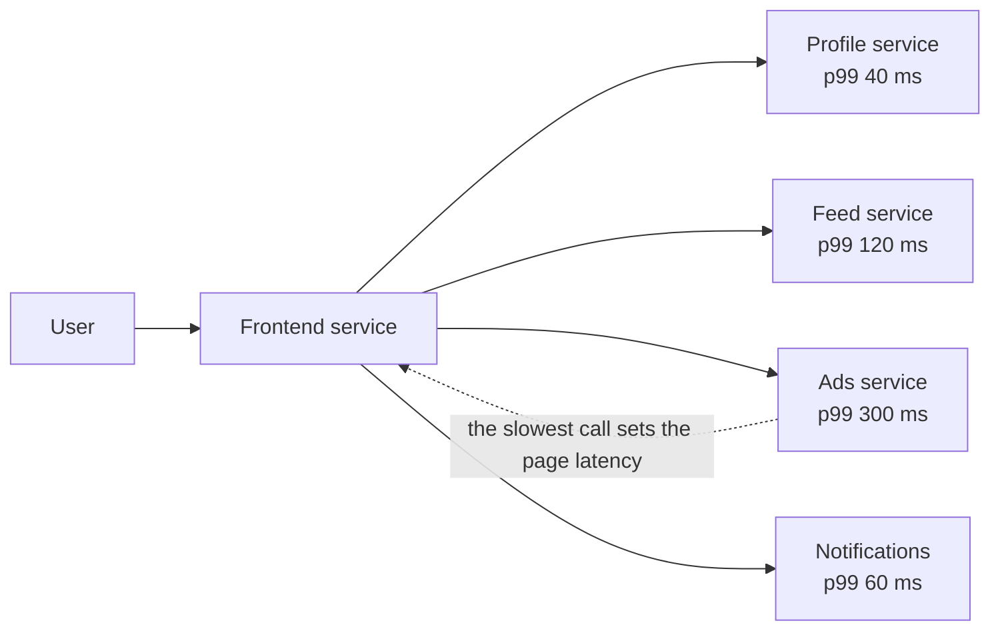

"Make it fast" and "make it scale" sound like the same request. They are not, and confusing them leads to designs that are quick in
a demo and fall over at peak. This lesson gives you precise words — latency, throughput, percentiles, utilisation — and the two
formulas that connect them.

## Why it matters

- **Performance** is how quickly the system handles *one* request: its **latency**.
- **Scalability** is whether it *stays* fast as load grows — more requests, more data, more users in more places — when you add
  resources.

A system can be fast and unscalable (a single in-memory server that answers in a millisecond until it runs out of memory) or
scalable and slow (a design that adds servers forever, each request crossing five network hops). Interviews probe both: "what is the
latency of this read?" and "what happens when traffic grows 10×?"

The vocabulary matters because non-functional requirements are written in it — "p99 under 200 ms at 20,000 requests per second" —
and every later estimate uses it.

## How it works

### Latency and throughput

- **Latency** is the time from sending a request to receiving the response, measured in milliseconds.
- **Throughput** is the amount of work completed per unit of time: requests per second (RPS or QPS), messages per second, bytes per
  second.

They are related but not the same. A highway's *speed limit* is latency; its *cars per hour* is throughput. You can raise
throughput by adding lanes (more servers) without changing the speed of any single car — or by batching cars into buses, which
raises throughput while making each passenger wait longer to board. That last trade-off — **batching improves throughput and hurts
latency** — appears everywhere, from database writes to Kafka producers.

### Percentiles, not averages

Latency is a distribution, not a number. Report it as percentiles:

- **p50** (median): half the requests are faster.
- **p99**: 99% are faster; 1 in 100 is slower.
- **p99.9**: 1 in 1,000 is slower.

The average hides the tail. If 99 requests take 20 ms and one takes 2 seconds, the average is about 40 ms — which describes none of
them. Users notice the slow ones, and heavy users (who make the most requests) hit the tail most often.

### Tail latency at scale

The tail gets worse when one user request fans out to many backend calls, because the user waits for the *slowest* one. If each
backend call is slow 1% of the time, the chance that at least one of *n* parallel calls is slow is `1 − 0.99ⁿ`:

| Fan-out | Requests that hit at least one slow call |
|---|---|
| 1 | 1% |
| 10 | 9.6% |
| 100 | 63% |

A backend's p99 becomes the frontend's median. This is why large systems fight tail latency explicitly — with timeouts, hedged
requests (send a duplicate after a short delay and take the first reply) and by reducing fan-out.

### Little's law: concurrency = throughput × latency

For any stable system, the average number of requests in flight `L` equals the arrival rate `λ` times the average time each spends
in the system `W`:

```text
L = λ × W
```

At 2,000 requests per second with 50 ms latency, about **100 requests** are in flight at any moment. If latency rises to 200 ms —
say a database slows down — the same traffic needs **400** concurrent slots. That is how a slow dependency exhausts thread pools and
connection pools without any increase in traffic.

### Utilisation and queueing

As a server approaches 100% utilisation, waiting time does not grow linearly — it explodes. In the simplest queueing model, the time
a request spends waiting grows roughly with `1 / (1 − utilisation)`: going from 50% to 90% busy multiplies queueing delay by about
five, and from 90% to 99% by another ten. That is why capacity plans target 50–70% utilisation at peak, not 100%: **headroom is what
keeps latency flat**.

### Dimensions of scalability

Load is not the only thing that grows:

- **Request volume** → stateless replicas, load balancing, caching.
- **Data volume** → partitioning (sharding), tiered storage, retention policies.
- **Geography** → CDNs, regional deployments, data locality.
- **Fan-out and contention** → asynchronous processing, partitioning hot data.

## Architecture

A request that fans out to several backends, where the user waits for the slowest call — the shape that turns a backend's p99 into
everyone's problem:



The usual responses: give each call a **timeout** and a fallback (render the page without ads rather than wait), call
independent services **in parallel**, and **cache** results that don't change per request.

## Failure scenarios

- **Saturation.** A server at 95% CPU doesn't fail outright; its queues grow and latency climbs until clients time out — which looks
  like an outage.
- **Slow dependency, exhausted pools.** By Little's law, a database that slows from 10 ms to 500 ms needs 50× more connections for
  the same traffic; the pool runs dry and requests that never touch the slow path also stall.
- **Retry amplification.** Clients that retry on timeout add load exactly when the system is slowest, pushing it further into
  overload (covered in [timeouts and retries](lesson:timeouts-retries)).
- **Tail spikes.** Garbage-collection pauses, noisy neighbours on shared hardware and cold caches cause p99 spikes without any change
  in average latency.

## Trade-offs

- **Throughput vs latency.** Batching, buffering and queueing raise throughput and add waiting time.
- **Utilisation vs latency.** Running hot saves money and sacrifices headroom; latency is the first casualty.
- **Fan-out vs freshness.** Precomputing results (fan-out at write time) makes reads fast and writes expensive; computing at read
  time does the opposite. Stage 10 covers this in depth.
- **Optimise vs scale out.** Making one request 2× cheaper is often worth more than doubling servers — and it is usually the first
  thing an experienced reviewer asks about.

## In real systems

- Google's paper *The Tail at Scale* (Dean and Barroso, 2013) popularised hedged and tied requests to cut tail latency in systems
  with large fan-out.
- Many teams publish latency SLOs at p99 or p99.9, not averages, because user experience is set by the tail.
- Load tests deliberately drive services past their comfortable utilisation to find the knee of the latency curve before production
  traffic does.

## Java and Spring Boot example

A few lines of arithmetic make the two ideas above concrete: how fan-out amplifies tail latency, and how Little's law turns a latency
change into a concurrency change (and therefore a thread-pool or connection-pool size).

```java file="TailLatency.java"
import java.util.Locale;

public class TailLatency {

    /** Chance that at least one of n parallel calls is slow, if each is slow with probability p. */
    static double chanceAnySlow(int n, double p) {
        return 1 - Math.pow(1 - p, n);
    }

    /** Little's law: requests in flight = arrival rate x time in system. */
    static double inFlight(double requestsPerSecond, double latencySeconds) {
        return requestsPerSecond * latencySeconds;
    }

    public static void main(String[] args) {
        System.out.println("Each backend call is slow 1% of the time (its p99).");
        for (int fanOut : new int[] {1, 10, 100}) {
            double pct = 100 * chanceAnySlow(fanOut, 0.01);
            System.out.printf(Locale.ROOT, "fan-out %3d -> %4.1f%% of requests hit a slow call%n",
                    fanOut, pct);
        }

        double rps = 2_000;
        for (double latencyMs : new double[] {50, 200}) {
            double busy = inFlight(rps, latencyMs / 1000);
            System.out.printf(Locale.ROOT, "%.0f req/s at %.0f ms -> %.0f requests in flight%n",
                    rps, latencyMs, busy);
        }
    }
}
```

```text title="Output" output="TailLatency.java"
Each backend call is slow 1% of the time (its p99).
fan-out   1 ->  1.0% of requests hit a slow call
fan-out  10 ->  9.6% of requests hit a slow call
fan-out 100 -> 63.4% of requests hit a slow call
2000 req/s at 50 ms -> 100 requests in flight
2000 req/s at 200 ms -> 400 requests in flight
```

In a Spring Boot service this is the arithmetic behind `server.tomcat.threads.max` and a connection pool's maximum size: if a
dependency's latency can quadruple, the pool sized for normal latency will run out — which is why the pool also needs a timeout.

## Common mistakes

- **Quoting averages.** Always talk about p99 (or p95) latency in requirements and diagnoses.
- **Treating "scalable" as a yes/no property.** Say *which* dimension grows and what component absorbs it.
- **Planning for 100% utilisation.** Capacity that only works at full utilisation has no room for spikes or failures.
- **Ignoring fan-out.** A page that calls 30 services inherits the worst tail of all of them.
- **Adding servers before profiling.** The bottleneck might be one slow query, not a lack of machines.

## In the interview

````question title="What is the difference between latency and throughput? Can improving one hurt the other?"
Latency is how long one request takes; throughput is how many requests (or bytes, or messages) the system completes per second. They
can trade against each other: batching writes or messages increases throughput because fixed costs are shared, but each item waits
for its batch, which increases latency. Adding servers raises throughput without changing per-request latency, while adding network
hops or queues can raise throughput and latency at the same time.
````

````question title="Why does p99 latency matter more than average latency in a system with many backend calls?"
Because the user waits for the slowest call. If one page fans out to 100 backend calls and each is slow 1% of the time, about 63% of
pages include at least one slow call — the backends' p99 becomes the page's median. Averages hide this entirely. The remedies are
fewer or parallel calls, timeouts with fallbacks, caching, and hedged requests for idempotent reads.
````

````question title="A service handles 5,000 requests per second at 40 ms. Its database slows down and latency rises to 400 ms. What happens to the thread pool?"
By Little's law, in-flight requests = throughput × latency. At 40 ms that is 5,000 × 0.04 = 200 concurrent requests; at 400 ms it is
2,000. A thread or connection pool sized for a few hundred is exhausted, new requests queue and time out, and requests that never
touch the slow database are delayed too. Timeouts on the database calls, a bounded pool with fast rejection, and a circuit breaker
contain the damage.
````

## Key takeaways

- **Performance** is about one request; **scalability** is about staying fast as load grows.
- Measure latency in **percentiles**; fan-out turns backend tails into user-visible medians.
- **Little's law** (`L = λ × W`) links throughput, latency and concurrency — and explains pool exhaustion.
- Latency grows sharply as utilisation approaches 100%; **plan for headroom**.

## Knowledge check

```quiz
? A service reports an average latency of 45 ms. What is the most important missing information?
+ The p99 (or p95) latency
- The number of servers
! Server count describes capacity, not what users experience.
- The programming language
! Language is an implementation detail; it doesn't describe the latency distribution.
- The median latency only
! The median still hides the slow tail.
> The average hides slow requests; percentiles describe what users actually feel.

? A page calls 10 backends in parallel, each slow 1% of the time. About what share of page loads include a slow call?
- 1%
! That would be true for one call, not ten.
+ About 10%
- About 50%
! That is closer to a fan-out of about 70 calls.
- 100%
! Slow calls are independent and rare; not every page hits one.
> 1 − 0.99¹⁰ ≈ 9.6%: fan-out multiplies exposure to the tail.

? Using Little's law, how many requests are in flight at 1,000 requests per second with 300 ms latency?
- 3
! That divides instead of multiplying.
- 30
! The units are off by a factor of ten — 300 ms is 0.3 s.
+ 300
- 3,000
! That would be 3 seconds of latency.
> L = λ × W = 1,000/s × 0.3 s = 300 concurrent requests.

? Why do capacity plans target around 60–70% utilisation at peak instead of 100%?
- Servers are unreliable above 70%
! Hardware doesn't fail at a utilisation threshold; queueing delay is the problem.
+ Waiting time grows sharply as utilisation approaches 100%, and headroom absorbs spikes and failures
- Cloud providers charge more above 70%
! Pricing doesn't depend on utilisation.
- Load balancers stop routing above 70%
! Load balancers keep routing; the servers just get slower.
> Queueing delay rises roughly with 1/(1 − utilisation), so the last 30% of capacity costs a lot of latency.
```

Two quick estimates — type a number, and you'll be told if it's within the stated factor of the reference:

```drill
? A service handles 1,500 requests per second with an average latency of 120 ms. How many requests are in flight on average?
= 180
~ 1.5
> Little's law: L = λ × W = 1,500/s × 0.12 s = 180 requests in flight.

? A page fans out to 20 backend calls in parallel, and each is slow 1% of the time. Roughly what percentage of page loads include at least one slow call?
= 18.2
~ 1.3
> 1 − 0.99²⁰ ≈ 1 − 0.818 = 0.182, so about 18% of page loads hit at least one slow call.
```
