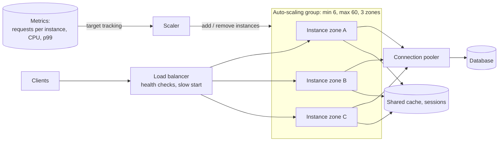

The application tier is the easiest part of a system to scale — as long as it holds no state. Put identical, stateless instances
behind a load balancer, add more when load rises, remove them when it falls. The interesting questions are what signal triggers
scaling, how fast new capacity arrives, and what scaling the app tier does to everything behind it.

## Why it matters

Almost every design has a tier of stateless services, and "how does it scale?" is the first scaling question an interviewer asks. A good
answer is short — stateless instances, a load balancer, auto-scaling on the right metric — but the follow-ups test whether you know the
traps: scaling on CPU when the service is I/O-bound, new instances arriving too late for a spike, deploys that halve capacity, and an
auto-scaled fleet that exhausts the database's connections.

## How it works

### The basic shape

1. **Stateless instances**: sessions, uploads, caches and background work live elsewhere (see
   [stateless vs stateful](lesson:stateless-vs-stateful)).
2. **A load balancer** spreads requests and removes unhealthy instances (see [load balancers](lesson:load-balancers)).
3. **An auto-scaling group** keeps between a minimum and maximum number of instances, adding or removing them in response to metrics.
4. **Spread across availability zones**, so losing one zone leaves enough capacity in the others.

### Choosing the scaling signal

| Signal | Good for | Watch out for |
|---|---|---|
| CPU utilisation | CPU-bound services (serialisation, crypto, computation) | I/O-bound services wait on databases at low CPU — they saturate without the metric moving |
| Requests per target (per instance) | Request/response APIs with predictable cost per request | Requests of very different cost |
| Latency (p95/p99) | User-facing SLOs | Latency can rise because a *dependency* is slow — more instances won't help and may hurt |
| Concurrency / in-flight requests | Thread- or connection-bound servers | Needs the server to expose it |
| Queue depth or age (for workers) | Consumers of queues and streams | Scale on *age of oldest message* when SLOs are about delay |
| Schedule | Known daily or event peaks | Must be maintained as patterns change |

**Target tracking** is the common policy: "keep average requests per instance near 800" or "keep CPU near 60%"; the scaler adds or removes
instances to hold the target. Pick the metric that saturates first for *this* service, as found by load testing.

### Scaling speed

New instances take time: provisioning, starting the runtime, loading configuration, warming caches and JIT compilers, passing readiness
checks. One to several minutes is typical for VMs; containers on existing nodes are faster; a cold Java service may serve slowly for its
first minute. Consequences:

- **Keep headroom**: target 50–70% utilisation, not 90%, so the fleet absorbs a spike while new capacity arrives
  ([server counts](lesson:servers-latency)).
- **Scale out fast, scale in slowly**: a short cool-down for scale-out and a long one for scale-in prevents flapping (adding and removing
  instances repeatedly).
- **Pre-scale for known events**: schedule capacity before a launch, a sale or a match; reactive scaling is always behind a step change.
- **Warm up**: send new instances a gradually increasing share of traffic (slow start) instead of a full share at once.

### What scaling the app tier does downstream

Every new instance opens connections and sends load to shared dependencies:

- **Database connections**: 50 instances × a pool of 20 = 1,000 connections; doubling the fleet doubles them
  ([connection pooling](lesson:connection-management)). Cap the fleet size or put a pooler in front.
- **Downstream rate limits and capacity**: scaling the caller doesn't scale the callee. If the bottleneck is downstream, more callers make
  it worse.
- **Caches**: per-instance caches start cold on every new instance, raising the miss rate during scale-out.

### Deploys are scaling events

A rolling deploy replaces instances in batches. If you replace 25% at a time and each new instance needs a minute to warm up, you run at
75% capacity for several minutes. Deploy with **surge capacity** (add new instances before removing old ones), **drain** connections
from instances being removed, and avoid deploying during peaks.

## Architecture



## Failure scenarios

- **Scaling on the wrong metric.** An I/O-bound service saturates its thread pool at 30% CPU; the CPU-based policy never scales; latency
  climbs. Scale on concurrency, request rate or latency instead.
- **Scaling into a downstream bottleneck.** The database is slow, latency rises, the latency-based policy adds instances, which add
  connections and load to the database, which gets slower. Cap the fleet, use concurrency limits, and shed load rather than scale.
- **Spike faster than scale-out.** A push notification to every user produces a 10× spike in seconds; new instances arrive minutes later.
  Headroom, pre-scaling, queues and load shedding cover the gap.
- **Flapping.** Aggressive scale-in removes instances, load per instance jumps, the scaler adds them back — repeatedly. Use asymmetric
  cool-downs.
- **Zone failure.** With instances spread over three zones, losing one removes a third of capacity at once; size so the remaining zones
  carry the peak, or scale out immediately into them.
- **Bad deploy at scale.** A broken version rolled to every instance. Canary first, then roll in batches with automated rollback.

## Trade-offs

- **Headroom vs cost.** More idle capacity absorbs spikes and failures; less saves money. Target 50–70% for user-facing services.
- **Many small vs few large instances.** Small instances scale in finer steps and each failure removes less capacity; large instances have
  less per-instance overhead (runtime, agents, connections).
- **Reactive vs scheduled scaling.** Reactive adapts to the unexpected but lags; scheduled is instant but needs maintenance. Use both.
- **Serverless vs instances.** Functions scale per request with no capacity planning but bring cold starts, per-request pricing and
  concurrency limits that can overwhelm databases.

## In real systems

- Cloud auto-scaling groups (AWS Auto Scaling, Google managed instance groups, Azure scale sets) support target tracking, step and
  scheduled policies; AWS Application Load Balancers offer slow-start mode for new targets.
- Kubernetes scales pods with the Horizontal Pod Autoscaler on CPU, memory or custom metrics, and nodes with a cluster autoscaler.
- Event-driven autoscalers (such as KEDA) scale consumers on queue length or lag.

## Common mistakes

- **"Just add more servers"** without saying what metric triggers it or what it does to the database.
- **Scaling on CPU for I/O-bound services.**
- **No headroom**, relying on auto-scaling to catch spikes it can't catch in time.
- **Forgetting connection pools multiply with instances.**
- **Ignoring deploys and zone loss** as capacity events.

## In the interview

````question title="How would you scale the API tier of this design?"
Keep the API servers stateless — sessions in a shared store, files in object storage, background work on queues — and run them behind a
load balancer across three availability zones in an auto-scaling group. I'd scale with target tracking on the signal that saturates first,
found by load testing; for a typical JSON API that's requests per instance or concurrency rather than CPU. I'd keep utilisation around
60% at peak so we can absorb spikes while new instances start, scale out quickly and in slowly, pre-scale for known events, and use
slow-start so new instances warm up. Finally, I'd check the downstream effects: the fleet's total database connections need a pooler or a
cap, and the database itself must be able to take the extra load.
````

````question title="Latency is rising and the auto-scaler keeps adding instances, but nothing improves. What is happening?"
The bottleneck is probably downstream — a slow database or dependency. Latency-based scaling adds instances, which add connections and
concurrent queries to the same bottleneck, making it worse. I'd confirm with dependency latency and saturation metrics, cap the fleet size,
stop scaling on latency for this case, add concurrency limits and load shedding to protect the dependency, and fix the real constraint:
slow queries, missing caching, or capacity in the dependency.
````

## Key takeaways

- Scale the app tier with **stateless instances, a load balancer and auto-scaling across zones**.
- Scale on the **metric that saturates first** — often requests or concurrency per instance, not CPU.
- New capacity is **slow**: keep **headroom**, scale out fast and in slowly, **pre-scale** for events, warm instances up.
- Scaling callers **multiplies load and connections downstream**; deploys and zone losses are capacity events too.

## Knowledge check

```quiz
? An I/O-bound API's thread pool saturates at 35% CPU. The auto-scaler targets 70% CPU. What happens at peak?
- It scales out correctly
! CPU never reaches the target, so no scaling is triggered.
+ It never scales out; requests queue and latency climbs
- It scales in because CPU is low
! It may hold steady or scale in — either way, capacity is missing.
- The load balancer adds threads
! Load balancers don't change server thread pools.
> Scale on the resource that saturates first — here concurrency or requests per instance.

? Why scale out quickly but scale in slowly?
+ To add capacity before users suffer, while avoiding flapping from removing instances too eagerly
- Because scale-in is more expensive than scale-out
! Removing instances saves money; the issue is stability.
- Because load balancers can't remove instances quickly
! They can, with draining.
- To keep database connections constant
! Connections follow instance count either way.
> Asymmetric cool-downs prevent oscillation.

? A fleet of 40 instances each has a database pool of 25. The auto-scaler doubles the fleet during an event. What should you check?
- Nothing — pools are per instance
! The total is what the database sees.
+ That 80 × 25 = 2,000 connections fit the database's limit, or that a pooler sits in between
- That the load balancer supports 80 instances
! Load balancers handle that easily.
- That CPU stays under 70%
! The connection limit can fail first.
> Auto-scaling multiplies per-instance resources against shared dependencies.

? A sale starts at 10:00 and traffic will jump 8× within a minute. What is the best plan?
- Rely on target-tracking auto-scaling
! New instances take minutes; the step change arrives first.
+ Pre-scale on a schedule before 10:00, keep headroom, and have load shedding as a backstop
- Lower the health-check interval
! Health checks don't add capacity.
- Disable auto-scaling during the sale
! You still need to react to unexpected load.
> Reactive scaling lags step changes; schedule capacity for known events.
```

```drill
? Peak is 36,000 requests/s; each instance handles 900 requests/s at the latency target; target utilisation is 60%. How many instances at peak (before zone redundancy)?
= 67
~ 1.15
> 900 × 0.6 = 540 usable; 36,000 ÷ 540 ≈ 66.7 → 67 instances.
```
