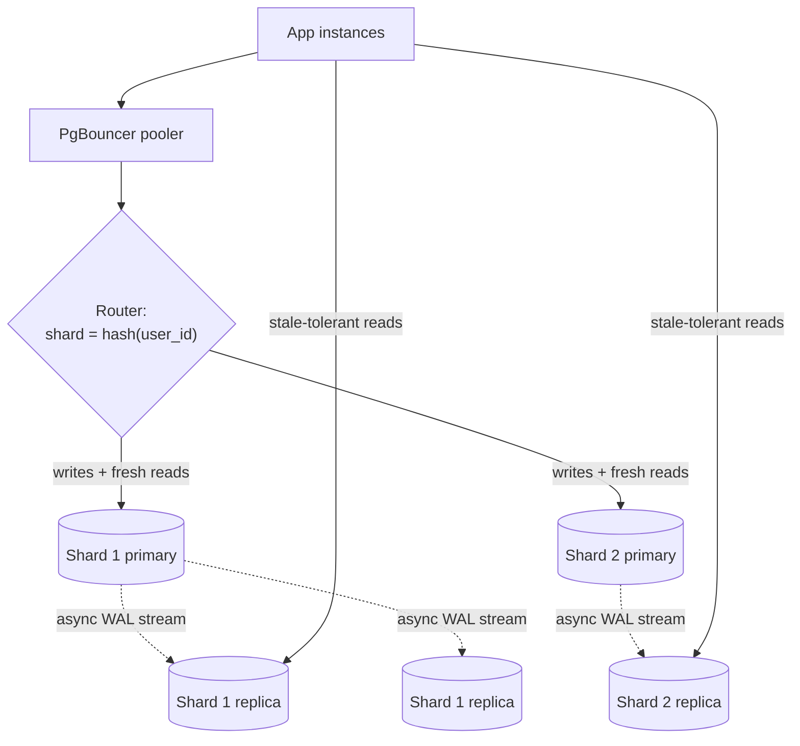

Application servers scale by adding copies; databases don't, because they hold state that must stay correct. This lesson is a
map of the tools for a database that has outgrown its first machine — connection pooling, read replicas, partitioning and sharding —
what each one solves, and what each one costs your data model. Later stages go deep on each.

## Why it matters

"The database is the bottleneck" is the most common turning point in a system design interview. The interviewer wants to see you reach
for the **least disruptive** tool that solves the **specific** limit you've hit — connections, read throughput, write throughput, data
size or latency — rather than "shard it" by reflex. Each step up the ladder adds complexity that never goes away.

## How it works

### The ladder

Climb only as far as the numbers require:

1. **Tune and index.** Fix slow queries, N+1 patterns and missing indexes ([query optimisation](lesson:query-optimization)).
2. **Scale up.** A bigger machine (more cores, memory, faster disks) — no application changes. Modern single instances go a long way.
3. **Pool connections** so many app instances don't overwhelm the database.
4. **Cache** hot reads in Redis or a CDN ([caching](lesson:caching-basics)).
5. **Read replicas** for read-heavy workloads.
6. **Partition** big tables within one database (for retention and query pruning).
7. **Shard** across several databases when writes or data size exceed one primary.
8. Or move specific workloads to a store built for them (wide-column for massive key-addressed writes, search for discovery).

### Connection pooling

Covered in [keep-alive and connection pooling](lesson:connection-management): each database connection is expensive (in PostgreSQL, a
server process), and the fleet-wide total must fit the database's limit. A pooler such as PgBouncer or RDS Proxy multiplexes thousands of
client connections onto a few dozen real ones. This is usually the first scaling fix, because auto-scaled app tiers hit connection limits
long before CPU limits.

### Read replicas

A **replica** continuously applies the primary's changes (by streaming its write-ahead log) and serves read-only queries.

- **Reads scale out:** if the primary handles 10,000 reads per second, adding four replicas that each handle a similar rate gives roughly
  five times the read capacity. Writes don't scale — every write still goes through the primary *and* is replayed on every replica.
- **Asynchronous replication** (the common default) acknowledges writes before replicas apply them, so replicas lag — usually
  milliseconds, sometimes seconds under load. Reads from a replica may be **stale**.
- **Synchronous replication** waits for at least one replica to confirm before acknowledging, trading write latency for durability and
  zero data loss on failover.
- **Failover:** a replica can be promoted if the primary fails (see [leader–follower replication](lesson:leader-follower)).

Replica lag creates the classic **read-your-writes** problem: a user updates their profile, the next page reads from a replica that hasn't
caught up, and the change seems lost. Common fixes: read a user's own recent writes from the primary (for a few seconds after writing, or
for "my" pages), or wait until the replica has reached the write's log position.

### Partitioning (within one database)

**Partitioning** splits one large table into smaller physical pieces inside the same database, by a partition key:

- **Range** (by month of `created_at`): perfect for time-series and retention — dropping last year is dropping partitions, not deleting
  billions of rows.
- **List** (by region or tenant tier).
- **Hash** (by `user_id` modulo N): spreads rows evenly.

Queries that include the partition key touch only the relevant partitions (**partition pruning**). It's still one database: transactions,
constraints and joins work as before, and the machine's limits still apply. Details in
[partition keys and retention](lesson:partition-keys-retention).

### Sharding (across databases)

**Sharding** splits data across several independent databases, each owning a subset of keys — every shard is a full primary (with its own
replicas). It scales **writes and storage** horizontally, at significant cost:

- Every query needs the **shard key** to know where to go; queries without it **scatter** to all shards and gather results.
- **Cross-shard transactions** and joins are no longer local — they need application logic, sagas or a distributed SQL database.
- **Rebalancing** when adding shards moves data around; schemes like [consistent hashing](lesson:consistent-hashing) reduce how much.
- **Hot keys** concentrate load on one shard.

The shard key is the most consequential decision: it should appear in almost every query, spread load evenly, and keep data that is
transacted together on the same shard (all of a user's orders with the user). Strategies are covered in [sharding](lesson:sharding).

| Tool | Solves | Doesn't solve | New problems |
|---|---|---|---|
| Pooling | Too many connections | Slow queries, CPU limits | Session-feature caveats in transaction pooling |
| Read replicas | Read throughput, read latency by region | Write throughput, data size | Stale reads, failover management |
| Partitioning | Huge tables, retention, pruning | One machine's CPU, memory, write limits | Partition key in queries; per-partition limits |
| Sharding | Write throughput, data size | — | Routing, cross-shard queries and transactions, rebalancing, hot shards |

## Architecture



Each shard is an ordinary primary with replicas. The router (in the application, a library such as Vitess's VTGate, or a proxy) maps each
key to its shard; writes and read-your-writes go to primaries; other reads may go to replicas.

## Failure scenarios

- **Replica lag spikes** during a bulk write; users read stale data or "lose" their own changes. Monitor lag and route around lagging
  replicas.
- **Primary failure with async replication** loses the writes the replica hadn't received. Synchronous or semi-synchronous replication to
  at least one replica avoids it, at a latency cost.
- **Connection storm** after failover: every app instance reconnects to the new primary at once; poolers and backoff smooth it.
- **Scatter-gather queries** on a sharded system: a query without the shard key hits every shard, so latency becomes the slowest shard's
  and load multiplies with shard count.
- **Hot shard:** one celebrity tenant on one shard saturates it while others idle.

## Trade-offs

- **Simplicity vs headroom.** Each rung adds lasting complexity; climb only when estimates or measurements show the current rung won't
  hold.
- **Freshness vs read scale.** Replicas multiply reads but serve slightly stale data.
- **Durability vs write latency.** Synchronous replication protects every write and adds a round trip to each one.
- **Sharding vs relational features.** Sharding buys write scale and pays with joins, transactions and ad-hoc queries.

## In real systems

- PostgreSQL streaming replication and MySQL binlog replication power read replicas; managed services (Amazon RDS/Aurora, Cloud SQL)
  automate them and failover.
- Vitess shards MySQL behind a routing layer and was built at YouTube; Citus extends PostgreSQL with distributed tables.
- Many companies run one large primary for years, adding replicas, caching and archival before sharding becomes necessary.

## Common mistakes

- **Sharding first**, before indexes, caching, replicas and a bigger machine.
- **Sending all reads to replicas**, including a user's reads of their own changes.
- **Choosing a shard key that most queries don't include.**
- **Ignoring connection limits** when scaling the app tier.
- **Confusing partitioning with sharding** — partitions live in one database; shards are separate databases.

## In the interview

````question title="Your database is the bottleneck. Walk me through how you would scale it."
First identify the limit. If it's slow queries, fix indexes and query shapes. If it's connections, add a pooler. If it's read
throughput — the common case — cache hot data and add read replicas, routing a user's own recent reads to the primary to avoid stale
reads. If tables are huge and old data is rarely read, partition by time and archive. Only if writes or total data exceed what one primary
can handle would I shard, choosing a shard key that appears in nearly every query and keeps related data together — for example user_id
for user-owned data — and accept that cross-shard queries and transactions become application concerns.
````

````question title="What problems do read replicas introduce, and how do you handle them?"
Replication is usually asynchronous, so replicas lag behind the primary; a read from a replica can miss a write that just committed. That
breaks read-your-writes: a user saves something and the next page doesn't show it. I'd route reads that must be fresh — a user's own
data shortly after they write it, or anything that decides a write — to the primary, and send stale-tolerant reads like public pages and
feeds to replicas. I'd also monitor replica lag and remove lagging replicas from rotation, and remember that replicas add read capacity
but no write capacity, since every replica replays every write.
````

## Key takeaways

- Climb the ladder: **tune → scale up → pool → cache → replicas → partition → shard**, as far as the numbers require.
- **Replicas** scale reads, not writes, and serve **possibly stale** data; route read-your-writes to the primary.
- **Partitioning** splits a table inside one database (retention, pruning); **sharding** splits data across databases (write scale).
- The **shard key** must appear in most queries, spread load and keep transactional data together.

## Knowledge check

```quiz
? A read-heavy service's primary is at 90% CPU from SELECT queries; writes are light. What is the most appropriate next step after indexing?
- Shard the database by user ID
! Sharding is costly and mainly addresses write or size limits.
+ Add read replicas (and caching) and route stale-tolerant reads to them
- Switch to synchronous replication
! That increases write latency and doesn't add read capacity by itself.
- Partition the table by month
! Partitioning doesn't add CPU.
> Replicas and caches multiply read capacity without changing the data model.

? A user edits their profile and immediately sees the old version. Reads go to async replicas. What is the fix?
+ Route that user's reads of their own data to the primary for a short time after a write
- Add more replicas
! More replicas don't reduce lag.
- Lower the cache TTL
! The stale read comes from the replica, not a cache.
- Use a bigger replica instance
! Replica size doesn't guarantee it has applied the latest write.
> Read-your-writes needs reads from a source known to include the write.

? What is the key difference between partitioning and sharding?
- Partitioning is for NoSQL, sharding for SQL
! Both concepts exist in both worlds.
+ Partitions are pieces of a table inside one database; shards are separate databases each owning a subset of the data
- Sharding keeps all data on one machine
! Sharding spreads data across machines.
- Partitioning requires consistent hashing
! Range and list partitioning don't use hashing.
> Partitioning helps manageability within one server; sharding scales beyond one server.

? Most queries in a sharded system include only `course_id`, but data is sharded by `user_id`. What happens?
- Queries become faster
! They have to ask every shard.
+ Those queries scatter to every shard and gather results, so load and latency grow with the shard count
- The router guesses the right shard
! Without the shard key, no single shard can be chosen.
- Nothing changes
! Routing depends entirely on the shard key.
> Choose a shard key that appears in the dominant queries.
```

Two capacity estimates:

```drill
? Peak reads are 45,000 per second. Each replica comfortably serves 10,000 reads per second, and you keep one spare. How many read replicas do you need?
= 6
~ 1.2
> 45,000 ÷ 10,000 = 4.5 → 5 replicas, plus 1 spare = 6.

? A table grows by 40 GB per month and only the last 12 months are queried. With monthly partitions, how much data is in the live partitions at steady state?
= 480 GB
~ 1.2
> 12 partitions × 40 GB = 480 GB; older partitions are detached and archived.
```
