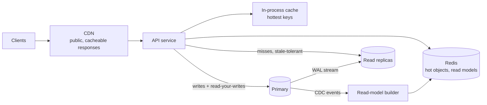

Most systems read far more than they write — often ten to a thousand times more — so reads are usually the first thing to outgrow a
single database. There is a well-trodden ladder of techniques for scaling them, and the skill is climbing it in the right order:
cheapest and least disruptive first, and only as far as the numbers require.

## Why it matters

"How do you handle 50,000 reads a second?" is one of the most common scaling questions, and the weak answer is "shard the database".
Sharding scales writes and storage; for reads there are cheaper tools that don't change your data model. Interviewers listen for the
order you reach for them, and for the consistency cost each one brings — especially replica lag and stale caches.

## How it works

### The read-scaling ladder

| Rung | Technique | Typical gain | Cost |
|---|---|---|---|
| 1 | **Optimise queries and indexes** | Often 10–1,000× for the slow queries | Engineering time; slightly slower writes |
| 2 | **Scale up** the database (more RAM so the working set fits) | 2–4× | Money; a ceiling |
| 3 | **Cache** hot results (Redis, in-process, CDN) | Most reads never reach the database | Staleness and invalidation |
| 4 | **Read replicas** | Roughly linear in replica count for reads | Replica lag; failover complexity |
| 5 | **Denormalised read models / materialised views** | Expensive queries become single lookups | Write amplification; keeping copies in sync |
| 6 | **Specialised read stores** (search index, key-value, columnar) | Queries the primary store can't serve well | Another system to keep in sync |
| 7 | **Partitioning / sharding** | Splits the data itself | Cross-shard queries and transactions |

Rungs 1–4 handle the large majority of read-heavy systems. Rungs 5–6 appear when the *shape* of a query, not its volume, is the problem —
a feed, a leaderboard, full-text search. Rung 7 is usually driven by write volume or data size, not reads.

### Read replicas in practice

A replica applies the primary's write-ahead log and serves read-only queries. Routing reads to replicas raises three problems:

- **Read-your-writes.** A user updates their profile and the next page reads from a replica that hasn't applied the update yet. Fixes:
  route a user's reads to the primary for a short window after they write (a few seconds, tracked in their session); or record the
  primary's log position (LSN) at write time and read from a replica only once it has replayed past that position; or read "my own data"
  from the primary always.
- **Monotonic reads.** Two consecutive requests hit two replicas with different lag; the user sees new data, then old data. Fix: pin a
  user (or session) to one replica.
- **Lag spikes.** A bulk update or a long query on the replica can make it fall seconds or minutes behind. Monitor lag, remove lagging
  replicas from rotation, and never send correctness-critical reads (for example, "is this seat free?") to replicas.

### Caching in front of replicas

A cache absorbs repeated reads of the same items; replicas absorb the rest. Sizing is about misses: at 50,000 reads/s and a 90% hit
ratio, replicas serve 5,000/s — and if the cache fails, they briefly see all 50,000. Plan replica capacity for a **degraded** hit ratio,
not the best case (see [cache failure modes](lesson:cache-failure-modes)).

### Read models: precompute the answer

Some reads are expensive however you serve them: "the 50 newest posts from accounts I follow", "top products in this category by rating".
Precompute them — a materialised view, a denormalised table, a per-user list in Redis — updated when the underlying data changes (by the
same transaction, a trigger, or events and change data capture). This is the core idea behind feeds, leaderboards and dashboards, and the
read side of [CQRS](lesson:event-sourcing-cqrs).

## Architecture



## Failure scenarios

- **Stale read after write.** The classic replica bug: the user "loses" their change. Route their reads to the primary briefly or wait for
  the replica to catch up to their write's log position.
- **Replica lag storm.** A large migration on the primary makes every replica fall minutes behind; stale data everywhere. Throttle bulk
  writes, monitor lag, fail reads over to the primary or degrade.
- **Cache outage.** Replicas sized for a 95% hit ratio receive twenty times their normal load. Size for degraded operation, use request
  coalescing, shed load.
- **Read model drift.** A missed event leaves a precomputed view wrong; periodic rebuilds or reconciliation correct it.
- **Replica promoted during failover** with missing writes (asynchronous replication) — covered in
  [leader–follower replication](lesson:leader-follower).

## Trade-offs

| Technique | Freshness | Effort | Best when |
|---|---|---|---|
| Indexes | Fresh | Low | Specific slow queries |
| Cache | Stale up to TTL / invalidation | Medium | Repeated reads of the same keys |
| Replicas | Stale by replica lag (usually ms) | Low–medium | Broad read volume, varied queries |
| Read models | Stale by update pipeline | High | Expensive query shapes read very often |
| Specialised store | Stale by sync pipeline | High | Search, geo, analytics queries |

## In real systems

- Large websites commonly run a primary with many read replicas plus a large cache tier; Facebook's TAO and memcache papers describe
  caching at enormous read scale, including handling invalidation across regions.
- Managed databases (Amazon RDS and Aurora, Cloud SQL) provide read replicas and reader endpoints; Aurora replicas share storage with the
  writer, keeping lag typically low.
- Social feeds, timelines and leaderboards are almost always precomputed read models rather than queries at read time.

## Common mistakes

- **Sharding to scale reads** before caching and replicas.
- **Sending every read to replicas**, including reads that must reflect the user's own writes.
- **Sizing replicas for the cache's best day.**
- **Caching without an invalidation plan.**
- **Precomputing everything**, paying write amplification for views nobody reads often.

## In the interview

````question title="Reads have grown to 40,000 per second against one PostgreSQL primary. What do you do?"
Climb the ladder. First, check that the top queries are indexed and efficient. Then cache the hot, repeated reads — objects by ID, popular
lists — in Redis with an invalidation plan, which typically removes most of the load. Add read replicas for the remaining stale-tolerant
reads, keeping reads of a user's own recent writes on the primary (or waiting for the replica to reach their write's log position). Size
replicas for a degraded cache hit ratio, not the best case. If certain queries are expensive by shape — feeds, rankings — precompute them
as read models. Sharding would only come in if writes or data size outgrew the primary.
````

````question title="How do you stop users seeing stale data after they update something, when reads go to replicas?"
Give them read-your-writes consistency. Options: after a write, mark the session so that user's reads go to the primary for a few seconds;
or capture the primary's WAL position (LSN) when the write commits, carry it with the user's next requests, and serve them from a replica
only once its replay position has passed it; or always read a user's own data from the primary. For monotonic reads, pin each session to
one replica so successive requests don't go backwards in time.
````

## Key takeaways

- Climb the ladder: **optimise → scale up → cache → replicas → read models → specialised stores → shard**.
- Replicas bring **replica lag**: provide **read-your-writes** and **monotonic reads** where users notice.
- Size replicas for a **degraded cache**, not the best case.
- Precompute **expensive query shapes** as read models; sharding is mainly for writes and size.

## Knowledge check

```quiz
? Which is usually the right first step for a read-heavy database under strain?
- Shard the database by user ID
! Sharding is costly and mainly addresses writes and data size.
+ Find and fix the most expensive queries and indexes, then cache hot repeated reads
- Switch to a NoSQL database
! A store migration is a last resort, not a first step.
- Add synchronous replication
! That adds write latency without adding read capacity.
> The cheapest, least disruptive rungs remove most read load.

? A user changes their display name and immediately sees the old one. Reads go to asynchronous replicas. Which fix provides read-your-writes?
+ Route that user's reads to the primary for a few seconds after a write, or until a replica has replayed past their write's position
- Add more replicas
! More replicas don't reduce lag.
- Increase the cache TTL
! A longer TTL makes staleness worse.
- Use eventual consistency everywhere
! That's what causes the problem here.
> Read-your-writes requires a source known to include the write.

? Replicas are sized for 5,000 reads/s, assuming a 95% cache hit ratio on 100,000 reads/s. The cache fails. What happens?
- Replicas handle it; caches are optional
! The replicas would receive 100,000 reads/s — twenty times their sizing.
+ Replicas are overwhelmed; plan for a degraded hit ratio, coalesce misses and shed load
- The primary automatically absorbs the extra load
! The primary is sized for writes, not 100,000 reads/s.
- Reads are queued until the cache recovers
! Without explicit queueing, they hit the database.
> Capacity behind a cache must survive the cache's absence, at least briefly.

? When does a precomputed read model beat replicas and caching?
- Whenever reads exceed writes
! Replicas and caches handle most read-heavy loads.
+ When an expensive query shape (a feed, a ranking) is read very often and can tolerate a short update delay
- When writes must be strongly consistent
! Read models are usually eventually consistent.
- When the data is small
! Small data rarely needs precomputation.
> Precompute the answer when computing it per request is too expensive.
```
