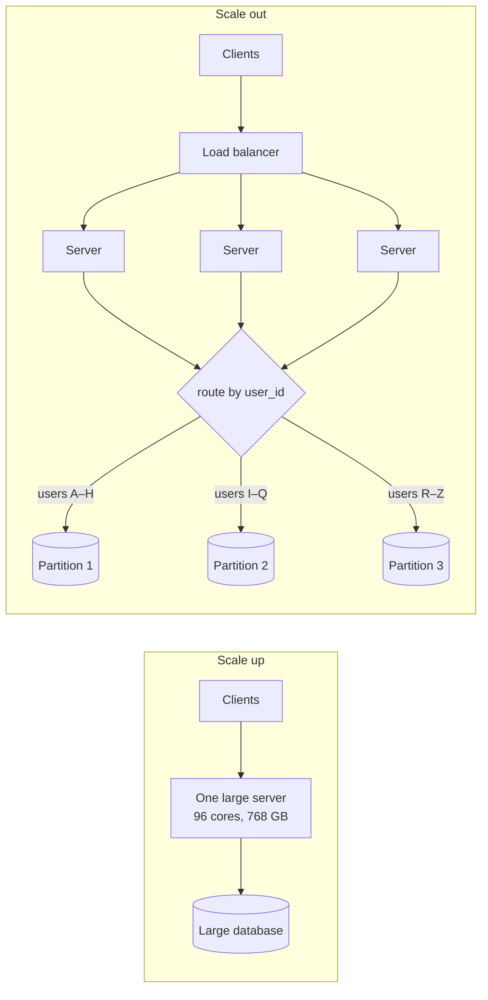

When a system runs out of capacity there are only two moves: make the machine bigger, or use more machines. Each has a ceiling, a
cost curve and a failure behaviour — and the second move only works if you can spread the load.

## Why it matters

- **Vertical scaling** ("scaling up") means a bigger machine: more CPU cores, memory, faster disks and network.
- **Horizontal scaling** ("scaling out") means more machines sharing the work.

Interviewers want to hear that you know *both*, and when each is right. "Just scale horizontally" without saying how load is spread,
where state lives and what breaks is a weak answer. "This database will fit on one large instance for the next two years, so I'll
scale it vertically and add a replica for failover" can be a strong one.

## How it works

### Vertical scaling

A larger machine runs the same software with no code changes. Cloud providers offer instances from a couple of cores up to hundreds of
cores and multiple terabytes of memory.

- **Advantages**: no distribution problems (no network partitions between your own components, no consistency between copies, no
  rebalancing); simple operations; the fastest path for stateful systems such as relational databases.
- **Limits**: there is a largest machine; price grows faster than capacity near the top end; resizing usually needs a restart or a
  failover; and one machine is one failure domain — it does not, by itself, improve availability.

### Horizontal scaling

Add machines and spread work across them.

- **Advantages**: near-linear capacity growth for stateless work; no hard ceiling; individual failures remove a fraction of capacity
  instead of all of it; commodity hardware.
- **Requirements**: the work must be divisible. Stateless request handling divides easily. Stateful work needs **partitioning** (each
  machine owns part of the data) or **replication** (each machine has a copy), and both bring coordination costs.

Scaling out is never perfectly linear. Two effects eat into it: **contention** (machines waiting on a shared resource, such as one
database or lock) and **coordination** (machines spending effort keeping each other in sync). A design scales well when it
minimises both — which is why statelessness and good partition keys come up so often.

### How load is distributed

More machines only help if requests reach them evenly. The main tools, from the outside in:

| Layer | Tool | Granularity | Notes |
|---|---|---|---|
| Global | DNS (round robin, geo, latency-based) | Per client, cached for the TTL | Coarse: clients cache answers; good for regions |
| Edge | Anycast + CDN | Per network route | Users reach the nearest point of presence |
| Service | Load balancer (L4/L7) | Per connection or request | Health checks remove dead servers |
| Client | Client-side balancing | Per request | Clients pick a server from a registry; no extra hop |
| Data | Partitioning by key (hash or range) | Per key | Decides *which* machine owns a piece of data |

The first four spread *requests* across interchangeable servers. The last spreads *data* across machines that are not
interchangeable — a request for user 42 must go to the machine that owns user 42.

## Architecture

Vertical and horizontal scaling side by side. On the right, load is distributed in two different ways: the stateless tier by a load
balancer, the data tier by key.



## Failure scenarios

- **The big box dies.** A vertically scaled system without a standby is a single point of failure: everything is down until it is
  replaced or restarted.
- **Uneven load after scaling out.** Long-lived connections (WebSockets, database connection pools) stay on old servers after new ones
  are added, so new capacity sits idle.
- **Hot partitions.** Data partitioning only spreads load if keys are spread: one celebrity user or one date can overload one partition
  while the others idle.
- **Shared bottleneck.** Adding app servers multiplies connections to the one database behind them — eventually the database, not the
  app tier, falls over.
- **Partial failure.** With many machines, *something* is always failing; the system must keep working around it.

## Trade-offs

| | Vertical | Horizontal |
|---|---|---|
| Code changes | None | State must be externalised or partitioned |
| Ceiling | Largest machine | Practically none for stateless work |
| Cost curve | Rises steeply at the top end | Roughly linear |
| Availability | One failure domain | Survives individual failures |
| Operational complexity | Low | Higher: deploys, balancing, partial failures |
| Best for | Relational databases, early-stage systems, in-memory workloads | Stateless services, caches, partitioned stores |

In practice, systems do both: scale stateless tiers out, scale stateful stores up until it hurts, then partition them.

## In real systems

- Many companies run their primary relational database on one large instance (plus replicas for reads and failover) for a long time;
  it is often the simplest correct design until write volume or data size forces sharding.
- Stateless web and API tiers are almost always scaled horizontally behind load balancers, often with auto-scaling on CPU or request
  rate (covered in [Stage 6](lesson:scaling-app-tier)).
- Global products combine layers: DNS sends users to a region, a load balancer to a server, and a partition key to the shard holding
  their data.

## Common mistakes

- **Dismissing vertical scaling.** A bigger database instance is frequently the right first answer — say it, with its limits.
- **Scaling out stateful servers without partitioning or replication.** Two servers each holding different session data is not
  scaling, it is a bug.
- **Forgetting the shared dependency.** Ten times the app servers means ten times the database connections.
- **Assuming DNS balances evenly.** Clients and resolvers cache answers; DNS is coarse and slow to change.
- **Choosing a partition key without checking skew.** Spreading data evenly is not the same as spreading traffic evenly.

## In the interview

````question title="When would you scale a component vertically instead of horizontally?"
When the component is stateful and hard to partition — typically a relational database — and the next larger machine gives enough
headroom for the planning horizon. Vertical scaling needs no code changes and avoids distributed-systems problems; it is often the
fastest, cheapest correct choice. I'd pair it with a replica for failover, because one machine is one failure domain, and note the
trigger for moving to partitioning: write rate or data size approaching what one node can handle.
````

````question title="What has to be true for a service to scale horizontally?"
Requests must be divisible across machines. For a stateless service, any instance can handle any request, so a load balancer can
spread traffic and you can add instances freely. Stateful services need the state either partitioned (each machine owns part of the
data, with requests routed by key) or replicated (each machine has a copy, with a consistency strategy). And shared dependencies —
databases, locks, external APIs — must not become the new bottleneck.
````

````question title="What are the ways load gets distributed across a fleet of servers?"
From the outside in: DNS (round robin or geo/latency-based) sends clients to a region or entry point, coarsely and with caching delays;
anycast and CDNs route users to the nearest edge; load balancers spread connections or requests across healthy servers in a service;
client-side load balancing lets callers pick an instance from a registry; and partitioning routes requests for a given key to the
machine that owns that data. The first four spread requests over interchangeable servers; partitioning spreads data over
non-interchangeable ones.
````

## Key takeaways

- **Vertical** scaling is simple and limited; **horizontal** scaling is powerful and requires divisible work.
- Scaling out costs **contention and coordination** — statelessness and good partition keys minimise both.
- Load is distributed at several layers: **DNS, edge, load balancer, client and data partitioning**.
- Real systems combine both: scale stateless tiers out, stateful stores up, then partition.

## Knowledge check

```quiz
? Which component is usually the best candidate for vertical scaling first?
+ A relational database that is approaching CPU limits but still fits on one machine
- A fleet of stateless API servers
! Stateless servers scale out easily behind a load balancer.
- A CDN
! CDNs are distributed by design.
- A set of background workers reading from a queue
! Workers scale out by adding consumers.
> Stateful stores are hard to partition; a bigger instance plus a failover replica often buys years of headroom.

? After adding servers behind a load balancer, the new servers stay mostly idle. What is a likely cause?
- The servers are too fast
! Speed doesn't make a load balancer skip a server.
+ Long-lived connections remain pinned to the original servers
- DNS TTLs are too short
! Short TTLs make clients pick up changes faster, not slower.
- The database is sharded
! Sharding is about data placement, not which app server gets requests.
> Load balancers distribute new connections; persistent connections keep using the servers they were opened against.

? A system partitions user data by user ID across three databases, but one database is overloaded. What is the most likely reason?
- Partitioning never works for user data
! Partitioning by user is very common and usually works.
+ Traffic is skewed: a few very active users map to the overloaded partition
- The load balancer is L4
! The load balancer sits in front of app servers and doesn't choose partitions.
- Three partitions are always too few
! The number of partitions doesn't explain one being much hotter than the others.
> Even data distribution doesn't guarantee even traffic; skewed keys create hot partitions.

? What is the main availability weakness of pure vertical scaling?
- It requires code changes
! Vertical scaling needs no code changes — that is its main advantage.
- It cannot use SSDs
! Large machines use the fastest storage available.
+ The single machine is a single failure domain
- It cannot run databases
! Databases are the classic vertical-scaling workload.
> One machine, however large, takes the whole service down when it fails — so pair it with a standby.
```
