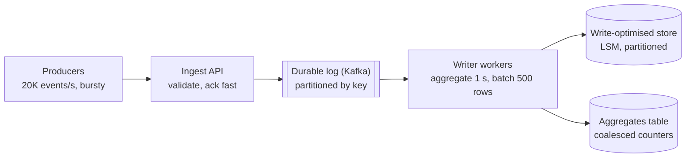

Reads can be copied, cached and served from anywhere; writes must land somewhere authoritative and durable. That makes write scaling
harder — and also more interesting, because the biggest wins usually come not from more machines but from doing fewer, larger, smarter
writes.

## Why it matters

Write-heavy systems — clicks, metrics, logs, locations, likes, messages — appear constantly in interviews. When the estimate says
"20,000 writes per second", the interviewer wants to hear options in a sensible order: reduce and batch the writes, smooth bursts with a
queue, use a storage engine built for writes, and partition only when one node truly can't keep up. Jumping straight to "shard it"
misses the cheaper, larger wins.

## How it works

### 1. Write less: batching and coalescing

Every write pays fixed costs — a network round trip, statement parsing, a transaction commit (which waits for the write-ahead log to be
flushed to disk). Amortise them:

- **Batch**: insert many rows per statement, or many statements per transaction. Measured on PostgreSQL 18 running in-process (no
  network, in-memory storage), inserting 10,000 rows one commit at a time ran at about **5,000 rows/s**; one transaction around them, about
  **7,000 rows/s**; multi-row `INSERT`s of 500 rows, about **115,000 rows/s**. On a real server, every per-row commit also pays a network
  round trip and a disk flush, so the gap is far larger.
- **Coalesce**: when many writes update the same thing, merge them first. 20,000 "like" events per second for 2,000 posts become 2,000
  increments per second if a worker aggregates per post for one second — or 2,000 per *ten* seconds with a ten-second window.
- **Send deltas, not snapshots**, and **debounce** chatty clients (save a document every few seconds, not every keystroke).

### 2. Smooth bursts with a queue

Writes are bursty; databases want a steady rate. Put a durable log or queue between producers and the database (**load levelling**):
producers write events quickly; consumers drain them at the rate the database can sustain, in batches. The queue absorbs a spike that
would otherwise overload the database — at the cost of the write being *asynchronous*: the caller gets "accepted", and the data is
visible a moment later. See [message queues](lesson:queues-pubsub).

### 3. Use a write-optimised storage engine

| | B-tree (PostgreSQL, MySQL InnoDB) | LSM tree (Cassandra, RocksDB, ScyllaDB, HBase) |
|---|---|---|
| Write path | Update pages in place (plus the WAL) — random I/O | Append to a log and an in-memory table; flush sorted files sequentially |
| Read path | One tree lookup | Check memtable and several sorted files (Bloom filters help) |
| Write throughput | Good | Excellent, especially for high write rates |
| Background cost | Page splits, vacuum/bloat | Compaction: rewrites files to merge them |
| Best for | Mixed workloads, transactions, rich queries | Append-heavy data: events, time series, messages, logs |

LSM-based stores turn random writes into sequential ones, which is why they sustain far higher write rates per node — and why they
dominate logging, metrics and messaging designs.

### 4. Reduce per-write overhead

- **Fewer indexes** on write-heavy tables — each index is another structure to update per insert.
- **Append, don't update**: inserting events and aggregating later avoids hot rows and lock contention.
- **Group commit and async commit** options trade a small durability window for throughput where acceptable.

### 5. Partition the writes

When one node can't absorb the write rate even after all of the above, **split the data** so each node takes a share: partitioned
tables in a distributed store, or [sharding](lesson:sharding) a relational database by a key that spreads writes evenly. Beware
[hot keys](lesson:hot-keys): partitioning spreads writes only if the key does.

## Architecture



## Failure scenarios

- **Hot partition.** All writes for one key (a viral post, today's date) land on one partition; the rest of the cluster idles. Use
  composite keys or salting.
- **Unbounded backlog.** Consumers can't keep up for hours; the queue grows, data becomes stale, and catching up takes longer than the
  backlog took to build. Monitor consumer lag; add consumers and partitions; apply backpressure (see
  [backpressure](lesson:backpressure)).
- **Lost acknowledged writes.** Acknowledging before the write is durable (in memory only) loses data on a crash. Acknowledge only after the
  durable log or database has it.
- **Duplicate writes.** At-least-once delivery from the queue re-applies batches after a crash. Make writes idempotent (upserts keyed by
  event ID) — see [deduplication](lesson:dedup).
- **Compaction storms** in LSM stores consume disk I/O and slow reads; capacity must include compaction.

## Trade-offs

- **Latency vs throughput.** Batching and coalescing add up to the batch window of delay; they multiply throughput.
- **Synchronous vs asynchronous writes.** A queue absorbs bursts and decouples failures, but the client no longer knows the write is
  visible; read-your-writes needs extra care.
- **Write vs read optimisation.** LSM trees and append-only designs make writes cheap and reads costlier; indexes do the opposite.
- **Durability vs speed.** Async commit and in-memory buffering are faster and can lose the last moments of data.

## In real systems

- Analytics and metrics pipelines (clickstreams, observability) ingest through Kafka or Kinesis and write in batches to columnar or LSM
  stores.
- Cassandra and ScyllaDB are used for very write-heavy workloads such as messaging, time series and activity logs; Discord has written
  publicly about storing trillions of messages in Cassandra and later ScyllaDB.
- PostgreSQL's `COPY` command bulk-loads rows far faster than individual `INSERT`s.

## Common mistakes

- **Sharding before batching** — the cheapest 10–100× is often in the write pattern.
- **One transaction per event** at high rates.
- **Many indexes on an append-heavy table.**
- **Acknowledging writes that aren't durable yet.**
- **Ignoring hot keys** when partitioning.

## In the interview

````question title="We need to ingest 50,000 click events per second. How do you design the write path?"
Accept events at a stateless ingest tier that validates and appends them to a durable, partitioned log such as Kafka, acknowledging once
the log has them — that absorbs bursts and decouples producers from storage. Consumers read in batches, aggregate per key over a short
window (counts per ad per second, say) to cut row writes, and write in large batches, idempotently keyed by event or window ID so
redeliveries don't double count. Raw events go to a write-optimised store or object storage for replay and analytics; aggregates go to a
store sized for the coalesced rate. Partition by a key that spreads load, watching for hot keys, and monitor consumer lag.
````

````question title="Why do LSM-tree databases handle writes better than B-tree databases?"
A B-tree updates pages in place, so each write touches a random location on disk (plus the write-ahead log), and page splits add more
work. An LSM tree appends writes to a log and an in-memory table, then flushes them as sorted, immutable files — sequential I/O that disks
and SSDs handle very efficiently. The cost moves to reads, which may check several files (helped by Bloom filters), and to background
compaction, which merges files. So LSM stores excel at append-heavy workloads, B-trees at mixed read/update workloads.
````

## Key takeaways

- Write less first: **batch, coalesce, debounce, send deltas** — often a 10–100× win.
- **Queues** smooth bursts into steady writes (at the cost of asynchronous visibility).
- **LSM-based stores** turn random writes into sequential ones; **B-trees** favour mixed workloads.
- **Partition** writes when one node can't keep up — by a key that spreads load — and make consumers **idempotent**.

## Knowledge check

```quiz
? 20,000 like events per second target 2,000 posts. Which change reduces database writes the most before adding hardware?
- Add an index on post_id
! An index adds write work.
+ Aggregate likes per post for a short window and write one increment per post per window
- Use a larger instance
! Hardware helps, but coalescing removes most writes.
- Write each like in its own transaction
! That maximises per-write overhead.
> Coalescing turns many writes to the same key into one.

? Why can a queue in front of the database protect it during a traffic spike?
- It makes writes synchronous
! It does the opposite: writes become asynchronous.
+ It buffers the burst durably, and consumers drain it at a rate the database can sustain
- It deduplicates all writes automatically
! Most queues deliver at least once; deduplication is up to you.
- It replicates the database
! Queues don't replicate databases.
> Load levelling trades immediate visibility for a steady write rate.

? A team acknowledges writes once they are in an in-memory buffer, flushed every 5 seconds. What is the risk?
+ A crash loses up to 5 seconds of acknowledged writes
- Reads become faster
! Not a risk, and not necessarily true.
- Writes become synchronous
! They're asynchronous to storage.
- The buffer prevents batching
! The buffer is a form of batching.
> Acknowledge only when the data is durable (a replicated log or database), unless loss is acceptable.

? Which storage engine is typically chosen for very high, append-heavy write rates such as messages or time series?
- A B-tree with many secondary indexes
! Each index adds random writes.
+ An LSM-tree-based store such as Cassandra or RocksDB
- An in-memory cache only
! Caches aren't durable stores of record.
- A single PostgreSQL table with row-level triggers
! Triggers add work per write.
> LSM trees convert random writes into sequential ones.
```
