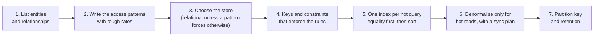

Four realistic features, each described the way an interviewer or product manager would describe it. For each one, design the
schema from its access patterns — tables or partitions, keys, constraints, indexes and any denormalised data — then compare your
answer with the worked solution. None of these is one of the practice problems; they exercise the same skills.

## How to use this workshop

Use the same method for every exercise. It is the method to use in an interview's data-model step:



- **Spend 10–15 minutes per exercise** before opening the hints. Write your tables in the compact `table (columns) PK / UNIQUE / index`
  form you'd use on a whiteboard.
- **Open hints one at a time.** Then compare with the solution, paying most attention to *why* each constraint and index exists.
- Every SQL statement in the solutions was run against PostgreSQL 18.
- Save designs you get wrong to your notebook — the mistakes are the most useful thing to revise.

## Exercises

### Exercise 1 — Course progress and "continue where you left off"

The course platform tracks which lessons each student has completed. Requirements:

- Marking a lesson complete must be **safe to repeat** (the app retries on flaky networks).
- The course card shows **"7 of 24 lessons · 29%"** for each enrolled course — on the home page, for every course, on every visit.
- A **"Continue"** button opens the last lesson the student touched.
- The home page lists the student's courses **most recently active first**.
- Scale: 5 million students, about 2,000 lesson completions per second at peak.

````hint title="Hint: which operation must be idempotent, and how can the database enforce it?"
A completion is a fact about (student, lesson). If that pair is the primary key, a repeated insert can be ignored with ON CONFLICT DO
NOTHING — and you can tell whether anything was actually inserted.
````

````hint title="Hint: how do you avoid counting completions on every home-page view?"
Keep a per-enrolment counter and "last lesson" columns, updated in the same transaction as the completion — but only increment when the
insert really added a row.
````

````solution title="Worked solution"
**Access patterns:** mark complete (write, idempotent); progress per enrolled course (hot read); last lesson per course (hot read); my
courses by recent activity (hot read).

```sql
CREATE TABLE courses (
  id            bigint PRIMARY KEY,
  title         text NOT NULL,
  lesson_count  integer NOT NULL
);
CREATE TABLE enrollments (
  user_id            bigint NOT NULL,
  course_id          bigint NOT NULL REFERENCES courses (id),
  lessons_completed  integer NOT NULL DEFAULT 0,
  last_lesson_id     bigint,
  last_activity_at   timestamptz NOT NULL DEFAULT now(),
  PRIMARY KEY (user_id, course_id)
);
CREATE INDEX enrollments_recent ON enrollments (user_id, last_activity_at DESC);

CREATE TABLE lesson_completions (
  user_id       bigint NOT NULL,
  lesson_id     bigint NOT NULL,
  course_id     bigint NOT NULL,
  completed_at  timestamptz NOT NULL DEFAULT now(),
  PRIMARY KEY (user_id, lesson_id)
);

INSERT INTO courses VALUES (42, 'Databases 101', 24);
INSERT INTO enrollments (user_id, course_id) VALUES (7, 42);
```

Marking complete inserts the fact and updates the counter only if the fact is new — one statement, one transaction:

```sql
WITH inserted AS (
  INSERT INTO lesson_completions (user_id, lesson_id, course_id)
  VALUES (7, 1003, 42)
  ON CONFLICT DO NOTHING
  RETURNING 1
)
UPDATE enrollments
SET lessons_completed = lessons_completed + (SELECT count(*) FROM inserted),
    last_lesson_id    = 1003,
    last_activity_at  = now()
WHERE user_id = 7 AND course_id = 42;
```

Running it twice leaves `lessons_completed = 1`. The home page is one indexed read with a small join:

```sql
SELECT c.title, e.lessons_completed, c.lesson_count,
       round(100.0 * e.lessons_completed / c.lesson_count) AS pct,
       e.last_lesson_id
FROM enrollments e
JOIN courses c ON c.id = e.course_id
WHERE e.user_id = 7
ORDER BY e.last_activity_at DESC
LIMIT 20;
```

**Why this design:** the composite primary key makes completions idempotent; the denormalised counter avoids a `COUNT(*)` per card per
visit and stays exact because it is updated in the same statement as the insert; the `(user_id, last_activity_at)` index serves the home
page ordering. 2,000 writes per second fits one PostgreSQL primary; `user_id` is the natural shard key later, since every query includes it.
````

### Exercise 2 — A Q&A forum with votes and accepted answers

Users post questions and answers. Requirements:

- Anyone can **up-vote or down-vote** a question or answer, **once**, and can change or remove their vote.
- Answers on a question page are sorted by **score**, with the **accepted answer** (at most one per question) pinned at the top.
- The question list shows each question's **score and answer count**.
- Reads outnumber writes about 100 to 1.

````hint title="Hint: how do you guarantee one vote per user per post, and still allow changing it?"
Store votes as rows keyed by (post, user) with a value of +1 or −1. Changing a vote is an update of that row; the difference between the
old and new value is what the post's score changes by.
````

````hint title="Hint: how can the database enforce 'at most one accepted answer per question'?"
A partial unique index — unique on question_id, but only for rows where is_accepted is true.
````

````solution title="Worked solution"
```sql
CREATE TABLE questions (
  id            bigint GENERATED ALWAYS AS IDENTITY PRIMARY KEY,
  author_id     bigint NOT NULL,
  title         text NOT NULL,
  body          text NOT NULL,
  score         integer NOT NULL DEFAULT 0,
  answer_count  integer NOT NULL DEFAULT 0,
  created_at    timestamptz NOT NULL DEFAULT now()
);
CREATE INDEX questions_recent ON questions (created_at DESC, id DESC);

CREATE TABLE answers (
  id           bigint GENERATED ALWAYS AS IDENTITY PRIMARY KEY,
  question_id  bigint NOT NULL REFERENCES questions (id),
  author_id    bigint NOT NULL,
  body         text NOT NULL,
  score        integer NOT NULL DEFAULT 0,
  is_accepted  boolean NOT NULL DEFAULT false,
  created_at   timestamptz NOT NULL DEFAULT now()
);
-- Answers for a question, best first.
CREATE INDEX answers_by_score ON answers (question_id, score DESC, id);
-- At most one accepted answer per question.
CREATE UNIQUE INDEX answers_one_accepted ON answers (question_id) WHERE is_accepted;

CREATE TABLE answer_votes (
  answer_id  bigint NOT NULL REFERENCES answers (id),
  user_id    bigint NOT NULL,
  value      smallint NOT NULL CHECK (value IN (-1, 1)),
  PRIMARY KEY (answer_id, user_id)
);

INSERT INTO questions (author_id, title, body) VALUES (1, 'Why is my index unused?', '...');
INSERT INTO answers (question_id, author_id, body) VALUES (1, 2, 'Check for functions on the column.');
INSERT INTO answers (question_id, author_id, body) VALUES (1, 3, 'Look at the column order.');
```

A vote (new or changed) upserts the vote row and adjusts the score by the difference between the new and old value, in one statement.
PostgreSQL 18's `RETURNING old.*/new.*` reports both values; for a first vote `old` is null. Because the upsert locks the vote row, two
concurrent submissions from the same user are applied one after the other, each with the correct delta:

```sql
WITH v AS (
  INSERT INTO answer_votes (answer_id, user_id, value) VALUES (1, 9, 1)
  ON CONFLICT (answer_id, user_id) DO UPDATE SET value = EXCLUDED.value
  RETURNING new.value - COALESCE(old.value, 0) AS delta
)
UPDATE answers SET score = score + (SELECT delta FROM v) WHERE id = 1;

-- The same user changes their mind: +1 becomes -1, so the score moves by -2.
WITH v AS (
  INSERT INTO answer_votes (answer_id, user_id, value) VALUES (1, 9, -1)
  ON CONFLICT (answer_id, user_id) DO UPDATE SET value = EXCLUDED.value
  RETURNING new.value - COALESCE(old.value, 0) AS delta
)
UPDATE answers SET score = score + (SELECT delta FROM v) WHERE id = 1;

SELECT id, score, is_accepted
FROM answers
WHERE question_id = 1
ORDER BY is_accepted DESC, score DESC, id;
```

```sql
-- expect error
-- Accepting a second answer for the same question violates the partial unique index.
UPDATE answers SET is_accepted = true WHERE question_id = 1;
```

Question votes follow the same pattern with a `question_votes` table; `answer_count` is incremented in the answer-insert transaction.

**Why this design:** votes are facts keyed by (post, user), so "once per user" is a primary key, and changing a vote is an upsert; scores
and counts are denormalised because reads dominate 100 to 1; the partial unique index enforces the accepted-answer rule even if two
moderators click at once. A very hot question's score row could become contended — at that point, buffer vote deltas and apply them in
batches.
````

### Exercise 3 — Library loans and a holds queue

A city library system lends physical copies of books. Requirements:

- A book has many **copies** across branches; a copy can be **on loan to only one member at a time**.
- Members can place a **hold** on a book (not a specific copy); holds are served **first come, first served** when any copy is returned.
- A member can have **at most one open hold per book**.
- Librarians list a member's **current loans** and **overdue loans** across the system.

````hint title="Hint: how do you express 'only one active loan per copy' when old loans stay in the table as history?"
Keep returned loans (returned_at set) as history and add a unique index on copy_id that applies only to rows where returned_at IS NULL.
````

````hint title="Hint: how do you take the next hold safely when two copies are returned at the same moment?"
Lock the oldest waiting hold with FOR UPDATE SKIP LOCKED so two concurrent returns pick different holds instead of the same one.
````

````solution title="Worked solution"
```sql
CREATE TABLE books (
  id     bigint PRIMARY KEY,
  isbn   text NOT NULL UNIQUE,
  title  text NOT NULL
);
CREATE TABLE copies (
  id         bigint PRIMARY KEY,
  book_id    bigint NOT NULL REFERENCES books (id),
  branch_id  integer NOT NULL
);
CREATE INDEX copies_book ON copies (book_id);

CREATE TABLE loans (
  id           bigint GENERATED ALWAYS AS IDENTITY PRIMARY KEY,
  copy_id      bigint NOT NULL REFERENCES copies (id),
  member_id    bigint NOT NULL,
  borrowed_at  timestamptz NOT NULL DEFAULT now(),
  due_at       timestamptz NOT NULL,
  returned_at  timestamptz
);
-- A copy can have only one loan that hasn't been returned.
CREATE UNIQUE INDEX loans_one_active_per_copy ON loans (copy_id) WHERE returned_at IS NULL;
-- Current and overdue loans per member.
CREATE INDEX loans_member_active ON loans (member_id, due_at) WHERE returned_at IS NULL;

CREATE TABLE holds (
  id         bigint GENERATED ALWAYS AS IDENTITY PRIMARY KEY,
  book_id    bigint NOT NULL REFERENCES books (id),
  member_id  bigint NOT NULL,
  placed_at  timestamptz NOT NULL DEFAULT now(),
  status     text NOT NULL DEFAULT 'waiting'
             CHECK (status IN ('waiting', 'ready', 'fulfilled', 'cancelled', 'expired'))
);
CREATE UNIQUE INDEX holds_one_open ON holds (book_id, member_id) WHERE status IN ('waiting', 'ready');
CREATE INDEX holds_queue ON holds (book_id, placed_at, id) WHERE status = 'waiting';

INSERT INTO books VALUES (1, '978-0000000001', 'Designing Data Systems');
INSERT INTO copies VALUES (10, 1, 3), (11, 1, 5);
INSERT INTO loans (copy_id, member_id, due_at) VALUES (10, 100, now() + interval '14 days');
INSERT INTO holds (book_id, member_id) VALUES (1, 200), (1, 201);
```

```sql
-- expect error
-- Lending copy 10 again while it is still out violates the partial unique index.
INSERT INTO loans (copy_id, member_id, due_at) VALUES (10, 101, now() + interval '14 days');
```

When copy 10 comes back, mark the loan returned and promote the oldest waiting hold — `SKIP LOCKED` makes concurrent returns pick
different holds:

```sql
BEGIN;
UPDATE loans SET returned_at = now() WHERE copy_id = 10 AND returned_at IS NULL;
UPDATE holds SET status = 'ready'
WHERE id = (
  SELECT id FROM holds
  WHERE book_id = 1 AND status = 'waiting'
  ORDER BY placed_at, id
  LIMIT 1
  FOR UPDATE SKIP LOCKED
)
RETURNING member_id;
COMMIT;
```

**Why this design:** history stays in `loans` and `holds`, while **partial unique indexes** enforce "one active loan per copy" and "one open
hold per member per book"; the partial `holds_queue` index serves first-come-first-served lookups and stays small because fulfilled holds
drop out of it; `loans_member_active` serves current and overdue lists (`WHERE member_id = ? AND due_at < now()`).
````

### Exercise 4 — Smart-thermostat readings

A smart-home company collects readings from thermostats. Requirements:

- **2 million devices** each send a reading (temperature, humidity, setpoint) **every 60 seconds**.
- The app shows a device's **latest reading** and a **24-hour chart**; the energy report shows **daily averages for the last 2 years**.
- Raw readings are needed for **90 days**; after that only hourly and daily aggregates.
- Each raw reading is about **50 bytes**.

Work out the write rate and daily volume first — they decide the store.

````hint title="Hint: what are the write rate and the daily raw volume?"
2,000,000 devices ÷ 60 s ≈ 33,000 writes per second. 33,000 × 50 bytes × 86,400 s ≈ 144 GB per day, so 90 days of raw data is about
13 TB before replication.
````

````hint title="Hint: what partition key bounds partition size and keeps the chart query on one partition?"
Combine the device with a day bucket: (device_id, day). A device writes 1,440 readings a day — about 72 KB — so partitions stay small, and
a 24-hour chart reads one or two partitions.
````

````solution title="Worked solution"
**Numbers:** ~33,000 writes per second sustained, ~144 GB per day, ~13 TB of raw data for 90 days (before replication). Every query is by
device and time; there are no joins or multi-row transactions. That points to a write-optimised, partitioned store — a wide-column
database such as Cassandra or ScyllaDB (or a time-series extension of PostgreSQL such as TimescaleDB if the team prefers SQL).

```text title="CQL (Cassandra)"
-- Raw readings: one partition per device per day, newest first, expire after 90 days.
CREATE TABLE readings_by_device_day (
  device_id  uuid,
  day        date,
  ts         timestamp,
  temp_c     float,
  humidity   float,
  setpoint_c float,
  PRIMARY KEY ((device_id, day), ts)
) WITH CLUSTERING ORDER BY (ts DESC)
  AND default_time_to_live = 7776000;      -- 90 days in seconds

-- Latest reading: one row per device, overwritten on every write.
CREATE TABLE latest_reading (
  device_id  uuid PRIMARY KEY,
  ts         timestamp,
  temp_c     float,
  humidity   float,
  setpoint_c float
);

-- Daily aggregates for the energy report: one partition per device per year.
CREATE TABLE daily_by_device_year (
  device_id  uuid,
  year       int,
  day        date,
  avg_temp_c float,
  min_temp_c float,
  max_temp_c float,
  PRIMARY KEY ((device_id, year), day)
) WITH CLUSTERING ORDER BY (day DESC);
```

- **Latest reading:** a single-row read from `latest_reading` (or a cache).
- **24-hour chart:** read today's and yesterday's partitions of `readings_by_device_day`, 1,440–2,880 rows.
- **2-year report:** read two or three partitions of `daily_by_device_year`.
- **Aggregates** are computed by a stream processor (or a scheduled job) from the raw readings — hourly rows into a similar
  `hourly_by_device_month` table, daily rows into `daily_by_device_year`.
- **Retention:** raw data expires by TTL; aggregates are kept for two years (with their own TTL or yearly cleanup).

**Why this design:** `device_id` gives millions of evenly loaded partitions (no hot partition, unlike partitioning by time); the day bucket
bounds each partition to about 72 KB; each screen reads one to three partitions in clustering order; TTLs handle retention without mass
deletes. The trade-off is that ad-hoc questions ("average temperature in Pune last July") need the data exported to an analytics store.
````

## Key takeaways

- Start from **access patterns with rates**; the numbers often choose the store for you.
- Let **keys and constraints** enforce business rules: composite keys for "once per", **partial unique indexes** for "one active at a
  time", `CHECK` for ranges.
- **Denormalise counters** for hot reads and update them **in the same statement or transaction** as the fact they summarise.
- For time-series and high write volume, partition by **entity + time bucket** and use **TTLs** for retention.

## Knowledge check

```quiz
? Which constraint enforces "a copy can be on loan to only one member at a time" while keeping returned loans as history?
- UNIQUE (copy_id) on the loans table
! That would allow only one loan per copy ever, blocking history.
+ A unique index on copy_id with `WHERE returned_at IS NULL`
- A CHECK constraint on returned_at
! CHECK constraints can't compare across rows.
- A foreign key from loans to copies
! It guarantees the copy exists, not exclusivity.
> Partial unique indexes enforce uniqueness only among "active" rows.

? Marking a lesson complete is retried by the app. Which design keeps the progress counter exact?
- Increment the counter on every request
! Retries would over-count.
+ Insert the completion with ON CONFLICT DO NOTHING and increment the counter only if a row was inserted, in one statement
- Recount completions every time the page loads
! Correct, but it moves the cost onto every read of a hot page.
- Store the percentage only
! A percentage can't be incremented safely or idempotently.
> The fact table provides idempotency; the counter changes only when the fact is new.

? 2 million devices each report every 60 seconds. Roughly what is the write rate?
- 3,300 per second
! That's ten times too low.
+ About 33,000 per second
- 120 million per second
! That multiplies instead of dividing.
- 2 million per second
! That would be one reading per device per second.
> 2,000,000 ÷ 60 ≈ 33,333 writes per second.

? Why is `(device_id, day)` a better partition key than `day` for thermostat readings?
+ It spreads writes over millions of partitions and keeps each partition small, while a chart still reads one or two partitions
- Days can't be partition keys
! They can; they just create hot partitions for current writes.
- It allows joins with other tables
! Wide-column stores don't support joins either way.
- It removes the need for retention
! Retention is still handled by TTLs.
> High cardinality spreads load; the day bucket bounds partition size.
```
