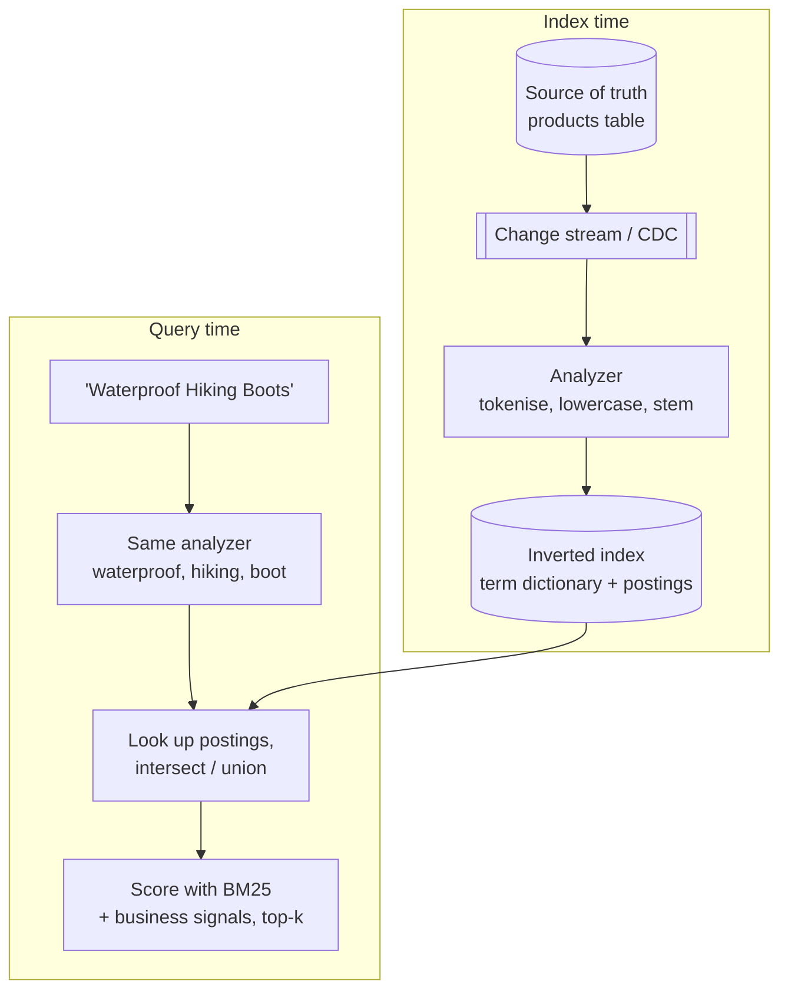

Almost every product has a search box, and almost every design interview that includes one expects more than `WHERE title LIKE
'%boot%'`. Search engines answer "which documents contain these words, and which are most relevant?" with a different data structure from
a database index: the **inverted index**. This lesson builds one, ranks results with BM25, and shows where typos, prefixes and freshness come
in.

## Why it matters

A B-tree index finds rows by a key's **prefix**. Text search needs something else:

- `LIKE '%boot%'` has a leading wildcard, so no B-tree can help — the database scans every row ([indexing](lesson:indexing)).
- Even a fast scan returns **matches, not ranking**: a product named "Boot dryer" and one described as "waterproof hiking boots" are equal to
  `LIKE`.
- Real queries need **normalisation**: "Boots" should match "boot", "café" should match "cafe", and "hikng" should probably match
  "hiking".

Search engines solve all three by doing the work at **index time**: break text into normalised terms, record which documents contain each
term, and keep statistics for scoring.

## How it works

### Analysis: text to terms

An **analyzer** turns text into terms, identically at index time and query time:

1. **Character filters**: strip HTML, map characters (`&` → `and`).
2. **Tokenizer**: split into tokens on whitespace and punctuation (language-aware tokenizers handle CJK text, hyphens, emails).
3. **Token filters**: lowercase, remove stop words, fold accents, **stem** ("boots" → "boot", "running" → "run"), add synonyms.

Analysis choices trade **recall** (find more) against **precision** (find the right thing). Aggressive stemming finds more but merges
words that shouldn't be merged; removing stop words shrinks the index but breaks queries like "to be or not to be".

### The inverted index

For every term, the index keeps a **postings list**: the documents containing it, with term frequency and often positions.

```text title="Inverted index for a tiny product catalogue"
term          postings (doc: term frequency)
boot       -> 0:1, 4:1, 5:1
hiking     -> 0:1, 2:1, 3:1, 5:3
waterproof -> 0:1, 3:1
```

- The **term dictionary** is sorted (Lucene stores it as a compact finite-state transducer), so finding a term — or all terms with a
  prefix — is fast.
- Postings lists are **sorted by document ID** and compressed (deltas between IDs, variable-length encoding), so long lists stay small and
  can be intersected quickly.
- **Positions** enable phrase queries ("hiking boots" as adjacent words) at the cost of a larger index.
- A query `waterproof AND boot` **intersects** two postings lists; `OR` merges them. Top-k algorithms (such as WAND) skip documents that
  can't make the top results, so common terms don't force scoring every match.

### Relevance: TF-IDF and BM25

Ranking combines three intuitions:

- **Term frequency (tf)**: a document mentioning "hiking" more is more about hiking — but with diminishing returns.
- **Inverse document frequency (idf)**: rare terms ("waterproof") say more than common ones ("hiking").
- **Length normalisation**: a match in a short title counts more than one buried in a long description.

**BM25**, the default in Lucene (and therefore Elasticsearch, OpenSearch and Solr), scores each query term as:

```text title="BM25 score of one query term in one document"
idf(t)       = ln(1 + (N - df + 0.5) / (df + 0.5))
score(t, d)  = idf(t) * tf * (k1 + 1) / (tf + k1 * (1 - b + b * |d| / avgdl))

N = documents, df = documents containing t, tf = occurrences of t in d,
|d| = terms in d, avgdl = average document length,
k1 = 1.2 (tf saturation), b = 0.75 (length weight)
```

A document's score is the sum over query terms. Products then blend text relevance with **business signals** — popularity, rating,
recency, availability, personalisation — through boosts, function scores or learned ranking models.

### Typos, prefixes and meaning

- **Fuzzy matching** finds terms within an edit distance (Lucene allows up to two edits) using automata over the term dictionary — no scan
  of every term.
- **Prefix search and autocomplete** use the sorted dictionary, **edge n-grams** (index "hik", "hiki", "hikin"...), or a dedicated
  completion structure kept in memory — see the [search autocomplete](problem:search-autocomplete) problem.
- **Semantic (vector) search** embeds documents and queries as vectors and finds nearest neighbours with approximate indexes such as HNSW.
  **Hybrid search** combines BM25 and vector scores — keyword precision plus meaning.

### Updates and freshness

Lucene-based engines write **immutable segments**. New documents become searchable when a new segment is opened (a **refresh**, typically
every second in Elasticsearch); updates are a delete plus a re-insert; background **merges** combine segments and purge deleted documents.
Search is therefore **near real-time**, and the index is usually fed from the database asynchronously ([Elasticsearch](lesson:elasticsearch)).

## Architecture



## Failure scenarios

- **Analyzer mismatch**: indexing with stemming but querying without (or a changed analyzer without reindexing) silently loses matches.
- **Stale index**: the database changed but the search index lags; a deleted or out-of-stock product still appears. Filter critical
  attributes (availability, permissions) at query time or re-check against the source.
- **Huge postings lists** for very common terms make OR queries expensive; stop words, top-k skipping and query rewriting limit them.
- **Deep pagination** (`page=500`) forces the engine to rank thousands of results on every shard; cap pages or use cursors.
- **Relevance regressions**: a boost tweak improves one query and breaks a hundred; keep a judged query set and measure before shipping.

## Trade-offs

| Choice | Gain | Cost |
|---|---|---|
| Stemming, synonyms, fuzziness | Higher recall | Lower precision, surprising matches |
| Storing positions | Phrase and proximity queries | Larger index |
| Frequent refresh | Fresher results | More small segments, more merge work, lower indexing throughput |
| Search engine vs database full-text | Relevance tuning, scale, rich features | Another system to keep in sync |
| Vector search | Matches meaning, not just words | Embedding cost, approximate results, harder to explain |

## In real systems

- **Apache Lucene** is the library inside Elasticsearch, OpenSearch and Solr; BM25 became Lucene's default similarity in version 6.
- **PostgreSQL full-text search** (`tsvector`, `tsquery`, GIN indexes) covers moderate needs inside the database, and the `pg_trgm`
  extension makes `LIKE '%term%'` and similarity queries index-assisted. Its built-in ranking functions are simpler than BM25.
- E-commerce and marketplace search combine BM25 with learned ranking on click and purchase data; most add vector retrieval for
  natural-language queries.

## Java and Spring Boot example

A complete toy search engine in plain Java: analysis (lowercase, stop words, crude plural stemming), an inverted index, BM25 scoring with
Lucene's defaults, and a "did you mean" suggestion by edit distance.

```java file="InvertedIndex.java"
import java.util.*;

// A tiny search engine: analyse text, build an inverted index, rank with BM25, fix a typo.
public class InvertedIndex {
    static final Set<String> STOP =
            Set.of("a", "an", "and", "the", "for", "with", "of", "in", "on");
    static final double K1 = 1.2, B = 0.75;                     // Lucene's default BM25 settings

    static final String[] DOCS = {
        "Waterproof hiking boots with a grippy sole",
        "Lightweight trail running shoes for dry trails",
        "Hiking socks: merino wool, cushioned",
        "Waterproof jacket for hiking and cycling in the rain",
        "Leather boots for city walking",
        "Hiking boots, hiking poles and a hiking backpack bundle",
    };

    final Map<String, Map<Integer, Integer>> postings = new TreeMap<>();  // term -> (doc -> tf)
    final int[] docLength = new int[DOCS.length];

    static List<String> analyse(String text) {                   // tokenise, lowercase, stop, stem
        List<String> terms = new ArrayList<>();
        for (String raw : text.toLowerCase().split("[^a-z]+")) {
            if (raw.isEmpty() || STOP.contains(raw)) continue;
            boolean plural = raw.length() > 3 && raw.endsWith("s");
            terms.add(plural ? raw.substring(0, raw.length() - 1) : raw);
        }
        return terms;
    }

    InvertedIndex() {
        for (int d = 0; d < DOCS.length; d++) {
            List<String> terms = analyse(DOCS[d]);
            docLength[d] = terms.size();
            for (String t : terms)
                postings.computeIfAbsent(t, k -> new TreeMap<>()).merge(d, 1, Integer::sum);
        }
    }

    double idf(String term) {
        int n = DOCS.length, df = postings.getOrDefault(term, Map.of()).size();
        return Math.log(1 + (n - df + 0.5) / (df + 0.5));
    }

    Map<Integer, Double> search(String query) {
        double avgLen = Arrays.stream(docLength).average().orElse(1);
        Map<Integer, Double> scores = new HashMap<>();
        for (String term : analyse(query)) {
            for (var e : postings.getOrDefault(term, Map.of()).entrySet()) {
                int tf = e.getValue(), len = docLength[e.getKey()];
                double norm = tf * (K1 + 1) / (tf + K1 * (1 - B + B * len / avgLen));
                scores.merge(e.getKey(), idf(term) * norm, Double::sum);
            }
        }
        return scores;
    }

    static int editDistance(String a, String b) {
        int[][] dp = new int[a.length() + 1][b.length() + 1];
        for (int i = 0; i <= a.length(); i++) dp[i][0] = i;
        for (int j = 0; j <= b.length(); j++) dp[0][j] = j;
        for (int i = 1; i <= a.length(); i++)
            for (int j = 1; j <= b.length(); j++)
                dp[i][j] = Math.min(Math.min(dp[i - 1][j] + 1, dp[i][j - 1] + 1),
                        dp[i - 1][j - 1] + (a.charAt(i - 1) == b.charAt(j - 1) ? 0 : 1));
        return dp[a.length()][b.length()];
    }

    public static void main(String[] args) {
        InvertedIndex index = new InvertedIndex();
        for (String t : List.of("boot", "hiking", "waterproof"))
            System.out.printf("%-11s -> docs %s  (idf %.2f)%n",
                    t, index.postings.get(t), index.idf(t));

        System.out.println("\nquery: \"waterproof hiking boots\"");
        index.search("waterproof hiking boots").entrySet().stream()
                .sorted(Map.Entry.<Integer, Double>comparingByValue().reversed())
                .forEach(e -> System.out.printf("  %.2f  doc %d  %s%n",
                        e.getValue(), e.getKey(), DOCS[e.getKey()]));

        String typo = "hikng";
        int hits = index.search(typo).size();
        System.out.println("\nquery: \"" + typo + "\" -> " + hits + " matches");
        index.postings.keySet().stream().filter(t -> editDistance(t, typo) <= 1)
                .forEach(t -> System.out.println("  did you mean \"" + t + "\"? (1 edit away)"));
    }
}
```

```text title="Output" output="InvertedIndex.java"
boot        -> docs {0=1, 4=1, 5=1}  (idf 0.69)
hiking      -> docs {0=1, 2=1, 3=1, 5=3}  (idf 0.44)
waterproof  -> docs {0=1, 3=1}  (idf 1.03)

query: "waterproof hiking boots"
  2.22  doc 0  Waterproof hiking boots with a grippy sole
  1.51  doc 3  Waterproof jacket for hiking and cycling in the rain
  1.27  doc 5  Hiking boots, hiking poles and a hiking backpack bundle
  0.77  doc 4  Leather boots for city walking
  0.45  doc 2  Hiking socks: merino wool, cushioned

query: "hikng" -> 0 matches
  did you mean "hiking"? (1 edit away)
```

Document 5 says "hiking" three times yet ranks below document 3: BM25 **saturates** term frequency and penalises the longer document, while
document 3 matches the rarer, more informative term "waterproof".

## Common mistakes

- **`LIKE '%term%'` on a large table** as the search design.
- **Using the search engine as the system of record** — it's a derived index; rebuild it from the database.
- **Different analyzers** at index and query time, or changing analyzers without reindexing.
- **Ignoring freshness**: no plan for how changes reach the index or how long they take.
- **Ranking by text alone** when the product needs popularity, recency or personal signals.
- **Unbounded pagination** across shards.

## In the interview

When a design needs search, say: *"The database stays the source of truth; changes flow via CDC into a search index with an inverted index
and BM25 ranking, plus boosts for popularity. Search is near real-time — about a second of lag — and availability filters are re-checked."*

````question title="Why can't you just use LIKE '%query%' for search?"
A leading wildcard prevents the database from using a B-tree index, so every query scans the table — fine for thousands of rows, not
millions. It also gives no ranking, no stemming or case folding beyond what you hand-code, no typo tolerance, and no multi-word relevance.
An inverted index precomputes term-to-document mappings so lookups touch only matching documents, and stores statistics for BM25 ranking.
(Within PostgreSQL, a trigram index can accelerate LIKE for moderate scale.)
````

````question title="How does a search engine rank results?"
For each query term it combines how often the term appears in the document (with diminishing returns), how rare the term is across all
documents (rarer is more informative), and how long the document is (matches in short fields count more) — BM25 is the standard formula.
Scores from different fields are boosted (title over description) and then combined with business signals such as popularity, recency or
personalisation, often through a learned ranking model.
````

````question title="How would you handle typos and partial words in search?"
At query time, fuzzy queries expand each term to dictionary terms within one or two edits, using automata over the sorted term dictionary.
For partial words and search-as-you-type, index edge n-grams of each term or use a dedicated in-memory completion structure, and rank
completions by popularity. "Did you mean" suggestions come from the same edit-distance machinery applied to whole queries, weighted by how
common each candidate is.
````

## Key takeaways

- An **inverted index** maps each analysed term to a sorted, compressed postings list; queries intersect and merge lists.
- **Analyzers** (tokenise, lowercase, stem, synonyms) run at index and query time — identically.
- **BM25** ranks by saturating term frequency, inverse document frequency and length normalisation; products add business signals.
- **Fuzzy queries**, **edge n-grams** and **completion structures** handle typos and prefixes; **vector search** adds meaning.
- Search indexes are **derived and near real-time**: feed them from the source of truth and plan for lag.

## Knowledge check

```quiz
? Why does `WHERE name LIKE '%boot%'` scan the whole table even with an index on name?
- LIKE is not supported by indexes at all
! LIKE 'boot%' can use a B-tree.
+ A leading wildcard means the B-tree can't narrow the search by prefix
- The index only stores numbers
! B-trees index text.
- The query planner ignores indexes for text
! It uses them when the predicate allows.
> Inverted or trigram indexes solve this.

? In BM25, why can a document that mentions the query term three times rank below one that mentions it once?
- BM25 ignores term frequency
! It uses it, with saturation.
+ Term frequency saturates and longer documents are penalised, while other matched terms (especially rare ones) add more
- Documents are ranked by ID
! Ranking is by score.
- Only the first occurrence counts
! Repeats count, with diminishing returns.
> Rare terms and concise matches carry more weight.

? Products were indexed with an English stemmer, but a deploy changed the query analyzer to a plain lowercase analyzer. What happens?
+ Queries like "boots" no longer match the indexed term "boot", so recall drops silently
- Nothing; analyzers only matter at index time
! Query text is analysed too.
- The index is rebuilt automatically
! Analyzer changes need an explicit reindex.
- Search fails with an error
! It just returns fewer results.
> Index and query analysis must agree.

? An out-of-stock product still appears in search results for a minute after the database update. What is the most likely reason and fix?
- The inverted index is corrupt; rebuild it nightly
! It's lag, not corruption.
+ The index is updated asynchronously (CDC plus refresh); filter availability at query time or re-check against the source for critical attributes
- BM25 caches scores
! Scores are computed per query.
- The analyzer stemmed the stock field
! Stock is a structured field, not analysed text.
> Search is a near-real-time, derived view.
```
