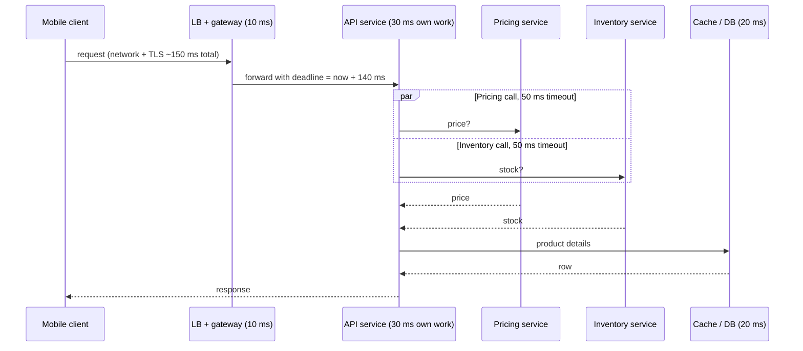

Peak requests per second is only useful once it becomes a number of machines, a check that the network can carry the bytes, and a
latency target split across every hop a request makes. This lesson turns traffic estimates into a fleet size and a latency budget.

## The question it answers

- **How many servers** does each tier need at peak — including spare capacity for failures and deploys?
- **Can the network carry it** — per server and per link?
- **How much time may each hop take** so the end-to-end latency target holds — and what timeouts follow from that?

## Formula

### Server count

```text title="Formula"
usable capacity per server = measured requests/s at the latency target × target utilisation
servers for peak           = ceil(peak requests/s ÷ usable capacity per server)
servers to survive a zone  = servers for peak × zones ÷ (zones − 1)      (or at least N + 1)
```

- **Measured capacity** means the throughput one instance sustains while still meeting its latency target — found by load testing. In an
  interview, assume a figure and say so: "a few thousand requests per second for a simple JSON API".
- **Target utilisation** (often 50–70%) leaves headroom for spikes, garbage collection pauses, noisy neighbours and uneven balancing.
- **Redundancy:** if the fleet is spread across three availability zones and must survive losing one, the remaining two must carry the
  peak: multiply by 3/2. Rolling deploys temporarily remove a further slice of capacity.

### Capacity from concurrency (Little's law)

For a server limited by concurrent work (threads, connections) rather than CPU:

```text title="Formula"
max requests/s per server ≈ concurrent requests it can hold ÷ average latency (s)
```

200 worker threads and 50 ms per request → at most 200 ÷ 0.05 = 4,000 requests/s. If a dependency slows to 500 ms, the same threads support
only 400 requests/s — which is why slow dependencies exhaust thread pools.

### Network throughput

```text title="Formula"
egress per server (bits/s) = requests/s per server × bytes per response × 8
servers needed for bandwidth = peak egress ÷ (NIC capacity × target utilisation)
```

Take the larger of the CPU-based and bandwidth-based counts. Media-heavy tiers are often bandwidth-bound long before CPU-bound — and the
real answer is usually a CDN.

### Latency budgets

An end-to-end target (say p99 under 300 ms for a mobile user) is a budget to distribute:

- **Outside your control:** the client's network and TLS setup — often 50–150 ms on mobile.
- **Each hop inside your system** gets a slice: load balancer, gateway, service work, downstream calls, cache and database.
- **Sequential calls add up; parallel calls cost the slowest one.** With fan-out, the slowest of N calls dominates, and tail latencies
  compound (see [tail latency](lesson:scalability-performance)).
- **Timeouts follow the budget and shrink downstream.** A service with a 100 ms budget can't give its dependency a 2-second timeout; pass a
  deadline along so every hop knows how much time is left.

## Worked example

**Fleet size.** A public API peaks at **30,000 requests/s**. A load test shows one instance sustains **800 requests/s** at the p99 target.
Target utilisation: **60%**.

- Usable per instance: 800 × 0.6 = 480 requests/s.
- For the peak: 30,000 ÷ 480 = 62.5 → **63 instances**.
- Across three zones, surviving the loss of one: 63 × 3/2 ≈ **95 instances** (about 32 per zone).

**Network check.** Responses average 5 KB: 30,000 × 5 KB = 150 MB/s ≈ 1.2 Gbit/s across 95 instances — about 13 Mbit/s each. Network is not
the constraint; CPU is.

**Latency budget** for a p99 target of 300 ms on mobile:

| Hop | Budget (p99) | Notes |
|---|---|---|
| Client network + TLS (outside our control) | 150 ms | Mobile radio, distance; reduced by edge TLS termination |
| Load balancer + API gateway | 10 ms | Auth with cached keys, routing, rate limit check |
| API service's own work | 30 ms | Validation, serialisation, business logic |
| Two downstream calls **in parallel** | 60 ms | Each with a 50 ms timeout; budget the slower one |
| Cache read, then database on a miss | 20 ms | Cache ~1 ms; indexed DB read a few ms; p99 higher |
| Spare | 30 ms | Retries, GC pauses, queueing under load |
| **Total** | **300 ms** | |

If the two downstream calls were sequential, they would need 120 ms and blow the budget — so either parallelise them, cache their results,
or move one off the request path.



## Try it

Set peak and per-server capacity, and compare the calculator's count with the zone-redundant number:

```estimator title="Public API fleet"
requestsPerDay = 864M
readsPerWrite = 9
writeBytes = 1 KB
readBytes = 5 KB
retentionYears = 1
peakFactor = 3
replication = 3
cachePercent = 10
serverRps = 800
targetUtilization = 60
```

864M requests a day is 10,000/s on average and 30,000/s at a 3× peak.

```drill
? Peak is 12,000 requests/s; one server sustains 1,000 requests/s at target latency; target utilisation is 50%. How many servers for the peak?
= 24
~ 1.15
> 1,000 × 0.5 = 500 usable per server; 12,000 ÷ 500 = 24.

? That fleet runs in 3 zones and must survive losing one zone. How many servers in total?
= 36
~ 1.15
> 24 × 3/2 = 36 — 12 per zone, so any two zones still hold 24.

? A server has 100 worker threads and each request takes 40 ms. What is its maximum throughput?
= 2500
~ 1.2
> 100 ÷ 0.04 s = 2,500 requests/s. If latency doubles to 80 ms, it halves.
```

## How it changes the design

| Finding | Design response |
|---|---|
| Tens of instances per tier | Normal: stateless services behind a load balancer with auto-scaling |
| Hundreds or more | Check per-request efficiency first; consider caching or moving work off the request path |
| Bandwidth-bound tier | CDN, compression, smaller payloads |
| Thread-bound servers with slow dependencies | Timeouts, bulkheads, asynchronous I/O, or caching the dependency |
| Sequential calls exceed the latency budget | Parallelise, batch, cache, or make the call asynchronous |
| Budget leaves no room for retries | Hedge or retry only within the deadline; otherwise fail fast |

## Common mistakes

- **Planning to 100% utilisation** — no room for spikes, failures or deploys.
- **No redundancy:** a fleet sized exactly for the peak becomes overloaded when one zone (or one instance) fails.
- **Using a benchmark's best case** as the per-server capacity.
- **Ignoring bandwidth** for media tiers.
- **A latency target with no budget**, so every team assumes it can use most of it.
- **Timeouts longer than the caller's budget**, so a slow dependency stalls everything above it.

## Key takeaways

- Servers = **peak ÷ (measured capacity × target utilisation)**, then add redundancy (**× zones/(zones − 1)** or N + 1).
- **Little's law** links concurrency, latency and throughput: slower dependencies mean less throughput per thread.
- Check **bandwidth** as well as CPU — media tiers are usually bandwidth-bound.
- Split the latency target into a **per-hop budget**; parallelise calls, and set **timeouts and deadlines** that fit the budget.

## Knowledge check

```quiz
? Peak load is 20,000 requests/s and one instance handles 1,000 requests/s at the latency target. Why provision more than 20 instances?
- Because load balancers need an odd number of instances
! Load balancers work with any count.
+ To keep utilisation below saturation and to survive instance or zone failures and deploys
- Because each instance can only use one CPU core
! Instances can use multiple cores.
- To make the database faster
! App-tier headroom doesn't speed up the database.
> Running at 100% leaves no headroom for spikes, failures or rolling deploys.

? A service's p99 budget is 120 ms and it calls two dependencies sequentially, each with a p99 of 70 ms. What is the problem and the fix?
+ Sequential calls alone take ~140 ms at p99; call them in parallel (or cache one) so the slower call bounds the time
- Nothing; p99s don't add up
! Sequential latencies add; the tail of the sum is at least as bad.
- Increase both timeouts to 1 second
! Longer timeouts make worst-case latency worse, not better.
- Add more instances of the calling service
! More instances don't shorten each request's path.
> Parallel calls cost the slowest call; sequential calls cost the sum.

? A thread-pool server handles 2,000 requests/s at 50 ms latency. A dependency slows and latency rises to 500 ms. What happens to throughput?
- It stays at 2,000/s
! Each thread is now held ten times longer.
+ It falls to about 200/s, so requests queue and time out
- It rises because threads are idle
! Threads are waiting, not idle.
- It falls to 1,000/s
! Latency rose tenfold, not twofold.
> Little's law: throughput = concurrency ÷ latency.

? Video segments average 2 MB and the tier serves 1,000 segments/s from 10 Gbit/s servers at 60% utilisation. How many servers does bandwidth alone require?
- 1
! 1,000 × 2 MB = 2 GB/s = 16 Gbit/s — more than one NIC.
+ About 3
- About 30
! That overcounts by 10×.
- About 300
! Far too many for 16 Gbit/s.
> 16 Gbit/s ÷ (10 × 0.6) ≈ 2.7 → 3 servers — or put a CDN in front.
```
