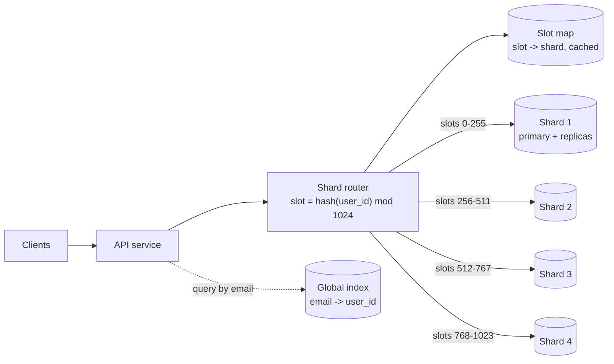

Sharding splits one logical dataset across several independent databases, each owning a subset of the keys. It is how a system
grows past the write throughput and storage of a single machine — and it permanently changes how you query, transact and operate.
Choosing the shard key and the sharding strategy is one of the most consequential decisions in a design.

## Why it matters

Once [scaling reads](lesson:scaling-reads) and [scaling writes](lesson:scaling-writes) on one primary run out, the data itself must be
split. Interviewers ask "how would you shard this?" for any large dataset, and the follow-ups are predictable: what about queries that
don't include the shard key? Transactions across shards? Adding shards later? A hot shard? Each has a standard answer, and missing them
is a common way to lose points.

## How it works

### The shard key

Every row has a **shard key** that determines its shard. A good shard key:

1. **Appears in the dominant queries**, so most requests go to exactly one shard.
2. **Spreads load evenly** — many distinct values, none receiving a big share of traffic.
3. **Keeps related data together**, so common transactions and joins stay on one shard (all of a user's orders with the user).

For a messaging app, `conversation_id`; for a SaaS product, `tenant_id`; for user-owned data, `user_id`. Choosing badly is expensive:
the key is baked into routing and data placement.

### Strategies

| Strategy | How a key maps to a shard | Strengths | Weaknesses |
|---|---|---|---|
| **Range** | Contiguous key ranges per shard (A–F, G–M …) | Efficient range scans; easy to split a range | Sequential keys (timestamps, auto-increment) send all new writes to the last shard |
| **Hash** | `hash(key)` decides the shard | Even spread; no sequential hotspot | Range queries hit every shard; naive `hash mod N` reshuffles almost everything when N changes |
| **Consistent / slot-based hash** | Hash into a fixed space of slots or a ring; slots assigned to shards | Even spread; adding a shard moves only some slots | Still no efficient range queries over the key |
| **Directory (lookup)** | A mapping service stores key → shard | Flexible: move a tenant individually, place big tenants alone | The directory is a critical dependency (cache it, replicate it) |
| **Geographic** | Region of the user or data | Data residency, low latency | Uneven regions; users who move |

Hash-based strategies with a fixed number of slots (Redis Cluster's 16,384 hash slots, Vitess keyspace ranges, DynamoDB partitions) are
the most common default; [consistent hashing](lesson:consistent-hashing) covers the details.

### Queries that don't include the shard key

- **Scatter-gather**: send the query to every shard and merge the results. Fine for rare admin queries; for frequent queries, latency is
  the slowest shard's and load multiplies with the shard count.
- **Global secondary index**: a separate table, sharded by the other key, mapping it to the primary key ("email → user_id"). Usually
  updated asynchronously, so it can lag.
- **Duplicate data under another key**: store messages by `conversation_id` *and* a per-user inbox by `user_id` — denormalisation
  designed per query.
- **A search or analytics store** fed by change data capture for ad-hoc queries.

### Joins and transactions across shards

- **Co-locate** data that is joined or transacted together by giving it the same shard key (orders and order lines by `customer_id`).
- **Reference data** (countries, plans) is small: replicate it to every shard.
- **Cross-shard transactions** need [two-phase commit or sagas](lesson:distributed-transactions) — slow and complex. Prefer designs
  where a transaction touches one shard; distributed SQL databases (Spanner, CockroachDB) make cross-shard transactions possible at a
  latency cost.

### Resharding

Shards fill up or get hot; you will add shards. Approaches:

- **Fixed many logical partitions** (for example, 1,024 logical shards on 8 physical servers): move whole logical partitions to new
  servers; no rehashing of keys. The most common practical approach.
- **Split a range** in two when it grows (range sharding).
- **Online migration**: copy the data to its new home, keep it in sync (dual writes or change data capture), switch reads, then writes,
  then clean up — with verification at each step.

## Architecture



1,024 logical slots spread over 4 shards: adding a fifth shard means moving some slots, not rehashing every key.

## Failure scenarios

- **Hot shard.** A celebrity account or a huge tenant lands on one shard and saturates it. Mitigate with key salting for hot writes,
  caching for hot reads, or moving that tenant to a dedicated shard (easy with a directory).
- **Sequential keys on range shards.** All new rows hit the last shard. Hash the key or prefix it.
- **Scatter-gather everywhere.** A frequent query lacks the shard key; every request touches every shard; adding shards makes it worse.
- **Resharding gone wrong.** Data copied but writes during the copy lost or duplicated. Use change data capture or dual writes with
  verification, and switch over in stages.
- **Shard outage.** One shard's primary fails; only its keys are affected — partial unavailability rather than total. Each shard needs
  its own replicas and failover.

## Trade-offs

- **Scale vs features.** Sharding buys horizontal write and storage scale; it costs cross-shard joins, transactions and ad-hoc queries.
- **Hash vs range.** Hash spreads load; range supports range scans but risks hotspots.
- **Directory vs computed placement.** A directory is flexible (move individual tenants) but adds a dependency; computed placement
  (hash/slots) needs no lookup but moves data in coarser units.
- **Application-level sharding vs a distributed database.** Doing it yourself (with Vitess, Citus or custom routing) keeps the familiar
  database; a distributed database (DynamoDB, Cassandra, Spanner, CockroachDB) shards for you with its own constraints.

## In real systems

- Vitess shards MySQL behind a routing layer (VTGate) and powers large deployments; Citus distributes PostgreSQL tables by a distribution
  column.
- Redis Cluster maps keys to 16,384 hash slots assigned to nodes; hash tags (`{user:42}`) force related keys into the same slot.
- DynamoDB and Cassandra partition by the partition key automatically; MongoDB supports ranged and hashed shard keys and zone sharding.
- Multi-tenant SaaS products often shard by tenant, moving their largest customers to dedicated shards.

## Common mistakes

- **Sharding too early**, before caching, replicas and write batching.
- **A shard key absent from the main queries.**
- **Timestamp or auto-increment keys** on range shards.
- **Ignoring resharding** — "we'll just add a shard" with modulo hashing reshuffles everything.
- **Assuming cross-shard transactions are free.**

## In the interview

````question title="How would you shard the messages table of a chat application?"
By conversation_id, because the dominant queries — load recent messages for a conversation, append a message to it — always include it,
so each touches one shard, and a conversation's messages stay together in order. Conversations are numerous, so hashing spreads load; I'd
hash into a fixed set of logical partitions (say 4,096) mapped onto physical shards so I can rebalance by moving partitions. For "all
conversations of a user", I'd keep a separate per-user table sharded by user_id rather than scattering a query across every shard. Very
large group conversations could be a hotspot; I'd watch for that and bucket them by time if they grow without bound.
````

````question title="How do you add shards without downtime?"
Avoid rehashing keys: shard into many logical partitions from the start and map them onto physical shards, so adding a shard means moving
some partitions. For each partition being moved: copy a snapshot to the new shard, stream subsequent changes with change data capture (or
dual-write), verify the copies match, then flip the routing map for that partition — first reads, then writes — and finally delete the old
copy. Clients cache the routing map and refresh it when told a partition moved. Moving one partition at a time keeps risk and extra load
small.
````

## Key takeaways

- A shard key must be **in the main queries**, **spread load**, and **keep transactional data together**.
- **Hash** (via fixed slots or consistent hashing) for even load; **range** for range scans; **directory** for flexibility.
- Queries without the shard key need **scatter-gather, global indexes or duplicated data**; avoid **cross-shard transactions**.
- Plan **resharding** from day one: many logical partitions, moved online with copy + CDC + switchover.

## Knowledge check

```quiz
? A table is range-sharded by `created_at`. What happens under heavy insert load?
- Writes spread evenly across shards
! Every new row has a recent timestamp.
+ All new rows go to the shard holding the latest range, which becomes a hotspot
- The table is automatically re-hashed
! Range sharding doesn't re-hash.
- Reads become impossible
! Reads still work; writes concentrate.
> Sequential keys and range sharding create a moving hotspot.

? Users are sharded by user_id. The login flow needs "find user by email" on every login. What is the best approach?
- Scatter the query to every shard on each login
! Every login touching every shard doesn't scale.
+ Maintain a global index (email → user_id), sharded by email
- Shard users by email instead
! Then every other user query loses its shard key.
- Store emails in a cache only
! A cache isn't a reliable index of record.
> A secondary index sharded by the other key turns scatter-gather into one lookup.

? Why do many systems shard into 1,024 or more logical partitions even with only 8 servers?
- To make each query touch more shards
! Each key still maps to one partition.
+ So adding servers means moving whole partitions, not rehashing every key
- Because databases require at least 1,024 shards
! No such requirement.
- To avoid needing replicas
! Each physical shard still needs replicas.
> Fixed logical partitions decouple data placement from server count.

? Orders and order lines must be updated in one transaction. How should they be sharded?
- Orders by order_id, order lines by line_id
! The rows for one order would land on different shards.
+ Both by the same key (e.g. customer_id or order_id), so a transaction stays on one shard
- Randomly, to spread load
! Random placement scatters related rows.
- Order lines in a separate database without sharding
! That makes every order transaction cross databases.
> Co-locate data that is transacted together.
```
