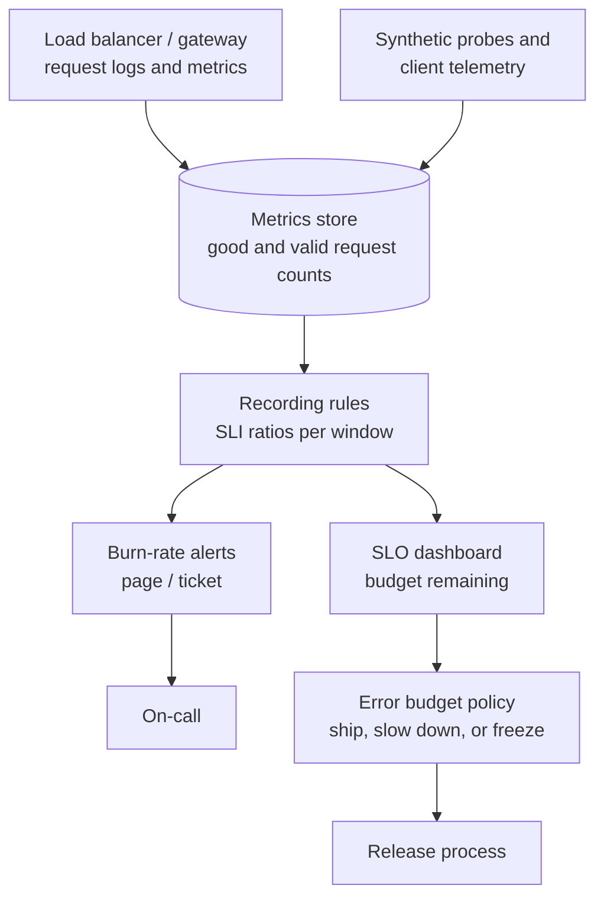

"The system should be highly available" isn't measurable, and "100% uptime" isn't achievable. **Service level objectives** turn
reliability into a number defined from the user's point of view, measured continuously, with an explicit **error budget** — the amount of
unreliability you're allowed. The budget then becomes a tool: it decides when to ship faster and when to stop and fix things.

## Why it matters

- Users experience **requests**, not servers: a reliability target must describe what users see.
- Every extra nine costs more and slows change; the target should be **as reliable as users need, not more**.
- Teams argue about whether to ship features or fix reliability; an error budget settles it with data.
- In interviews, saying "availability 99.9%, p99 latency under 300 ms, measured at the load balancer" makes non-functional requirements
  concrete ([requirements](lesson:requirements)).

## How it works

### SLI, SLO, SLA

- **SLI (service level indicator)**: a measured ratio of good events to valid events.
  - Availability: successful requests ÷ valid requests (excluding, say, 4xx caused by clients).
  - Latency: requests served faster than 300 ms ÷ valid requests.
  - Freshness, correctness, durability for pipelines and storage (e.g. "events visible within 60 s").
- **SLO (service level objective)**: a target for an SLI over a window — "99.9% of checkout requests succeed over a rolling 28 days".
- **SLA (service level agreement)**: a contract with customers, with consequences (credits) if missed. SLAs are set **looser** than
  internal SLOs, so you notice trouble before it costs money.

Good SLIs measure as close to the user as practical — at the load balancer, or with client-side telemetry and synthetic probes — and use
**percentiles or thresholds**, never averages, for latency ([scalability and performance](lesson:scalability-performance)).

### Error budgets

The **error budget** is 1 − SLO, expressed in the SLI's units:

```text title="Error budget"
SLO 99.9% over 28 days, 2,000,000 valid requests per day
budget = 0.1% x 2,000,000 x 28 = 56,000 failed requests per 28 days
       (or, for a time-based SLI, 0.1% of 40,320 minutes = 40 minutes)
```

An **error budget policy** states what happens as it's spent: while budget remains, teams ship freely (and may take risks like
experiments); when it's exhausted, releases pause except for reliability fixes until the window recovers. The budget aligns product and
reliability goals instead of pitting them against each other.

### Burn rate and alerting

**Burn rate** = observed error rate ÷ error rate allowed by the SLO. A burn rate of 1 uses exactly the whole budget over the window; 10
exhausts a 30-day budget in 3 days. Alerting on burn rate pages for problems that threaten the SLO and ignores blips that don't.

The widely used multi-window scheme from Google's SRE workbook, for a 30-day SLO:

| Severity | Long window | Short window | Burn rate | Budget consumed if it continues for the long window |
|---|---|---|---|---|
| Page | 1 hour | 5 minutes | 14.4 | 2% |
| Page | 6 hours | 30 minutes | 6 | 5% |
| Ticket | 3 days | 6 hours | 1 | 10% |

The **short window** confirms the problem is still happening, so an alert stops firing soon after the issue is fixed.

```drill
? A service's SLO allows 0.1% errors. It is currently failing 0.5% of requests. What is the burn rate?
= 5
~ 1.05
> 0.5% ÷ 0.1% = 5 — the 30-day budget would be gone in 6 days.

? An SLO of 99.95% over a 30-day window. How many minutes of full outage does the error budget allow?
= 21.6
~ 1.05
> 30 × 24 × 60 × 0.0005 = 21.6 minutes.

? At a burn rate of 14.4, how many days until a 30-day error budget is exhausted?
= 2.08
~ 1.05
> 30 ÷ 14.4 ≈ 2.08 days — fast enough to page someone now.
```

## Architecture



A burn-rate alert expressed as a Prometheus rule (illustrative metric names, as produced by Micrometer for Spring MVC):

```yaml title="Prometheus alert: fast burn of a 99.9% SLO"
groups:
  - name: checkout-slo
    rules:
      - alert: CheckoutErrorBudgetFastBurn
        expr: |
          (
            sum(rate(http_server_requests_seconds_count{service="checkout", status=~"5.."}[1h]))
            / sum(rate(http_server_requests_seconds_count{service="checkout"}[1h]))
          ) > (14.4 * 0.001)
          and
          (
            sum(rate(http_server_requests_seconds_count{service="checkout", status=~"5.."}[5m]))
            / sum(rate(http_server_requests_seconds_count{service="checkout"}[5m]))
          ) > (14.4 * 0.001)
        labels:
          severity: page
        annotations:
          summary: "Checkout is burning its 30-day error budget 14x too fast"
```

## Failure scenarios

- **SLI measured in the wrong place**: server-side metrics miss requests that never arrived (DNS, load balancer, network failures); users
  are down while dashboards are green.
- **Averages hide pain**: mean latency of 80 ms with a p99 of 4 s; use threshold-based latency SLIs.
- **SLO too strict**: the budget is always exhausted and releases are permanently frozen — the target ignores reality.
- **SLO too loose**: users complain while the budget looks healthy; the SLI isn't measuring what users feel.
- **Low-traffic services**: a few failures swing the ratio wildly; use longer windows or synthetic traffic.
- **Alert fatigue**: alerting on every cause (CPU, a single pod) rather than on burn rate pages people for nothing.

## Trade-offs

| Choice | Gain | Cost |
|---|---|---|
| Higher SLO | Happier users, fewer incidents | More redundancy, slower releases, higher cost |
| Rolling window (28–30 days) | Smooth, always current | Old incidents linger in the number |
| Calendar window (monthly) | Matches SLAs and reports | Budget resets abruptly |
| Request-based SLI | Weights by traffic | Low-traffic periods matter less |
| Time-based SLI (good minutes) | Simple to explain | Treats a 1% error minute like a 100% one, depending on threshold |

## In real systems

- Google's SRE books popularised SLOs, error budgets and burn-rate alerting; many monitoring tools (Grafana, Datadog, Cloud Monitoring)
  now have SLO features built in.
- Cloud providers publish SLAs per service (often 99.9%–99.99%) with service credits — useful anchors for dependency analysis
  ([availability math](lesson:availability-math)).
- Teams commonly set separate SLOs per critical user journey (log in, search, checkout) rather than one per service.

## Common mistakes

- **Choosing SLOs from what's measurable** instead of what users experience.
- **Promising 100%** or more nines than dependencies allow.
- **Setting the SLA equal to the SLO**, leaving no warning margin.
- **Paging on causes** (CPU, memory) instead of symptoms and burn rates.
- **Having an error budget but no policy** for what happens when it's spent.

## In the interview

Turn vague requirements into SLOs early: *"Checkout: 99.95% of requests succeed and 99% complete under 500 ms, measured at the edge over 28
days — that's a budget of about 20 minutes a month, which rules out manual failover."*

````question title="What is an error budget and how do you use it?"
It's the amount of unreliability the SLO permits — for a 99.9% availability SLO, 0.1% of requests in the window may fail. While budget
remains, the team can release quickly and take measured risks; as it's consumed, releases slow down, and when it's exhausted, feature work
pauses in favour of reliability work until the window recovers. Burn-rate alerts tell on-call when the current failure rate would exhaust
the budget far too early.
````

````question title="How would you alert on an SLO without paging for every blip?"
Alert on burn rate with two windows: page when the error rate over the last hour is high enough to consume about 2% of a 30-day budget
(burn rate 14.4) and the last 5 minutes confirm it's still happening; page at a lower rate over 6 hours for slower burns; open a ticket for
gradual burns over days. Short spikes that don't threaten the SLO never page, and alerts clear quickly once the problem stops.
````

## Key takeaways

- **SLI** = good events ÷ valid events, measured near the user; **SLO** = target over a window; **SLA** = looser contract.
- **Error budget** = 1 − SLO; an **error budget policy** decides shipping versus fixing.
- **Burn rate** = observed error rate ÷ allowed rate; alert with **multi-window burn rates** (14.4× / 6× / 1×).
- Use **percentile or threshold latency SLIs**, never averages.

## Knowledge check

```quiz
? Which is the best availability SLI for a public API?
- Percentage of time the servers' processes are running
! Processes can run while requests fail.
+ Successful responses ÷ valid requests, measured at the load balancer
- Average CPU utilisation below 80%
! A resource metric, not user experience.
- Number of open incidents
! Not a ratio of user outcomes.
> Measure what users experience, as close to them as practical.

? The SLA promises 99.9%. What should the internal SLO be?
- 99.9%, the same
! No warning before credits are owed.
+ Somewhat stricter, e.g. 99.95%, so the team reacts before the SLA is breached
- 99%, looser
! The SLA would be breached first.
- 100%
! Unachievable and freezes all change.
> SLOs sit inside SLAs.

? The error budget for the month is exhausted after a bad week. What does a typical error budget policy say?
- Nothing changes
! Then the budget has no purpose.
+ Pause risky releases and prioritise reliability fixes until the budget recovers
- Lower the SLO immediately
! Moving the goalposts hides the problem.
- Remove the alerts
! That hides symptoms.
> The budget converts reliability into a shared decision rule.

? Mean latency is 90 ms, but users complain the app is slow. What is the likely SLI problem?
- Latency doesn't matter for users
! It does.
+ The average hides a long tail; use a threshold SLI such as "99% of requests under 300 ms"
- Mean latency is too low to measure
! It's measurable.
- The SLO window is too short
! The aggregation is the problem.
> Percentiles and thresholds, not averages.
```
