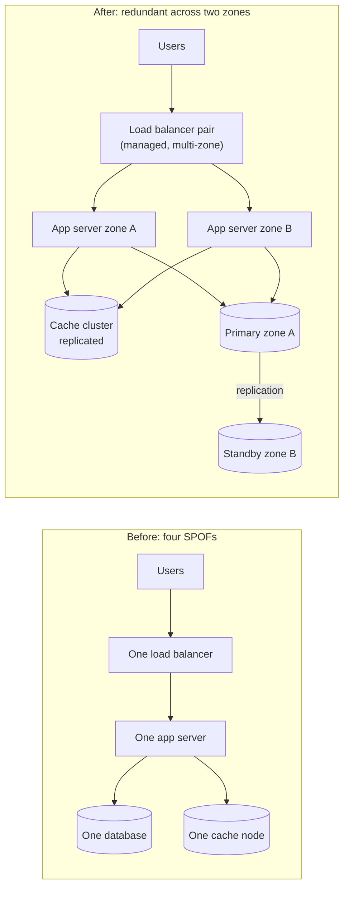

A single point of failure (SPOF) is any one component whose failure stops the whole system. Finding them is the quickest way to
improve a design's availability — and the obvious ones are rarely the dangerous ones.

## Why it matters

Every diagram you draw in an interview will be stress-tested with some version of *"what happens if this box dies?"* If the answer for
any box is "everything stops", you have a SPOF. Removing it means **redundancy** — having more than one of something — and, for
components that hold data, **replication** — keeping copies of that data elsewhere.

But redundancy is not free and not automatic: two load balancers that share one power supply, or a standby database nobody has ever
failed over to, are still single points of failure in disguise.

## How it works

### Finding SPOFs

Walk the request path and ask, for each component: *if this disappears, does the system keep serving?* Then look beyond the diagram.

| Usual suspects | Hidden ones |
|---|---|
| A single load balancer | The DNS provider, or a DNS record with a long TTL pointing at one IP |
| A single database primary | A shared configuration or secrets service every app needs at startup |
| A single cache node every request depends on | An authentication service called on every request |
| One availability zone | A cron job or "leader" that runs on one specific server |
| A single queue broker | One NAT gateway, firewall or network link |
| | A certificate that expires, or one person who knows how to fail over |

### Redundancy

- **N+1 / N+2**: run one or two more instances than needed, so a failure (or a deploy) doesn't reduce capacity below what peak
  traffic requires.
- **Active-active**: all copies serve traffic. Failure of one shifts its load to the rest. Efficient, but every copy must handle
  writes or coordination correctly.
- **Active-passive (standby)**: one copy serves, another waits to take over. Simpler for stateful systems; the standby costs money and
  must be kept in sync and tested.

### Failure domains

Redundant copies only help if they don't fail *together*. A **failure domain** is a set of components that a single event can take down:
a process, a host, a rack (shared power and switch), an availability zone (a datacenter or group of them), a region. Spread copies
across the domain you need to survive: hosts for crashes, zones for datacenter outages, regions for regional disasters.

### Replication

For stateful components, redundancy means **replication** — keeping copies of data on several machines.

- **Synchronous**: a write is acknowledged only after the copies have it. No acknowledged data is lost on failover; every write waits
  for the slowest copy.
- **Asynchronous**: the write is acknowledged once the primary has it; copies catch up shortly after. Fast, but a failover can lose
  the last few writes, and replicas can serve stale reads.

Replication protects against **losing a machine**. It does not protect against **bugs, bad writes or deletes** — they replicate too —
which is why backups remain necessary (see [availability, reliability, fault tolerance and durability](lesson:availability-reliability)).

### Failover

Redundancy is only useful if the system *switches* to the healthy copy:

1. **Detect** the failure (health checks, heartbeats).
2. **Decide** — and be sure only one copy becomes active, to avoid two primaries (split brain).
3. **Redirect** traffic (load balancer, DNS, client reconnect).
4. **Recover** the failed component and restore redundancy.

Each step is software, and each can fail. Automated, regularly exercised failover is a mechanism; manual, untested failover is a hope.

## Architecture

The same small system before and after removing its single points of failure:



The cache in the "after" design is also a dependency to think about: if the whole cluster fails, does the database survive the full
read load? If not, the cache is still a SPOF in practice — a point the [cache failure modes](lesson:cache-failure-modes) lesson returns to.

## Failure scenarios

- **Correlated failure.** Both "redundant" servers sit in one rack, zone or on one hypervisor host; one event takes both.
- **Failover that fails.** The standby is out of date, misconfigured, or the promotion script hasn't been run in a year.
- **Split brain.** The old primary was only *unreachable*, not dead; after a standby is promoted, two primaries accept writes and diverge.
- **Capacity after failure.** Two servers each at 70% CPU survive one failure only if the remaining one can take 140% — it can't.
- **Shared dependency.** Five redundant services all need the one config service to start; when it is down, a routine restart becomes an outage.

## Trade-offs

- **Cost.** Redundancy multiplies infrastructure; standby capacity sits mostly idle. Choose the failure domain to protect against from
  the availability target, not by reflex.
- **Complexity.** Replication, failover and fencing add logic that is exercised rarely and therefore tends to hide bugs.
- **Consistency vs durability vs latency.** Synchronous replication protects acknowledged writes at the cost of write latency;
  asynchronous replication is fast and can lose recent writes on failover.
- **Active-active vs active-passive.** Active-active uses all capacity and fails over instantly, but needs every copy to handle state
  safely; active-passive is simpler for databases and wastes the standby.

## In real systems

- Managed load balancers and managed databases offer multi-zone deployment as a configuration option precisely because single-zone
  deployments are a common SPOF.
- Many outages traced to "redundant" systems turn out to involve a shared dependency — a configuration service, DNS, an expired
  certificate or a control plane — rather than the redundant components themselves.
- Teams that run regular failover drills (or chaos experiments, see [chaos engineering](lesson:chaos-engineering)) find broken failover
  paths before a real incident does.

## Common mistakes

- **Only looking at the boxes on the diagram.** DNS, configuration, auth, certificates and people are dependencies too.
- **Redundant copies in the same failure domain.** Spread across hosts, zones or regions as the requirement demands.
- **Forgetting post-failure capacity.** N+1 means the system still meets peak load with one instance gone.
- **Treating replication as backup.** Deletes replicate.
- **Assuming failover works because it is configured.** Test it.

## In the interview

After drawing your architecture, say explicitly: *"Let me check for single points of failure"* — and walk each box. It is one of the
fastest ways to show reliability thinking.

````question title="How would you find and remove single points of failure in a design?"
Walk the request path box by box and ask what happens if each component disappears; then look past the diagram at shared dependencies
such as DNS, configuration, authentication, certificates and network links. For stateless components, run N+1 instances across failure
domains behind a load balancer. For stateful ones, replicate (synchronously if acknowledged data must not be lost) and automate failover
with a mechanism that prevents two primaries. Finally, check capacity after a failure and test failover regularly.
````

````question title="What is the difference between active-active and active-passive redundancy?"
In active-active, every copy serves traffic and a failure shifts load to the survivors — efficient and fast to fail over, but each copy
must handle reads and writes safely, which is hard for stateful systems. In active-passive, one copy serves while a standby is kept in
sync and takes over on failure — simpler for databases, but the standby's capacity is idle, failover takes time, and you must make sure
the old active is fenced off so two copies don't both accept writes.
````

````question title="Two app servers each run at 70% CPU behind a load balancer. Is the service redundant?"
Not in practice. If one fails, the other must absorb 140% of a single server's load and will saturate, so the service degrades or fails
anyway. Redundancy has to include capacity: with N servers needed at peak, run N+1 (or N+2 to allow for deploys during a failure), so
that losing one still leaves enough headroom.
````

## Key takeaways

- A **SPOF** is any component whose failure stops the system — including hidden dependencies like DNS, config and auth.
- Remove SPOFs with **redundancy across failure domains**, and **replication** for stateful components.
- Redundancy needs **capacity after failure** (N+1) and **working, tested failover** — with protection against split brain.
- Replication protects against losing machines, **not against mistakes**; keep backups.

## Knowledge check

```quiz
? Two "redundant" database servers are in the same rack. What is the risk?
- They will replicate too slowly
! Being in the same rack, if anything, makes replication faster.
+ A single rack-level event, such as a power or switch failure, takes both down
- They can't both be read from
! Rack placement doesn't restrict reads.
- Replication won't work within one rack
! Replication works fine within a rack.
> Redundant copies must be in different failure domains to survive the events you care about.

? Which of these is a hidden single point of failure?
- Three app servers behind a load balancer
! That is redundant.
+ A configuration service that every app server must reach to start
- A database with a standby in another zone
! That is a redundant pair, assuming failover works.
- A CDN with many edge locations
! A CDN is distributed by design.
> Shared dependencies outside the diagram's main path are classic hidden SPOFs.

? After a network glitch, both the old primary and the newly promoted standby accept writes. What is this called?
- Replication lag
! Lag is replicas being behind, not two primaries.
- Cache penetration
! That is about requests for keys that don't exist.
+ Split brain
- A hot partition
! That is uneven load on one partition.
> Failover must fence off the old primary so only one copy accepts writes.

? What does N+1 redundancy mean?
+ Running one more instance than peak load requires, so one failure still leaves enough capacity
- Running exactly as many instances as peak load requires
! Then any failure leaves the system under-provisioned.
- Keeping one backup per database
! N+1 is about live capacity, not backups.
- Replicating each write to N+1 regions
! It is a capacity rule, not a replication factor.
> Redundancy has to include the capacity to survive a failure at peak.
```
