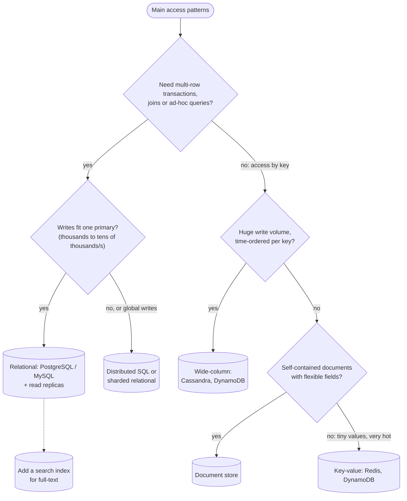

"SQL or NoSQL?" is one of the first data questions in every design, and the weakest answers pick by reputation ("NoSQL scales")
rather than by need. The strong answer starts from the access patterns, the consistency each operation needs and the expected scale —
and usually ends at a relational database unless a specific requirement pushes elsewhere.

## Why it matters

The primary data store shapes everything around it: how you model data, which queries are cheap, how you scale, what consistency you
can promise and how hard future features will be. It's also a decision that is expensive to reverse. Interviewers want to see that you
can justify the choice in one or two sentences tied to the requirements, and name what you'd give up.

## How it works

### The families

| Family | Data model | Strong at | Weak at | Examples |
|---|---|---|---|---|
| **Relational** | Tables with schemas, joins, constraints | Transactions, flexible queries, integrity, ad-hoc analysis | Very large write throughput on one node; horizontal scaling needs sharding | PostgreSQL, MySQL, SQL Server, Aurora |
| **Distributed SQL** | Relational, automatically sharded and replicated | SQL + transactions at horizontal scale, multi-region | Higher write latency (consensus), cost, operational novelty | CockroachDB, Google Spanner, YugabyteDB, TiDB |
| **Key-value** | Key → opaque value | Huge throughput, predictable low latency by key | Anything other than lookup by key | Redis, DynamoDB (also a document store), Memcached |
| **Document** | JSON-like documents, nested fields | Aggregates read together, flexible schemas | Cross-document joins and transactions (improving but costlier) | MongoDB, Couchbase, Firestore |
| **Wide-column** | Partition key → sorted rows of columns | Massive write throughput, time-ordered data per key, multi-region | Ad-hoc queries; must design tables per query | Cassandra, ScyllaDB, HBase, Bigtable |
| **Graph** | Nodes and edges | Multi-hop relationship queries | Bulk aggregation, horizontal scaling of arbitrary graphs | Neo4j, Amazon Neptune |
| **Search** | Inverted index over documents | Full-text, relevance ranking, faceting | Source of truth, transactions | Elasticsearch, OpenSearch |
| **Time series** | Timestamped measurements | High ingest, downsampling, time-range queries | General-purpose queries | TimescaleDB, InfluxDB, Prometheus |

"NoSQL" is not one thing: a key-value store and a graph database have almost nothing in common. Name the family.

### Start from access patterns

Write down the main reads and writes before choosing:

1. **What are the queries?** "Get course by ID", "list a course's reviews newest first", "find courses by keyword", "count enrolments per
   day". Lookups by key suit almost anything; ad-hoc filters, joins and aggregates suit relational; full-text needs a search index.
2. **What must be atomic?** Moving money between accounts, reserving the last seat, enforcing unique usernames — these want transactions
   and constraints.
3. **How much and how fast?** Thousands of writes per second fit a single well-sized relational primary; hundreds of thousands per
   second of simple writes point to a partitioned store.
4. **How does the data relate?** Highly connected data with many-to-many relationships favours relational (or graph); self-contained
   aggregates (an order with its lines) suit documents.
5. **What consistency does each read need?** Read-your-writes on profile edits, strong consistency on balances, eventual consistency on
   like counts.

### "Postgres until proven otherwise"

A single PostgreSQL or MySQL primary on modern hardware handles thousands to tens of thousands of transactions per second and terabytes of
data, with read replicas for read scaling. It gives you transactions, constraints, joins, secondary indexes, JSON columns
(`jsonb`) for flexible attributes, full-text search good enough for many products and decades of tooling. For most interview systems
below hyperscale, it is the right default — and saying so with a reason is a strong answer.

Move away when a requirement clearly demands it:

- **Write volume beyond one primary**, with simple access by key (event ingestion, IoT telemetry, messaging inboxes) → wide-column or
  DynamoDB, partitioned by the key you read by.
- **Single-digit-millisecond lookups at enormous scale with no joins** (sessions, carts, feature flags) → key-value.
- **Global multi-region writes with strong consistency** → distributed SQL.
- **Relevance search** → a search engine *beside* the primary store.
- **Deep relationship traversal** (fraud rings, friend-of-friend recommendations) → graph, often beside the primary store.

### Polyglot persistence

Real systems use several stores, each for what it does best — relational for the system of record, Redis for caching and counters, a
search index for discovery, object storage for files, a warehouse for analytics — kept in sync with events or change data capture. Each
extra store adds operations, consistency questions and failure modes, so add them for a reason.

## Architecture



The flowchart is a starting point, not a rule: the deciding questions are always atomicity, query flexibility and scale.

## Failure scenarios

- **Picking NoSQL, then needing joins.** Product asks for "courses by instructor with average rating" across collections; the team
  writes application-side joins and denormalised copies that drift.
- **Picking relational, then outgrowing one primary** without a partition-friendly schema; sharding later needs keys that weren't
  designed in.
- **Eventual consistency surprises.** A NoSQL store's default reads may be eventually consistent; users don't see their own writes unless
  you request strongly consistent reads.
- **Hot partitions.** Key-based stores spread load by key; one celebrity key overwhelms its partition (see
  [partition keys](lesson:partition-keys-retention)).
- **Too many stores.** Five databases for a small product: five things to back up, monitor, secure and keep consistent.

## Trade-offs

| | Relational | Key-value / wide-column | Document |
|---|---|---|---|
| Query flexibility | High (SQL, joins) | Low (by key / by partition + sort key) | Medium (by fields, indexes) |
| Transactions | Multi-row, multi-table | Limited (single item or small batches) | Single document; multi-document costlier |
| Schema | Enforced | None | Flexible per document |
| Horizontal write scaling | Needs sharding or distributed SQL | Built in | Built in (sharding) |
| Modeling effort | Model the data, then query freely | Model each query in advance | Model aggregates around access |

The underlying trade: **relational systems make writes and modeling easy and push scaling work later; partitioned NoSQL systems make
scaling easy and push query-design work earlier.**

## In real systems

- Many large products still run their core on sharded MySQL or PostgreSQL, adding specialised stores beside it.
- DynamoDB and Cassandra are common for high-volume, key-addressed data such as carts, inboxes, sessions and event logs.
- Document stores are popular for content and catalog data with varied attributes; MongoDB documents are limited to 16 MB and DynamoDB
  items to 400 KB, so large blobs go to object storage.
- Distributed SQL (Spanner, CockroachDB) is chosen for globally consistent transactional data such as financial ledgers across regions.

## Common mistakes

- **"NoSQL because it scales"** without a scale estimate or an access-pattern argument.
- **Ignoring transactions and constraints** for data that needs them (money, inventory, uniqueness).
- **Treating MongoDB, Redis and Cassandra as interchangeable.**
- **Using the search engine as the system of record.**
- **Not naming the consistency mode** of each read.

## In the interview

````question title="Which database would you use for this system and why?"
I'd start from the access patterns and consistency needs. For a course platform — users, courses, enrolments, payments, reviews — the
data is relational, enrolments and payments need transactions and uniqueness constraints, and the queries include joins and filters. At
our estimate of a few thousand writes per second, a single PostgreSQL primary with read replicas fits comfortably, so PostgreSQL is the
system of record. I'd add Redis for caching hot course pages and counters, and a search index for course discovery fed by change data
capture. If write volume later exceeded one primary, I'd shard by a key such as course_id or move the high-volume, key-addressed parts,
like progress events, to a wide-column store.
````

````question title="When would you choose a wide-column store like Cassandra over PostgreSQL?"
When writes are very high-volume and simple, data is naturally partitioned by a key that every query includes, and reads are by that key
in a known order — for example, per-device telemetry, per-user activity logs or message inboxes ordered by time. Cassandra spreads
writes across nodes with no single primary, scales linearly and replicates across regions. I'd give up joins, ad-hoc queries and
multi-row transactions, design one table per query, and pay attention to partition size and hot keys. If I need flexible queries or
strong transactional guarantees, PostgreSQL remains the better choice.
````

## Key takeaways

- Choose a store from **access patterns, atomicity needs, scale and consistency** — never from reputation.
- **Relational** is the right default for most systems: transactions, constraints, flexible queries, replicas for reads.
- Reach for **wide-column/key-value** for massive key-addressed writes, **document** for flexible aggregates, **distributed SQL** for global
  transactional scale, **search** and **graph** beside the primary store.
- Relational defers scaling work; partitioned NoSQL front-loads **query design**.

## Knowledge check

```quiz
? Which requirement most strongly argues for a relational database?
- Storing user profile pictures
! Images belong in object storage regardless.
+ Transferring credits between two users atomically and enforcing unique usernames
- Looking up sessions by ID at very high rates
! Key-value stores excel at that.
- Ingesting a million sensor readings per second
! That points to a partitioned write-optimised store.
> Multi-row transactions and uniqueness constraints are a relational strength.

? A team chose a key-value store; now product wants "top-rated courses in each category, filtered by price". What problem have they hit?
+ Key-value stores answer lookups by key; ad-hoc filters and aggregates need precomputed tables, another index or another store
- Key-value stores can't store numbers
! They store any value; the problem is querying.
- The data is too small for key-value
! Size isn't the issue.
- They need a CDN
! A CDN can't compute the query.
> Partitioned stores require you to design for each query in advance.

? What is the most defensible statement about "NoSQL scales better"?
- It is always true
! A well-sized relational primary with replicas handles most workloads.
+ Partitioned stores scale writes horizontally more easily, at the cost of query flexibility and often transactions
- It is never true
! Built-in partitioning genuinely helps very high write volumes.
- Only document stores scale
! Wide-column and key-value stores scale too.
> Scaling ease is real but comes with modelling and consistency trade-offs.

? Where should full-text course search live in a design whose system of record is PostgreSQL?
- Only in PostgreSQL LIKE queries
! LIKE '%term%' can't use B-tree indexes and lacks relevance ranking.
+ In a search index fed from PostgreSQL by events or change data capture
- In the search index only, deleting the PostgreSQL tables
! Search engines aren't designed to be the system of record.
- In Redis
! Redis isn't a relevance-ranked search engine by default.
> Keep the system of record relational; derive the search index from it.
```
