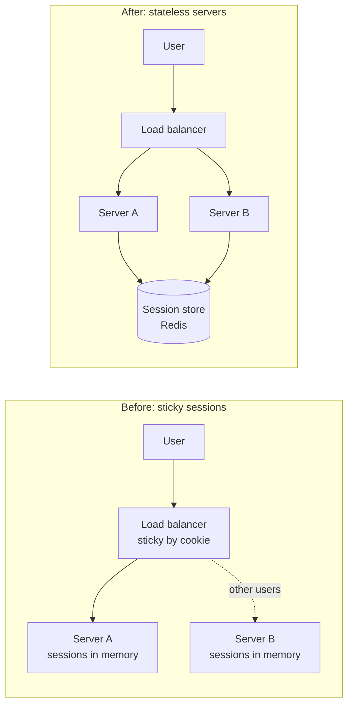

Whether a server keeps state between requests decides how easily it scales, how it fails and how you deploy it. Most of a good
architecture is about pushing state out of the many servers and into a few components built to hold it.

## Why it matters

**State** is anything a server remembers between requests that affects how it answers the next one: a user's session, a shopping
cart in memory, an open WebSocket, a local cache, a file written to local disk, a half-finished job.

- A **stateless** service keeps none of it. Any instance can handle any request, so you can add instances, remove them, restart them
  or route around a dead one freely.
- A **stateful** service keeps some of it. Requests must reach the instance that holds the relevant state, and losing an instance
  loses that state unless it was copied elsewhere.

Statelessness is what makes horizontal scaling, auto-scaling and zero-downtime deploys straightforward. But state has to live
*somewhere* — the goal is to concentrate it in components designed for it (databases, caches, queues) and keep everything else stateless.

## How it works

### Find the state

Common kinds of state hiding in "stateless" services:

| State | Example | Where it should live instead |
|---|---|---|
| Session | Logged-in user, CSRF token, cart | A shared session store (Redis), or a signed token on the client |
| User uploads | Files written to local disk | Object storage (S3) |
| Caches | In-process map of hot data | A shared cache, or accept per-instance caches that may disagree briefly |
| Background work | Jobs held in memory | A durable queue |
| Connections | WebSocket for a chat user | A dedicated connection tier, with routing to the right instance |
| Coordination | "Only one instance runs the nightly job" | A lock or leader election in a coordination service |

### Make the request tier stateless

Two standard ways to remove session state from application servers:

- **Shared session store.** Servers read and write sessions in a fast external store such as Redis, keyed by a session ID in a cookie.
  The session can be revoked by deleting it. Cost: one network round trip per request, and the store must be highly available.
- **Self-contained tokens.** The session data is signed (for example a JWT) and carried by the client. Servers verify the signature and
  need no lookup. Cost: tokens can't easily be revoked before they expire, and they grow with what you put in them.

### Living with stateful components

Some components are stateful by nature: databases, caches, message brokers, connection servers, stream processors. Techniques for
them:

- **Partitioning**: each instance owns a subset of keys, and requests are routed by key (often with consistent hashing). Losing an
  instance affects only its keys.
- **Replication**: copies on several instances, so another can take over.
- **Sticky routing**: the load balancer sends a client back to the same instance (by cookie or source IP). It works, but unevenly
  spreads load, breaks when instances leave, and turns instance failure into user-visible loss of state.
- **Draining and handoff**: before stopping an instance, stop sending it new work and let existing connections or jobs finish or
  migrate.

## Architecture

The same app before and after moving session state out of the servers:



Before: if server A restarts, its users are logged out, and A can't be removed without moving them. After: any server can handle any
request; deploys and scale-in are uneventful; the session store is now the component to make highly available.

## Failure scenarios

- **Instance crash with in-memory state.** Every user pinned to that instance loses their session or cart.
- **Uneven load from stickiness.** A few heavy users stuck to one instance overload it while others idle; new instances get no
  existing users.
- **Session store outage.** Externalising state moves the risk: if Redis is down, *everyone* is logged out. It needs replication and
  failover — or a fallback such as signed tokens.
- **Local disk surprises.** Files written to an instance's disk disappear when the instance is replaced, and other instances never
  see them.
- **Deploys drop connections.** Restarting a WebSocket server disconnects every client on it at once; without draining and staggered
  restarts, they all reconnect at once (a thundering herd).

## Trade-offs

| Aspect | Shared session store | Signed tokens (JWT) | Sticky sessions |
|---|---|---|---|
| Server statelessness | Yes | Yes | No |
| Extra hop per request | Yes (fast) | No | No |
| Revocation | Immediate (delete) | Hard before expiry | Immediate |
| Survives instance loss | Yes | Yes | No |
| Load spread | Even | Even | Uneven |

Externalising state adds a dependency and a network hop. That is almost always worth it for request-serving tiers, and a deliberate
choice for latency-critical paths.

## In real systems

- Most web frameworks support pluggable session stores; Spring Session, for example, swaps the servlet container's in-memory
  sessions for Redis or a database without changing controller code.
- Mobile and single-page apps commonly use short-lived signed access tokens plus a refresh token stored server-side — combining
  stateless verification with the ability to revoke.
- Real-time products separate a stateful **connection tier** (holding WebSockets) from stateless business services, and route messages
  to the right connection server — covered in [real-time updates at scale](lesson:realtime-at-scale).

## Java and Spring Boot example

With Spring Session, moving `HttpSession` from the server's heap to Redis is a configuration change. The controller code is unchanged —
which is the point: the application stays simple, and the servers become interchangeable. (Compiled against Spring Framework 7 and
Spring Session 4; the same code works on Spring Boot 3.)

```java title="SessionConfig.java"
import org.springframework.context.annotation.Bean;
import org.springframework.context.annotation.Configuration;
import org.springframework.data.redis.connection.lettuce.LettuceConnectionFactory;
import org.springframework.session.data.redis.config.annotation.web.http.EnableRedisHttpSession;

// Every app server reads and writes sessions in Redis instead of its own memory,
// so the load balancer can send any request to any server.
@Configuration
@EnableRedisHttpSession(maxInactiveIntervalInSeconds = 1800)
public class SessionConfig {

    @Bean
    public LettuceConnectionFactory redisConnectionFactory() {
        return new LettuceConnectionFactory("sessions.redis.internal", 6379);
    }
}
```

```java title="CartController.java"
import jakarta.servlet.http.HttpSession;
import java.util.ArrayList;
import java.util.List;
import org.springframework.web.bind.annotation.PostMapping;
import org.springframework.web.bind.annotation.RequestBody;
import org.springframework.web.bind.annotation.RestController;

@RestController
public class CartController {

    // Unchanged code: HttpSession is now backed by Redis, not by this server's heap.
    @PostMapping("/cart/items")
    public List<String> addItem(@RequestBody String sku, HttpSession session) {
        @SuppressWarnings("unchecked")
        List<String> cart = (List<String>) session.getAttribute("cart");
        if (cart == null) {
            cart = new ArrayList<>();
        }
        cart.add(sku);
        session.setAttribute("cart", cart); // write back so the change is saved
        return cart;
    }
}
```

Two production details: the session store needs its own high availability (a replicated Redis setup), and anything stored in the
session is serialised on every write, so keep sessions small — store IDs, not whole objects.

## Common mistakes

- **Calling a service stateless because it has no database.** In-memory sessions, caches and local files are state.
- **Relying on sticky sessions for correctness.** They are a performance hint at best; instances will disappear.
- **Moving state to a single Redis node.** You've created a new single point of failure.
- **Putting large objects in sessions or tokens.** Every request pays to serialise, transfer and verify them.
- **Forgetting connection state.** WebSocket servers are stateful even if no data is stored on them.

## In the interview

````question title="What makes a service stateless, and why does it matter for scaling?"
A stateless service keeps nothing between requests that affects later responses — no in-memory sessions, local files or pending work —
so any instance can serve any request. That lets a load balancer spread traffic evenly, auto-scaling add and remove instances freely,
deploys restart instances without user impact, and failures be handled by routing around the dead instance. The state still exists, but
it lives in components designed to hold it: databases, caches, queues and object storage.
````

````question title="Compare a shared session store with JWTs for keeping application servers stateless."
A shared session store (such as Redis) keeps session data server-side under a random session ID: sessions can be revoked instantly and
stay small on the wire, but every request makes a network call and the store must be highly available. JWTs carry signed session data on
the client: no lookup is needed and there is no shared dependency, but tokens can't be revoked before expiry without extra machinery
(a deny-list), and their size grows with their claims. A common compromise is short-lived access tokens with server-side refresh tokens.
````

````question title="Some components must be stateful. How do you scale and protect them?"
Partition the state so each instance owns a subset of keys and requests are routed by key (often with consistent hashing), so load spreads
and a failure affects only part of the data. Replicate each partition so another instance can take over. Drain instances before stopping
them — stop new work, let in-flight work finish or migrate. And keep the stateful tier as small and specialised as possible, with
stateless services in front of it.
````

## Key takeaways

- **State** is anything remembered between requests: sessions, caches, files, connections, in-flight work.
- Stateless services make **scaling, deploys and failure handling** easy; push state into components built for it.
- Remove session state with a **shared session store** or **signed tokens**; avoid relying on sticky sessions.
- Scale unavoidable state with **partitioning, replication and draining** — and make the new state store highly available.

## Knowledge check

```quiz
? A service has no database but keeps each user's shopping cart in a `HashMap` on the server. Is it stateless?
- Yes, because it has no database
! State isn't only databases; in-memory data that affects later requests is state.
+ No — the cart is state, so requests must return to the same server and the cart is lost if it restarts
- Yes, as long as there is a load balancer
! A load balancer doesn't make in-memory state shareable.
- It depends on the programming language
! The language is irrelevant; where the data lives is what matters.
> In-memory carts tie users to instances and disappear on restart.

? What is the main risk of moving sessions from server memory to a single Redis node?
- Sessions become slower to read than from a database
! Redis is typically faster than a database for this access pattern.
+ The Redis node becomes a single point of failure for every logged-in user
- The application servers become stateful
! The servers become stateless; the state moved to Redis.
- Sessions can no longer be revoked
! Deleting the key revokes a server-side session immediately.
> Externalised state must itself be highly available, for example with replication and automatic failover.

? Why can JWT-based sessions be hard to revoke?
- They are encrypted
! Many JWTs are signed, not encrypted; that is not why revocation is hard.
+ Servers accept any token with a valid signature until it expires, without checking a central store
- They are stored in Redis
! JWTs are carried by the client precisely so no server-side store is needed.
- They can't contain a user ID
! JWTs routinely carry a user ID claim.
> Without a server-side lookup there is nothing to delete; you need short expiries or a deny-list.

? When is sticky routing (session affinity) a reasonable choice?
+ As a performance optimisation for warm per-instance caches, where losing affinity costs speed but not correctness
- As the only place user sessions are stored
! Then any instance loss logs users out and deploys disrupt them.
- To guarantee even load distribution
! Stickiness usually makes load less even.
- To avoid needing health checks
! Health checks are still needed to remove failed instances.
> Affinity is fine as a hint; correctness must not depend on it.
```
